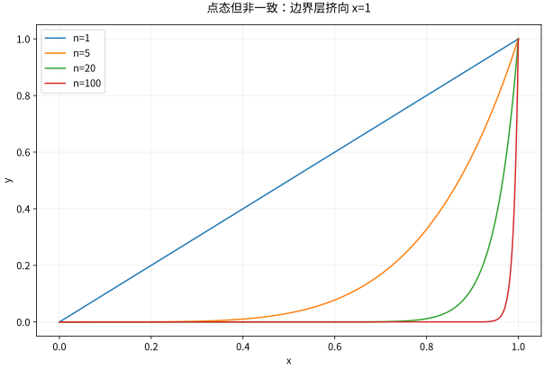

# 函数列函数项级数与一致收敛

## 同一个函数列有不止一种收敛方式

点态收敛允许每个点用自己的阈值 $N(x,\varepsilon)$；一致收敛要求存在同一个 $N(\varepsilon)$ 同时适用于全域。对于有界差值，它等价于

$$
\|f_n-f\|_\infty=\sup_{x\in E}|f_n(x)-f(x)|\to0.
$$

$f_n(x)=x^n$ 在 $[0,1]$ 点态趋于 $f(x)=0$（$x<1$）、$f(1)=1$，但不一致，因为连续函数的一致极限应连续，且对每个 $n$，在1左侧可把 $x^n$ 做得任意接近1。限制到 $[0,a]$、$a<1$，误差上界 $a^n\to0$，就一致收敛了。

*图：$x^n$ 的陡峭区域不断挤向1。固定某个 $x<1$ 可以避开它，但整个区间无法同时避开，这正是点态与一致的区别。*

## 连续性如何通过极限

设 $f_n$ 连续且一致趋于 $f$。固定 $a$，把

$$
|f(x)-f(a)|\le|f(x)-f_N(x)|+|f_N(x)-f_N(a)|+|f_N(a)-f(a)|.
$$

先用一致收敛选定一个 $N$ 控制两端各小于 $\varepsilon/3$；再用这个固定 $f_N$ 的连续性选邻域控制中间。顺序不能颠倒：若 $N$ 还随 $x$ 变化，就不能对同一个函数使用连续性容差。

在有限区间上，若各 $f_n$ Riemann 可积且一致收敛，则极限可积且积分收敛，因为积分差不超过 $(b-a)\|f_n-f\|_\infty$。无限测度域上这个估计不再有限，一致收敛本身不足以交换积分。

## 求导需要控制导数，而不只是函数值

若 $f_n\in C^1[a,b]$，$f_n(x_0)$ 在某一点收敛，且 $f_n'$ 一致趋于 $g$，则由

$$
f_n(x)=f_n(x_0)+\int_{x_0}^x f_n'(t)dt
$$

可得 $f_n$ 一致趋于 $f(x)=L+\int_{x_0}^xg(t)dt$，并有 $f'=g$。本节采用 $C^1$ 版本使证明直接，存在更弱版本但须额外论证。

反例 $f_n(x)=\sin(nx)/n$ 在实轴一致趋零，导数 $\cos(nx)$ 却不趋于零；在 $x=0$ 永远为1。因此“函数图像很接近”不能推出“斜率也很接近”。近似求导是对高频误差敏感的操作。

从算子角度追问这一条件，见 [[数学/16-数学分析/20-泛函分析/07-一致有界原理与闭图定理#导数为什么可以闭却无界：全域与图范数不能省|导数的闭图与图范数]]：函数和导数都一致收敛时，闭图确认两个极限相容；只给导数范数的共同上界仍不能制造导数极限。同页的差商例说明，步长更小会放大一致范数下的输入误差，因此返回本节时仍须核对导数收敛条件。

## 函数项级数与 M 判别法

若 $|u_n(x)|\le M_n$ 对全域成立且 $\sum M_n<\infty$，则 $\sum u_n$ 一致绝对收敛。证明用同一个数项尾和控制所有 $x$：$\sup_x|\sum_{n=N}^Mu_n(x)|\le\sum_{n=N}^MM_n$。例 $\sum\sin(nx)/n^2$ 在实轴一致收敛，而逐项求导所得 $\sum\cos(nx)/n$ 在0发散，不能直接交换导数。

一致收敛不必来自 M 判别法，也不等于一致绝对收敛；该判别法只是方便的充分条件。对含参数振荡级数，可使用一致版本的 Dirichlet 判别法，但必须统一控制部分和及尾项。

## 练习与答案

证明 $f_n(x)=x/(n+x)$ 在 $[0,A]$ 一致趋零，但在 $[0,\infty)$ 不一致；判断 $n\,1_{(0,1/n)}$ 的点态极限与积分。

> [!question]- 解答
> 有界域上 $0\le f_n\le A/(n+A)\to0$；无界域上上确界为1。第二列在每个固定 $x\ge0$ 最终为0，点态极限0，但每项积分为1。高度随 $n$ 增加，质量集中到越来越窄的区间，缺少统一可积控制。

## 继续学习

前一节：[[数学/16-数学分析/07-数项级数绝对条件收敛与判别法|数项级数绝对条件收敛与判别法]]。 下一节：[[数学/16-数学分析/09-幂级数解析性与Taylor反例|幂级数解析性与Taylor反例]]。

课程地图：[[数学/16-数学分析/00-数学分析-MOC|数学分析课程地图]]；[[数学/90-资源/06-统一符号约定与定理条件索引|符号与条件索引]]。

## 跨学科连接

[[数学/45-复变函数/06-Taylor级数零点恒等定理与解析延拓|Taylor级数零点恒等定理与解析延拓]]。什么时候可以对函数项级数逐项求导或积分，并由一致收敛把极限操作带到复幂级数中？目标页说明全纯函数的 Taylor 展开和刚性；逐点收敛不够，导数级数的控制与收敛区域也必须另行核对。

## 核验与延伸阅读

本页为独立编写的讲解、推导与算例；以下一手教材用于对照标准定义与课程范围，不是逐段译写。更具体的主题定位见 [[数学/90-资源/04-六科学术来源与阅读对照|学术来源对照]]。

- [Jiří Lebl：Basic Analysis I & II，作者开放教材](https://www.jirka.org/ra/html/ra.html)
