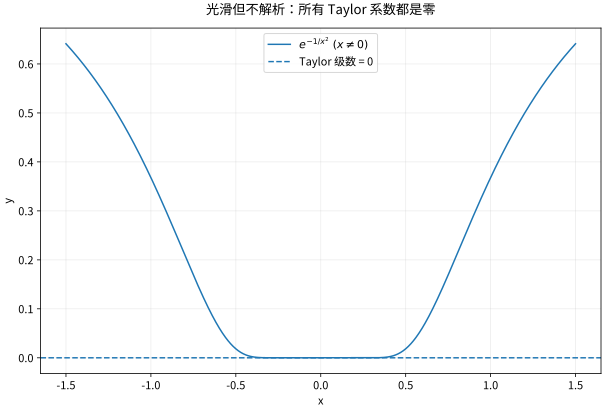

# 幂级数解析性与Taylor反例

## 幂级数的优势是内部自动获得统一控制

设 $\sum c_n(x-a)^n$ 收敛半径为 $R$。对 $0<r<s<R$，由于 $\sum|c_n|s^n$ 收敛，对 $|x-a|\le r$ 有统一几何比较，因此级数及其逐项导数在这类紧子区间上一致收敛。导数中的 $n$ 因子不会改变半径，因为 $n^{1/n}\to1$。

因此在 $|x-a|<R$ 内可任意次逐项求导，系数由函数唯一确定：$c_n=f^{(n)}(a)/n!$。这并不是说任意光滑函数都等于自己的 Taylor 级数，而是从“已有幂级数表示”推出光滑性及系数公式。

## 解析性与光滑性的箭头方向

实解析函数局部等于某个收敛幂级数，所以无限可微。反向不成立，平坦函数

$$
f(x)=\begin{cases}e^{-1/x^2},&x\ne0,\\0,&x=0\end{cases}
$$

所有导数在0都为零，却在任何含非零点的邻域为正。每阶导数可写成 $P(1/x)e^{-1/x^2}$；令 $t=1/x^2$，指数 $e^{-t}$ 压过任意幂次，所以每阶都能连续补到0。

这揭示两种极限不能混淆：固定阶数、$x\to0$ 的余项变小，并不意味着固定 $x\ne0$、阶数趋无穷时余项消失。

*图：函数在0附近极平，但不是恒零。图像分辨率可能把很小的正值画成与横轴重合，因此数值图只能辅助，真正结论来自指数压过幂次的估计。*

## 实函数的收敛半径为何常由复奇点决定

$1/(1+x^2)$ 在整个实轴光滑，但在0的级数 $\sum(-1)^nx^{2n}$ 只有半径1。实轴上没有奇点并不能保证实 Taylor 级数无限半径。把变量放到复平面后，$z=\pm i$ 是距离0为1的极点，恰好限制圆盘内的解析延拓。这是实分析与复分析的重要交汇。

在本节只直接用几何级数证明半径1；关于一般全纯函数的 Taylor 半径与最近奇点的关系，在复变函数课程中由 Cauchy 公式建立，避免循环论证。

## 端点值与 Abel 定理

若 $\sum_{n=0}^{\infty}a_n=S$ 收敛，则 $\lim_{r\uparrow1}\sum a_nr^n=S$。用分部求和写成对部分和的加权平均：

$$
\sum_{n=0}^{\infty}a_nr^n=(1-r)\sum_{n=0}^{\infty}S_nr^n,
\qquad 0\le r<1.
$$

减去 $S$ 后，把有限前缀和统一小的尾部拆开；有限前缀乘 $1-r$ 消失，尾部由 $\sup_{n\ge N}|S_n-S|$ 控制。这样才合法地把内部函数值连到边界的条件收敛级数。

## 算例：反正切的端点

由 $1/(1+x^2)=\sum(-1)^nx^{2n}$ 在 $|x|<1$ 内积分，得到 $\arctan x=\sum(-1)^nx^{2n+1}/(2n+1)$。右侧在1由交错判别收敛，再由 Abel 定理得其和为 $\pi/4$。若只说“把 $x=1$ 代入”，便略过了保证端点值一致的桥梁。

## 练习与答案

求 $\sum n x^n$ 的半径和函数和；解释 $C^\infty$ 是否足够保证函数由单点全部导数唯一决定。

> [!question]- 解答
> 半径1，内部由几何级数求导后乘 $x$ 得 $x/(1-x)^2$。端点通项不趋零，均发散。无限光滑不够：零函数和平坦函数在0具有完全相同的各阶导数，却不是同一个局部函数；若额外要求实解析，则幂级数系数唯一，局部函数才被确定。

## 继续学习

前一节：[[数学/16-数学分析/08-函数列函数项级数与一致收敛|函数列函数项级数与一致收敛]]。 下一节：[[数学/16-数学分析/10-反常积分与含参积分的极限交换|反常积分与含参积分的极限交换]]。

课程地图：[[数学/16-数学分析/00-数学分析-MOC|数学分析课程地图]]；[[数学/90-资源/06-统一符号约定与定理条件索引|符号与条件索引]]。

## 跨学科连接

[[数学/45-复变函数/05-Cauchy积分公式与全纯函数的刚性|Cauchy积分公式与全纯函数的刚性]]。实变量 Taylor 展开为何可能在一点附近失效，而复全纯函数又为何由 Cauchy 公式获得真正的幂级数表示与导数控制？目标页给出复情形的刚性来源；实光滑并不自动解析，不能把复分析结论反推到任意 $C^\infty$ 实函数。

## 核验与延伸阅读

本页为独立编写的讲解、推导与算例；以下一手教材用于对照标准定义与课程范围，不是逐段译写。更具体的主题定位见 [[数学/90-资源/04-六科学术来源与阅读对照|学术来源对照]]。

- [Jiří Lebl：Basic Analysis I & II，作者开放教材](https://www.jirka.org/ra/html/ra.html)
