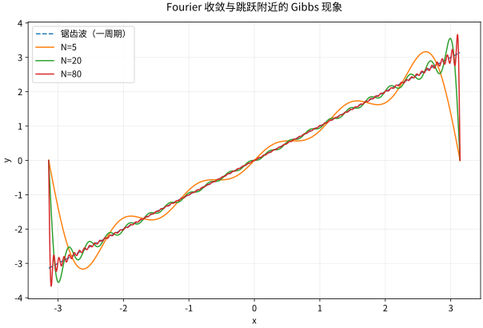

# Fourier级数正交展开与收敛

## 要解决的问题：函数能像向量一样分解吗

有限维向量可以投影到正交坐标轴。Fourier 方法把坐标轴换成不同频率的波，研究的却仍是“投影误差能否趋于零”。先修是内积、函数列和积分；不应先背一张变换表，再把任何无穷和都当成原函数。

在 $[-\pi,\pi]$ 上采用内积 $\langle f,g\rangle=\int_{-\pi}^{\pi}f\overline g\,dx$。实 Fourier 系数为
$$
a_0=\frac1\pi\int_{-\pi}^{\pi}f,\quad a_n=\frac1\pi\int_{-\pi}^{\pi}f(x)\cos nx\,dx,\quad b_n=\frac1\pi\int_{-\pi}^{\pi}f(x)\sin nx\,dx.
$$
部分和 $S_Nf=a_0/2+\sum_{n=1}^N(a_n\cos nx+b_n\sin nx)$ 是到次数不超过 $N$ 的三角多项式空间的正交投影。这一结论只需把平方误差展开：若 $g$ 在该空间内，则
$$
\|f-g\|_2^2=\|f-S_Nf\|_2^2+\|S_Nf-g\|_2^2.
$$
交叉项为零，所以它是唯一的最小二乘逼近，唯一按几乎处处等价理解。

## 三种收敛说的是三件事

Bessel 不等式来自上式中误差非负。三角系统在 $L^2$ 中的完备性进一步给出 $S_Nf\to f$ 于 $L^2$ 和 Parseval 恒等式
$$
\frac1\pi\int_{-\pi}^{\pi}|f|^2=\frac{|a_0|^2}{2}+\sum_{n\ge1}(|a_n|^2+|b_n|^2)
$$
（此处实正弦余弦系数也允许复值）。完备性可由下面的 Fejér 逼近及连续函数在 $L^2$ 中稠密得到，不是由“显然所有函数都是波”得到。

逐点收敛另需条件。一条方便的充分条件是周期延拓在一周期上分段 $C^1$，这里指存在有限分割，使函数在各子区间内 $C^1$ 且函数和一阶导数具有有限单侧延拓；此时在每一点收敛到 $(f(x-)+f(x+))/2$。跳跃点不可能由连续的部分和一致逼近；在连续点之外写“等于 $f(x)$”尤其容易错。一般连续函数的普通 Fourier 部分和也未必处处收敛，不能把充分条件删掉。

## Fejér 平均为什么更稳健

令 $\sigma_N=(S_0+\cdots+S_N)/(N+1)$。它可写为
$$
\sigma_N f(x)=\frac1{2\pi}\int_{-\pi}^{\pi}K_N(t)f(x-t)\,dt,
\quad K_N(t)=\frac1{N+1}\left(\frac{\sin((N+1)t/2)}{\sin(t/2)}\right)^2.
$$
核非负、积分为 $2\pi$，并且对每个 $\delta>0$，$|t|\ge\delta$ 的核积分趋于零。对连续周期函数，用一致连续性将积分分成 $|t|<\delta$ 的“小函数差”和外部的“小核质量”，便得到一致收敛。这里的核心是近似恒等算子，不是形式上交换求和。

## 完整算例：锯齿波与平方和

$f(x)=x$ 在 $(-\pi,\pi)$ 内奇对称，故 $a_n=0$。分部积分得
$$
b_n=\frac2\pi\int_0^\pi x\sin nx\,dx=\frac{2(-1)^{n+1}}n.
$$
周期端点两侧极限是 $\pi$ 与 $-\pi$，故级数在那里收敛到 $0$。Parseval 给出
$$
\frac1\pi\frac{2\pi^3}{3}=4\sum_{n\ge1}\frac1{n^2},
\qquad \sum_{n\ge1}\frac1{n^2}=\frac{\pi^2}{6}.
$$
接近跳跃处会出现 Gibbs 现象：随着 $N$ 增大，过冲区域变窄，但过冲相对于跳跃高度的比例不趋于零。它不违反 $L^2$ 收敛，因为“尖而窄”的误差仍可有趋零的总平方积分。

*图：同一锯齿波的有限项 Fourier 部分和。端点按周期延拓解释，不把端点跳跃误判为计算错误。*

## 自测与解答

求 $f(x)=|x|$ 的系数，并说明为何它比锯齿波衰减更快。

> [!question]- 解答
> 奇正弦系数为零，$a_0=\pi$，而
> $$a_n=\frac2\pi\int_0^\pi x\cos nx\,dx=\frac{2((-1)^n-1)}{\pi n^2}.$$
> 所以 $|x|=\pi/2-(4/\pi)\sum_{n\ \mathrm{odd}}\cos(nx)/n^2$。绝对值函数的周期延拓连续，但一阶导数有跳跃；比函数本身跳跃的锯齿波多一次分部积分带来的衰减。这里系数绝对可和，Weierstrass 判别法还给出一致收敛。

## 继续学习

前一节：[[数学/16-数学分析/12-多重积分换元与积分次序|多重积分换元与积分次序]]。 下一节：[[数学/16-数学分析/14-测度可测函数与Lebesgue积分|测度可测函数与Lebesgue积分]]。

课程地图：[[数学/16-数学分析/00-数学分析-MOC|数学分析课程地图]]；[[数学/90-资源/06-统一符号约定与定理条件索引|符号与条件索引]]。

## 跨学科连接

[[数学/46-数理方程/06-Fourier方法与Sturm-Liouville谱|Fourier方法与Sturm-Liouville谱]]。正交投影得到的 Fourier 系数如何变成边值问题的特征函数展开，边界条件又如何决定可用的谱？目标页将展开用于 PDE；$L^2$ 收敛、逐点收敛和边界处的级数值不是同一结论。

## 核验与延伸阅读

本页为独立编写的讲解、推导与算例；以下一手教材用于对照标准定义与课程范围，不是逐段译写。更具体的主题定位见 [[数学/90-资源/04-六科学术来源与阅读对照|学术来源对照]]。

- [Jiří Lebl：Basic Analysis I & II，作者开放教材](https://www.jirka.org/ra/html/ra.html)
- [Sheldon Axler：Measure, Integration & Real Analysis，作者开放教材](https://measure.axler.net/)
