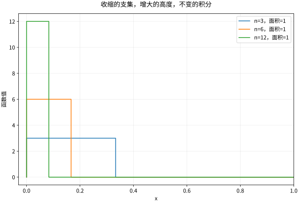

# 收敛定理与Fubini-Tonelli

## 极限与积分交换的三个支点

所有函数均在同一测度空间 $(X,\mathcal A,\mu)$ 上可测。“收敛”若未补充说明，下面的逐点条件允许在零测集上例外。

**单调收敛定理。** 若 $0\le f_n\uparrow f$，则 $\int f_n\uparrow\int f$，允许结果为 $+\infty$。直觉是只有质量累加，没有正负抵消或向无穷远迁移。证明的关键：对任意简单函数 $0\le s\le f$ 和 $0<c<1$，集合 $\{f_n\ge cs\}$ 单调覆盖 $s>0$ 的区域，故 $\lim\int f_n\ge c\int s$；再取简单函数的上确界并令 $c\uparrow1$。

**Fatou 引理。** 非负 $f_n$ 满足
$$\int\liminf f_n\le\liminf\int f_n.$$
令 $g_n=\inf_{k\ge n}f_k$，则 $g_n\uparrow\liminf f_n$，由单调收敛与 $\int g_n\le\inf_{k\ge n}\int f_k$ 得证。质量可在极限中丢失，所以一般只有不等号。

**支配收敛定理。** 若 $f_n\to f$ 几乎处处，且存在同一个 $g\in L^1$ 使 $|f_n|\le g$，则 $\|f_n-f\|_1\to0$，从而积分收敛。证明可对 $2g-|f_n-f|\ge0$ 用 Fatou，再用 $\int|f_n-f|\ge0$。重点是支配函数不能随 $n$ 改变。

## 为什么尖峰会使直觉失败

在 $(0,1)$ 上取 $f_n=n1_{(0,1/n)}$。每个 $x>0$ 最终都落在支集外，故逐点趋零，但积分恒为 $1$。任何共同的可积支配函数都不可能存在，否则支配收敛会给出矛盾。

再取 $g_n=1_{(n,n+1)}$ 于 $\mathbb R$，它们高度甚至统一不超过 $1$，但积分仍恒为 $1$，点态趋零。在无限测度空间，“有界”不是“有可积支配”。

*图：$n1_{(0,1/n)}$ 的支集收缩、峰值增大，但面积保持为 1。图形说明为什么仅逐点收敛不足以交换积分。*

## Tonelli 与 Fubini 不能只记名字

对两个 $\sigma$-有限测度空间的乘积，非负可测 $f$ 满足 Tonelli：二重积分等于两个次序的累次积分，值可以无穷。若 $\int|f|<\infty$，Fubini 保证几乎所有截面可积，而且两种次序给出相同有限值。先用 Tonelli 检查 $|f|$，再用 Fubini 处理正负，是可靠流程。

例如 $f(x,y)=e^{-x-y}1_{x>0,y>0}$ 非负，两次积分均为 $1$。若无绝对可积性，两个累次积分即使各自存在也可能不同，见 [[数学/16-数学分析/12-多重积分换元与积分次序|积分次序章节]] 的 $(x^2-y^2)/(x^2+y^2)^2$ 反例。

## 算例：含参积分的导数

令 $F(t)=\int_0^\infty e^{-tx}\sin x\,dx$，$t>0$。在固定 $t_0>0$ 附近取 $t\ge t_0/2$，差商可由中值定理支配于 $xe^{-t_0x/2}\in L^1$，所以
$$F'(t)=-\int_0^\infty xe^{-tx}\sin x\,dx.$$
先算 $F(t)=1/(1+t^2)$，得右边对应积分 $2t/(1+t^2)^2$。证明是在参数的局部邻域寻找支配，不要求一条对所有 $t>0$ 都有效的界。也不能据此直接把 $t=0$ 代进绝对收敛结论。

## 自测与解答

求 $\lim_n\int_0^1\frac{nx}{1+n^2x^2}\,dx$，给出两条理由。

> [!question]- 解答
> 对固定 $x>0$，被积函数趋零，并且由 $2nx\le1+n^2x^2$ 得统一上界 $1/2$，在有限区间上可积，故极限为零。
> 直接换元给出 $\log(1+n^2)/(2n)\to0$。第一条方法解释换极限为何合法，第二条核验数值；两者作用不同。

## 继续学习

前一节：[[数学/16-数学分析/14-测度可测函数与Lebesgue积分|测度可测函数与Lebesgue积分]]。 下一节：[[数学/16-数学分析/16-度量完备压缩映射与微分方程|度量完备压缩映射与微分方程]]。

课程地图：[[数学/16-数学分析/00-数学分析-MOC|数学分析课程地图]]；[[数学/90-资源/06-统一符号约定与定理条件索引|符号与条件索引]]。

## 跨学科连接

[[数学/46-数理方程/08-热核全空间问题与Duhamel原理|热核全空间问题与Duhamel原理]]。热核卷积和 Duhamel 积分中何时可以交换极限、积分与空间--时间积分，怎样寻找同一个可积支配函数？目标页给出全空间热方程表示；逐点收敛、有界性或形式上的卷积写法都不足以替代支配/非负/绝对可积条件。

## 核验与延伸阅读

本页为独立编写的讲解、推导与算例；以下一手教材用于对照标准定义与课程范围，不是逐段译写。更具体的主题定位见 [[数学/90-资源/04-六科学术来源与阅读对照|学术来源对照]]。

- [Jiří Lebl：Basic Analysis I & II，作者开放教材](https://www.jirka.org/ra/html/ra.html)
- [Sheldon Axler：Measure, Integration & Real Analysis，作者开放教材](https://measure.axler.net/)
