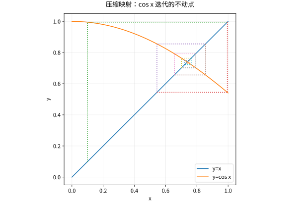

# 度量完备压缩映射与微分方程

## 完备性为什么与求解方程有关

迭代构造通常先证明近似解彼此接近，再需要一个真实对象承接极限。完备空间正是“每个 Cauchy 序列都在空间内部收敛”的保证。它不是紧致性：无限维 Hilbert 空间完备，但其单位球一般不紧。

## 压缩映射定理及误差证明

设 $(X,d)$ 非空完备，$T:X\to X$ 满足 $d(Tx,Ty)\le qd(x,y)$，其中固定 $0\le q<1$。从任意 $x_0$ 迭代 $x_{n+1}=Tx_n$，有
$$
d(x_{n+1},x_n)\le q^n d(x_1,x_0),\qquad
d(x_m,x_n)\le\frac{q^n}{1-q}d(x_1,x_0)\quad(m>n).
$$
因此序列 Cauchy，极限 $x_*$ 在 $X$。压缩蕴含连续，取极限得 $Tx_*=x_*$。若另有固定点 $y_*$，则 $d(x_*,y_*)\le qd(x_*,y_*)$，故唯一。误差界为
$$d(x_n,x_*)\le\frac{q^n}{1-q}d(x_1,x_0),\qquad d(x_n,x_*)\le\frac q{1-q}d(x_n,x_{n-1}).$$
前者是先验界，后者可用实际相邻迭代计算。

## 两个条件都不能省

在不完备空间 $(0,1)$ 上 $T(x)=x/2$ 是压缩，却无空间内固定点。在完备空间 $\mathbb R$ 上平移 $T(x)=x+1$ 满足 Lipschitz 常数 $1$，也无固定点。仅有每对不同点的距离严格变小而没有统一 $q<1$，一般也不足以直接套用定理。

算 $x=\cos x$ 时在 $[0,1]$ 上 $T$ 映回自身，且 $|T'|\le\sin1<1$，所以迭代必收敛到唯一解。把迭代图画出来是辅助，真正的保证来自不变区间与统一收缩。

*图：$x_{n+1}=\cos x_n$ 的阶梯轨迹。横轴上的迭代点趋向 $y=x$ 与 $y=\cos x$ 的交点。*

## 从固定点到微分方程

初值问题 $y'=f(t,y),\ y(t_0)=y_0$ 等价于
$$y(t)=y_0+\int_{t_0}^t f(s,y(s))\,ds.$$
在闭时间区间的连续函数空间里定义右侧算子。具体取矩形邻域 $R=[t_0-a,t_0+a]\times[y_0-b,y_0+b]$，其中 $a,b>0$。若 $f$ 在 $R$ 上连续，满足 $|f|\le M$，且关于 $y$ 一致 Lipschitz，常数为 $L$，选择 $0<h\le a$ 同时满足 $Mh\le b$ 与 $Lh<1$，则该算子把 $C([t_0-h,t_0+h])$ 中 $\|y-y_0\|_\infty\le b$ 的闭球映入自身，并为压缩。完备性、映入自身、收缩三个环节齐备，才得局部存在唯一。

$f$ 连续本身可提供局部存在的另一套理论，但不提供唯一性。$y'=2\sqrt{|y|},y(0)=0$ 有静止一段时间后再变为 $(t-a)^2$ 的解。另一方面，局部 Lipschitz 也不保证全局存在：$y'=y^2,y(0)=1$ 的解在 $t=1$ 爆破。

## 自测与解答

若一次固定点迭代已知 $q=1/3$，且 $d(x_n,x_{n-1})\le 10^{-5}$，当前误差最多是多少？

> [!question]- 解答
> 后验界给出 $d(x_n,x_*)\le(1/2)10^{-5}=5\times10^{-6}$。这是在映入自身、完备性、统一收缩均成立之后的结论；观察相邻项接近本身不能保证已经接近真正固定点。

## 继续学习

前一节：[[数学/16-数学分析/15-收敛定理与Fubini-Tonelli|收敛定理与Fubini-Tonelli]]。 下一节：[[数学/16-数学分析/17-函数空间范数完备性与紧性|函数空间范数完备性与紧性]]。

课程地图：[[数学/16-数学分析/00-数学分析-MOC|数学分析课程地图]]；[[数学/90-资源/06-统一符号约定与定理条件索引|符号与条件索引]]。

## 跨学科连接

[[数学/46-数理方程/01-一阶常微分方程与初值问题|一阶常微分方程与初值问题]]。初值问题怎样改写为积分不动点方程，并在什么时间区间、什么函数空间和什么 Lipschitz 条件下由压缩映射保证局部唯一？目标页给出 ODE 的解法语境；连续右端可有存在而无唯一，局部 Lipschitz 也不等于全局存在。

## 核验与延伸阅读

本页为独立编写的讲解、推导与算例；以下一手教材用于对照标准定义与课程范围，不是逐段译写。更具体的主题定位见 [[数学/90-资源/04-六科学术来源与阅读对照|学术来源对照]]。

- [Jiří Lebl：Basic Analysis I & II，作者开放教材](https://www.jirka.org/ra/html/ra.html)
- [Sheldon Axler：Measure, Integration & Real Analysis，作者开放教材](https://measure.axler.net/)
