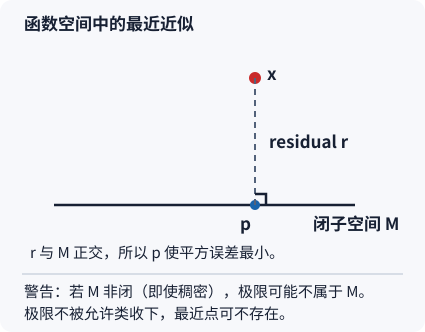

# Hilbert 投影与 Riesz 表示的证明

> 读者问题：有限维最小二乘为什么能移到函数空间？如果可选函数类越来越丰富，最近的近似会不会突然不存在？

在有限维中，拟合等于把数据向量投到列空间。函数空间中也可把目标函数投到一类允许函数上；但“允许函数类闭合”变成存在最近点的关键条件。本页固定本库的复内积约定：**第一变量线性、第二变量共轭线性**，因此在 \(L^2\) 中
\[
\langle f,g\rangle=\int f\,\overline g\,d\mu.
\]
这会决定 Riesz 公式中代表向量出现在哪一边。

## 从高中式“垂线最短”到函数的最近近似

把 \(x\) 看成一个待拟合的曲线，\(M\) 看成允许使用的函数。若能找到 \(p\in M\)，使 \(x-p\) 与允许的每个改动方向垂直，那么从 \(p\) 再往任何方向改都会增加平方误差：
\[
\|x-(p+v)\|^2=\|x-p\|^2+\|v\|^2\quad(v\in M).
\]
这里的“垂直”是内积为零；函数的内积是积分，因此它是整体平方误差而非逐点误差。

**可停在这里。** 要把有限维最小二乘带到函数空间，只需记住：把“列空间”换成一个**闭线性子空间**，把点积换成积分内积。下面说明“闭”为什么不能省。

## 定理：闭凸集总有唯一最近点

令 \(H\) 是完备内积空间（Hilbert 空间），\(C\subset H\) 非空、闭且凸。对任意 \(x\in H\)，存在唯一 \(p\in C\)，满足
\[
\|x-p\|=\inf_{c\in C}\|x-c\|.
\]
这是“到闭凸集的投影”；只有当 \(C\) 是线性子空间时，它才自动给出正交分解。

### 存在性：为什么极小序列不会逃走

平移为 \(x=0\)，设 \(d=\inf_{c\in C}\|c\|\)。取极小序列 \(c_n\in C\)，使 \(\|c_n\|^2\to d^2\)。凸性给出 \((c_n+c_m)/2\in C\)。平行四边形恒等式给出
\[
\|c_n-c_m\|^2
=2\|c_n\|^2+2\|c_m\|^2-4\left\|\frac{c_n+c_m}{2}\right\|^2
\le 2\|c_n\|^2+2\|c_m\|^2-4d^2\to0.
\]
所以 \((c_n)\) 是 Cauchy 序列。这里首次使用 **Hilbert 空间完备性**：它收敛到某个 \(p\in H\)；再用 **\(C\) 闭**，得到 \(p\in C\)，并由范数连续性取得距离 \(d\)。

### 唯一性：为什么不能有两个同样近的点

若 \(p,q\in C\) 都达到最小距离，凸性仍给出中点在 \(C\)。平行四边形恒等式（仍平移回 \(x=0\)）给出
\[
\left\|\frac{p+q}{2}\right\|^2+\frac14\|p-q\|^2
=\frac12\|p\|^2+\frac12\|q\|^2=d^2.
\]
中点的范数至少为 \(d\)，故 \(\|p-q\|=0\)。这也说明“凸”负责唯一；非凸集合可能有两个最近点。

## 闭线性子空间：从最近点得到正交条件

令 \(M\) 为闭线性子空间，\(p=P_Mx\) 是最近点，\(r=x-p\)。任取 \(v\in M\) 及实数 \(t\)，因为 \(p+tv\in M\)，函数
\[
\|r-tv\|^2=\|r\|^2-2t\operatorname{Re}\langle r,v\rangle+t^2\|v\|^2
\]
在 \(t=0\) 取最小值，故 \(\operatorname{Re}\langle r,v\rangle=0\)。在复空间再把 \(v\) 换成 \(iv\)：本页约定下 \(\langle r,iv\rangle=-i\langle r,v\rangle\)，于是虚部也为零。因此
\[
x=P_Mx+r,\qquad P_Mx\in M,\quad r\in M^\perp.
\]
反过来，上式的勾股恒等式证明 \(P_Mx\) 最优。\(M\) 闭才保证 \(P_Mx\) 存在；正交条件本身不是把任意稠密子空间“补成”有最近点的魔法。

### 一个有限维跟算：它正是最小二乘

在 \(\mathbb R^3\) 中取 \(M=\operatorname{span}\{(1,1,0)\}\)，\(x=(2,0,3)\)。令 \(p=a(1,1,0)\)。正交条件
\[
0=\langle x-p,(1,1,0)\rangle=2-2a
\]
给出 \(a=1\)，所以 \(p=(1,1,0)\)，残差 \((1,-1,3)\) 与生成向量点积为零。把生成向量换成设计矩阵的各列，就得到 [[数学/20-线性代数与几何/14-最小二乘伪逆与正则化|有限维正规方程]]；本页只改变空间，不重做其数值算法。

### 反例：稠密仍不够，非闭时最近点可消失

令 \(H=\ell^2\)，\(M=c_{00}\) 为只有有限个非零坐标的序列。\(M\) 稠密却不闭。取
\[
x=(1,1/2,1/3,\ldots)\in\ell^2\setminus c_{00}.
\]
其截断序列都在 \(M\) 且趋近 \(x\)，所以 \(\inf_{m\in M}\|x-m\|=0\)。若最小值被某个 \(m\in M\) 取到，就会有 \(x=m\)，矛盾。这里失败的不是“逼近”，而是极限没有被允许类收下。

## Riesz 表示：每个连续线性读数都是一个内积

在上述复约定下，若 \(\varphi:H\to\mathbb C\) 是连续线性泛函，则存在唯一 \(y_\varphi\in H\)，使
\[
\varphi(x)=\langle x,y_\varphi\rangle\quad(\forall x\in H),
\qquad \|\varphi\|=\|y_\varphi\|.
\]
注意若采用“第二变量线性”的书，公式中的变量位置会对调；不能把两个约定混写。

若 \(\varphi=0\)，取 \(y_\varphi=0\)。以下设 \(\varphi\ne0\)。令 \(N=\ker\varphi\)；它因连续性闭。选 \(z\notin N\)，并按投影分解 \(z=n+u\)，其中 \(n\in N\)、\(u\in N^\perp\)。此时 \(u\ne0\) 且 \(\varphi(u)=\varphi(z)\ne0\)。对任意 \(x\)，\(x-\varphi(x)z/\varphi(z)\in N\)，故与 \(u\) 正交；又 \(\langle z,u\rangle=\|u\|^2\)，所以
\[
\langle x,u\rangle=\frac{\varphi(x)}{\varphi(z)}\|u\|^2,
\qquad
y_\varphi=\frac{\overline{\varphi(z)}}{\|u\|^2}u.
\]
第二变量共轭线性使 \(\langle x,y_\varphi\rangle=\varphi(x)\)，这正是本页约定下不可略去的共轭。若 \(y,y'\) 都表示同一泛函，取 \(x=y-y'\) 得 \(\|y-y'\|^2=0\)，故表示向量唯一。范数等式在 \(y_\varphi\ne0\) 时由 Cauchy--Schwarz 和 \(x=y_\varphi/\|y_\varphi\|\) 取等，零泛函已单列处理。例如在 \(H=\mathbb C\)、\(\varphi(x)=ix\) 时，正确代表是 \(y_\varphi=-i\)；漏掉共轭会给出错误的 \(-ix\)。

**本科快进。** 完整证明的依赖链是：内积诱导范数、平行四边形恒等式、完备性、闭集保极限、Cauchy--Schwarz，以及连续线性泛函的核闭。Riesz 此处是 Hilbert 空间版本；不要把它与表示一般测度的 Riesz--Markov 定理混为一谈。

## 去哪里继续、以及它不承诺什么

- [[数学/16-数学分析/17-函数空间范数完备性与紧性]] 给出 \(L^2\) 的完备性、闭凸投影的概览和本页内积约定；这里补足证明链与非闭反例。
- [[数学/80-跨学科专题与综合练习/01-投影从最小二乘到Fourier与有限元]] 把同一投影用于 Fourier 与有限元；这里不复制其 Gram 矩阵和能量内积例子。
- [[数学/30-概率与统计/11-条件期望与最小均方估计]] 说明“允许函数只使用某些信息”时，投影就是条件期望。

这一定理不说每个 Banach 空间或每个非凸约束都有唯一最近点，也不说数值算法总能稳定找到它；这些需要分别检查空间、集合和算法。
