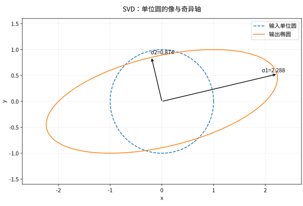

# 特征值、SVD 与低秩近似

> [!info] 历史证据已补入
> 原有证据字段保持其历史记录；所指 [[Logs/2026-09-05_改造证据/内容审阅记录|内容审阅记录]] 已从 WorkWithLLM 按原字节补入。其范围见 [[Logs/来源材料/WorkWithLLM/README|来源说明]]；本批未重新认证本页内容或提升证据等级。

## 本课目标

- 理解特征向量是“变换后方向不变”的向量；
- 说明 SVD 如何把任意矩阵拆成输入方向、缩放和输出方向；
- 推导截断 SVD 的重构形式与误差；
- 区分“用 SVD 近似已有矩阵”和“用 LoRA 学习低秩增量”。

## 直觉轨：复杂变换也有主方向

设

$$
A=\begin{bmatrix}3&0\\0&1\end{bmatrix}.
$$

$x$ 轴方向 $(1,0)$ 被拉长 3 倍，$y$ 轴方向 $(0,1)$ 不变。它们是特征向量，对应特征值 3 和 1。一般矩阵可能旋转、翻转、拉伸并把维度压扁；SVD 总能找到一组正交输入方向，分别缩放后落到一组正交输出方向。

如果绝大部分效果集中在少数几个缩放系数上，就能只保留这些“主要通道”，得到低秩近似。

*读图先预测：圆上的哪一个输入方向会被拉得最远？图中的矩阵是 $A_\mathrm{fig}=\begin{bmatrix}2&1\\0&1\end{bmatrix}$，不是上面的对角例。先猜最长、最短的输入轴，再读后面的 $A^\mathsf TA$ 验算。只保留最大奇异通道时，较小奇异值对应的右奇异向量 $v_2$ 被送到零：$A_1v_2=0$；这是截断后的 $A_1$ 的零空间，不表示原满秩 $A_\mathrm{fig}$ 已经把 $v_2$ 消掉。*

## 严谨轨一：特征值与特征向量

对方阵 $A\in\mathbb R^{n\times n}$，若非零向量 $v$ 满足

$$
Av=\lambda v,
$$

则 $v$ 是特征向量，$\lambda$ 是特征值。非零解存在当且仅当

$$
\det(A-\lambda I)=0.
$$

特征值可能为负数或复数；实矩阵也不保证有足够多线性无关的实特征向量。对实对称矩阵，谱定理给出格外整洁的结论：存在正交矩阵 $Q$ 和实对角矩阵 $\Lambda$，使

$$
A=Q\Lambda Q^\mathsf T.
$$

### 数值例：不沿坐标轴的主方向

$$
A=\begin{bmatrix}2&1\\1&2\end{bmatrix}.
$$

特征多项式 $(2-\lambda)^2-1=0$，所以 $\lambda_1=3,\lambda_2=1$；对应方向可取 $(1,1)$ 和 $(1,-1)$。矩阵沿对角线方向拉伸 3 倍，沿另一条对角线保持 1 倍。

## 严谨轨二：奇异值分解

任意 $A\in\mathbb R^{m\times n}$ 都有 SVD：

$$
A=U\Sigma V^\mathsf T,
$$

在完全 SVD 中，$U\in\mathbb R^{m\times m}$、$\Sigma\in\mathbb R^{m\times n}$、$V\in\mathbb R^{n\times n}$，$U,V$ 为正交矩阵。经济型 SVD 只保留 $s=\min(m,n)$ 个可能非零的通道：$U_s\in\mathbb R^{m\times s}$、$\Sigma_s\in\mathbb R^{s\times s}$、$V_s^\mathsf T\in\mathbb R^{s\times n}$。奇异值

$$
\sigma_1\ge\sigma_2\ge\cdots\ge0
$$

称为奇异值。$V$ 的列给出输入方向，$U$ 的列给出输出方向，$\sigma_i$ 给出各通道的缩放量。

因为

$$
A^\mathsf T A=V\Sigma^\mathsf T\Sigma V^\mathsf T,
$$

$v_i$ 是 $A^\mathsf TA$ 的特征向量，$\sigma_i=\sqrt{\lambda_i(A^\mathsf TA)}$。这解释了奇异值为何非负。数值计算通常直接使用稳定的 SVD 算法，不建议先显式形成 $A^\mathsf TA$：后者会放大条件数问题。

## 截断 SVD 与最佳低秩近似

SVD 也可写成若干秩一矩阵的和：

$$
A=\sum_{i=1}^{r}\sigma_i u_i v_i^\mathsf T,
\qquad r=\operatorname{rank}(A).
$$

对 $1\le k\le r$ 只保留前 $k$ 项：

$$
A_k=\sum_{i=1}^{k}\sigma_i u_i v_i^\mathsf T=U_k\Sigma_kV_k^\mathsf T.
$$

Eckart–Young–Mirsky 定理说明，在所有秩不超过 $k$ 的矩阵中，$A_k$ 对 Frobenius 范数和二算子范数都是最佳近似之一：

$$
\min_{\operatorname{rank}(B)\le k}\|A-B\|_F
=\|A-A_k\|_F
=\sqrt{\sum_{i>k}\sigma_i^2}.
$$

若 $1\le k<r$ 且 $\sigma_k=\sigma_{k+1}$，最佳近似可能不唯一，但最小误差仍由奇异值决定。

### 参数量为何减少

原矩阵 $A\in\mathbb R^{m\times n}$ 有 $mn$ 个数。秩 $k$ 分解可用 $L\in\mathbb R^{m\times k}$ 与 $R\in\mathbb R^{k\times n}$ 表示，参数数约为 $k(m+n)$。只有当 $k(m+n)<mn$ 时才真正节省存储或可训练参数。

## LLM 应用：LoRA 的低秩是增量约束

LoRA 通常冻结原权重 $W_0$，学习

$$
W=W_0+\Delta W,
\qquad
\Delta W=BA,
$$

其中 $A\in\mathbb R^{r\times n}$、$B\in\mathbb R^{m\times r}$，所以 $\operatorname{rank}(\Delta W)\le r$。它与截断 SVD 有共同的低秩几何，但目的不同：

- 截断 SVD 从一个**已知矩阵**算出给定范数下的最佳近似；
- LoRA 在训练数据与损失函数下**学习权重增量**，不保证等于某个预先存在增量的 SVD 截断；
- $r$ 是容量上界，实际秩可能更低。

训练工程见 [[AI/20-LLM/30-训练/03-SFT-LoRA与QLoRA|SFT、LoRA 与 QLoRA]]。

## 常见误区

把重构误差连到下游输入时，需要额外一步：对任意 $x$，$\|(A-A_k)x\|_2\le\|A-A_k\|_2\|x\|_2$。这是指定线性映射的绝对输出误差界，不是整个非线性模型的任务指标。若真实输出 $Ax$ 很小，即使绝对误差小，相对误差仍可能很大；条件数、输入分布和后续运算要分别讨论。自检：令 $A=\operatorname{diag}(5,0.1)$、只保留第一通道、$x=(0,1)$，重构舍弃量仅 0.1，但该输入输出被全部消去，不能推断任务无损。

| 误区 | 更准确的说法 |
| --- | --- |
| “特征分解适用于任何长方形矩阵。” | 普通特征值要求方阵；SVD 适用于任意矩形矩阵。 |
| “奇异值就是特征值。” | 奇异值是 $A^\mathsf TA$ 特征值的非负平方根。 |
| “低秩一定损失很小。” | 只有被舍弃奇异值的能量较小时，指定范数下误差才小。 |
| “LoRA 就是对权重做 SVD。” | LoRA 学习低秩增量；标准训练过程不需要先对目标增量做 SVD。 |
| “Frobenius 误差小就保证模型行为不变。” | 参数空间误差不直接等于所有输入上的功能误差，需要行为评测。 |

## 练习

1. 对 $D=\operatorname{diag}(5,2,0.5)$，写出奇异值，并计算最佳秩 1 近似的 Frobenius 误差。
2. 若 $W\in\mathbb R^{4096\times4096}$，LoRA rank $r=16$，比较原矩阵参数数与两个低秩因子的参数数。
3. 为什么 $A^\mathsf TA$ 的特征值不会为负？

> [!question]- 核对要点
> 1. 奇异值为 $5,2,0.5$；误差 $\sqrt{2^2+0.5^2}=\sqrt{4.25}$。
> 2. 原矩阵 $4096^2=16,777,216$；低秩因子共 $16(4096+4096)=131,072$，约为前者的 $1/128$。这里只比较增量参数，不含原权重。
> 3. 对任意 $x$，$x^\mathsf TA^\mathsf TAx=\|Ax\|_2^2\ge0$，所以它半正定。

## 成功标准

你能解释 $U,\Sigma,V$ 的几何角色，能由奇异值计算截断误差，并能准确说出 LoRA 与截断 SVD 的相同点和不同点。

## 导航

- 上一站：[[数学/20-线性代数与几何/03-点积范数距离与余弦相似度|点积、范数、距离与余弦]]
- 下一站：[[数学/20-线性代数与几何/05-正交投影子空间与方向消除|正交投影、子空间与方向消除]]
- 实验：[[数学/20-线性代数与几何/80-低秩近似数值实验|低秩近似数值实验]]
- 返回：[[数学/20-线性代数与几何/00-线性代数与几何-MOC|线性代数与几何 MOC]]

## 系统理论对照

本页保留应用问题与最小实验；更完整的对象定义、推导条件和反例见 [[数学/20-线性代数与几何/10-线性映射核像与四个基本子空间|线性映射核像与四个基本子空间]]；[[数学/20-线性代数与几何/14-最小二乘伪逆与正则化|最小二乘伪逆与正则化]]；[[数学/20-线性代数与几何/16-SVD的推导最优低秩与PCA|SVD的推导最优低秩与PCA]]。应用记号与标准教材不同时，以定义和矩阵形状对照，不仅比较字母。
