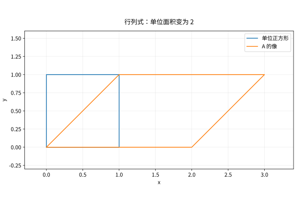

# 行列式体积可逆性与计算

## 行列式测量什么

行列式是方阵列向量张成的有向体积比例。它只适用于方阵，可能为负或复数；实数情形的几何体积比例是 $|\det A|$。它是可逆性的一个判据，但不是默认的高效解方程工具。

从三条规则可唯一确定它：对每一列线性；交换两列变号（因而重复列为零）；$\det I=1$。将每列按标准基展开，只有下标互不相同的项保留，得到置换公式
$$\det A=\sum_{\sigma\in S_n}\operatorname{sgn}(\sigma)\prod_{i=1}^n a_{i,\sigma(i)}.$$
这是定义与证明工具，直接计算有 $n!$ 项，实际应消元。

## 乘法性质的推导思路

把 $B$ 的列 $b_j$ 同时送入线性映射 $A$。函数 $D(b_1,\ldots,b_n)=\det(Ab_1,\ldots,Ab_n)$ 仍是交替多线性的，且在标准基处值为 $\det A$。由唯一性，$D=(\det A)\det B$，故 $\det(AB)=\det A\det B$。

如果 $A$ 可逆，乘法式给出 $\det A\det A^{-1}=1$。若列线性相关，利用多线性可得行列式为零；反之消元到对角主元时行列式非零意味着所有主元存在。所以
$$A\text{ 可逆}\iff\det A\ne0\iff\operatorname{rank}A=n.$$

## 如何计算而不制造无用工作

加一行的倍数到另一行，行列式不变；交换行改变符号；一行乘 $c$，行列式乘 $c$。上三角矩阵的行列式是对角元之积。若 $PA=LU$ 且 $L$ 单位下三角，则 $\det A=\det P\prod_i u_{ii}$。

例如
$$A=\begin{pmatrix}1&2&0\\2&5&1\\0&1&3\end{pmatrix}.$$
第二行减两倍第一行得到 $(0,1,1)$，第三行再减新的第二行得到 $(0,0,2)$，所以 $\det A=2$。

余子式展开和伴随矩阵恒等式 $A\operatorname{adj}A=(\det A)I$ 可以推导 Cramer 法则，但用它计算大规模线性系统通常比 LU 更慢、更难控制舍入误差。行列式很小也不直接代表病态，因为缩放会改变行列式：$10^{-6}I_{100}$ 行列式极小，二范数条件数却为 $1$。

*图：单位正方形经 $A=\begin{pmatrix}2&1\\0&1\end{pmatrix}$ 映成面积为 2 的平行四边形；面积取行列式绝对值。*

## 自测与解答

证明上三角分块矩阵 $\begin{pmatrix}B&C\\0&D\end{pmatrix}$ 的行列式是 $\det B\det D$，并说明对一般四块矩阵不能写 $\det(BD-C E)$ 的理由。

> [!question]- 解答
> 在置换展开中，下方行若选到左侧列会遇到零。因此非零项必须分别在两块对角区域选列，置换符号和乘积均分解，得到两个行列式的乘积。
> 一般矩阵块不交换，甚至尺寸不容许 $BD$；二阶标量公式不能把标量直接替换成矩阵。某些附加可逆或可交换条件下有专门公式，应通过 Schur 补推导，而非盲套。

## 继续学习

前一节：[[数学/20-线性代数与几何/07-线性方程组消元LU与解的结构|线性方程组消元LU与解的结构]]。 下一节：[[数学/20-线性代数与几何/09-向量空间基维数与坐标|向量空间基维数与坐标]]。

课程地图：[[数学/20-线性代数与几何/00-线性代数与几何-MOC|线性代数课程地图]]；[[数学/90-资源/06-统一符号约定与定理条件索引|符号与条件索引]]。

## 跨学科连接

[[数学/25-高等代数/10-多重线性张量积外代数与行列式|多重线性张量积外代数与行列式]]。置换求和与消元为何都算出同一个有向体积比例，而最高外幂上的诱导映射又为何把这个比例定义为 $\det A$？目标页从交替多线性和 $\Lambda^nA$ 解释乘法公式；几何体积在实数域取 $|\det A|$，不把复数行列式当作普通体积。

## 核验与延伸阅读

本页为独立编写的讲解、推导与算例；以下一手教材用于对照标准定义与课程范围，不是逐段译写。更具体的主题定位见 [[数学/90-资源/04-六科学术来源与阅读对照|学术来源对照]]。

- [MIT 18.06SC：Linear Algebra，课程资料](https://ocw.mit.edu/courses/18-06sc-linear-algebra-fall-2011/)
- [Sheldon Axler：Linear Algebra Done Right，作者站点](https://linear.axler.net/)
