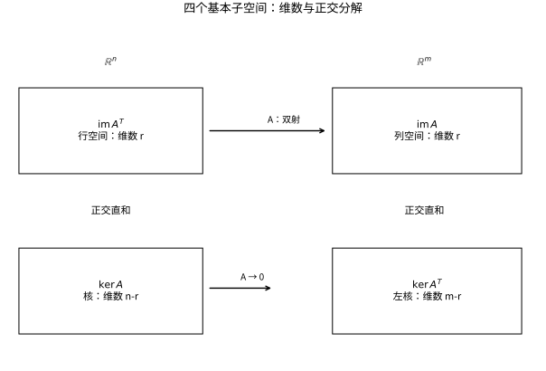

# 线性映射核像与四个基本子空间

## 矩阵是映射的坐标记录

线性映射 $T:V\to W$ 满足 $T(au+bv)=aT(u)+bT(v)$。核 $\ker T$ 是被压到零的输入方向，像 $\operatorname{im}T$ 是可以达到的输出。选好两边的基后，将基向量的像按列排列就得到矩阵。

## 秩—零化度定理的证明

先取核的基 $v_1,\ldots,v_k$，扩充成 $V$ 的基 $v_1,\ldots,v_n$。那么 $T(v_{k+1}),\ldots,T(v_n)$ 生成像。若其线性组合为零，对应输入组合属于核；由于全组独立，这些系数全零。所以它们是像的基，得到
$$\dim V=\dim\ker T+\dim\operatorname{im}T.$$
定理要求定义域有限维才能写此有限整数公式。它说明每消失一个独立方向，可达到的输出维数就少一个。

## 四个基本子空间

对实矩阵 $A\in\mathbb R^{m\times n}$，列空间与左核位于 $\mathbb R^m$，行空间与核位于 $\mathbb R^n$：
$$\ker A=(\operatorname{im}A^T)^\perp,\qquad \ker A^T=(\operatorname{im}A)^\perp.$$
例如 $Ax=0$ 等价于 $x$ 与每个行向量正交，所以第一式直接成立；第二式同理。它们给出正交直和
$$\mathbb R^n=\operatorname{im}A^T\oplus\ker A,\quad \mathbb R^m=\operatorname{im}A\oplus\ker A^T.$$
复矩阵必须将 $T$ 换成共轭转置 $*$。

*图：输入被拆成行空间方向和核方向；只有前者影响输出。输出空间另外包含与列空间正交的左核。框中尺寸是维数关系示意，不是按比例绘制的欧氏图。*

## 算例：可解性的正交检验

取 $A=\begin{pmatrix}1&2\\2&4\\1&2\end{pmatrix}$。秩为 $1$；像由 $(1,2,1)^T$ 生成，核由 $(-2,1)^T$ 生成。左核满足 $y_1+2y_2+y_3=0$，可取基 $(-2,1,0)^T$、$(-1,0,1)^T$。

因此 $Ax=b$ 可解，当且仅当 $b$ 与两个左核向量都正交，即 $b_2=2b_1,b_3=b_1$。这不是额外方法，而是“右端必须落在像内”的对偶描述。当不成立时，最小二乘会把 $b$ 投影到像。

## 单射、满射与维数

单射当且仅当核为零；满射当且仅当像等于陪域。方阵情况下两者等价，但矩形矩阵不然：$\mathbb R^2\to\mathbb R^3$ 可以单射却不满射。写清定义域和陪域比只看一个矩阵外形更重要。

## 自测与解答

微分映射 $D:P_3\to P_2$ 的核与像是什么？在标准幂基下矩阵如何写？

> [!question]- 解答
> 核是常数多项式空间，维数 1；每个二次多项式都有三次以内原函数，所以像为 $P_2$，维数 3。矩阵为
> $$[D]=\begin{pmatrix}0&1&0&0\\0&0&2&0\\0&0&0&3\end{pmatrix}.$$
> $4=1+3$ 验证秩—零化度。这也说明“微分会丢失积分常数”就是核的非平凡性。

## 继续学习

前一节：[[数学/20-线性代数与几何/09-向量空间基维数与坐标|向量空间基维数与坐标]]。 下一节：[[数学/20-线性代数与几何/11-基变换相似与矩阵表示|基变换相似与矩阵表示]]。

课程地图：[[数学/20-线性代数与几何/00-线性代数与几何-MOC|线性代数课程地图]]；[[数学/90-资源/06-统一符号约定与定理条件索引|符号与条件索引]]。

## 跨学科连接

[[数学/46-数理方程/17-变分原理Lax-Milgram与能量估计|变分原理Lax-Milgram与能量估计]]。建议比较定义、适用条件与所用范数，再迁移方法。

## 核验与延伸阅读

本页为独立编写的讲解、推导与算例；以下一手教材用于对照标准定义与课程范围，不是逐段译写。更具体的主题定位见 [[数学/90-资源/04-六科学术来源与阅读对照|学术来源对照]]。

- [MIT 18.06SC：Linear Algebra，课程资料](https://ocw.mit.edu/courses/18-06sc-linear-algebra-fall-2011/)
- [Sheldon Axler：Linear Algebra Done Right，作者站点](https://linear.axler.net/)
