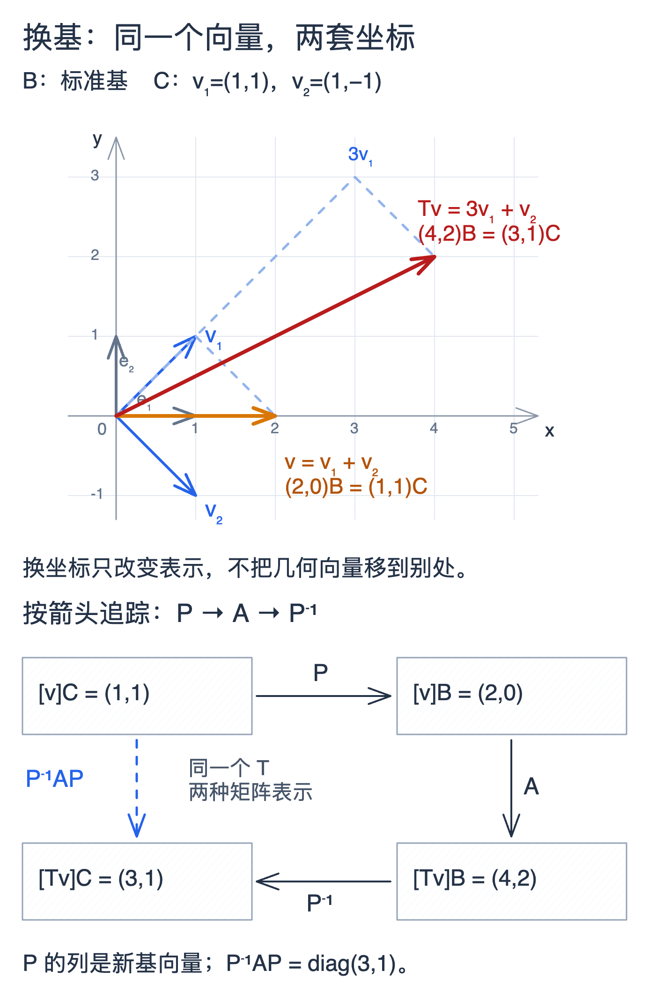

# 基变换相似与矩阵表示

## 基变换先问哪个坐标由哪个得到

设基 $\mathcal C$ 的向量在基 $\mathcal B$ 下按列组成 $P$，则
$$[v]_{\mathcal B}=P[v]_{\mathcal C}.$$
这句话决定所有后续逆矩阵的位置。若 $T:V\to V$ 在 $\mathcal B$ 下矩阵为 $A$，则
$$[Tv]_{\mathcal C}=P^{-1}AP[v]_{\mathcal C}.$$
因此新矩阵 $B=P^{-1}AP$，称相似。它代表**同一线性算子**在不同基下的坐标，而不是任意两个有相同大小的矩阵。

## 左右变换为何有两种不同结构

对于 $T:V\to W$，若定义域、陪域独立换基，分别有 $P,Q$，矩阵变为 $Q^{-1}AP$，称矩阵等价；它只保留秩的分类。对于二次型 $q(x)=x^TAx$，代入 $x=Py$ 得 $q=y^TP^TAPy$，这是合同，保留惯性而非特征值。相似、等价、合同回答不同问题，不能混写。

## 完整算例：找到能让映射变简单的基

取 $A=\begin{pmatrix}2&1\\1&2\end{pmatrix}$。沿 $v_1=(1,1)^T$ 伸长为 3 倍，沿 $v_2=(1,-1)^T$ 伸长为 1 倍。于是
$$P=\begin{pmatrix}1&1\\1&-1\end{pmatrix},\quad P^{-1}=\frac12P,\quad P^{-1}AP=\begin{pmatrix}3&0\\0&1\end{pmatrix}.$$
向量 $(2,0)^T$ 的新坐标为 $(1,1)^T$，映射后新坐标为 $(3,1)^T$，转回旧坐标为 $(4,2)^T$，与直接乘 $A$ 相符。

这里取 $\mathcal B$ 为标准基、$\mathcal C=(v_1,v_2)$。矩阵作用在列向量上，$P^{-1}AP$ 从右向左执行三个步骤：先把新基坐标译成标准坐标，用标准基下的 $A$ 作用，再把结果重新编码成新基坐标。

$$
\begin{aligned}
[v]_{\mathcal B}&=P[v]_{\mathcal C}=(2,0)^T,\\
[Tv]_{\mathcal B}&=A[v]_{\mathcal B}=(4,2)^T,\\
[Tv]_{\mathcal C}&=P^{-1}[Tv]_{\mathcal B}=(3,1)^T.
\end{aligned}
$$

*图：上半部在同一个平面内画出 $v=v_1+v_2=(2,0)$ 和 $Tv=3v_1+v_2=(4,2)$；B、C 后缀说明坐标属于哪套基。下半部沿 $P\to A\to P^{-1}$ 追踪同一映射，左侧直接用 $P^{-1}AP$ 得到相同结果。换基只改变表示，不能把坐标对的变化理解为向量被移动到了别处。[[数学/20-线性代数与几何/assets/basis-change-coordinates.excalidraw|可编辑 Excalidraw 源图]]；正文使用由源图显式导出的 PNG，关闭绘图插件后仍可阅读。*

## 什么不会随基变化

迹、行列式、特征多项式、秩与最小多项式在相似下不变。例如
$$\det(tI-P^{-1}AP)=\det(P^{-1}(tI-A)P)=\det(tI-A).$$
但共享迹和行列式并不保证相似：$I_2$ 与 $\begin{pmatrix}1&1\\0&1\end{pmatrix}$ 都有迹 2、行列式 1，前者的 $A-I$ 秩为零，后者秩为 1。因此需要更细的不变量，通向 Jordan 与有理标准形。

坐标依赖也影响长度：任意基的坐标二范数未必等于原空间的几何长度；只有正交归一基保留标准内积。一般基要引入 Gram 矩阵 $G=P^TP$，长度平方为 $y^TGy$。

## 自测与解答

在 $\mathbb R^2$ 取新基 $(1,0)^T,(1,1)^T$，求标准旋转 $A=\begin{pmatrix}0&-1\\1&0\end{pmatrix}$ 的新矩阵，并核验第一列。

> [!question]- 解答
> $P=\begin{pmatrix}1&1\\0&1\end{pmatrix}$，故 $P^{-1}AP=\begin{pmatrix}-1&-2\\1&1\end{pmatrix}$。第一基向量旋转成 $(0,1)^T=-(1,0)^T+(1,1)^T$，新坐标 $(-1,1)^T$ 正是第一列。无需死记公式，也能用作用核验方向。

## 继续学习

前一节：[[数学/20-线性代数与几何/10-线性映射核像与四个基本子空间|线性映射核像与四个基本子空间]]。 下一节：[[数学/20-线性代数与几何/12-特征结构对角化与动力系统|特征结构对角化与动力系统]]。

课程地图：[[数学/20-线性代数与几何/00-线性代数与几何-MOC|线性代数课程地图]]；[[数学/90-资源/06-统一符号约定与定理条件索引|符号与条件索引]]。

## 跨学科连接

[[数学/25-高等代数/05-不变子空间主分解与最小多项式|不变子空间主分解与最小多项式]]。相似为何保留最小多项式，却仍不足以仅靠迹、行列式判定矩阵；最小多项式在所用数域中分裂且无重根时又如何给出对角化？目标页用不变子空间和主分解回答这一点；无重根但不在该数域分裂时，仍不能在该数域对角化。

## 核验与延伸阅读

本页为独立编写的讲解、推导与算例；以下一手教材用于对照标准定义与课程范围，不是逐段译写。更具体的主题定位见 [[数学/90-资源/04-六科学术来源与阅读对照|学术来源对照]]。

- [MIT 18.06SC：Linear Algebra，课程资料](https://ocw.mit.edu/courses/18-06sc-linear-algebra-fall-2011/)
- [Sheldon Axler：Linear Algebra Done Right，作者站点](https://linear.axler.net/)
