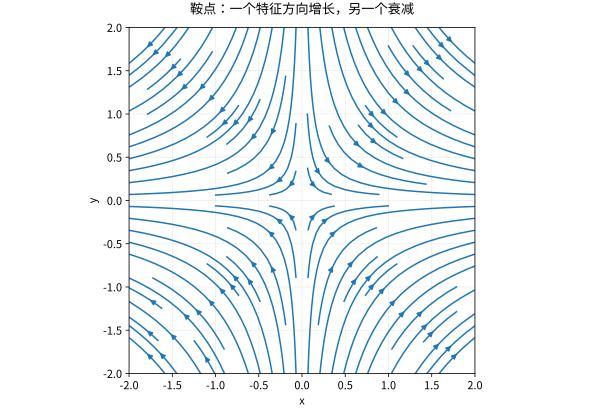

# 特征结构对角化与动力系统

## 特征向量寻找“不拐弯”的方向

$Av=\lambda v$ 要求 $v\ne0$；零向量不能用来宣布任何数都是特征值。特征值满足 $\det(\lambda I-A)=0$，但从根得到动力行为还需要知道特征向量是否足够。

不同特征值对应的特征向量线性独立。证明可假设存在最短线性关系，对其作用 $A-\lambda_k I$ 消去一项，得到更短关系，矛盾。若能找到 $n$ 个独立特征向量，则 $A=PDP^{-1}$。重根本身不阻止对角化，例如 $I$；真正要求每个特征值的几何重数等于代数重数。

## 对角化如何解演化问题

离散系统 $x_{k+1}=Ax_k$ 有 $x_k=A^kx_0$；连续系统 $x'=Ax$ 有 $x(t)=e^{tA}x_0$。对角化后分别计算 $D^k$、$e^{tD}$，再转回坐标。

取 $A=\begin{pmatrix}2&1\\1&2\end{pmatrix}$，初值 $(1,0)^T=\tfrac12(1,1)^T+\tfrac12(1,-1)^T$。因此
$$A^kx_0=\frac12\binom{3^k+1}{3^k-1},\qquad e^{tA}x_0=\frac12\binom{e^{3t}+e^t}{e^{3t}-e^t}.$$
模式独立演化是谱方法的核心，不是矩阵乘方的偶然技巧。

## 不可对角化时会发生什么

$J=\begin{pmatrix}\lambda&1\\0&\lambda\end{pmatrix}=\lambda I+N$，$N^2=0$。于是
$$e^{tJ}=e^{\lambda t}(I+tN).$$
当 $\lambda\ne0$ 且整数 $k\ge1$，$J^k=\lambda^kI+k\lambda^{k-1}N$；$\lambda=0$ 的情形直接用幂零性，不强行解释负幂。多项式因子 $t$ 或 $k$ 来自广义特征链。这也是仅检查“实部等于零”无法判定有界性的原因。

有限维连续系统 $e^{tA}\to0$ 当且仅当所有特征值实部严格负；离散系统 $A^k\to0$ 当且仅当谱半径 $\rho(A)<1$。这允许非平凡 Jordan 块，因为严格衰减的指数最终压过有限次数多项式。边界上则必须考虑块大小。

*图：鞍点系统 $x'=x,y'=-y$ 的方向场与轨线；一个特征方向增长，另一个衰减。稳定不能只看其中一个方向。*

## 反例：特征值不控制所有短时行为

$A=\begin{pmatrix}-1&M\\0&-1\end{pmatrix}$ 的特征值全为 $-1$，长期衰减，但 $e^{tA}=e^{-t}\begin{pmatrix}1&Mt\\0&1\end{pmatrix}$ 可以先产生很大的暂态放大。谱结论是渐近结论，不是“任意时刻范数单调减小”。正规性与条件数在这里开始重要。

## 自测与解答

实平面旋转 $90^\circ$ 是否可在实数域、复数域对角化？

> [!question]- 解答
> 特征多项式 $t^2+1$ 在实数域无根，所以无实特征向量，不能实对角化；在复数域有不同特征值 $i,-i$，故可复对角化。讨论标准形前必须声明数域。

## 继续学习

前一节：[[数学/20-线性代数与几何/11-基变换相似与矩阵表示|基变换相似与矩阵表示]]。 下一节：[[数学/20-线性代数与几何/13-内积Gram-Schmidt与QR分解|内积Gram-Schmidt与QR分解]]。

课程地图：[[数学/20-线性代数与几何/00-线性代数与几何-MOC|线性代数课程地图]]；[[数学/90-资源/06-统一符号约定与定理条件索引|符号与条件索引]]。

## 跨学科连接

[[数学/25-高等代数/06-Jordan标准形广义特征向量与幂零链|Jordan标准形广义特征向量与幂零链]]。当特征向量不足以对角化时，Jordan 链怎样精确产生 $e^{tA}$ 与 $A^k$ 中的多项式因子，并补足本页的临界稳定性判断？目标页从广义特征空间和幂零链构造 Jordan 块；它要求特征多项式在所用数域分裂，不能把实数域的复根情形直接套入。

## 核验与延伸阅读

本页为独立编写的讲解、推导与算例；以下一手教材用于对照标准定义与课程范围，不是逐段译写。更具体的主题定位见 [[数学/90-资源/04-六科学术来源与阅读对照|学术来源对照]]。

- [MIT 18.06SC：Linear Algebra，课程资料](https://ocw.mit.edu/courses/18-06sc-linear-algebra-fall-2011/)
- [Sheldon Axler：Linear Algebra Done Right，作者站点](https://linear.axler.net/)
