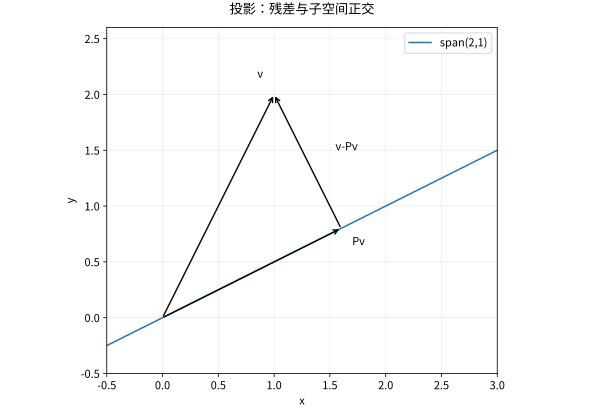

# 内积Gram-Schmidt与QR分解

## 内积把代数变成几何

本库在复向量空间采用**第一变量线性**的约定，标准内积为 $\langle x,y\rangle=y^*x$。因此 $\|x\|^2=x^*x$，正交条件为 $y^*x=0$。使用另一种约定也可以，但整段推导必须一致。

Cauchy–Schwarz 不等式可以从非负平方得到。若 $v\ne0$，令 $\alpha=\langle u,v\rangle/\|v\|^2$，则
$$0\le\|u-\alpha v\|^2=\|u\|^2-\frac{|\langle u,v\rangle|^2}{\|v\|^2}.$$
等号当且仅当两向量线性相关。这一证明同时给出了投影系数，而不是另背一个公式。

## Gram–Schmidt 每一步消掉什么

对独立向量 $a_1,\ldots,a_n$，令
$$v_j=a_j-\sum_{i<j}\langle a_j,q_i\rangle q_i,\qquad q_j=v_j/\|v_j\|.$$
减去的是在已有方向上的全部投影；由归纳可知 $q_j$ 与之前所有 $q_i$ 正交。独立性保证 $v_j\ne0$，否则原向量已在之前的张成空间里。若输入相关，必须跳过零残差或采用带秩判定的算法。

把系数收集起来得 $A=QR$，其中 $Q$ 列正交归一、$R$ 上三角。薄 QR 用于 $m\times n$、$m\ge n$ 的满列秩矩阵时，$Q$ 为 $m\times n$，不要把 $QQ^*=I_m$ 与 $Q^*Q=I_n$ 混淆；前者通常只是列空间投影。

## 完整算例

取 $a_1=(1,1,0)^T,a_2=(1,0,1)^T$。有
$$q_1=\frac1{\sqrt2}(1,1,0)^T,\quad r_{12}=\frac1{\sqrt2},\quad v_2=(1/2,-1/2,1)^T,$$
故 $r_{22}=\sqrt{3/2}$，$q_2=(1,-1,2)^T/\sqrt6$。于是
$$R=\begin{pmatrix}\sqrt2&1/\sqrt2\\0&\sqrt{3/2}\end{pmatrix}.$$
直接核验 $q_1^Tq_2=0$、$QR=A$，比仅列最终矩阵更能发现归一化错误。

## 计算中为何常用 Householder

精确算术下，经典与改进 Gram–Schmidt 得到同一正交化关系；浮点下，近相关向量相减会放大误差，经典版本容易丢失正交性。改进版本逐次更新残差，重正交化可再改善。Householder 反射
$$H=I-2\frac{vv^*}{v^*v}$$
满足 $H^*=H,H^*H=I$，可把一列的下方元素整体消去，组成稳定的 QR。复数情形选择反射向量时还需合适相位，避免相减抵消，不能把实数符号选择照搬。

*图：向量分解为子空间上的投影与垂直残差。投影误差最小来自直角关系。*

## 自测与解答

证明 $P=QQ^*$ 是到 $\operatorname{im}Q$ 的正交投影，假设 $Q^*Q=I$。

> [!question]- 解答
> $P^*=P$ 且 $P^2=Q(Q^*Q)Q^*=P$，所以是自伴幂等映射。$Px\in\operatorname{im}Q$，并且 $Q^*(x-Px)=0$，因此残差垂直列空间。特别地，投影不一定可逆，也不一定保持所有向量长度。

## 继续学习

前一节：[[数学/20-线性代数与几何/12-特征结构对角化与动力系统|特征结构对角化与动力系统]]。 下一节：[[数学/20-线性代数与几何/14-最小二乘伪逆与正则化|最小二乘伪逆与正则化]]。

课程地图：[[数学/20-线性代数与几何/00-线性代数与几何-MOC|线性代数课程地图]]；[[数学/90-资源/06-统一符号约定与定理条件索引|符号与条件索引]]。

## 跨学科连接

[[数学/16-数学分析/13-Fourier级数正交展开与收敛|Fourier级数正交展开与收敛]]。建议比较定义、适用条件与所用范数，再迁移方法。

## 核验与延伸阅读

本页为独立编写的讲解、推导与算例；以下一手教材用于对照标准定义与课程范围，不是逐段译写。更具体的主题定位见 [[数学/90-资源/04-六科学术来源与阅读对照|学术来源对照]]。

- [MIT 18.06SC：Linear Algebra，课程资料](https://ocw.mit.edu/courses/18-06sc-linear-algebra-fall-2011/)
- [Sheldon Axler：Linear Algebra Done Right，作者站点](https://linear.axler.net/)
