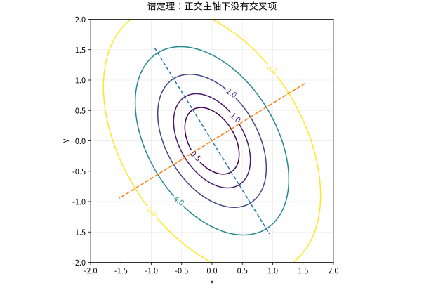

# 谱定理二次型与正定矩阵

## 对称性为什么带来更强结论

实对称矩阵可由正交矩阵对角化，复 Hermitian 矩阵可由酉矩阵对角化，特征值均为实数。这里的正交基使坐标分解不扭曲长度，所以谱可以直接解释能量。这一节沿用 12 的特征向量与 13 的正交基；复数情形的内积仍为 $\langle x,y\rangle=y^*x$，酉矩阵满足 $Q^*Q=I$。若从最小二乘页进入，眼下只需要这一节的自伴结论与下方 $A^*A$ 算例，带着它去构造 SVD 即可返回。

先证明实特征值：若 $Av=\lambda v$，则 $v^*Av=\lambda\|v\|^2$，左边因 $A=A^*$ 为实数。不同特征值的特征向量正交，由
$$\langle Av,w\rangle=\langle v,Aw\rangle$$
和实特征值直接得到。存在一个特征向量后，其正交补在 $A$ 下不变，在正交补上归纳便得完整正交特征基；存在性可由复数域特征多项式有根与上面的实值性，或实 Rayleigh 商极值获得。

### 从正规方程带来的半正定对象

14 留下的问题是：最小二乘的核方向不影响残差，怎样把它与受约束方向正交分开？输入矩阵 $A\in\mathbb F^{m\times n}$（$\mathbb F=\mathbb R$ 或 $\mathbb C$）可以是矩形，无法直接要求它有同一输入、输出空间的特征基。正规方程中的 $B=A^*A\in\mathbb F^{n\times n}$ 则是自伴矩阵，且

$$
z^*Bz=z^*A^*Az=\|Az\|_2^2\ge0.
$$

因而可用本节谱定理找输入空间的完整正交特征基 $v_i$。若 $Bv_i=\mu_i v_i$、$\|v_i\|_2=1$，则 $\mu_i=v_i^*Bv_i=\|Av_i\|_2^2\ge0$；非负的特征值由此得证。$\mu_i=0$ 恰好意味着 $Av_i=0$；更一般地 $\ker(A^*A)=\ker A$，因为非负平方为零当且仅当 $Az=0$。正特征方向被 $A$ 保留，零方向被压到零。

对 14 的 $A=(1\ 1)$，

$$
B=\begin{pmatrix}1&1\\1&1\end{pmatrix},\qquad
v_1=\frac1{\sqrt2}\binom11,\quad
v_2=\frac1{\sqrt2}\binom1{-1},\qquad
Bv_1=2v_1,\quad Bv_2=0.
$$

$v_1,v_2$ 是单位向量且正交，它们区分“两个参数一起改变”和“等量反向改变”；后者正是 14 的核方向。现在只需带回 $\mu_1=2,\mu_2=0$ 与这两个方向，去 [[数学/20-线性代数与几何/16-SVD的推导最优低秩与PCA#任何矩形矩阵都能分解为旋转与拉伸|16 的 SVD 构造这一节]]：它会把 $\sqrt{\mu_i}$ 变成奇异值，并对正方向用 $Av_i$ 构造输出单位向量，然后把你送回 14 计算伪逆与岭解。二次型、Hessian 和 Cholesky 仍在下面，完成这次小回程后按目标继续。

## 二次型就是不同方向上的能量

对实对称 $A=Q\Lambda Q^T$，令 $y=Q^Tx$，则
$$x^TAx=\sum_i\lambda_i y_i^2.$$
正定意味着所有非零 $x$ 能量严格正，等价于全部特征值正。半正定允许零方向；不定既有正能量方向又有负能量方向。一般实矩阵的二次型只依赖其对称部分，因为 $x^T(A-A^T)x=0$。

对 $x\ne0$，Rayleigh 商 $R(x)=x^TAx/(x^Tx)$ 是特征值以 $y_i^2$ 为权的平均，故最小、最大值分别为 $\lambda_{\min},\lambda_{\max}$。最小曲率可以为局部增量给出下界，最大曲率则影响梯度法的步长选择。

具体地，设 $x_*\in\mathbb R^n$，实值函数 $f$ 在 $x_*$ 的一个开邻域内属于 $C^2$（二阶偏导存在且连续）。**若 $\nabla f(x_*)=0$ 且 Hessian $H=\nabla^2f(x_*)$ 正定，则 $x_*$ 是严格局部极小点。** 驻点条件消去 Taylor 展开的一阶项：
$$f(x_*+h)-f(x_*)=\frac12h^THh+o(\|h\|^2).$$
由 Rayleigh 商，$h^THh\ge\lambda_{\min}\|h\|^2$，且 $\lambda_{\min}>0$。余项除以 $\|h\|^2$ 趋于零，故充分小的非零 $h$ 满足
$$f(x_*+h)-f(x_*)\ge\frac{\lambda_{\min}}4\|h\|^2>0.$$
这里需要的是驻点附近的比较，不要求 $f$ 在整个定义域内都为二次函数。

用三个一维函数检查前提和结论，Hessian 在一维就是二阶导：

| 函数与考察点 | 一阶导、二阶导在 $0$ 的值 | 能得出什么 |
| --- | --- | --- |
| $f(x)=x^2$，$x_*=0$ | $f'(0)=0$，$f''(0)=2>0$ | 满足上述条件，$0$ 是严格局部极小点。 |
| $f(x)=e^x$，$x_*=0$ | $f'(0)=1$，$f''(0)=1>0$ | 缺少驻点条件；任意小的 $h<0$ 都有 $e^h<1$，所以 $0$ 不是极小点。 |
| $f(x)=x^4$，$x_*=0$ | $f'(0)=0$，$f''(0)=0$ | 二阶测试不能判定；直接比较 $h^4>0$ 可知 $0$ 仍是严格极小点。 |

因此 Hessian 正定是在上述驻点和正则性前提下的充分条件，不是严格局部极小的必要条件。

*图：正定二次型 $3x^2+2xy+2y^2$ 的椭圆等值线；主轴对应正交特征方向。*

## Cholesky 与主子式判别

正定矩阵可唯一分解为 $A=LL^*$，其中 $L$ 下三角且对角元正实数。第一步取 $l_{11}=\sqrt{a_{11}}$，消去首列后得到的 Schur 补仍正定，递归完成。反过来若 $L$ 可逆，$x^*LL^*x=\|L^*x\|^2>0$。

Sylvester 判据：Hermitian 矩阵正定当且仅当所有顺序主子式正。**半正定不能只检查顺序主子式非负**，一般需所有主子式非负。例如 $\operatorname{diag}(0,-1)$ 的前两个顺序主子式都是零，却不是半正定。

## 算例与自测

$A=\begin{pmatrix}2&1\\1&2\end{pmatrix}$ 的特征值为 $3,1$，故 $\|x\|^2\le x^TAx\le3\|x\|^2$。求其 Cholesky 因子，并解释等号方向。

> [!question]- 解答
> $$L=\begin{pmatrix}\sqrt2&0\\1/\sqrt2&\sqrt{3/2}\end{pmatrix}.$$
> 下界等号沿 $(1,-1)^T$，上界等号沿 $(1,1)^T$。误差界必须指出使用欧氏范数，否则常数可能改变。

## 继续学习

前一节：[[数学/20-线性代数与几何/14-最小二乘伪逆与正则化|最小二乘伪逆与正则化]]。 下一节：[[数学/20-线性代数与几何/16-SVD的推导最优低秩与PCA|SVD的推导最优低秩与PCA]]。

课程地图：[[数学/20-线性代数与几何/00-线性代数与几何-MOC|线性代数课程地图]]；[[数学/90-资源/06-统一符号约定与定理条件索引|符号与条件索引]]。

## 跨学科连接

[[数学/25-高等代数/08-双线性型合同与实二次型惯性|双线性型合同与实二次型惯性]]。谱定理中的正交相似对角化为何保留特征值并给出欧氏能量界，而合同化为何只保留正惯性指数 $p$、负惯性指数 $n$ 与二次型矩阵的核维数 $z$？目标页用惯性定理和反例区分二者；合同可缩放非零特征值，不能据此保留 Rayleigh 商或条件数。$p,n,z$ 是维数不变量，不表示保留某一组具体正、负方向，也不应与满足 $q(x)=0$ 的各向同性锥混同。

带单位的应用可到 [[物理/20-电磁学/08-多导体静电与电容矩阵#对称与正定，来自同一个场能|三导体电场能二次型]]：令 $A=\mathbf C'$（F/m）、$x=\mathbf v$（V），$x^TAx=2W'_E$（J/m）。回来解释为什么包含参考的三电位矩阵有共同势平移零方向，固定参考后的二电压矩阵却正定；再用 $Q'_2=0$ 消元得到正的 Schur 补。这里的核来自电位参考自由度，不代表负电容或一个有储能的物理模式。

## 核验与延伸阅读

本页为独立编写的讲解、推导与算例；以下一手教材用于对照标准定义与课程范围，不是逐段译写。更具体的主题定位见 [[数学/90-资源/04-六科学术来源与阅读对照|学术来源对照]]。

- [MIT 18.06SC：Linear Algebra，课程资料](https://ocw.mit.edu/courses/18-06sc-linear-algebra-fall-2011/)
- [Sheldon Axler：Linear Algebra Done Right，作者站点](https://linear.axler.net/)
- [MIT 18.02：SD. Second Derivative Test](https://ocw.mit.edu/courses/18-02-multivariable-calculus-fall-2007/8ba72b6c820c6d1966c7894124070f0a_2nd_derivative.pdf)：第 1、4 页说明先找驻点、邻域内连续二阶导以及二阶测试退化时不能判定；本页用 Rayleigh 商和 Taylor 余项写出任意有限维的充分条件。
