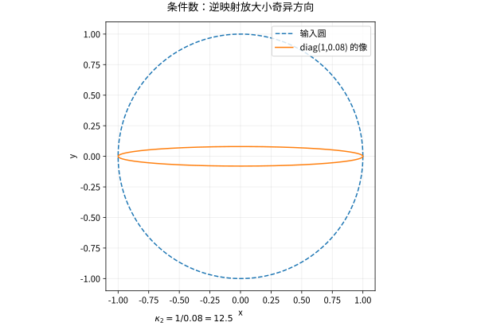

# 矩阵范数条件数与数值稳定性

## 小残差为何可能对应大错误

对可逆方阵 $A$，若 $A\hat x=b+\delta b$，则
$$\frac{\|\hat x-x\|}{\|x\|}\le\|A\|\|A^{-1}\|\frac{\|\delta b\|}{\|b\|}.$$
这里用相容诱导范数并假设 $b\ne0$。条件数 $\kappa(A)=\|A\|\|A^{-1}\|$ 衡量问题本身对相对扰动的敏感度。二范数下 $\kappa_2(A)=\sigma_{\max}/\sigma_{\min}$；奇异矩阵通常约定为无穷。

诱导矩阵范数 $\|A\|=\sup_{x\ne0}\|Ax\|/\|x\|$ 自动满足 $\|AB\|\le\|A\|\|B\|$。$\|A\|_2=\sigma_{\max}$，$\|A\|_1$ 是最大列绝对值和，$\|A\|_\infty$ 是最大行绝对值和；Frobenius 范数不是由同维向量范数以此方式诱导的，但也有常用乘积不等式。

## 矩阵也扰动时

若 $(A+E)(x+\delta x)=b+e$，并且 $\|A^{-1}E\|<1$，由 Neumann 级数
$$(I+A^{-1}E)^{-1}=\sum_{j\ge0}(-A^{-1}E)^j$$
可知扰动矩阵仍可逆。由 $(A+E)\delta x=e-Ex$ 得到
$$\frac{\|\delta x\|}{\|x\|}\le\frac{\kappa(A)}{1-\kappa(A)\|E\|/\|A\|}\left(\frac{\|E\|}{\|A\|}+\frac{\|e\|}{\|b\|}\right),$$
其中分母形式要求更强但易检验的 $\kappa(A)\|E\|/\|A\|<1$。不满足这个小扰动条件时，不应继续引用该界。

## 一个可以手算的病态例子

取 $A=\operatorname{diag}(1,\varepsilon)$、$b=(1,0)^T$。精确解为 $(1,0)^T$。把右端改成 $(1,\varepsilon)^T$，相对扰动大小约为 $\varepsilon$，解却变成 $(1,1)^T$，误差大小为 $1$。算法即使完全精确，也不能消除这种敏感性。

*图：$\operatorname{diag}(1,0.08)$ 把单位圆压成细椭圆；逆映射会强烈放大短轴方向的扰动。*

## 前向误差、后向误差、残差

前向误差问计算答案离真实答案多远；后向误差问这个答案是否精确解决了一个邻近问题。后向稳定算法产生小后向误差，但对病态问题仍可产生大前向误差，约由“条件数 × 后向误差”解释。

残差 $r=b-A\hat x$ 给出仅改变右端的后向解释 $A\hat x=b-r$。更尺度无关的指标常用
$$\eta=\frac{\|r\|}{\|A\|\|\hat x\|+\|b\|}.$$
它与允许同时扰动矩阵和右端的范数型后向误差密切相关，但不同的逐分量误差模型会给出不同指标。报告数字时应说明尺度、范数和模型。

## 自测与解答

为什么 $10^{-100}I$ 不是二范数意义上的病态矩阵，却仍可能在某种实现中出问题？

> [!question]- 解答
> 其所有奇异值相同，条件数为 1，相对敏感性并不大。但绝对数值尺度可能造成下溢、溢出或与其他量相减时丢失有效位。条件数分析不替代浮点范围分析。通过缩放改变尺度可缓解范围问题，却不自动改善原本的相对病态性。

## 继续学习

前一节：[[数学/20-线性代数与几何/16-SVD的推导最优低秩与PCA|SVD的推导最优低秩与PCA]]。 下一节：[[数学/20-线性代数与几何/18-分块矩阵Schur补与矩阵指数|分块矩阵Schur补与矩阵指数]]。

课程地图：[[数学/20-线性代数与几何/00-线性代数与几何-MOC|线性代数课程地图]]；[[数学/90-资源/06-统一符号约定与定理条件索引|符号与条件索引]]。

## 跨学科连接

[[数学/46-数理方程/19-差分格式稳定性CFL与收敛|差分格式稳定性CFL与收敛]]。建议比较定义、适用条件与所用范数，再迁移方法。

## 核验与延伸阅读

本页为独立编写的讲解、推导与算例；以下一手教材用于对照标准定义与课程范围，不是逐段译写。更具体的主题定位见 [[数学/90-资源/04-六科学术来源与阅读对照|学术来源对照]]。

- [MIT 18.06SC：Linear Algebra，课程资料](https://ocw.mit.edu/courses/18-06sc-linear-algebra-fall-2011/)
- [Sheldon Axler：Linear Algebra Done Right，作者站点](https://linear.axler.net/)
