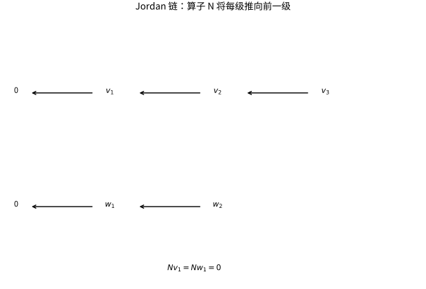

# Jordan标准形广义特征向量与幂零链

## 广义特征向量补上缺失的方向

假设特征多项式在底域分裂，例如在 $\mathbb C$ 上。主分解先把算子拆到各特征值。对固定 $\lambda$，令 $N=T-\lambda I$，它在广义特征空间上幂零。Jordan 理论因此归结为给幂零算子找一组链基。

一条长度 $k$ 的链按 $v_1,\ldots,v_k$ 排列，满足 $Nv_1=0,Nv_j=v_{j-1}$。在此基下矩阵有 $\lambda$ 在主对角、1 在上超对角。链不是任意 $k$ 个核向量，而是通过 $N$ 逐级连接的向量。

## 如何从核维数读出块大小

令 $d_j=\dim\ker N^j$，$d_0=0$。一个大小为 $s$ 的块对 $d_j$ 的贡献是 $\min(j,s)$，所以
$$b_j=d_j-d_{j-1}=\text{大小至少为 }j\text{ 的块数}.$$
大小恰为 $j$ 的块数为 $b_j-b_{j+1}$。这证明块大小由算子唯一确定，顺序除外，也提供实用计算法。

例如广义特征空间维数 5，$d_1=2,d_2=4,d_3=5$，则 $b_1=2,b_2=2,b_3=1$，块大小是 3 与 2。仅知道代数重数 5、几何重数 2，还不足以排除块大小 4 与 1，必须继续看核的增长。

*图：长度 3 与长度 2 的两条链在 $N=T-\lambda I$ 下逐级落向零；箭头方向是算子作用方向。*

## 构造链的思路与算例

在嵌套核 $0\subset\ker N\subset\ker N^2\subset\cdots$ 中，从最高层挑选能代表新方向的向量，再向下作用 $N$ 形成链。补充较短链，使每层所需的独立方向都得到覆盖。通过对最大非零幂作用来消去最长链最高系数，可逐层验证全部链向量独立；维数计数完成生成性。这是存在性证明的核心，不是仅凭画图宣布链总存在。

具体取
$$N=\begin{pmatrix}0&1&1\\0&0&1\\0&0&0\end{pmatrix}.$$
选 $v_3=e_3$，得 $v_2=Ne_3=e_1+e_2$，$v_1=N^2e_3=e_1$。三向量独立。令 $P=(v_1\ v_2\ v_3)$，即列顺序从链底排到链顶，则 $NP=PJ_3(0)$，所以 $P^{-1}NP=J_3(0)$。若反按 $v_3,v_2,v_1$ 排列，Jordan 块的 1 会落在下次对角线；若直接把标准基当作 Jordan 基，则会漏掉第一行第三列的额外 1。

## Jordan 形式的用途与数值警告

在一个大小 $s$ 的块上，若底域为 $\mathbb R$ 或 $\mathbb C$（更一般地，$\operatorname{char}F=0$ 或 $\operatorname{char}F\ge s$），
$$f(\lambda I+N)=\sum_{j=0}^{s-1}\frac{f^{(j)}(\lambda)}{j!}N^j$$
对多项式或在附近解析的函数成立；解析函数的说法也只在相应实/复分析环境中使用。Jordan 分类本身只需特征多项式分裂，不能由此省掉阶乘可逆条件。例如在 $\mathbb F_2$ 上，$N=J_3(0)$、$f(t)=t^2$ 时 $N^2=E_{13}\ne0$，但 $f'=f''=0$ 且 $2!=0$，上式的二阶项无定义。任意特征下可改用 $f(\lambda+t)$ 的 $t^j$ 系数（Hasse 系数）表示，而本页不展开这一替代技术。矩阵指数因此在实/复域包含 $t^j e^{\lambda t}$，解释共振与多项式暂态。

Jordan 形是精确代数分类，但对微小矩阵扰动不连续，浮点计算不宜以“识别精确块结构”为默认目标。例如 $\begin{pmatrix}0&1\\\varepsilon&0\end{pmatrix}$ 在 $\varepsilon\ne0$ 时有两个不同复特征值，$\varepsilon=0$ 时却是一个 Jordan 块。数值工作通常使用 Schur 形。

## 自测与解答

$6\times6$ 幂零矩阵满足核维数依次为 $3,5,6$，求 Jordan 块及最小多项式。

> [!question]- 解答
> 至少长度 1、2、3 的块数分别是 3、2、1，所以恰长 1、2、3 的块各一个，块大小为 $3,2,1$。最小多项式由最长链决定，为 $t^3$；特征多项式则为 $t^6$。

## 继续学习

前一节：[[数学/25-高等代数/05-不变子空间主分解与最小多项式|不变子空间主分解与最小多项式]]。 下一节：[[数学/25-高等代数/07-多项式矩阵Smith标准形与有理标准形|多项式矩阵Smith标准形与有理标准形]]。

课程地图：[[数学/25-高等代数/00-高等代数-MOC|高等代数课程地图]]；[[数学/90-资源/06-统一符号约定与定理条件索引|符号与条件索引]]。

## 跨学科连接

[[数学/46-数理方程/02-高阶线性常微分方程与方程组#常系数与特征多项式|高阶线性常微分方程与方程组]] 把重根产生的 $e^{\lambda t},te^{\lambda t},\ldots$ 解释为伴随矩阵的 Jordan 链；这里的 $e^{t(\lambda I+N)}=e^{\lambda t}\sum_{j=0}^{r-1}t^jN^j/j!$（$N^r=0$）正好给出同一机制。

## 核验与延伸阅读

本页为独立编写的讲解、推导与算例；以下一手教材用于对照标准定义与课程范围，不是逐段译写。更具体的主题定位见 [[数学/90-资源/04-六科学术来源与阅读对照|学术来源对照]]。

- [Sheldon Axler：Linear Algebra Done Right，作者站点](https://linear.axler.net/)
- [J. S. Milne：群、环、域与 Galois 理论课程笔记](https://www.jmilne.org/math/CourseNotes/)
