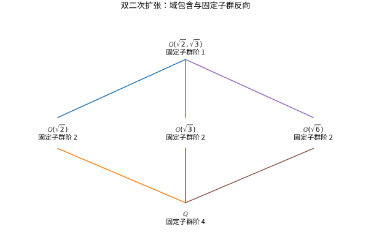

# Galois对应入门与代数结构综合

## 根之间的对称性如何控制中间域

对扩张 $E/F$，固定 $F$ 每个元素的域自同构构成群 $\operatorname{Aut}(E/F)$。自同构必须把多项式的根送到同一多项式的根，因为它保持系数、加法与乘法；但不是任意根的置换都能延伸成域自同构，必须保持全部代数关系。

有限扩张称 Galois，当它正规且可分；等价于它是某个可分多项式的分裂域。此时 $|\operatorname{Gal}(E/F)|=[E:F]$。只有可分但不正规时，底域嵌入可能送到别的共轭域，不全是 $E$ 自身的自同构。

## Galois 对应的准确陈述

设 $E/F$ 有限 Galois，$G=\operatorname{Gal}(E/F)$。中间域 $K$ 与子群 $H$ 通过
$$K\longmapsto\operatorname{Gal}(E/K),\qquad H\longmapsto E^H=\{x:\sigma x=x\ \forall\sigma\in H\}$$
反向一一对应，并且 $[E:E^H]=|H|$、$[E^H:F]=[G:H]$。子群越大，要求固定的操作越多，固定域越小。$K/F$ Galois 当且仅当相应子群正规，此时 $\operatorname{Gal}(K/F)\cong G/H$。

证明路线由三项组成：不同域嵌入作为函数线性独立；有限自同构群的固定域满足扩张次数等于群阶；正规可分性保证所需嵌入能延伸回分裂域。完整证明链见 [[数学/25-高等代数/30-Galois理论/00-Galois理论-MOC|Galois 理论专题]]；其中 [[数学/25-高等代数/30-Galois理论/04-有限Galois基本定理与正规商群|有限 Galois 基本定理与正规商群]] 证明一般对应，[[数学/25-高等代数/30-Galois理论/05-双二次扩张与S3全部对应|双二次扩张与 $S_3$ 的全部对应]] 列全本页例子的每个子群、固定域和正规性。本页保留下面这个可独立跟算的入门版本，不把关键引理压缩成“显然”。

## 完整例子：双二次扩张

令 $E=\mathbb Q(\sqrt2,\sqrt3)$。可独立改变两个平方根的符号，得到 4 个自同构，群为 $C_2\times C_2$，与扩张次数 4 相等。

保持 $\sqrt2$、反转 $\sqrt3$ 的二阶子群固定 $\mathbb Q(\sqrt2)$；反转 $\sqrt2$、保持 $\sqrt3$ 的子群固定 $\mathbb Q(\sqrt3)$；同时反转两者的子群固定 $\mathbb Q(\sqrt6)$。证明最后一项时，把任意元素写为 $a+b\sqrt2+c\sqrt3+d\sqrt6$，固定条件强迫 $b=c=0$。

群只有这三个二阶子群，所以只有这三个二次中间域。所有子群正规，三个二次扩张都 Galois。顶端平凡子群固定整个 $E$，底端全群固定 $\mathbb Q$。

*图：双二次扩张的中间域包含关系；每个节点同时标出对应固定子群阶数。域向上变大时，固定子群变小。*

## 反例与方程可解性的边界

$\mathbb Q(\sqrt[3]2)/\mathbb Q$ 次数为 3，但全部元素实，另外两个共轭根不在域内，故不正规。唯一实根只能被固定，其自同构群为平凡群。这说明任意有限扩张都不能直接套用 Galois 对应。

在特征零下，多项式可由根式求解与其 Galois 群可解有关；一般五次方程没有统一的根式公式，指的是存在不可解 Galois 群的五次方程，不是“所有五次方程都不能用根式解”。例如 $x^5-2=0$ 显然可用根式表达。一般定理的证明涉及正规列、循环扩张与单位根，列为进阶，而不是一句口号替代证明。

## 自测与解答

在上述双二次扩张中，$\alpha=\sqrt2+\sqrt3$ 能否生成整个域？求其最小多项式。

> [!question]- 解答
> $\alpha^2=5+2\sqrt6$，所以 $(\alpha^2-5)^2=24$，即 $\alpha^4-10\alpha^2+1=0$。又 $(\sqrt3+\sqrt2)(\sqrt3-\sqrt2)=1$，故 $\sqrt3=(\alpha+\alpha^{-1})/2$、$\sqrt2=(\alpha-\alpha^{-1})/2$，都在 $\mathbb Q(\alpha)$ 中。因此它生成整个四次扩张，以上首一四次式就是最小多项式。

## 继续学习

前一节：[[数学/25-高等代数/13-域扩张有限域与代数数|域扩张有限域与代数数]]。

课程地图：[[数学/25-高等代数/00-高等代数-MOC|高等代数课程地图]]；[[数学/90-资源/06-统一符号约定与定理条件索引|符号与条件索引]]。

## 核验与延伸阅读

本页为独立编写的讲解、推导与算例；以下一手教材用于对照标准定义与课程范围，不是逐段译写。更具体的主题定位见 [[数学/90-资源/04-六科学术来源与阅读对照|学术来源对照]]。

- [Sheldon Axler：Linear Algebra Done Right，作者站点](https://linear.axler.net/)
- [J. S. Milne：群、环、域与 Galois 理论课程笔记](https://www.jmilne.org/math/CourseNotes/)
