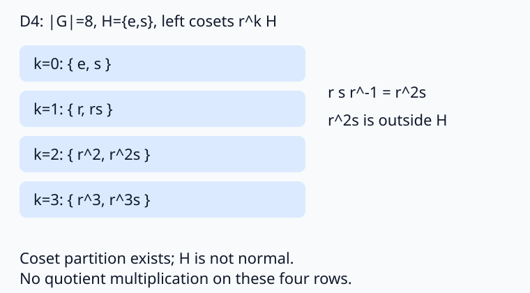

# 有限群 Cauchy 与 Sylow 计数

知道 $|G|=30$，能否断言它是简单群？知道 $|G|=8$，能否把每个子群的陪集相乘？这两类问题分别需要**存在性与计数**、**正规性**。本页从作用出发证明 Cauchy 和 Sylow，再用同一组 $S_3,D_4$ 算例检验条件。

先修 [[数学/25-高等代数/11-群同态陪集与商群#陪集如何证明整除关系|Lagrange 的陪集证明]] 与 [[数学/25-高等代数/11-群同态陪集与商群#群作用把抽象结构变成计数|轨道稳定子]]：若有限 $p$-群 $P$ 作用于有限集合 $X$，每条轨道大小是 $|P|$ 的约数，故是 $p$ 的幂。非单点轨道大小被 $p$ 整除，于是
$$|X|\equiv |X^P|\pmod p,\qquad X^P=\{x:gx=x\text{ 对所有 }g\in P\}.$$
这里固定点是**被全群固定**，与只被某一个元素固定不同。本页 $p$ 始终是素数，所有群和被计数的集合均有限。[Milne，Lemma 5.1，印刷 p78](https://www.jmilne.org/math/CourseNotes/GT.pdf#page=78)

## Cauchy：整除群阶的素数确实产生元素

**定理。** 若 $p\mid |G|$，则 $G$ 中有阶恰为 $p$ 的元素。

取
$$X=\{(g_1,\ldots,g_p)\in G^p:g_1\cdots g_p=e\}.$$
任取前 $p-1$ 项，最后一项唯一确定，所以 $|X|=|G|^{p-1}$ 被 $p$ 整除。循环移位 $T(g_1,\ldots,g_p)=(g_2,\ldots,g_p,g_1)$ 保持 $X$：新乘积等于 $g_1^{-1}(g_1\cdots g_p)g_1=e$。即使 $G$ 不交换也合法。$T^p=1$，因此循环群 $C_p$ 作用于 $X$；轨道只能有 1 或 $p$ 个元素。

单点轨道恰为 $(g,\ldots,g)$ 且 $g^p=e$。固定点数被 $p$ 整除，且至少有全单位元的一点，故至少有 $p$ 点。选 $g\ne e$ 且 $g^p=e$，其阶整除 $p$，只能是 $p$。这是一般证明，程序里的有限枚举只核对例子。这里用循环移位给出另一条作用证明；所列来源的证明用类方程，本页不依赖其阿贝尔群结构定理。[Milne，Theorem 4.13，印刷 p62](https://www.jmilne.org/math/CourseNotes/GT.pdf#page=62)

不能把素数换成任意约数。$A_4$ 阶为 12 却没有阶为 6 的子群：若有，则指数 2，因而正规，给出非平凡同态 $A_4\to C_2$。每个三循环的像阶同时整除 3 和 2，故为单位元；三循环生成 $A_4$（双换位可写成两个三循环之积，例如 $(12)(34)=(132)(134)$，右侧先作用），所以该同态只能平凡，矛盾。

## Sylow 存在性：让群作用在它的子集上

写 $|G|=p^a m$，$p\nmid m$、$a\ge1$。阶为 $p^a$ 的子群称 Sylow $p$-子群。我们先证明它存在，之后才讨论共轭与个数；不预先假设所求子群存在。

令 $X$ 为 $G$ 的全部 $p^a$ 元子集，$G$ 通过左乘作用于 $X$。需要先证 $|X|=\binom{p^a m}{p^a}$ 不被 $p$ 整除。在 $\mathbb F_p[t]$ 中二项式系数给出 $(1+t)^p=1+t^p$，重复 $a$ 次得到
$$(1+t)^{p^a m}=(1+t^{p^a})^m.$$
比较 $t^{p^a}$ 的系数，得 $\binom{p^a m}{p^a}\equiv m\not\equiv0\pmod p$。

若所有轨道大小都被 $p$ 整除，$|X|$ 也被 $p$ 整除，矛盾。于是有 $A\in X$，其轨道大小 $[G:H]$ 不被 $p$ 整除，$H=\operatorname{Stab}_G(A)$。由 $|G|=[G:H]|H|$，$p^a\mid |H|$。另一方面，$H$ 左乘作用于 $A$ 是自由的：$hx=x$ 强迫 $h=e$。每条轨道大小都是 $|H|$，所以 $|H|\mid |A|=p^a$。两边合起来 $|H|=p^a$，所求子群存在。[Milne，Theorem 5.2，印刷 pp78–79](https://www.jmilne.org/math/CourseNotes/GT.pdf#page=78)

## 共轭、包含和计数为何同时成立

固定一个 Sylow 子群 $Q$，任意 $p$-子群 $P$ 通过左乘作用于左陪集集合 $G/Q$。这个集合有 $m$ 点，$p\nmid m$；前面的固定点同余保证至少一个 $gQ$ 被 $P$ 全部固定。于是对每个 $h\in P$ 有 $hgQ=gQ$，即 $g^{-1}hg\in Q$，故
$$P\subseteq gQg^{-1}.$$
这证明每个 $p$-子群包含于某个 Sylow 子群；若 $P$ 本身阶为 $p^a$，两边同阶，必相等。因此所有 Sylow $p$-子群共轭。

记其总数为 $n_p$。$G$ 的共轭作用在这些子群上传递，稳定子是正规化子
$$N_G(P)=\{g:gPg^{-1}=P\}.$$
故 $n_p=[G:N_G(P)]$；因 $P\subset N_G(P)$，有 $n_p\mid [G:P]=m$。

最后令 $P$ 自己共轭作用于 Sylow 子群集合。若某个 $Q$ 被全 $P$ 固定，表示 $P$ 正规化 $Q$。这时 $PQ$ 是子群：把乘积中的 $qp$ 换成 $p(p^{-1}qp)$，后括号仍在 $Q$，逆元同样封闭；且 $Q\triangleleft PQ$。映射 $P\times Q\to PQ$ 的每个纤维有 $|P\cap Q|$ 个元素（$pq=p'q'$ 等价于 $p'^{-1}p=q'q^{-1}\in P\cap Q$），故
$$|PQ|=\frac{|P||Q|}{|P\cap Q|}$$
是 $p$ 的幂。Lagrange 使它不能超过 $|G|$ 的最高 $p$ 幂 $p^a$，又包含 $P,Q$，所以 $PQ=P=Q$。唯一固定点是 $P$ 本身，因此
$$n_p\equiv1\pmod p,\qquad n_p\mid m.$$
这里用的是已证明的存在性、陪集作用与 Lagrange，没有用计数结论去反证自身。[Milne，Theorem 5.6、Lemma 5.7、Corollary 5.8，印刷 pp79–80](https://www.jmilne.org/math/CourseNotes/GT.pdf#page=79)

共轭只有一个像等价于正规，所以 Sylow 子群正规当且仅当 $n_p=1$。普通子群也可能正规，但“普通子群唯一”没有这里自动提供的计数公式。

## S3 与 D4：陪集存在，乘法还要过一关

置换乘法约定右侧先作用。$S_3$ 中 $H=\langle(12)\rangle$ 的左陪集是
$$H=\{e,(12)\},\quad (13)H=\{(13),(123)\},\quad(23)H=\{(23),(132)\}.$$
共轭 $(123)(12)(123)^{-1}=(23)\notin H$，所以 $H$ 不正规。甚至直接取同一陪集 $H$ 的两代表 $e,(12)$：$e(13)H=(13)H$，而 $(12)(13)H=(132)H=(23)H$。因此把陪集相乘不能良定义。三个换位分别生成三个 Sylow 2-子群，$n_2=3$；$\langle(123)\rangle=A_3$ 是唯一 Sylow 3-子群，$n_3=1$，商 $S_3/A_3\cong C_2$。

本页 $D_4$ 指正方形对称群，**阶为 8**；有些书将它记为 $D_8$。令 $r$ 为逆时针转 $90^\circ$、$s$ 为一个反射，满足 $r^4=s^2=e$、$sr=r^{-1}s$，元素唯一写为 $r^k s^\varepsilon$（$0\le k<4,\varepsilon\in\{0,1\}$）。$\langle s\rangle$ 的左陪集为
$$\{e,s\},\{r,rs\},\{r^2,r^2s\},\{r^3,r^3s\}.$$
$r s r^{-1}=r^2s\notin\langle s\rangle$，所以这个二阶子群不正规。$\langle r\rangle$ 是指数 2 的正规子群：所有指数 2 子群的非自身左、右陪集都等于其补集，故左右陪集一致。商 $D_4/\langle r\rangle\cong C_2$。整个 $D_4$ 本身是唯一 Sylow 2-子群，不能用它的唯一性误推每个二阶子群正规。

*图的每行是一个左陪集 $r^k\langle s\rangle$；共轭等式展示 $s$ 离开 $\langle s\rangle$。行分组不是商群运算表。图由与枚举相同的 $r,s$ 参数生成。*

## 排除群结构时，计数要走到矛盾

非平凡群称简单群，若它没有除 $\{e\}$ 和自身之外的正规子群。下面的排除只证明“不简单”，不会自动给出全部同构分类。

阶 21 的群有 $n_7\mid3$ 且 $n_7\equiv1\pmod7$，只能 $n_7=1$。它有真非平凡正规子群，故不是简单群；却不能因此宣布循环，因为 $n_3$ 仍可为 1 或 7。

阶 30 的群若简单，则 $n_5$ 不能为 1，只能为 6；$n_3$ 不能为 1，只能为 10。不同素数阶子群交集为单位元，同阶的不同素数阶子群交集也为单位元。因此 6 个五阶子群贡献 $6(5-1)=24$ 个非单位元，10 个三阶子群贡献 $10(3-1)=20$ 个，已需要至少 $1+24+20=45>30$ 个元素。矛盾，阶 30 没有简单群。这样的元素计数只对**素数阶**子群直接成立，阶 $p^a$ 子群可能有较大交集。

## 练习、完整答案与用途

1. 阶 15 的群一定循环吗？证明，不要只说两个 Sylow 子群正规。
2. 阶 12 的群中 $n_3$ 有哪些可能？这能否确定一个 Sylow 3-子群正规？
3. 在 $D_4$ 中 $\langle r^2\rangle$ 是否正规？其商是否循环？

> [!question]- 答案
> 1. $n_5\mid3$、$n_5\equiv1\pmod5$，故 $n_5=1$；$n_3\mid5$、$n_3\equiv1\pmod3$，故 $n_3=1$。取两正规子群 $P=\langle a\rangle$、$Q=\langle b\rangle$。交集平凡，$|PQ|=15$。交换子 $aba^{-1}b^{-1}$ 因两者正规同时属于 $P,Q$，所以为 $e$，$a,b$ 交换。若 $(ab)^k=e$，则 $a^k=b^{-k}\in P\cap Q$，所以 $5\mid k$ 且 $3\mid k$。因此 $ab$ 阶为 15，生成全群。
> 2. $n_3\mid4$ 且 $n_3\equiv1\pmod3$，故为 1 或 4。只有前一种正规。$A_4$ 的八个三循环生成四个三阶子群，实现后一种；不能把候选数当确定数。
> 3. $r^2$ 与 $r,s$ 都交换，是中心元素，所以其生成子群正规。商由 $[r],[s]$ 生成，两者都阶 2 且交换，共有四个元素，因此为 $C_2\times C_2$，非循环。

在 [[数学/25-高等代数/81-有限群与因子分解复算|有限群与因子分解复算]] 核对 $S_3,D_4$ 的具体陪集、子群与商表；它不能替代上面的任意有限群证明。接着读 [[数学/25-高等代数/16-整环Euclid域PID与唯一分解|整环的分解条件]]，比较“整除必要条件”与“存在性保障”。[[数学/25-高等代数/17-群环域结构综合题与反例|结构综合题]] 将正规性、素理想、域扩张接回同一条解题路线。
