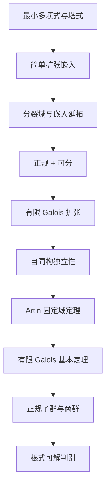

# Galois 理论：从根的嵌入到方程的根式边界

为什么“一个多项式的根可以互换”会变成“中间域与子群反向对应”？真正承担结论的不是一句“对称性”，而是下面一条可逐段检查的证明链。

*图源：本页 Mermaid 源码。箭头是逻辑依赖；例子可以提前算，但不能用一个例子替代一般证明。*

## 建议顺序

1. [[数学/25-高等代数/30-Galois理论/01-代数扩张最小多项式与嵌入延拓|代数扩张、最小多项式与嵌入延拓]]：从 $F[x]/(m_\alpha)$ 证明“嵌入由根决定”，再逐层延拓。
2. [[数学/25-高等代数/30-Galois理论/02-分裂域正规可分与Galois判别|分裂域、正规、可分与 Galois 判别]]：分清“有一个根”“全部根都在”“根互异”三件事，并单列正特征反例。
3. [[数学/25-高等代数/30-Galois理论/03-自同构固定域与Artin定理|自同构、固定域与 Artin 定理]]：完整证明自同构的线性独立及 $[E:E^G]=|G|$。
4. [[数学/25-高等代数/30-Galois理论/04-有限Galois基本定理与正规商群|有限 Galois 基本定理与正规商群]]：证明对应的两个方向，而不把“次数相等”当作显然。
5. [[数学/25-高等代数/30-Galois理论/05-双二次扩张与S3全部对应|双二次扩张与 S₃ 的全部对应]]：把两个群的每个子群、中间域、正规性和商群算完。
6. [[数学/25-高等代数/30-Galois理论/06-根式可解与Galois群边界|根式可解与 Galois 群边界]]：说明单位根、正规闭包和循环扩张为何不能省，并指出特征 $p$ 的断点。
7. [[数学/25-高等代数/30-Galois理论/80-Galois对应有限复算|有限复算]]：只核对 $V_4$、$S_3$ 的有限群格和例中次数，不认证一般定理。

## 两次贯穿检查

- $\mathbb Q(\sqrt2,\sqrt3)$：从塔式得到次数 4；四个符号变换组成 $V_4$；三个二阶子群对应三个二次域，所有子群正规。
- $x^3-2$：$\mathbb Q(\sqrt[3]2)$ 只有一个根，非正规；分裂域 $L=\mathbb Q(\sqrt[3]2,\omega)$ 次数 6，群为 $S_3$；三个二阶子群对应三个非正规三次域，唯一三阶正规子群对应 $\mathbb Q(\omega)$。

读完应能解释同一个现象的三层含义：嵌入把生成元送到共轭根；正规性保证像仍留在原域；固定域定理才把“哪些元素不动”转成精确次数。任何一层缺失，都不能直接写出完整 Galois 对应。

## 来源与范围

主依据是 J. S. Milne, *Fields and Galois Theory*, v5.10（2022）：第 2 章印刷 pp.27–34，第 3 章 pp.35–46，第 5 章 pp.64–77。[作者正式课程笔记入口](https://www.jmilne.org/math/CourseNotes/ft.html)说明版本、章节与许可。本组正文独立组织证明和例题，来源用于核对陈述与依赖，不代替正文。无限 Galois 理论、Krull 拓扑、一般 Kummer 理论和 $A_5$ 单纯性的完整证明不在本组；用到时会明确标出。
