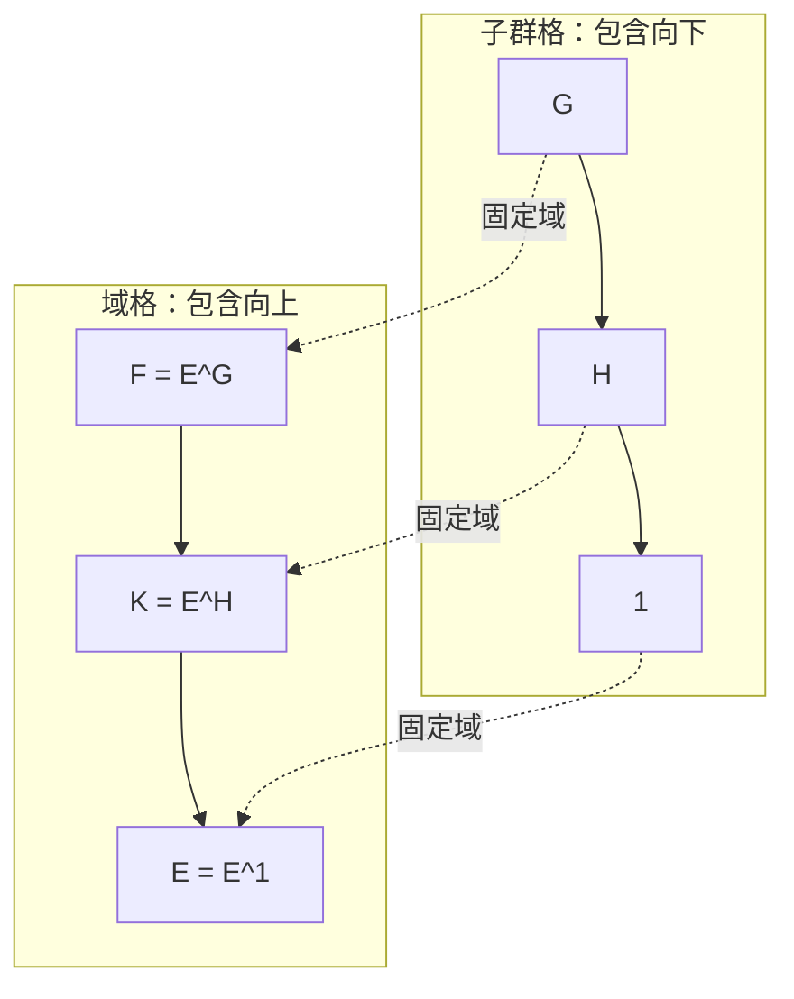

# 有限 Galois 基本定理与正规商群

设 $E/F$ 是有限 Galois 扩张，$G=\operatorname{Gal}(E/F)$。基本定理说
$$K\longmapsto \operatorname{Gal}(E/K),\qquad H\longmapsto E^H$$
在中间域 $F\subset K\subset E$ 与子群 $H\le G$ 之间给出反向一一对应。要证明“一一对应”，必须分别证明从两端走一圈都回到原对象。

## 从子群出发：为什么不会变大

取 $H\le G$，令 $K=E^H$。每个 $h\in H$ 固定 $K$，故
$$H\subseteq\operatorname{Gal}(E/K).$$
Artin 定理直接给
$$[E:K]=[E:E^H]=|H|$$
并且 $\operatorname{Aut}(E/E^H)=H$，所以包含关系其实是等号：
$$\operatorname{Gal}(E/E^H)=H.$$
这一步正是固定域次数定理承担的工作；没有它，“显然没有更多自同构”并不成立。

## 从中间域出发：为什么不会变大

取 $F\subset K\subset E$。因为 $E/F$ 是某个可分多项式 $f\in F[x]$ 的分裂域，视 $f$ 为 $K[x]$ 多项式后仍可分，而 $E$ 仍由它的根生成，所以 $E/K$ 也是有限 Galois。令
$$H=\operatorname{Gal}(E/K).$$
Galois 判别与 Artin 定理给 $|H|=[E:K]$，同时 $K\subseteq E^H$。再比较次数：
$$[E:E^H]=|H|=[E:K].$$
有限塔式迫使 $E^H=K$。至此两个复合都是恒等，双射成立。

包含方向反转也不需要猜：$K_1\subset K_2$ 时，固定更大域的自同构条件更严，故
$$\operatorname{Gal}(E/K_1)\supset\operatorname{Gal}(E/K_2).$$
相应次数公式为
$$[E:E^H]=|H|,\qquad [E^H:F]=[G:H].$$
[Milne，Theorem 3.17，印刷 pp.39–42](https://www.jmilne.org/math/CourseNotes/FT.pdf#page=40)

## 共轭把子群与中间域一起移动

对 $\sigma\in G$，直接逐元素检查：$x\in E^H$ 当且仅当每个 $h\in H$ 固定 $x$。于是对每个 $h$，
$$(\sigma h\sigma^{-1})(\sigma x)=\sigma(hx)=\sigma x,$$
故 $\sigma(E^H)\subset E^{\sigma H\sigma^{-1}}$；对 $\sigma^{-1}$ 做同样论证得到反向包含。因此
$$\boxed{\sigma(E^H)=E^{\sigma H\sigma^{-1}}}.$$
这条等式把“子群正规”准确翻译成“中间域被所有 $F$-自同构保持”。

## 正规子群为何给出商群

令 $K=E^H$。若 $H\triangleleft G$，上式给 $\sigma(K)=K$，所以每个 $\sigma\in G$ 可限制为 $K$ 的 $F$-自同构。得到群同态
$$\rho:G\to\operatorname{Gal}(K/F),\qquad \sigma\mapsto\sigma|_K.$$
其核恰为固定 $K$ 的元素，即 $H$。还需证明满射：任意 $\tau\in\operatorname{Gal}(K/F)$ 先由有限嵌入延拓定理延到 $E\hookrightarrow\overline F$；$E/F$ 正规使延拓像仍是 $E$，故它属于 $G$，并限制回 $\tau$。第一同构定理于是给
$$\operatorname{Gal}(K/F)\cong G/H.$$

反过来，若 $K/F$ 正规，则任意 $\sigma\in G$ 的限制把 $K$ 送回 $K$；故 $\sigma(K)=K$，共轭公式给 $E^{\sigma H\sigma^{-1}}=E^H$。对应的单射性迫使 $\sigma H\sigma^{-1}=H$，所以 $H$ 正规。

因此
$$K/F\text{ Galois}\iff H\triangleleft G,$$
其中可分性由 $E/F$ 向中间扩张继承。**普通子群也对应中间域；只有正规子群才允许把 $G/H$ 当群，并对应底层 Galois 扩张。**

*图源：本页 Mermaid 源码。子群格箭头从大子群指向小子群，域格箭头从小域指向大域；对应虚线展示次序反转。*

## 不能删掉“有限 Galois”

- 若 $E/F$ 有限但不正规，例如 $\mathbb Q(\sqrt[3]2)/\mathbb Q$，自同构群平凡；它唯一的子群无法同时编码底域与顶域这两个不同的中间域。
- 若 $E/F$ 正规但不可分，例如 $\mathbb F_p(t)/\mathbb F_p(t^p)$，自同构群仍平凡，次数却为 $p$。
- 若扩张无限，必须把子群换成 Krull 拓扑中的闭子群；普通抽象子群可能与其闭包有同一固定域。这里的有限证明没有覆盖该情形。

## 练习与完整答案

**题。** 设 $E/F$ 有限 Galois，$H_1\subset H_2\le G$，相应固定域为 $K_i=E^{H_i}$。证明 $[K_1:K_2]=[H_2:H_1]$。若 $H_1\triangleleft H_2$，还可得到哪个 Galois 群？

> [!question]- 解答
> 反向对应给 $K_2\subset K_1$。Artin 次数公式与塔式给
> $$[K_1:K_2]=\frac{[E:K_2]}{[E:K_1]}=\frac{|H_2|}{|H_1|}=[H_2:H_1].$$
> 把顶层底域改看作 $K_2$，扩张 $E/K_2$ 的 Galois 群是 $H_2$；其中间域 $K_1$ 对应 $H_1$。若 $H_1\triangleleft H_2$，正规商群结论给 $K_1/K_2$ Galois 且
> $$\operatorname{Gal}(K_1/K_2)\cong H_2/H_1.$$
> 只知道 $H_1\triangleleft G$ 或 $H_2\triangleleft G$ 不是这一步的精确条件；需要的是 $H_1$ 在 $H_2$ 中正规。

下一课把定理的每个节点在两个例子中全部列出：[[数学/25-高等代数/30-Galois理论/05-双二次扩张与S3全部对应|双二次扩张与 $S_3$ 全对应]]。
