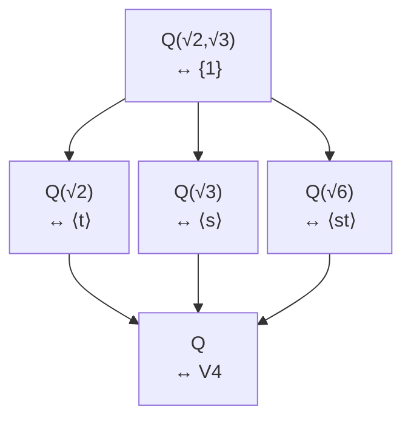
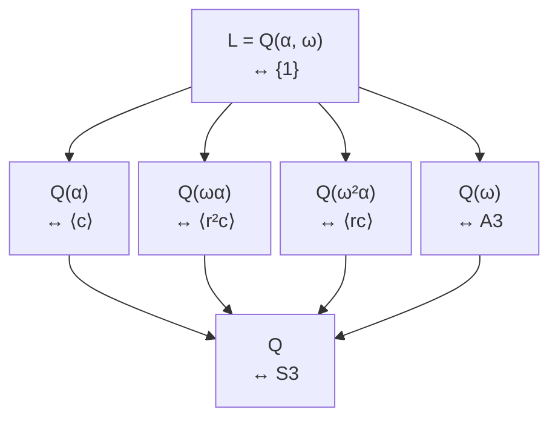

# 双二次扩张与 $S_3$ 的全部对应

基本定理学会与否，最直接的检验是：给定分裂域，能否不漏、不重地列出全部中间域，并从子群正规性判断哪些子扩张 Galois。本课完成两个最小而互补的格：阿贝尔的 $V_4$ 与非阿贝尔的 $S_3$。

## 例一：$\mathbb Q(\sqrt2,\sqrt3)$ 的全部中间域

令 $E=\mathbb Q(\sqrt2,\sqrt3)$。已知次数 4，并有两个变号
$$s(\sqrt2)=-\sqrt2,\ s(\sqrt3)=\sqrt3;\qquad
t(\sqrt2)=\sqrt2,\ t(\sqrt3)=-\sqrt3.$$
它们交换且都为二阶，故
$$G=\{1,s,t,st\}\cong C_2\times C_2.$$
群的子群只有 $G$、三个二阶子群、平凡群。逐项固定：

| 子群 $H$ | 固定域 $E^H$ | 次数 $[E^H:\mathbb Q]$ | $H\triangleleft G$？ |
| --- | --- | ---: | --- |
| $G$ | $\mathbb Q$ | 1 | 是 |
| $\langle s\rangle$ | $\mathbb Q(\sqrt3)$ | 2 | 是 |
| $\langle t\rangle$ | $\mathbb Q(\sqrt2)$ | 2 | 是 |
| $\langle st\rangle$ | $\mathbb Q(\sqrt6)$ | 2 | 是 |
| $\{1\}$ | $E$ | 4 | 是 |

例如 $st$ 固定 $a+b\sqrt2+c\sqrt3+d\sqrt6$ 当且仅当 $b=c=0$。表已穷尽子群，所以也穷尽中间域；“似乎还可以加入 $\sqrt2+\sqrt3$”不会产生新域，因为它已经生成整个 $E$。所有子群正规，故三个二次中间域对 $\mathbb Q$ 都 Galois，群均为 $C_2$。

*图源：本页 Mermaid 源码。实线是域包含；节点右侧同时标相应固定子群。*

## 例二：$x^3-2$ 的分裂域为何是 $S_3$

令 $\alpha=\sqrt[3]2>0$、$\omega^2+\omega+1=0$，$L=\mathbb Q(\alpha,\omega)$。Eisenstein 给 $[\mathbb Q(\alpha):\mathbb Q]=3$；实域不含非实的 $\omega$，第二层次数 2，因此 $[L:\mathbb Q]=6$。

定义
$$r(\alpha)=\omega\alpha,\quad r(\omega)=\omega;\qquad
c(\alpha)=\alpha,\quad c(\omega)=\omega^2.$$
这里 $[L:\mathbb Q(\omega)]=3$，而 $\alpha$ 满足 $x^3-2$，所以该三次式就是 $\alpha$ 在 $\mathbb Q(\omega)$ 上的最小多项式。简单扩张嵌入引理因此保证固定 $\omega$ 且把 $\alpha$ 送到另一根 $\omega\alpha$ 的 $r$ 良定义；$c$ 是复共轭在 $L$ 上的限制。$r$ 循环三个根，$c$ 交换后两个根，满足
$$r^3=c^2=1,\qquad crc=r^{-1}.$$
它们生成至少六个不同自同构 $1,r,r^2,c,rc,r^2c$；次数上界又是 6，所以已是全部，$G\cong S_3$。

## 六个子群对应六个中间域

$S_3$ 的子群恰为：全群、$A_3=\langle r\rangle$、三个换位子群、平凡群。三个换位各固定一个三次根：

- $c$ 固定 $\alpha$，交换 $\omega\alpha$ 与 $\omega^2\alpha$；
- $rc$ 固定 $\omega^2\alpha$，交换另外两根；
- $r^2c$ 固定 $\omega\alpha$。

因此完整表为：

| 子群 $H$ | 固定域 $L^H$ | $[L^H:\mathbb Q]=[G:H]$ | 正规？ |
| --- | --- | ---: | --- |
| $S_3$ | $\mathbb Q$ | 1 | 是 |
| $A_3=\langle r\rangle$ | $\mathbb Q(\omega)=\mathbb Q(\sqrt{-3})$ | 2 | 是 |
| $\langle c\rangle$ | $\mathbb Q(\alpha)$ | 3 | 否 |
| $\langle rc\rangle$ | $\mathbb Q(\omega^2\alpha)$ | 3 | 否 |
| $\langle r^2c\rangle$ | $\mathbb Q(\omega\alpha)$ | 3 | 否 |
| $\{1\}$ | $L$ | 6 | 是 |

为什么 $L^{\langle r\rangle}=\mathbb Q(\omega)$？右侧显然被 $r$ 固定，且 $[L:\mathbb Q(\omega)]=3=|\langle r\rangle|$，Artin 次数迫使没有更大固定域。三个三次域相互共轭而不相等；若 $\mathbb Q(\alpha)$ 正规，它应包含另两个共轭根，但它是实域。

只有 $\{1\},A_3,S_3$ 正规，所以对 $\mathbb Q$ Galois 的中间扩张只有 $L$、$\mathbb Q(\omega)$、$\mathbb Q$。限制同态给
$$\operatorname{Gal}(\mathbb Q(\omega)/\mathbb Q)\cong S_3/A_3\cong C_2.$$
不能写 $S_3/\langle c\rangle$：分母不正规，陪集集合存在，但商群乘法不良定义。

*图源：本页 Mermaid 源码。三条三次域分支对应三个互相共轭的二阶子群；二次域分支对应唯一的三阶正规子群。*

## 完整题解：给出一个元素，反推出固定群

**题。** 在 $L$ 中令 $\beta=\alpha+\omega\alpha+\omega^2\alpha$。求 $\beta$；再令 $\gamma=\alpha+\omega^2\alpha$，求哪些群元素固定 $\gamma$，并由此判断 $\mathbb Q(\gamma)$ 的次数。

> [!question]- 解答
> 因 $1+\omega+\omega^2=0$，$\beta=0$；它不生成任何新域，说明“把全部根相加”可能只回到底域。对 $\gamma=\alpha(1+\omega^2)=-\omega\alpha$，它与 $\omega\alpha$ 只差非零有理倍数 $-1$，故生成同一个三次域 $\mathbb Q(\omega\alpha)$。从上表知其固定群是 $\langle r^2c\rangle$。也可直接算：$r^2c$ 固定根 $\omega\alpha$，从而固定 $\gamma$；其余非单位元素不固定该根。固定群阶2，故 $[\mathbb Q(\gamma):\mathbb Q]=[S_3:\langle r^2c\rangle]=3$。

## 改变假设的反例

把 $x^3-2$ 换成 $x^3-3x+1$。它在 $\mathbb Q$ 上无有理根，故不可约；判别式为 $81=9^2$，是平方，其 Galois 群落在 $A_3$，事实上为 $C_3$。三个实根生成的分裂域次数为3，群格只有一个非平凡层。由此可见“不可约三次式的 Galois 群总是 $S_3$”错误；还要检查判别式是否为平方（这一判别的完整证明见 Milne 第4章印刷 pp.47–50，本页仅用于改变条件的例子）。

用 [[数学/25-高等代数/30-Galois理论/80-Galois对应有限复算|有限复算]] 可枚举这里的子群、正规性和指数；域的识别仍由上述手算承担。
