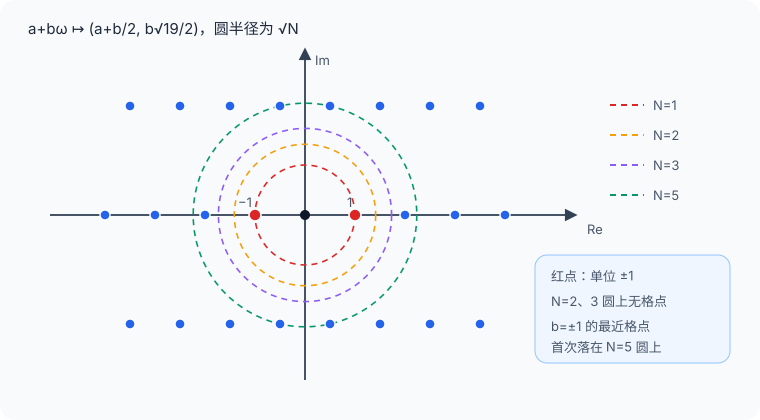

# 负十九二次整数环与理想类

令
$$
\begin{gathered}
K=\mathbb Q(\sqrt{-19}),\\
\omega=\frac{1+\sqrt{-19}}2.
\end{gathered}
$$
Minkowski 定理谈的是**数域的整数环**，所以第一步不能先把 $\mathbb Z[\omega]$ 当作整数环使用；我们先证明它确实收集了 $K$ 中全部代数整数。

## 整数环为什么恰好是 $\mathbb Z[\omega]$

$\omega$ 满足首一整系数方程
$$
\omega^2-\omega+5=0,
$$
所以 $\mathbb Z[\omega]$ 中每个元素都是代数整数。反向取任意代数整数
$$
\begin{gathered}
\alpha=x+y\sqrt{-19}\in K,\\
x,y\in\mathbb Q.
\end{gathered}
$$
代数整数的迹与范数既是有理数又是代数整数，因而是整数。记
$$
\begin{gathered}
m=\operatorname{Tr}_{K/\mathbb Q}(\alpha)=2x\in\mathbb Z,\\
n=N_{K/\mathbb Q}(\alpha)=x^2+19y^2\in\mathbb Z.
\end{gathered}
$$
若 $y=p/q$ 已约分，则
$$
-76\frac{p^2}{q^2}=m^2-4n\in\mathbb Z.
$$
因此 $q^2\mid76$；$19$ 平方自由，故 $q=1$ 或 $2$，即 $t=2y\in\mathbb Z$。于是
$$
\begin{gathered}
\alpha=\frac{m+t\sqrt{-19}}2,\\
n=\frac{m^2+19t^2}{4}\in\mathbb Z.
\end{gathered}
$$
模 $4$ 看平方只可能为 $0$ 或 $1$，上式迫使 $m,t$ 同奇偶。若都偶，则 $\alpha\in\mathbb Z[\sqrt{-19}]$；若都奇，则
$$
\alpha=\frac{m-t}{2}+t\omega\in\mathbb Z[\omega].
$$
故
$$
\mathcal O_K=\mathbb Z[\omega].
$$
这里使用了两个标准事实：代数整数对加法、乘法封闭；有理代数整数只有整数。它们属于代数整数的一般理论，而分母与奇偶性的收束已在本例中展开。

## 元素范数与格点

每个元素唯一写成 $a+b\omega$，$a,b\in\mathbb Z$。共轭 $\bar\omega=1-\omega$，所以
$$
\begin{aligned}
N(a+b\omega)&=(a+b\omega)(a+b\bar\omega)\\
&=a^2+ab+5b^2\\
&=\left(a+\frac b2\right)^2+\frac{19b^2}{4}.
\end{aligned}
$$
它是非负整数，且只在元素为 $0$ 时为 $0$；乘法性来自域范数。若 $b\ne0$，则 $N(a+b\omega)\ge5$；若 $b=0$，范数为 $a^2$。于是单位的范数必须为 $1$，并且本环单位恰为 $\pm1$。

把 $K$ 嵌入 $\mathbb C$，$a+b\omega$ 对应格点
$$
\left(a+\frac b2,\frac{\sqrt{19}}2b\right),
$$
元素范数就是到原点距离的平方。下图显示为什么单位只有 $\pm1$，以及为什么找不到元素范数 $2$ 或 $3$；图只是公式的可视化，不承担证明。

## 判别式是 $-19$

基 $1,\omega$ 的迹矩阵为
$$
\begin{pmatrix}
\operatorname{Tr}(1)&\operatorname{Tr}(\omega)\\
\operatorname{Tr}(\omega)&\operatorname{Tr}(\omega^2)
\end{pmatrix}
=
\begin{pmatrix}2&1\\1&-9\end{pmatrix},
$$
因为 $\omega^2=\omega-5$。所以
$$
\Delta_K=\det\begin{pmatrix}2&1\\1&-9\end{pmatrix}=-19.
$$
这个数将直接进入 Minkowski 常数，不能用多项式判别式而不先确认 $1,\omega$ 是整数基。

## 三个名称相近、对象不同的范数

1. **域范数** $N_{K/\mathbb Q}(\alpha)=\alpha\bar\alpha$ 可取正负；本例为非负。正文简写为 $N(\alpha)$。
2. 非零**整理想范数**
   $$N(I)=[\mathcal O_K:I]=|\mathcal O_K/I|$$
   是正整数。
3. 对主理想，二者相接：
   $$N((\alpha))=|N_{K/\mathbb Q}(\alpha)|.$$

第三式不是符号巧合：乘以 $\alpha$ 在整数格上给出一个整矩阵，它的行列式绝对值同时计算像格的指数与域范数。一般分式理想的范数取正有理数，并满足
$$
\begin{gathered}
N(IJ)=N(I)N(J),\\
N(I^{-1})=N(I)^{-1}.
\end{gathered}
$$

## 理想类把“每个理想是否主生成”装进一个群

这里调用一般定理：**数域的整数环是 Dedekind 整环**，因此每个非零分式理想都有乘法逆。全体非零分式理想组成群，主分式理想组成子群；商群
$$
\operatorname{Cl}(\mathcal O_K)
=\frac{\{\text{非零分式理想}\}}{\{\text{非零主分式理想}\}}
$$
称理想类群。一个类 $[I]$ 是把所有相差主分式理想的理想放在一起：$[I]=[J]$ 当且仅当 $I=(\alpha)J$ 对某个 $\alpha\in K^\times$ 成立。

若类群只有单位类，则每个非零整理想都是主理想；零理想本来就是 $(0)$，所以整数环是 PID。反之 PID 使所有非零分式理想也主生成。故本例的正向目标精确变为
$$
\operatorname{Cl}(\mathcal O_K)=1.
$$

Milne 的 *Algebraic Number Theory* Chapter 2 给出整数环理论，Chapter 3 pp.47–55 给出 Dedekind 整环、分式理想群与理想类群；MIT 18.785 Lecture 14 p.5 把理想范数写成指数并给出主理想范数公式。下一课只把这些一般工具按本例所需的最小形式使用。

一般理想语言可继续 [[数学/25-高等代数/60-交换代数与代数几何/02-局部化分母与局部环#素理想的局部化：恰有一个极大理想|素理想局部化]] 与 [[数学/25-高等代数/60-交换代数与代数几何/04-坐标环反变与曲线参数化#整性怎样解释这次参数化的收益与代价|整性与尖点正规化]]：局部化指定可逆分母，整闭包指定分式域中满足首一关系的元素。本页数域整数环成为 PID 仍需下一课的理想类界；不能从“整闭”直接推出所有理想主生成。
