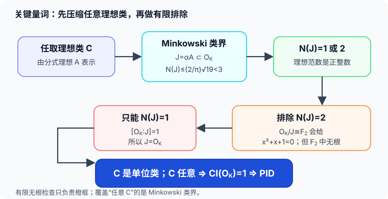

# Minkowski 界如何推出 PID

有限枚举“小范数理想”本身回答不了任意理想 $A$。缺少的桥是：**每一个理想类都有一个受统一上界控制的整理想代表**。Minkowski 理想类界正好给出这句话。

## 调用的一般定理

设 $K$ 是次数 $n=r+2s$ 的数域，$r$ 个实嵌入、$s$ 对复嵌入，整数环判别式为 $\Delta_K$。Minkowski 常数为
$$
M_K=\frac{n!}{n^n}\left(\frac4\pi\right)^s\sqrt{|\Delta_K|}.
$$
**Minkowski 理想类界：**每个理想类都含有整理想 $J$，满足
$$
N(J)\le M_K.
$$

MIT 18.785 Lecture 14, Theorems 14.13 与 14.15，印刷 pp.5–7 给出定理及证明。为看清量词如何传递，记任意类由非零分式理想 $A$ 表示。Theorem 14.13 应用于 $A^{-1}$，给出非零 $\alpha\in A^{-1}$，使
$$
|N_{K/\mathbb Q}(\alpha)|\le M_KN(A^{-1})=\frac{M_K}{N(A)}.
$$
令 $J=\alpha A$。因为 $\alpha\in A^{-1}$，所以 $J\subseteq\mathcal O_K$ 是整理想；它仍在类 $[A]$ 中，且
$$
N(J)=|N_{K/\mathbb Q}(\alpha)|N(A)\le M_K.
$$
这一步才允许后面只检查有限个小范数；它先覆盖了**任意** $[A]$。

## 本例的界严格小于 $3$

对 $K=\mathbb Q(\sqrt{-19})$，有 $n=2,r=0,s=1,\Delta_K=-19$，故
$$
M_K=\frac{2!}{2^2}\frac4\pi\sqrt{19}
=\frac2\pi\sqrt{19}\approx2.7750<3.
$$
甚至不用小数也能确认最后一个不等式：$\pi>3$，所以
$$
M_K<\frac{2\sqrt{19}}3<3,
$$
后一个不等式平方后就是 $76<81$。

理想范数是正整数。因此每个理想类都有一个整理想 $J$，且
$$
N(J)\in\{1,2\}.
$$

## 范数 $1$ 的理想就是全环

$N(J)=[\mathcal O_K:J]=1$ 表示 $J=\mathcal O_K$。它代表类群单位元。所以只需证明不存在范数 $2$ 的理想。

## 模 $2$ 的多项式排除范数 $2$ 理想

假设 $N(J)=2$。商环 $\mathcal O_K/J$ 有两个元素，因而同构于 $\mathbb F_2$。商映射把 $\omega$ 送到某个 $x\in\mathbb F_2$；因为
$$
\omega^2-\omega+5=0,
$$
$x$ 必须满足
$$
x^2+x+1=0\quad\text{于 }\mathbb F_2.
$$
但代入 $x=0,1$ 都得到 $1$，无根，矛盾。因此不存在范数 $2$ 的整理想。

也可以把这一步读成：$X^2-X+5$ 在 $\mathbb F_2[X]$ 不可约，所以素数 $2$ 在二次整数环中惰性；本证明只需“无根”这一特殊情形，不依赖完整的 Dedekind–Kummer 分解定理。

数论后续 [[数学/28-数论/05-整数环理想与素数分裂#三个素数，三种机制|三个商环]] 用同一个模2不可约式证明(2)为素理想、剩余域四元，继而与5的两个不同求值核、19的一个平方零方向对照。这里排除的是范数2理想，不能误读成没有2上方的素理想；实际(2)范数是4。返回本页时，PID仍由对任意理想类的Minkowski界承担，不能把后面的有限分裂表当作替代证明。

## 把量词收回来

现在回到任意理想类 $C$：

1. Minkowski 界给 $C$ 中某个整理想 $J$，$N(J)\le2$；
2. 范数 $2$ 已排除，所以 $N(J)=1$；
3. 因而 $J=\mathcal O_K$，故 $C$ 是单位类。

$C$ 任意，所以 $\operatorname{Cl}(\mathcal O_K)=1$。第 01 课的理想类判据遂给出
$$
\boxed{\mathcal O_K=\mathbb Z\left[\frac{1+\sqrt{-19}}2\right]\text{ 是 PID}.}
$$

## 为什么单纯枚举不够

若只写“我查过范数 $1,2$ 的理想”，逻辑上仍可能有一个非主理想，其所在类的所有代表范数都大于 $2$。Minkowski 界排除的正是这个可能：它不是在小范围中找规律，而是先把每个类都送进这个小范围。程序复算能够检查 $2.7750<3$ 和模 $2$ 无根，却不能代替这一一般定理。
