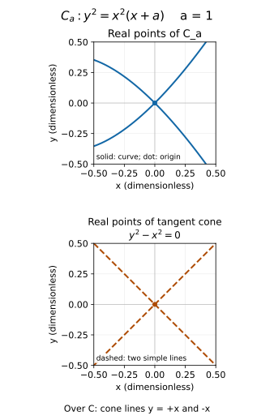
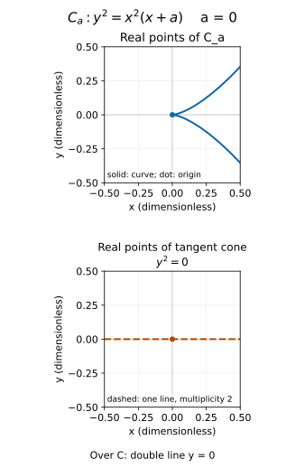
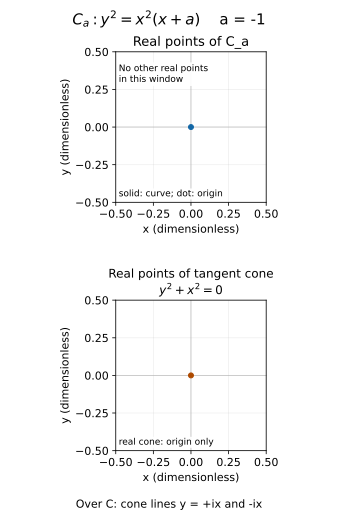

# 局部环、切空间与曲线奇点

梯度为零首先说明一组一阶方程退化。要把它解释为对象的奇点，还必须确定底域、约化理想和局部维数。以同一横轴写 $y$ 或 $y^2$，能立即检验这些前提是否被遗漏。

## 方程、理想与切空间

给 $A=k[x_1,\ldots,x_n]/I$、$a\in V_k(I)$，定义该呈示在 $a$ 的代数切空间

$$T_a(A)=\{v\in k^n:\sum_i(\partial_i f)(a)v_i=0\ \forall f\in I\}.$$

若 $I=(f_1,\ldots,f_r)$，只需这些生成元：对 $f=\sum h_j f_j$，乘积微分在 $a$ 处给 $df_a=\sum h_j(a)(df_j)_a$，因为 $f_j(a)=0$。所以切空间是 $r\times n$ Jacobian 矩阵 $J(a)$ 的核，维数 $n-\operatorname{rank}_kJ(a)$；不依赖**同一理想**的生成集。这不是说相同零点的所有方程组都等价。

取 $k=\mathbb R$ 或 $\mathbb C$，$I=(y),J=(y^2)$、$a=(c,0)$。前者 Jacobian $(0,1)$，切空间横轴；后者 $(0,2y)|_a=(0,0)$，切空间整平面。后者算的是非约化环 $k[x,y]/(y^2)$，含一阶幂零方向。约化横轴的坐标环应为 $k[x,y]/(y)$，不能宣称“同一条直线有两种几何奇点判断”。

对几何点集 $X$，采用 $I=I_k(X)$ 后才记 $T_aX$。代数闭域上这等于取原理想的根；非代数闭域必须重新区分 $k$-点集的消失理想与原来的代数对象。例如实方程 $x^2+y^2=0$ 的实点集只有原点，而其商环是维数 1 的整环，不能用实点图的维数替换代数维数。

## 局部环怎样给内在切空间

点的极大理想 $\mathfrak m=\{f\in A:f(a)=0\}$，剩余域 $A/\mathfrak m=k$。一阶坐标组成 $\mathfrak m/\mathfrak m^2$，其对偶

$$T_a(A)\cong\operatorname{Hom}_k(\mathfrak m/\mathfrak m^2,k).$$

证明：$v$ 给线性泛函 $[f]\mapsto df_a(v)$；乘积两因子在点消失，其微分为零，所以确实杀掉 $\mathfrak m^2$。反向，$x_i-a_i$ 的类生成 $\mathfrak m/\mathfrak m^2$，泛函在这些类上的值给 $v_i$。多项式按 $x_i-a_i$ 展开，去掉常数和二次以上项，恰得到上述 Jacobian 关系，因此双向互逆。

还可把 $v$ 看成保持常数的同态 $A\to k[\varepsilon]/(\varepsilon^2)$，$f\mapsto f(a)+df_a(v)\varepsilon$；乘积法则保障同态性。这里 $\varepsilon$ 是记录一阶信息的代数元，不是一个足够小的浮点数。

改用局部环 $A_{\mathfrak m}$ 不改变这个向量空间：若 $s(a)\ne0$，对 $u\in\mathfrak m$ 有 $u/s\equiv u/s(a)$ 模 $(\mathfrak m A_{\mathfrak m})^2$，因为差的分子含 $u(s(a)-s)\in\mathfrak m^2$。因此定义是当地函数环的性质，不依赖原先的嵌入坐标。

若 $F:X\to Y$，$F^*$ 将目标点的消失函数拉回源点的消失函数，诱导余切空间反向映射；取对偶即得到向前的 $dF_a:T_aX\to T_{F(a)}Y$，坐标公式仍是 Jacobian 乘列向量。这也解释 [[数学/45-复变函数/30-多复变量与复流形/02-复流形图册切空间与射影直线#切向量和余切向量必须按转换共同变化|复流形切与余切转换]] 中的方向。

## 维数与正则：判断奇点所需的一般合同

Krull 维数是素理想严格包含链的最大长度或上确界，数的是包含之间的间隔：域为 0 维，非域 PID 为 1 维。点的局部维数为 $\dim A_{\mathfrak m}$，由 [[数学/25-高等代数/60-交换代数与代数几何/02-局部化分母与局部环#理想与点的局部信息怎样保留下来|局部化素理想对应]] 可在 $A$ 中数包含于 $\mathfrak m$ 的链。

Noether 局部环称正则，若 $\dim_k\mathfrak m/\mathfrak m^2=\dim A_{\mathfrak m}$。这是标准的等价定义：左边等于极大理想的最小生成元数。理由是任意生成元在商中生成；反向选商的一组基并提升为 $u_i$，商模 $M=\mathfrak m/(u_i)$ 有 $M=\mathfrak m M$，Nakayama 引理使 $M=0$。这项引理的有限模版本可直接证明：取有限生成元 $z_i$，写 $z_i=\sum a_{ij}z_j$、$a_{ij}\in\mathfrak m$；伴随矩阵使 $\det(I-(a_{ij}))$ 杀掉全部 $z_i$，但该行列式模 $\mathfrak m$ 为 1，是局部单位，故全部为零。Noether 性保证所用模有限生成。

在代数闭域上的有限生成坐标环，称点非奇异若其局部环正则。由于切空间公式，一般 Jacobian 判据准确写成

$$a\text{ 非奇异}\iff n-\operatorname{rank}_kJ(a)=\dim A_{\mathfrak m_a}.$$

这里采用实际约化坐标环，不先把“方程个数”当作余维。不同维数分量相交时尤其不能用一项全局维数替代局部维数。正则与光滑在代数闭域有限型对象上的对应可核 [Stacks, Lemma 10.140.2](https://stacks.math.columbia.edu/tag/00TS)；不完美域的正则不自动推出相对底域光滑。例如 $k=\mathbb F_p(s)$，域 $k[t]/(t^p-s)$ 是 0 维正则环，但在代数闭扩张后变成 $(t-s^{1/p})^p$ 的非约化商。域条件是性质的一部分。

一个常用外部维数定理的**输入**为有限生成 $k$-代数整环 $A$，**输出**为 $\dim A=\operatorname{trdeg}_k\operatorname{Frac}(A)$，且每个极大点局部维数相同，见 [Stacks, Lemma 10.116.1](https://stacks.math.columbia.edu/tag/00P0)。它的标准证明经 Noether 正规化及整扩张的素链。下面曲线的维数不只引用这个名称，而作直接证明。

## 为什么下面两条曲线局部都一维

设 $A$ 为整环，包含 $k[x]$，且有限于 $k[x]$。对任意非零素理想 $P\subset A$，选 $0\ne a\in P$。$a$ 在 $\operatorname{Frac}(A)$ 中代数于 $k(x)$，取其最小方程并清分母，得到

$$c_d(x)a^d+\cdots+c_1(x)a+c_0(x)=0,\qquad c_0\ne0.$$

常数项非零因为 $a\ne0$、最小多项式不被 $T$ 整除。于是 $0\ne c_0\in P\cap k[x]$。$A/P$ 为有限维 $k$-向量空间且是整环，所以每个非零元的乘法为有限维单射、因而满射，存在逆；故 $P$ 极大。任何非零极大理想 $\mathfrak m$ 以下只有 $(0)$ 这一素理想，链 $(0)\subsetneq\mathfrak m$ 给局部维数 1。

尖点 $A=k[t^2,t^3]$ 是整环，以 $x=t^2,y=t^3$ 表示，关于 $k[x]$ 由 $1,y$ 生成。节点 $A=k[x,y]/(y^2-x^2-x^3)$ 也关于 $k[x]$ 由 $1,y$ 生成；它是整环（此处特征 0）：$x^2(1+x)$ 不是 $k(x)$ 的平方，因为不可约因子 $1+x$ 的指数为奇数，所以首一二次式在 $k(x)[y]$ 不可约，Gauss 引理降到 $k[x,y]$。因此上段证明适用于所有曲线上极大点，特别是原点。这兑现了判断奇点实际使用的维数前提。

## 尖点与节点：切空间一样，分支不同

以下 $k=\mathbb C$，绘图时可看实部分。尖点 $f=y^2-x^3$，

$$J_f=(-3x^2,2y).$$

原点秩 0，切空间为 $k^2$，大于局部维数 1，所以奇异；其他点至少一个偏导非零，切空间 1 维，故非奇异。最低非零齐次项是 $y^2$，切锥为重横轴。切空间只保留一次项，而切锥还记第一层非零的高阶关系。

节点 $g=y^2-x^2-x^3$，$J_g=(-2x-3x^2,2y)$。原点同样切空间二维，但最低项 $y^2-x^2=(y-x)(y+x)$ 给两条不同切线。参数化

$$x=t^2-1,\qquad y=t(t^2-1)$$

在 $t=1$ 与 $t=-1$ 都映到原点；各导数分别 $(2,2)$、$(-2,2)$ 非零，指向两条分支。参数化没有在每支退化，却仍存在内在节点。若删去“特征 0”，特征 2 会使两条锥线合并，这个节点解释必须重做。

## 同一曲线族：先预测，再区分所见对象

**先停在这里作预测。** 把现有节点和尖点放进同一族 $C_a:y^2=x^2(x+a)$，依次取 $a=1,0,-1$。只知道原点的 Jacobian 是零行，能分辨哪一个是尖点、哪一个有两条不同切线吗？若 $a=-1$ 的实图只剩一点，能否判断当地代数环是零维？先写下理由，再往下核对。

这里坐标 $x,y$ 与参数 $a$ 都无量纲。代数对象明确取

$$A_{a,k}=k[x,y]/(F_a),\quad F_a=y^2-x^3-ax^2,\quad k=\mathbb R\text{ 或 }\mathbb C,\quad \mathfrak m=(\bar x,\bar y),\quad \mathcal O_{a,k}=(A_{a,k})_{\mathfrak m}.$$

图只显示 $C_a(\mathbb R)$ 和切锥的**实点**。它没有画 $T_0(C_a\text{ over }\mathbb C)=\mathbb C^2$：这个切空间是复二维（实四维）的向量空间，不是纸上的实二维平面。对 $k=\mathbb R$，$T_0(A_{a,k})=\mathbb R^2$ 也只是一阶代数切空间，不能自动当成实点轨迹的切向量集合。

### 图卡与一阶、首项的对照

三张图采用同一正方形窗口 $-1/2\le x,y\le1/2$、横纵等比例。上框蓝实线是曲线的实点，下框橙虚线是切锥的实点；圆点标原点。重横轴只画一条线，并明确标重数 2；重数来自方程，线宽和颜色不表示测量强度。$a=-1$ 的下框只有实原点，图卡底部文字另列复切线，未把 $\pm ix$ 伪画成实分支。

$a=1$：原点附近两条实解析分支为 $y=\pm x\sqrt{1+x}$，各穿过原点；去掉原点后有四个半支。切锥抓住这两支的不同初始方向。

$a=0$：尖点参数 $(t^2,t^3)$ 给一条实解析分支，去掉原点有上下两个半支；它们同向贴近横轴。切锥保留双重横轴关系，切空间却仍是整个 $k^2$。

$a=-1$：窗口内 $x-1<0$，而 $y^2=x^2(x-1)$；实数平方非负，故只能 $x=y=0$。窗口外 $x\ge1$ 仍有实点，截图也未给完整实点集。复数域没有“平方非负”这个论据，$y^2+x^2=(y-ix)(y+ix)$ 有两条不同复切线。

| $a$；定义理想均为 $(F_a)$ | 底域 $k$ | $\dim\mathcal O_{a,k}$ | 原点 Jacobian 核 | 最低齐次项 / 切锥 | 实点集在原点附近 |
| --- | --- | --- | --- | --- | --- |
| $1$ | $\mathbb R$ 或 $\mathbb C$ | $1$ | $k^2$，维数 $2$ | $y^2-x^2$；两条简单线 $y=\pm x$ | 局部实维数 $1$；两条相交解析分支 |
| $0$ | $\mathbb R$ 或 $\mathbb C$ | $1$ | $k^2$，维数 $2$ | $y^2$；重横轴 | 局部实维数 $1$；尖点一条解析分支 |
| $-1$ | $\mathbb R$ | $1$ | $\mathbb R^2$，维数 $2$ | $y^2+x^2$；实支撑只有原点 | 孤立点，局部实维数 $0$ |
| $-1$ | $\mathbb C$ | $1$ | $\mathbb C^2$，复维数 $2$ | $(y-ix)(y+ix)$；两条简单复线 | 实截图只显示其满足实坐标的点 |

表中“局部实维数”说的是欧氏邻域中实点集的维数，“局部代数维数”说的是指定局部环的 Krull 维数。$a=-1$ 时若仅把足够小实邻域中的孤立点当作新的点集 $\{0\}$，其消失理想是 $(x,y)$、坐标环是 $\mathbb R$，这是另一个零维对象；不能把这个环替换为 $\mathcal O_{-1,\mathbb R}$。也不要把原点附近点集的消失理想误当完整实曲线的消失理想。

### 从同一方程复算表格

直接求导得 $J_{F_a}=(-3x^2-2ax,2y)$，原点为零行，对全部 $a$ 只告诉我们 $T_0(A_{a,k})=k^2$。$F_a$ 没有一次项，因此在 $\mathfrak m/\mathfrak m^2$ 里还没有线性关系；取最低非零齐次项，则 $a\ne0$ 时为 $y^2-ax^2$，$a=0$ 时为 $y^2$。在这里的平面主理想情形，乘 $F_a$ 的任何非零局部函数，其首项是两者首项的积，所以关联分次环是 $k[x,y]/(y^2-ax^2)$（$a=0$ 时为 $k[x,y]/(y^2)$）。切锥由这个首项理想给出，含重数信息，不能只取它的点集。

局部维数使用前面已有的直接证明：$A_{a,k}$ 关于 $k[x]$ 仍由 $1,y$ 有限生成；对这里两个底域及任意 $a$，$x^2(x+a)$ 在 $k(x)$ 不是平方，因为 $x+a$ 是一次因子，$a\ne0$ 时指数为 1，$a=0$ 时 $x$ 的总指数为 3。因此 $F_a$ 不可约，商为整环。原点极大理想非零，故 $(0)\subsetneq\mathfrak m$ 的局部素链长度为 1；不能再插入非零非极大的素理想，故 $\dim\mathcal O_{a,k}=1$。切空间二维大于当地环一维，三个原点均非正则；这项判断在图画以前已经成立。

图由方程解成 $y=\pm|x|\sqrt{x+a}$ 采样，仅在 $x+a\ge0$ 画线；$a=1$ 将 $[-1/2,0]$ 与 $[0,1/2]$、上下符号分别绘制，每段 401 点；$a=0$ 只采 $[0,1/2]$，每符号 401 点；$a=-1$ 此窗口没有线段，只精确标原点。数值采样会漏掉更小尺度的细节，不证明所有分支已被发现；原点和实点不存在性的结论来自上面的代数与符号论证。生成入口及自查见 [图的生成与复算说明](../../90-资源/图示/issue228/README.md)。没有图时，上表、首项分解和非负性论证仍能独立完成判断。

### 改变参数，检验预测

1. 不看图，仅给 $J_{F_a}(0)=0$，能否区分 $a=1$、$0$、$-1$？补充哪一层关系才够区分这里的切锥？
2. 给 $a=-1$ 的实截图只有一个点。写明还缺少什么，才能判断 $\mathcal O_{-1,k}$ 的维数与正则性。
3. 将参数改为 $a=1/4$ 与 $a=-1/4$。先预测实切线和原点附近实分支，再复算最低齐次项。负参数时窗口需多小，才能保证只见原点？
4. 同样观察到 $\gamma'(0)=0$，比较 $\gamma(t)=(t^3,0)$ 与 $\nu(t)=(t^2,t^3)$。能否据此宣布两条像曲线都有几何奇点？把答案返回实隐函数定理和机器人 Jacobian 的对象条件。

> [!question]- 预测后的复算答案
> 1. 不能；零行给相同二维核。二次首项分别是 $y^2-x^2$、$y^2$、$y^2+x^2$；还要声明底域，最后一个在 $\mathbb R$ 没有非零实锥点，在 $\mathbb C$ 分成两条线。
> 2. 必须固定底域、理想和局部环，再数素链或使用已证明的一维结论。对 $k=\mathbb R,\mathbb C$，这个商都是整环、原点局部维数 1，切空间维数 2，故当地环非正则。实截图的零维只属于局部实点集。把对象改成孤立点的消失理想 $(x,y)$ 才会得到零维正则环，不能悄悄换对象。
> 3. $a=1/4$ 给 $y^2-x^2/4=(y-x/2)(y+x/2)$，两条实切线斜率 $\pm1/2$，局部两条实解析分支。$a=-1/4$ 给 $y^2+x^2/4$，只有实原点，复切线 $y=\pm ix/2$。取 $|x|<1/4$，便有 $x-1/4<0$，确保实点只有原点；若沿用 $|x|\le1/2$，会看到 $x\ge1/4$ 的远处实点，不能说整个窗口只有一点。两者当地代数维数仍为 1，一阶切空间维数仍为 2。
> 4. 横轴采用约化环 $\mathbb R[x]$，原点是一维正则点；只是 $t^3$ 参数在此退化。尖点采用 $\mathbb R[x,y]/(y^2-x^3)$，局部一维而切空间二维，是当地环非正则。返回 [[数学/16-数学分析/11-多元微分逆映射与隐函数定理#隐函数是把部分坐标固定的逆映射|隐函数定理的可逆分块条件]]：退化只说明该充分条件失效；返回 [[AI/45-机器人与具身智能/01-坐标变换与平面运动学#差速轮是另一种模型|机器人状态、输入与约束]]：先辨明从什么变量到什么任务量、Jacobian 的 shape 和实际约束，曲线参数速度的观察不足以判机械臂。一般流形与真实机械臂后续分别由 #155、#164 承接，本图不替它们作实机或一般理论验收。

再到 [[数学/25-高等代数/60-交换代数与代数几何/06-齐次坐标射影闭包与无穷远#坐标图不等于有效相机观测|坐标图与实际观测]] 检查同一边界：这里实截图只取实坐标和有限窗口；那里还要核所选代表、裁剪和深度。写清丢掉了什么信息，才能说明“看不见”究竟来自对象还是观测。

## 参数导数为零，不是几何奇点的定义

尖点 $\nu(t)=(t^2,t^3)$ 在 0 导数为零，且前面已独立证明其当地环非正则。对实光滑横轴用退化参数化 $\gamma(t)=(t^3,0)$，在 0 同样导数零；但横轴的约化环 $\mathbb R[x]$ 在原点为一维正则局部环，点集是光滑直线。它甚至点上一一，只是这个参数的逆在零点不可微。曲线与某个参数化的性质必须分开。

回访 [[数学/16-数学分析/11-多元微分逆映射与隐函数定理#隐函数是把部分坐标固定的逆映射|隐函数定理]]：对 $C^1$ 实约束、$D_yF$ 可逆，确能得到局部图像，且切空间是该满秩导数的核。秩下降只让这个充分条件不能使用；$y^2=0$ 和 $t^3$ 已给两个不同失败来源。在 [[AI/45-机器人与具身智能/01-坐标变换与平面运动学#差速轮是另一种模型|机器人模型边界]] 中也要区分机构真实约束、所选任务映射与参数坐标；本课曲线例并不证明某个机械臂已经奇异或可控制。

**无步骤迁移。** 在实平面比较 $(y)$、$(y^2)$、$(y^2-x^3)$，再比较上述两个参数化。给每个结论写明所用对象与条件。

> [!question]- 参考解
> 前两者点集相同，但只 $(y)$ 是该直线的约化消失理想；直接对 $y^2$ 的导数为零说明非约化呈示的一阶退化。尖点理想的商是整环、约化，局部维数 1，原点切空间维数 2，因而代数奇异。尖点参数导数零与这个结论相容；横轴退化参数导数也零，却没有改变横轴的正则环。实 $C^1$ 隐函数定理判断能否用指定坐标分块反解；机器人 Jacobian 还要指定从哪个状态/关节变量到哪个任务变量、shape 和物理约束。这些分别返读上述两个目标段，不把一个行列式口号用于全部对象。

返回 [[数学/25-高等代数/60-交换代数与代数几何/00-交换代数与代数几何-MOC|本组课程路线]]。
