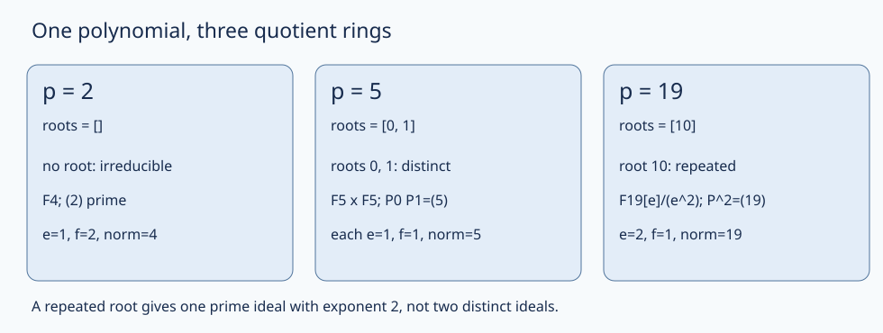

# 整数环、理想与素数分裂

整数素数在更大的环中还素吗？$5$ 在下面的环中变成两个因子的乘积，$2$ 却保持素性，$19$ 的情况又不同。变化不是算术出了故障，而是“允许哪些因子”改变了。本课固定一个已经建立的整数环，把“元素分解”“理想分解”“模素数后的多项式”接成可证明的同一件事。

## 先报对象，再谈唯一分解

以下环均交换、有 $1\ne0$。“整环”只保证没有零因子；非零乘法约分合法，并不保证不可约元素是素元。概念与一般证明复用 [[数学/25-高等代数/16-整环Euclid域PID与唯一分解#因子需要先分清单位、关联、不可约与素元|单位、关联、不可约与素元]]。

| 对象 | 可以使用什么 | 不可以偷带什么 |
|---|---|---|
| $\mathbb Z$ 中的非零整数 | Euclid/Bézout；素分解在单位 $\pm1$ 与次序之外唯一 | 对一般整环直接套整数 gcd 的 Bézout 系数 |
| 任意整环 $A$ | 非零约分；理想与商环；分式域 | 自动有 gcd、PID、UFD 或理想唯一分解 |
| $S=\mathbb Z[\sqrt{-5}]$ 中的元素 | 范数 $a^2+5b^2$、合法非零约分 | 不可约自动为素，或元素唯一分解 |
| $R=\mathbb Z[\omega]=\mathcal O_K$，$K=\mathbb Q(\sqrt{-19})$，$\omega=(1+\sqrt{-19})/2$ | 既有证明给出 $R$ 为 PID，故为 UFD；元素范数 $a^2+ab+5b^2$；非零理想范数是商的大小 | 因为不是 Euclidean 就说不是 UFD；把正定元素范数当作理想本身 |
| 一般数域 $L$ 的**完整整数环** $\mathcal O_L$ 中的非零理想 | 一般 Dedekind 定理给出非零真理想的唯一素理想分解 | 自动有元素唯一分解，或对任意子环直接用该定理 |

$S$ 的警报器是 $6=2\cdot3=(1+\sqrt{-5})(1-\sqrt{-5})$：没有范数为 $2$、$3$ 的元素，所以这四个因子均不可约；单位只有 $\pm1$，两个分解不靠单位与重排相同。完整范数论证在 [[数学/25-高等代数/16-整环Euclid域PID与唯一分解#逆箭头和一般整环的反例|一般整环的反例]]。换成负十九环不会复制这个失败：[[数学/25-高等代数/40-PID与非欧几里得反例/01-负十九二次整数环与理想类|整数环与判别式]] 已证 $R=\mathcal O_K$、$\Delta=-19$，[[数学/25-高等代数/40-PID与非欧几里得反例/02-Minkowski界如何推出PID|Minkowski 到 PID]] 已把任意理想类压到小范数并排除非平凡类。此处消费这些结论，不用几个小素数代替它们。

最后一行明确调用一般定理：数域的完整整数环是 Dedekind 环，其中每个非零真理想唯一分解为非零素理想的正整数幂；这是比本课更一般的结构定理，证明见 [Milne《Algebraic Number Theory》Theorems 3.7、3.29](https://www.jmilne.org/math/CourseNotes/ANT.pdf)。下面关于**本固定 $R$ 的每一个有理素数**的结论由商环直接证明，不把该一般定理的名字当作计算步骤。

## 理想乘法和商环怎样看见分裂

$(\alpha)=\alpha R$ 是一个集合；$\alpha$ 是元素。$IJ$ 是有限和 $\sum a_i b_i$（$a_i\in I,b_i\in J$）构成的理想，不只是单个乘积的集合。$I+J=R$ 称互素；若 $1=u+v$、$u\in I,v\in J$，则对 $z\in I\cap J$，$z=zv+zu\in IJ$，故
$$I\cap J=IJ\quad\text{当 }I+J=R.$$
素理想 $P$ 的判据是 $R/P$ 为整环，极大理想的判据是商为域；见 [[数学/25-高等代数/12-环理想商环与同态基本定理#素理想、极大理想的判别|商环判别]]。有限商是整环时也是域：乘非零元是有限集上的单射，因而满射，得到逆元。

因为 $\omega^2=\omega-5$，映射 $X\mapsto\omega$ 给出
$$R\simeq\mathbb Z[X]/(X^2-X+5),\qquad R/pR\simeq\mathbb F_p[X]/(\bar f),\quad f=X^2-X+5.$$
理由是首一除法把每个多项式唯一化为 $a+bX$；$1,\omega$ 在 $\mathbb Q$ 上线性无关，所以整数系数余式只有全零才映为零。再把两个系数模 $p$，商的元素恰为 $p^2$ 个 $a+b\bar\omega$。这一表示使用了**整个 $R=\mathbb Z[\omega]$**，不能对没有给出这种表示的环照抄。

定义理想绝对范数 $\mathrm N(I)=[R:I]=|R/I|$（此处 $I\ne0$）；在分解 $pR=\prod P_i^{e_i}$ 中，$e_i$ 是分歧指数，$f_i=[R/P_i:\mathbb F_p]$ 是剩余域次数。它们不是元素范数的两种写法。本例的三种结果如下，接着逐一证明。

| $\bar f$ 的样子 | $pR$ | 剩余域及 $\mathrm N(P_i)$ | 类型 |
|---|---|---|---|
| 两个不同根 $r,s$ | $P_rP_s$，$P_t=(p,\omega-t)$ | 各为 $\mathbb F_p$、各指数 $p$；$e_i=f_i=1$ | 分裂 |
| 二次不可约 | $pR$ 自己为素理想 | $\mathbb F_{p^2}$、指数 $p^2$；$e=1,f=2$ | 惰性 |
| 重根（本例仅 $p=19$） | $P^2$ | $\mathbb F_{19}$、指数 $19$；$e=2,f=1$ | 分歧 |

若有不同根，求值 $a+b\omega\mapsto a+bt\pmod p$ 是满射到域，核为 $P_t$，故 $P_t$ 是极大理想、范数 $p$。$P_r+P_s$ 含 $p$ 和 $r-s$，由整数 Bézout 含 $1$，故互素。若 $a+b\omega$ 同时落在两个核，则 $a+br=a+bs=0$，相减得 $b=0$，再得 $a=0$（都在 $\mathbb F_p$）；所以交为 $pR$。上式遂证 $pR=P_rP_s$。这也由 [[数学/25-高等代数/12-环理想商环与同态基本定理#环版本中国剩余定理|环 CRT]] 给出 $R/pR\simeq\mathbb F_p\times\mathbb F_p$，它有零因子，不是域。

若 $\bar f$ 二次不可约，则商是域：对任意次数小于 $2$ 的非零 $g$，$\gcd(g,\bar f)=1$，多项式 Bézout 给出 $ug+v\bar f=1$，故 $[u]$ 是 $[g]$ 的逆。于是 $pR$ 是素理想，商大小 $p^2$。这里使用的是域上多项式 Euclid，和把整数模数随意约掉不是一回事。

## 三个素数，三种机制

**$p=2$。** $\bar f=X^2+X+1$ 在 $0,1$ 均不为零，二次故不可约。因此 $(2)$ 是素理想，$2$ 是素元；$\mathrm N((2))=4$，元素范数 $N_{K/\mathbb Q}(2)=4$。范数为素整数是素性的充分条件，这个例子说明它不是必要条件。

**$p=5$。** $\bar f=X(X-1)$，所以 $(5)=(5,\omega)(5,\omega-1)$。更具体地，$N(\omega)=N(1-\omega)=5$，且 $\omega(1-\omega)=5$。由包含关系及指数均为 $5$ 得
$$P_0=(\omega),\quad P_1=(1-\omega),\quad (5)=(\omega)(1-\omega).$$
为什么主理想指数等于元素范数？乘 $a+b\omega$ 在基 $(1,\omega)$ 上的整数矩阵是
$$\begin{pmatrix}a&-5b\\b&a+b\end{pmatrix},\qquad\det=a^2+ab+5b^2.$$
其列向量张成主理想格，非零行列式的绝对值就是整数格指数；这是既有 [[数学/25-高等代数/40-PID与非欧几里得反例/01-负十九二次整数环与理想类#三个名称相近、对象不同的范数|范数与指数接口]]。两理想不同（两求值核不同），所以两个生成元不关联。

**$p=19$。** 模 $19$ 有 $\bar f=(X-10)^2$。设 $P=(19,\omega-10)$、$\delta=2\omega-1=\sqrt{-19}$，则 $\delta^2=-19$，且 $\delta=2(\omega-10)+19\in P$。乘 $\delta$ 的矩阵为 $\left(\begin{smallmatrix}-1&-10\\2&1\end{smallmatrix}\right)$，行列式 $19$；于是 $(\delta)\subseteq P$ 且两者指数都为 $19$，所以相等。最后
$$P^2=(\delta^2)=(-19)=(19).$$
这里恰有一个素理想在 $19$ 上方：商中每个素理想都须含平方为零的 $[X-10]$，进一步商为 $\mathbb F_{19}$，故只有这个核。$[X-10]\ne0$（非零一次余式）但平方为零；$R/(19)$ 是带非零幂零元的环，既不是域，也不是两个域的直积。重根没有领到“两份不同根”的通行证。

图由下方实验中 $p=2,5,19$ 的同一根列表和范数生成，回答“为什么只有一种情况能用两不同核的 CRT”。$p=19$ 两个重数不等于两个极大理想。

## 一般素数如何由互反律分类

对奇素数 $p\ne19$，$2$ 可逆，恒等式 $4f(X)=(2X-1)^2+19$ 说明根存在当且仅当 $(-19/p)=1$；判别式非零，根存在就有两个不同根。由 [[数学/28-数论/03-二次剩余Gauss引理与互反律|互反律与补充律]]，令 $h=(p-1)/2$，
$$\left(\frac{-19}{p}\right)=(-1)^h\left(\frac{19}{p}\right)=(-1)^h(-1)^{9h}\left(\frac p{19}\right)=\left(\frac p{19}\right).$$
所以除 $2,19$ 外，$p$ 模 $19$ 属于非零平方集合
$$\{1,4,5,6,7,9,11,16,17\}$$
时分裂，否则惰性；$2$ 已单独证明惰性，$19$ 分歧。集合来自 $1^2,\ldots,9^2\pmod{19}$，一般结论来自互反律与商环证明。有限素数表既不替代这些证明，也不说明每个剩余类出现多少素数；后一个问题去 [[数学/28-数论/06-Euler乘积收敛与素数分布入口#素数分布究竟还在问什么|素数分布入口]]。

本课是 [Milne Theorem 3.41 的单生成整数环情形](https://www.jmilne.org/math/CourseNotes/ANT.pdf) 的直接证明。一般应用要核完整整数环和生成元条件；不满足时需检查整数环指数或另用一般理想方法。现有 [[数学/25-高等代数/40-PID与非欧几里得反例/02-Minkowski界如何推出PID#模 $2$ 的多项式排除范数 $2$ 理想|模 $2$ 排除小范数理想]] 现在有了更完整解释：$2$ 上方唯一素理想的范数是 $4$，不是 $2$。

## 撤去提示以后

1. 同伴说“负十九环不是 Euclidean，因此 $6$ 会像 $\mathbb Z[\sqrt{-5}]$ 一样有两种不关联不可约分解”。指出对象与箭头错误。若只知道一个环为整环，还能合法做什么约分？
2. 判断 $R/(2)$、$R/(5)$、$R/(19)$ 哪些是域，哪些有非零零因子，哪些有非零幂零元；给具体元素作证。解释为什么范数 $4$ 不妨碍 $2$ 为素元。
3. 不枚举所有环元素，分解 $7R$，求两个素理想的范数，并说明在 $R$ 已知为 PID 时能额外说什么，不能仅由根列表读出什么。
4. 有人从 $\bar f=(X-10)^2\pmod{19}$ 写出 $R/(19)\simeq\mathbb F_{19}\times\mathbb F_{19}$，再据此称“$19$ 分裂为两个不同素理想”。修正推理，并用 $\delta$ 给出理想等式。

> [!question]- 答案
> 1. 非 Euclidean 不推出非 PID/非 UFD；本 $R$ 已由一般理想类界证明为 PID，因此元素分解唯一。$\mathbb Z[\sqrt{-5}]$ 是另一个环。整环中 $a\ne0,ab=ac$ 仍推出 $b=c$；把不可约当素元，才是一般整环不允许的额外步骤。
> 2. $R/(2)$ 为四元域，无非零零因子。$R/(5)$ 中 $[\omega]$、$[1-\omega]$ 都非零且乘积零；CRT 的两个域分量使它没有非零幂零元（各分量某次幂为零就各自为零）。$R/(19)$ 的 $[\omega-10]$ 非零而平方零。$2$ 的素性来自主理想商为域，不要求元素范数本身是素整数。
> 3. 模 $7$ 的根为 $2,6$：$4-2+5=7$、$36-6+5=35$，且二次多项式至多两根。故 $7R=(7,\omega-2)(7,\omega-6)$，两范数各 $7$，互素且不同。PID 保证各自有单个生成元；根列表本身只给两个生成元的理想表示，不自动算出了那个单生成元，也不重证 PID。
> 4. CRT 要求两个不同根对应的理想互素；重复同一理想的和仍是它自己，不能应用。正确商为 $\mathbb F_{19}[\varepsilon]/(\varepsilon^2)$；$P=(19,\omega-10)=(\delta)$，$\delta=2\omega-1$，所以 $19R=P^2$，分歧指数 $2$、剩余次数 $1$，不是两个不同素理想。

在 [[数学/28-数论/80-整数同余与单位有限复算#整数环与Euler乘积的有限复算|精确实验]] 中检查 $p\le101$ 的全部素数、理想乘积格与这三个商。有限输出只核固定输入；返回 [[数学/28-数论/00-数论-MOC|数论路线]] 时，保留元素、理想、商三个对象标签。
