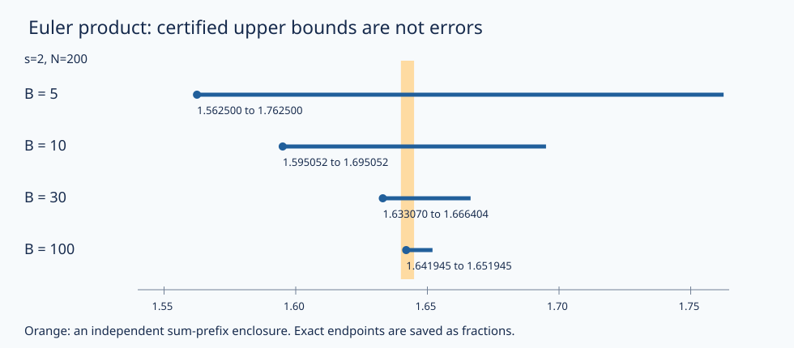

# Euler 乘积、收敛与素数分布入口

整数唯一分解能把“所有正整数的和”改写成“所有素数的积”。但无限符号不能靠形式展开领取合法性。本课先确定有限乘积到底数了哪些整数，再用一个可量化的尾界取极限；最后区分“有无限多个素数”“素数倒数和发散”和“素数数量的精确渐近”。它们不是同一句话的三种字体。

## 先固定收敛区间

本课的完整证明先限定**实数 $s>1$**，定义
$$\zeta(s)=\sum_{n=1}^{\infty}n^{-s}.$$
对整数 $N\ge1$，单调积分比较给出
$$0<\sum_{n>N}n^{-s}\le\int_N^\infty t^{-s}\,dt=\frac{N^{1-s}}{s-1}.$$
因此正项级数收敛；有限前缀 $S_N(s)$ 与右端给出明确上下夹界。原因是对每个 $n>N$，$n^{-s}\le\int_{n-1}^n t^{-s}dt$，再把不等式相加。回看 [[数学/16-数学分析/07-数项级数绝对条件收敛与判别法#正项判别法背后的比较|积分与正项比较]]，这里的整数索引是承重条件：若允许非整数截点，应先取下整，不能把同一个尾界不加修改地套上。

实数 $s\le1$ 时原级数发散：$n^{-s}\ge1/n$，调和级数发散。下面也不会把 $s=1$ 的 $\zeta$ 写成有限数。复数版本的标准定理是 $\operatorname{Re}s>1$ 中绝对收敛的 Euler 乘积；[MIT 18.785 Lecture 16，Theorem 16.2](https://math.mit.edu/classes/18.785/2016fa/LectureNotes16.pdf) 给出该版本，本课后续计算与完整证明只用实数情形。

## 有限素数乘积数的是光滑整数

固定**整数 $B\ge2$**，记
$$P_B(s)=\prod_{p\le B\atop p\text{ 素数}}(1-p^{-s})^{-1}.$$
每个因子由收敛等比级数展开；因子只有有限个，正项有限乘积的逐次极限合法。于是
$$P_B(s)=\sum_{\substack{n\ge1\\\text{每个素因子}\le B}}n^{-s}.$$
称这类整数为 $B$-光滑整数，$1$ 也包括。为什么每个整数只出现一次？[[数学/28-数论/01-整数整除Euclid算法与Bezout#整数结构：哪里允许消掉一个因子|整数唯一分解]] 恰好把所选各素数幂的指数向量与这些整数一一对应。这里仍有无限多项，因为同一素数的幂没有上限。它不是 $\sum_{n\le B}n^{-s}$。

所有 $n\le B$ 都被包含，漏掉的整数都大于 $B$。由于正项求和可按子集分开，得到一般误差估计
$$0\le\zeta(s)-P_B(s)\le\sum_{n>B}n^{-s}\le\frac{B^{1-s}}{s-1}.$$
当整数 $B\to\infty$，右端趋零，所以
$$\boxed{\zeta(s)=\lim_{B\to\infty}P_B(s)=\prod_p(1-p^{-s})^{-1}\quad(s>1).}$$
这给出了等式、极限次序与误差；一般收敛证明不需要先知道 $\zeta(2)$ 的闭式。[MIT 18.781 Lecture 14，PDF pp4–5](https://ocw.mit.edu/courses/18-781-theory-of-numbers-spring-2012/a97051320da973caebacda06c3a74eac_MIT18_781S12_lec14.pdf) 给出从算术函数到 Euler 乘积的动机；这里显式补出有限截断的对象和尾界，避免把形式等号当作收敛证据。

还可核对无限乘积不会悄悄趋零或无穷：对 $0\le x<1$，由积分 $-\log(1-x)=\int_0^x(1-t)^{-1}dt$ 得
$$x\le-\log(1-x)\le\frac{x}{1-x}.$$
取 $x=p^{-s}<1/2$，有限和满足 $0\le\log P_B(s)\le2\sum_{p\le B}p^{-s}\le2\sum_{n\ge2}n^{-s}<\infty$。左边随 $B$ 增加且有界，故对数收敛，$P_B(s)$ 的极限有限且为正；倒数积也收敛到正数 $1/\zeta(s)$。本实数正因子情形的对数绝对收敛就体现在这个界里。

## 一个可以手核的截断

取 $s=2,B=5$，
$$P_5(2)=\frac43\frac98\frac{25}{24}=\frac{25}{16},\qquad S_5(2)=\frac{5269}{3600}.$$
二者不同：$6,8,9,10,\ldots$ 虽超过 $5$，素因子仍只来自 $2,3,5$，已进入乘积展开。例如 $1/6^2$ 的来源是 $2^{-2}3^{-2}$。前缀 $S_5$ 没有它。

一般夹界在这里给 $25/16\le\zeta(2)\le25/16+1/5=141/80$。再算 $S_{200}(2)$ 并取其尾界 $1/200$，可收紧为
$$\max\{P_B(2),S_{200}(2)\}\le\zeta(2)\le\min\{P_B(2)+1/B,S_{200}(2)+1/200\}.$$
所有端点在实验中是精确有理数；图上小数只用于定位。区间交集有据可查，画得接近某条线本身不构成证明。

图把 $B=5,10,30,100$ 的 $[P_B(2),P_B(2)+1/B]$ 与 $S_{200}$ 夹界放在同一横轴；每一行的来源是相同 JSON 中的精确分数。乘积是下界，尾界是承诺的误差上限，不能把右端点称为实际误差。

## 到 $s=1$，哪些结论真的改变

对每个有限 $B$，$P_B(1)$ 的等比展开仍成立，且包含所有 $n\le B$，所以
$$P_B(1)\ge H_B=\sum_{n=1}^B\frac1n\longrightarrow\infty.$$
调和发散可按 $2^{j-1}<n\le2^j$ 分组，每组和至少 $1/2$。因此素数无限乘积在 $s=1$ 不收敛到有限值，倒数积 $\prod_{p\le B}(1-1/p)\to0$。对 $0<s\le1$，各因子不小于 $s=1$ 的因子，乘积也趋无穷。$s=0$ 因子分母已经为零；$s<0$ 时原实级数同样发散，不属于上述几何级数展开的范围。

再证明一个更有内容的结论：$\sum_p1/p$ 发散。若它收敛，对 $x=1/p\le1/2$ 逐个用上面的对数界，可得每个有限 $B$ 都满足
$$\log P_B(1)=\sum_{p\le B}-\log(1-1/p)\le2\sum_{p\le B}\frac1p\le C<\infty.$$
这与 $P_B(1)\ge H_B\to\infty$ 冲突。故素数倒数和发散，也就有无限多个素数。仅有“无限多个”本身不够推出倒数和发散：无限集合 $\{2^k:k\ge1\}$ 的倒数和是 $1$。

这不授权把发散级数赋成某个有限值。解析延拓可在更大的复平面区域定义与原函数相接的函数，但它的构造与唯一性另需复分析；在原级数不收敛的点，不能把延拓值冒充普通无穷求和的值。本课没有从代入 $s=0$、负数的形式乘积得到任何结论。

## 素数分布究竟还在问什么

定义 $\pi(x)=\#\{p\le x:p\text{ 素数}\}$，$x\ge2$。这是精确计数函数；素数定理的精确目标是
$$\pi(x)\sim\frac{x}{\log x},\qquad\text{即}\quad\lim_{x\to\infty}\frac{\pi(x)\log x}{x}=1.$$
这是已经证明的标准定理，完整证明可去 [MIT 18.785 Lecture 16，§16.2、Theorem 16.15](https://math.mit.edu/classes/18.785/2016fa/LectureNotes16.pdf)。**本课不证明它**：Euler 乘积在 $s>1$ 收敛，以及 $\sum_p1/p$ 发散，都没有给出上式所需的计数误差控制。积分比较确实另给
$$\frac1{s-1}\le\zeta(s)\le1+\frac1{s-1}\quad(s>1),$$
因为整段积分是下界，首项加从 $1$ 起积分是上界；这说明沿实轴靠近 $1$ 的增长尺度，仍不是素数定理的证明。

有限实算如下；末列是浮点展示，不是精确代数恒等式。

| $x$ | $\pi(x)$ | $\pi(x)\log x/x$ 约值 |
|---|---|---|
| 10 | 4 | 0.921034 |
| 100 | 25 | 1.151293 |
| 1000 | 168 | 1.160503 |
| 10000 | 1229 | 1.131951 |

比值并不按这些输入单调趋近 $1$。任意有限表只能核相应前缀，不能控制任意大 $x$。即便有素数定理，也别把总体渐近改写成“任意短区间均匀”：对任意整数 $m\ge2$，$m!+2,\ldots,m!+m$ 中第 $j$ 项被 $j$ 整除且大于 $j$，所以连续 $m-1$ 个数都合成，素数间隔没有统一常数上界。

同样，[[数学/28-数论/05-整数环理想与素数分裂#一般素数如何由互反律分类|模 $19$ 分裂准则]] 判断的是**给定素数**的类型，不证明每个非零剩余类有无限多素数，更不证明等分布；那些需要算术级数中素数的额外定理。至此解析入口已经提出了精确问题、给出合法乘积和有限边界，而没有把整个解析数论塞进一次极限。

## 撤去提示以后

1. 同伴写 $\prod_{p\le5}(1-p^{-2})^{-1}=\sum_{n\le5}n^{-2}$。算出两边，指出至少一个被右侧漏掉、左侧包含的具体项，并给 $\zeta(2)$ 的有理夹界。
2. 证明所有 $s>1$ 的倒数 Euler 积极限为正，再只改成 $s=1$，证明极限变成零。哪一步不能继续用原来的统一上界？
3. “素数无限多个，所以素数倒数和发散”缺什么？给一个无限集合反例，再补全本课针对素数的实际证明。
4. 有人由上表与负十九分裂准则宣布：“所有足够大的长度 $100$ 区间都有素数，模 $19$ 的每个非零类也已证明均匀。”分别给出反驳或缺失的论证。这里需要重算旧 CRC 或 RSA 实验吗？

> [!question]- 答案
> 1. 左 $25/16$，右 $5269/3600$，差 $89/900$；例如 $1/36$ 出现在左侧展开。因为遗漏项全大于 $5$，$25/16\le\zeta(2)\le141/80$；这只是保证界，非实际误差等号。
> 2. $s>1$ 时 $\log P_B\le2\sum_{n\ge2}n^{-s}<\infty$，且非负递增，故极限有限；倒数极限正。$s=1$ 时 $P_B\ge H_B\to\infty$，所以倒数趋零。整数倒数总和不再收敛，原常数上界不存在。
> 3. $\{2^k\}$ 无限但倒数和有限，故仅无限性不够。若素数倒数和有限，逐有限和的 $-\log(1-1/p)\le2/p$ 将 $\log P_B(1)$ 一致控在有限常数内，与调和下界矛盾。
> 4. 取 $m\ge101$ 且足够大，阶乘块给至少 $100$ 个连续合数，已反驳第一个断言。第二个断言缺算术级数中素数的分布证明；互反律只在素数已给定时分类，有限表不能补全无限量词。CRC/RSA 消费的是早先已交的代数接口，与这两个新无限命题无关；重算它们不能修复这个缺口。

复算入口是 [[数学/28-数论/80-整数同余与单位有限复算#整数环与Euler乘积的有限复算|同数据的有理区间与素数计数]]；再回 [[数学/28-数论/00-数论-MOC|数论路线]] 对照整数、元素、理想与正项极限各自的权限。
