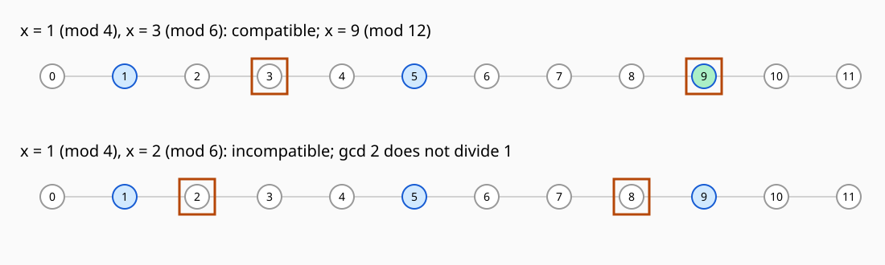
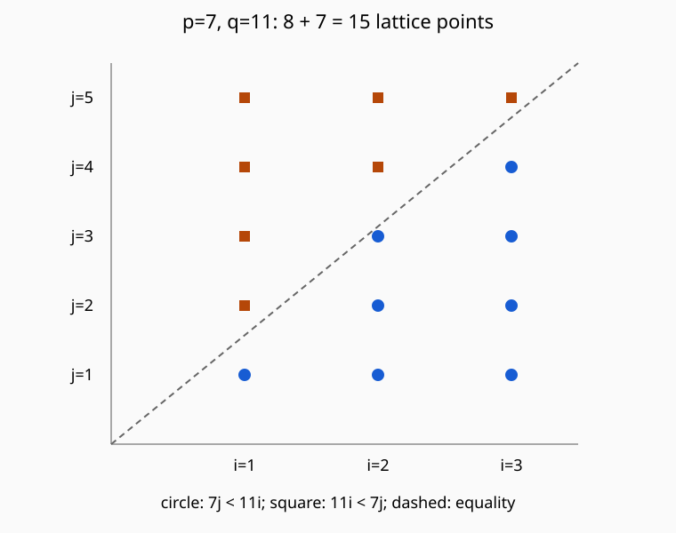

# 整数同余与单位有限复算

01/02已经给一般证明；本页用有限、确定、精确整数的第二条路线检查手算与实现。原CRC、RSA实验不重跑；这里只消费它们已给的数据和职责，计算本次数论课承诺的有限对象。

## 断言重要性与独立核查对象

- **高重要性：** 整数除法/Euclid下降、Bézout不变量、线性同余与非互素CRT的充要条件及lcm唯一性、Euler/Fermat与单位/阶的前提。这些需要非作者检查一般证明、原典和反例，有限扫描不承担全称命题。
- **中重要性：** 固定Euclid系数、余数、CRT解、单位群与负数/0/模1边界；采用直接扫描余类对照公式实现，检查实际输入和全部有限输出。检查逆元不要求系数与某个实现逐字相同，只要求归一逆类和恒等式准确。
- **低重要性：** 12位置相位图的布局。图的数据来自同一模数/余数定义，颜色与圆/方框形状双编码，作用是解释为何检查完整共同周期而不是碰巧挑一小段。

## 输入、可独立手算的预期与容差

规范源码为 [[数学/28-数论/integer_congruence_lab.py|integer_congruence_lab.py]]，Python3.10+标准库，无外部依赖。所有数学断言为整数，不设浮点误差容差，预期差值必须0。

| 固定输入 | 手算预期 | 所检验的区别 |
|---|---|---|
| gcd(240,46) | $2=-9\cdot240+47\cdot46$ | 不只返回2，还保留系数与每步来源 |
| gcd(−240,46)、(0,46)、(240,0)、(0,0) | 分别2、46、240、约定0 | 恢复符号与零边界 |
| $6x\equiv8\pmod{14}$；改右端7 | 解为6、13；无解 | gcd整除右端、约后模数改变 |
| $4x\equiv0\pmod4$；改右端2 | 0/1/2/3全部；无解 | 约后模1，不调用逆元 |
| 余2模3、余3模5 | 8模15 | 互素CRT的具体消费 |
| 余1模4、余3模6；改第二余2 | 9模12；无解 | 非互素兼容与lcm |
| $23^{-1}\pmod{120}$ | 47 | 1081=9×120+1 |
| $U(8)$ | 1/3/5/7，阶1/2/2/2，φ=4 | 群阶不等于任一元素阶 |
| φ(120) | 32 | 素数幂/互素分解与直接互素计数 |

程序另检负余数CRT $x\equiv-1\pmod4,x\equiv5\pmod6$，预期11模12；以及一条模1无约束与模6余3，结果3模6。

三种指定余数按原被除式分别计算：整数13÷11得q1/r2；$GF(2)[x]$ 中M(1101)÷G(1011)得q1/r110；先补零 $x^3M$(1101000)÷G得q1111/r001。程序的 `poly_multiply` 用无进位逐位XOR，`poly_divmod` 逐次消最高次；恢复恒等式 $f=qG+r$ 也用同一多项式乘法，而非整数乘法。泛化正确性由多项式带余除法主解释负责。

F₄用比特00、01、10、11分别表示0、1、α、α+1，模数111表示 $x^2+x+1$。完整乘法表与每个非零逆为 $1^{-1}=1,\alpha^{-1}=\alpha+1,(\alpha+1)^{-1}=\alpha$；与模4仅1/3可逆相对照。可约商G′=1001中11与111两个非零类相乘余0，但10与100相乘余1。这个反例单独核[x]单位不代表整个商为域，不声称做了真实通信检错。

## 有限扫描范围与实际输出

源码从扩展Euclid、逆元构造出线性同余和二模合并，然后以不同的直接枚举结果比较：

| 完整扫描的有限对象 | 固定范围 | 实际数量与结论 |
|---|---|---|
| 带符号gcd对 | $-30\le a,b\le30$，含双零 | 3721对，gcd与Bézout恒等式均精确符合 |
| 线性同余 | $1\le m\le16,-12\le a\le12,0\le b<m$ | 3400式，直接扫0至m−1与公式的全部解一致 |
| 二模系统 | $1\le m,n\le12,0\le a<m,0\le b<n$ | 6084组，其中4272组兼容；完整lcm周期的直接解与合并结果一致 |
| 单位群 | $2\le m\le40$，每个类都判互素 | 39行，φ公式、逆元、Euler及阶整除φ均符合 |

线性数量由 $25\sum_{m=1}^{16}m=3400$ 独立得到；CRT数量由 $(\sum_{m=1}^{12}m)^2=6084$ 得到。兼容对每组模数应有 $mn/\gcd(m,n)=L$ 个余数对，因为每个 $x\bmod L$ 给唯一兼容余数对，若给同一对则差被L整除；因此4272可由 $\sum_{m,n=1}^{12}\operatorname{lcm}(m,n)$ 另算。本脚本逐组直接扫描，不先把“不兼容”结果过滤掉。

另有非单位反例 $2^{\varphi(8)}\bmod8=0$、单位 $3^4\bmod8=1$，以及合数 $341=11\cdot31$ 却 $2^{340}\bmod341=1$。这些是具体反例，不称为概率素性检验的通过率。

2026-10-17实际经本机两槽、每槽1线程的接口运行：

```sh
python3 /private/tmp/wwl-next-context/run_local.py --timeout 300 -- python3 /private/tmp/wwl-next-151/数学/28-数论/integer_congruence_lab.py
```

退出码0，实际标准输出：

```json
{"status": "PASS", "signed_gcd_pairs": 3721, "linear_congruences": 3400, "two_modulus_systems": 6084, "compatible_systems": 4272, "unit_moduli": 39}
```

在源码目录一般复现入口为 `python3 integer_congruence_lab.py`，它只生成相邻的 [[数学/28-数论/实践结果/integer-congruence-20261017.json|完整JSON实际结果]] 与下图；源码为真源，修改后同步下方镜像，不反写旧网络或密码实验输出。



这些运行不证明任意输入全正确、生产密码安全、CPU恒定时间、真实TLS握手或CRC错误分布；数学证明/程序有限结果/SVG显示/Obsidian客户端与真人理解属于不同层。客户端与真人未认证。回 [[数学/28-数论/00-数论-MOC|入口]] 选择一般论证。

## 完整源码镜像

<!-- code-sync: ./integer_congruence_lab.py -->
```python
"""Exact finite integer/congruence fixtures; no production cryptography.

Python 3.10+ standard library. Source generates its own JSON and SVG.
Finite scans check implementation/examples, not universally quantified proofs.
"""
from math import gcd
from pathlib import Path
import json


def extended_gcd(a, b, with_trace=False):
    """Return nonnegative g, s, t with g = s*a+t*b; gcd(0,0)=0."""
    a0, b0 = abs(a), abs(b)
    old_r, r, old_s, s, old_t, t = a0, b0, 1, 0, 0, 1
    trace = []
    while r:
        q, remainder = divmod(old_r, r)
        assert old_r == old_s*a0+old_t*b0 and r == s*a0+t*b0
        trace.append({'r0': old_r, 'r1': r, 'q': q, 'remainder': remainder,
                      'r0_coefficients_abs': [old_s, old_t],
                      'r1_coefficients_abs': [s, t]})
        old_r, r = r, remainder
        old_s, s = s, old_s-q*s
        old_t, t = t, old_t-q*t
    result = (old_r, old_s*(-1 if a < 0 else 1), old_t*(-1 if b < 0 else 1))
    assert result[0] == result[1]*a+result[2]*b
    return (*result, trace) if with_trace else result


def inverse(a, modulus):
    if modulus < 2:
        raise ValueError('unit inverse interface requires modulus >= 2')
    d, s, _ = extended_gcd(a, modulus)
    if d != 1:
        raise ValueError('not a unit')
    return s % modulus


def linear_solutions(a, b, modulus):
    if modulus < 1:
        raise ValueError('positive modulus required')
    d, _, _ = extended_gcd(a, modulus)
    if b % d:
        return []
    reduced = modulus//d
    x0 = 0 if reduced == 1 else inverse(a//d, reduced)*(b//d) % reduced
    return [x0+j*reduced for j in range(d)]


def merge_crt(a, m, b, n):
    if m < 1 or n < 1:
        raise ValueError('positive moduli required')
    d, _, _ = extended_gcd(m, n)
    if (b-a) % d:
        return None
    reduced = n//d
    t = 0 if reduced == 1 else inverse(m//d, reduced)*((b-a)//d) % reduced
    period = m*reduced
    return ((a+m*t) % period, period)


def unit_order(a, modulus):
    if gcd(a, modulus) != 1 or modulus < 2:
        raise ValueError('expected unit modulo at least 2')
    value = 1
    for exponent in range(1, modulus+1):
        value = value*a % modulus
        if value == 1:
            return exponent
    raise AssertionError('finite unit must return to 1')


def phi_by_factors(n):
    value, remaining, p = n, n, 2
    while p*p <= remaining:
        if remaining % p == 0:
            value -= value//p
            while remaining % p == 0:
                remaining //= p
        p += 1
    if remaining > 1:
        value -= value//remaining
    return value


def poly_multiply(a, b):
    """GF(2)[x] coefficients in integer bits, not integer multiplication."""
    result = 0
    while b:
        if b & 1:
            result ^= a
        a <<= 1
        b >>= 1
    return result


def poly_divmod(numerator, denominator):
    if numerator < 0 or denominator <= 0:
        raise ValueError('nonnegative polynomial bits and nonzero divisor required')
    q, r = 0, numerator
    while r and r.bit_length() >= denominator.bit_length():
        shift = r.bit_length()-denominator.bit_length()
        q ^= 1 << shift
        r ^= denominator << shift
    assert numerator == poly_multiply(q, denominator) ^ r
    assert r == 0 or r.bit_length() < denominator.bit_length()
    return q, r


def render_phase(path):
    parts = ['<svg xmlns="http://www.w3.org/2000/svg" width="1100" height="330" viewBox="0 0 1100 330" role="img" aria-labelledby="title desc">',
             '<title id="title">CRT compatibility in one complete twelve-position period</title>',
             '<desc id="desc">Top: positions 1,5,9 modulo four and 3,9 modulo six overlap at 9. Bottom: positions 1,5,9 and 2,8 do not overlap. Circles mark the first condition, squares the second; filled green marks a common solution.</desc>',
             '<rect width="1100" height="330" fill="#fafafa"/>']
    for row, b in enumerate((3, 2)):
        y = 95+150*row
        parts.append(f'<text x="25" y="{y-50}" font-family="sans-serif" font-size="20">x = 1 (mod 4), x = {b} (mod 6): '+('compatible; x = 9 (mod 12)' if b == 3 else 'incompatible; gcd 2 does not divide 1')+'</text>')
        parts.append(f'<line x1="65" y1="{y}" x2="1055" y2="{y}" stroke="#aaa"/>')
        for x in range(12):
            px = 65+90*x
            a_hit, b_hit = x % 4 == 1, x % 6 == b
            if b_hit:
                parts.append(f'<rect x="{px-22}" y="{y-22}" width="44" height="44" fill="none" stroke="#b54708" stroke-width="3"/>')
            parts.append(f'<circle cx="{px}" cy="{y}" r="15" fill="'+('#abefc6' if a_hit and b_hit else '#d1e9ff' if a_hit else 'white')+'" stroke="'+('#175cd3' if a_hit else '#999')+'" stroke-width="2"/>')
            parts.append(f'<text x="{px}" y="{y+5}" text-anchor="middle" font-family="sans-serif" font-size="14">{x}</text>')
    parts.append('</svg>')
    path.write_text('\n'.join(parts)+'\n')


def main():
    root = Path(__file__).resolve().parent
    egcd_cases = []
    for a, b in ((240, 46), (-240, 46), (0, 46), (240, 0), (0, 0)):
        d, s, t, trace = extended_gcd(a, b, True)
        assert d == gcd(a, b)
        egcd_cases.append({'a': a, 'b': b, 'gcd': d, 's': s, 't': t, 'trace': trace})
    egcd_count = 0
    for a in range(-30, 31):
        for b in range(-30, 31):
            d, s, t = extended_gcd(a, b)
            assert d == gcd(a, b) and d == s*a+t*b
            egcd_count += 1
    linear_count = 0
    for m in range(1, 17):
        for a in range(-12, 13):
            for b in range(m):
                actual = linear_solutions(a, b, m)
                direct = [x for x in range(m) if (a*x-b) % m == 0]
                assert actual == direct
                linear_count += 1
    crt_count = compatible = 0
    for m in range(1, 13):
        for n in range(1, 13):
            period = m*n//gcd(m, n)
            for a in range(m):
                for b in range(n):
                    result = merge_crt(a, m, b, n)
                    direct = [x for x in range(period)
                              if x % m == a and x % n == b]
                    assert direct == ([] if result is None else [result[0]])
                    if result is not None:
                        assert result[1] == period
                        compatible += 1
                    crt_count += 1
    unit_rows = []
    for m in range(2, 41):
        units = [a for a in range(m) if gcd(a, m) == 1]
        assert len(units) == phi_by_factors(m)
        orders = {a: unit_order(a, m) for a in units}
        for a in units:
            assert a*inverse(a, m) % m == 1
            assert pow(a, len(units), m) == 1 and len(units) % orders[a] == 0
        unit_rows.append({'modulus': m, 'phi': len(units), 'units': units,
                          'orders': orders})
    crt_cases = [{'a': a, 'm': m, 'b': b, 'n': n,
                  'solution_and_period': merge_crt(a, m, b, n)}
                 for a, m, b, n in ((2, 3, 3, 5), (1, 4, 3, 6), (1, 4, 2, 6),
                                    (-1, 4, 5, 6), (9, 1, 3, 6))]
    M, G = 0b1101, 0b1011
    q0, r0 = divmod(13, 11)
    q1, r1 = poly_divmod(M, G)
    q2, r2 = poly_divmod(M << 3, G)
    assert (q0, r0, q1, r1, q2, r2) == (1, 2, 1, 6, 15, 1)
    gf4_table = [[poly_divmod(poly_multiply(a, b), 0b111)[1]
                  for b in range(4)] for a in range(4)]
    gf4_inverses = {a: next(b for b in range(1, 4) if gf4_table[a][b] == 1)
                   for a in range(1, 4)}
    assert gf4_inverses == {1: 1, 2: 3, 3: 2}
    assert poly_divmod(poly_multiply(0b11, 0b111), 0b1001)[1] == 0
    assert poly_divmod(poly_multiply(0b10, 0b100), 0b1001)[1] == 1
    assert pow(2, 4, 8) == 0 and pow(3, 4, 8) == 1
    assert 341 == 11*31 and pow(2, 10, 341) == pow(2, 340, 341) == 1
    report = {'status': 'PASS', 'arithmetic': 'exact integers; zero numerical tolerance',
              'extended_gcd_cases': egcd_cases,
              'finite_sweeps': {'signed_gcd_pairs': egcd_count,
                                'linear_congruences': linear_count,
                                'two_modulus_systems': crt_count,
                                'compatible_systems': compatible,
                                'unit_moduli': len(unit_rows)},
              'crt_cases': crt_cases,
              'linear_cases': [{'a': a, 'b': b, 'modulus': m,
                                 'solutions': linear_solutions(a, b, m)}
                                for a, b, m in ((6, 8, 14), (6, 7, 14), (4, 0, 4), (4, 2, 4))],
              'unit_rows': unit_rows,
              'inverse_23_mod_120': inverse(23, 120), 'phi_120': phi_by_factors(120),
              'three_remainders': {'integer_13_by_11': {'q': q0, 'r': r0},
                                   'GF2_M_by_G': {'q_bits': format(q1, 'b'), 'r_bits': format(r1, '03b')},
                                   'GF2_shifted_M_by_G': {'q_bits': format(q2, 'b'), 'r_bits': format(r2, '03b')}},
              'GF4': {'modulus_bits': '111', 'multiplication_table': gf4_table,
                      'inverses': gf4_inverses, 'unit_count': 3},
              'Z4_units': [a for a in range(4) if gcd(a, 4) == 1],
              'reducible_GF2_quotient': {'modulus_bits': '1001', 'nonzero_zero_divisors_bits': ['11', '111'],
                                        'x_inverse_bits': '100'},
              'counterexamples': {'nonunit_2_pow_phi8': 0, 'composite_341': [11, 31], '2_pow_340_mod_341': 1},
              'boundary': 'finite fixtures only; no prime certification algorithm, production crypto or protocol execution'}
    (root/'实践结果').mkdir(exist_ok=True)
    (root/'assets').mkdir(exist_ok=True)
    (root/'实践结果'/'integer-congruence-20261017.json').write_text(
        json.dumps(report, ensure_ascii=False, indent=2)+'\n')
    render_phase(root/'assets'/'crt-phase.svg')
    print(json.dumps({'status': 'PASS', **report['finite_sweeps']}))


if __name__ == '__main__':
    main()
```


## 二次剩余与Pell固定实验

本节承接03/04的一般证明，旧integer_congruence_lab.py和原结果不重跑、不改写；新规范源为 [[数学/28-数论/qr_pell_lab.py|qr_pell_lab.py]]，仍只用Python3.10+标准库。有限符号与Pell输出不替代一般互反/存在性/全部解证明。

**断言重要性。** 高重要性是Euler判别的域根数、Gauss折回置换、奇a的floor式与格点全分割，以及CF尾式、一般D两次鸽巢中K非零/同余消分母、最小单位区间归约；这些按正文和primary来源独核。固定小素数符号/格点、CF整数状态与范数、完整有界Pell解列表为中重要性，以另一条有限算法核查。格点布局为低重要性，但它必须正确区分点在直线的哪一侧，不能让示意图承担未证明的一般结论。

### 固定输入、运行前预期与变条件

互反部分取3至97间的全部24个奇素数，a遍历−p至2p（含两端）。Euler幂判别、对分子试除分解后递归使用互反/2补充律，与直接平方集合三路比较；非零类再核Gauss折回。这里的素性由试除至isqrt(p)检查，只适用于这些小输入，不声称提供通用高效素性认证。

| 输入 | 可独立手算的预期 | 失去哪个条件会怎样 |
|---|---|---|
| a3/p11 | 余3,6,9,1,4，翻转2次，符号+1 | p必须奇素数，a不能被p整除才用Gauss |
| p7/q11 | 两边floor和8、7，总15，互反乘积−1 | p=q时线上会有点；不能继续同一分割 |
| 37、7模101 | 符号+1/−1，根分别21/80与无根 | 判存在不自动给通用快速开根算法 |
| x²+3x+1模11 | 判别式5，原式两根2、6 | 模2下2A无逆，不能照搬完成平方 |
| a2/p5 | 奇a floor若乱用会给+1，但真值−1 | 偶分子先提2，用补充律 |
| a2/n15 | Jacobi+1但无根；完整平方集0/1/4/6/9/10 | 合数分母不保留Legendre充分判定 |

p7q11格点坐标是1≤i≤3、1≤j≤5。程序逐点用整数比较7j与11i，图中8个蓝圆在7j<11i侧，7个橙方在另一侧；两种形状避免仅凭色觉判读。图源为同一源码render_lattice函数，实际图为 

CF固定D为2、3、5、6、7、8、10、13，每个生成前20个收敛分数及第21项用于末个误差界。D8不是平方自由，仍在非平方整数的定理范围。完整商状态写成 $(\sqrt D+P)/Q$，初始P0/Q1；令s=isqrt(D)，a=(s+P)//Q，再令P′=aQ−P、Q′=(D−P′²)/Q。这是对上一完整商减整数、取倒数的有理化，源码逐步检查整除与Q′>0。因为Q正整数、0<√D−s<1，floor((√D+P)/Q)恰为(s+P)//Q；所有取项均用整数，不从浮点sqrt截断。

误差不通过打印小数来“看着很小”：记r=p/q、δ=1/(q q_next)，由有理数平方核 $(r-δ)^2<D<(r+δ)^2$（若r−δ≤0，左侧自动满足正根下界），从而精确认证 $|\sqrt D-r|<δ$。同时核行列式±1、互素、范数符号交替及有界范数。全部数学比较为整数/Fraction，容差0。

Pell是另一条有限计算：每个上述D，完整遍历1≤y≤1000，算isqrt(Dy²+1)并平方回查。首次正解按y最小取得，接着取该单位的幂与范围内**全部**正解列表比较。程序未将“第一个CF范数+1”无条件当作一般D的基本解；一般正解存在/幂分类由04证明，CF与全部Pell解的一般对应和周期分类没有在本包冒称证明。

| D | 完整有界搜索的最小(x,y) |
|---|---|
| 2 | (3,2) |
| 3 | (2,1) |
| 5 | (9,4) |
| 6 | (5,2) |
| 7 | (8,3) |
| 8 | (3,1) |
| 10 | (19,6) |
| 13 | (649,180) |

√2前20项另核 $p_n+q_n\sqrt2=(1+\sqrt2)^{n+1}$，乘法在整数系数对中完成，不用近似实数幂。反例保留14142/10000的范数−3836、约分后7071/5000的范数−959；同范数7相除得到9/7、4/7的有理系数，不是整数解。右端−1、D3的模3拒绝证据也保留，不能从正Pell存在性推负Pell存在。

### 实际运行与结果

2026-10-17经本机两槽、每槽1线程接口运行：

```sh
python3 /private/tmp/wwl-next-context/run_local.py --timeout 300 -- python3 /private/tmp/wwl-next-151-qr-pell/数学/28-数论/qr_pell_lab.py
```

退出码0，真实标准输出：

```json
{"status": "PASS", "odd_primes": 24, "symbol_inputs": 3198, "odd_floor_inputs": 1034, "distinct_prime_pairs": 276, "sqrt_D_cases": 8, "convergents_per_D": 20, "Pell_y_tests": 8000}
```

3198=Σ(3p+1)，1034=Σ(p−1)，276=C(24,2)，均可从固定范围另算；8000是8个D各1000个y，未把无界搜索说成已运行完。完整结果是 [[数学/28-数论/实践结果/qr-pell-20261017.json|JSON实际结果]]，记录全部160行CF与8组有界Pell解。一般复现可在源码目录执行 `python3 qr_pell_lab.py`，只重生自己的JSON/SVG。

本次没有运行旧CRT/密码实验，没有验证任意D的高效Pell求解、一般模开平方算法或真实客户端/真人学习结果。源与图同数据不等于Obsidian实际渲染已验。回 [[数学/28-数论/03-二次剩余Gauss引理与互反律|03一般互反证明]] 或 [[数学/28-数论/04-连分数逼近与Pell方程|04一般逼近/Pell证明]]。

### 二次剩余与Pell完整源码镜像

<!-- code-sync: ./qr_pell_lab.py -->
```python
"""Exact finite checks for reciprocity and continued-fraction/Pell lessons.

Standard library only; fixed small primes, exact integer surds and finite scans.
No floating root extraction is used for any mathematical assertion.
"""
from fractions import Fraction
from itertools import combinations
from math import isqrt, gcd
from pathlib import Path
import json


def is_prime(n):
    return n >= 2 and all(n % d for d in range(2, isqrt(n)+1))


def require_odd_prime(p):
    if p < 3 or p % 2 == 0 or not is_prime(p):
        raise ValueError('Legendre denominator must be an odd prime')


def legendre_power(a, p):
    require_odd_prime(p)
    r = pow(a, (p-1)//2, p)
    return -1 if r == p-1 else r


def prime_factors(a):
    result, factor = [], 2
    while factor*factor <= a:
        count = 0
        while a % factor == 0:
            a //= factor
            count += 1
        if count:
            result.append((factor, count))
        factor += 1
    if a > 1:
        result.append((a, 1))
    return result


def legendre_reciprocity(a, p):
    """Factor reduced numerator, use the two supplements and prime reciprocity.

    Each odd-prime recursive denominator is smaller than the previous one.
    Trial factoring is for these small fixtures, not a general fast root solver.
    """
    require_odd_prime(p)
    a %= p
    if a == 0:
        return 0
    sign = 1
    for q, exponent in prime_factors(a):
        if q == 2:
            value = -1 if p % 8 in (3, 5) else 1
        else:
            value = (-1 if p % 4 == q % 4 == 3 else 1)*legendre_reciprocity(p % q, q)
        sign *= value**exponent
    return sign


def gauss_data(a, p):
    require_odd_prime(p)
    if a % p == 0:
        raise ValueError('Gauss lemma requires a unit')
    h = (p-1)//2
    residues = [a*i % p for i in range(1, h+1)]
    folded = [min(r, p-r) for r in residues]
    flips = sum(2*r > p for r in residues)
    assert sorted(folded) == list(range(1, h+1))
    return {'a': a, 'p': p, 'positive_residues': residues,
            'folded': folded, 'flips': flips, 'symbol': (-1)**flips}


def lattice_data(p, q):
    require_odd_prime(p)
    require_odd_prime(q)
    if p == q:
        raise ValueError('reciprocity needs distinct primes')
    h, k = (p-1)//2, (q-1)//2
    below, above = [], []
    for i in range(1, h+1):
        for j in range(1, k+1):
            assert q*i != p*j
            (below if p*j < q*i else above).append((i, j))
    floor_q_over_p = [q*i//p for i in range(1, h+1)]
    floor_p_over_q = [p*j//q for j in range(1, k+1)]
    assert len(below) == sum(floor_q_over_p)
    assert len(above) == sum(floor_p_over_q)
    assert len(below)+len(above) == h*k
    assert legendre_power(q, p)*legendre_power(p, q) == (-1)**(h*k)
    return {'p': p, 'q': q, 'h': h, 'k': k, 'below': below, 'above': above,
            'floor_q_over_p': floor_q_over_p, 'floor_p_over_q': floor_p_over_q,
            'q_over_p_symbol': legendre_power(q, p), 'p_over_q_symbol': legendre_power(p, q)}


def sqrt_convergents(D, terms):
    if D < 2 or isqrt(D)**2 == D or terms < 1:
        raise ValueError('nonsquare integer D>=2 and positive term count required')
    s, P, Q = isqrt(D), 0, 1
    pm2, pm1, qm2, qm1 = 0, 1, 1, 0
    rows = []
    for n in range(terms+1):
        a = (s+P)//Q  # floor((sqrt(D)+P)/Q), Q positive integer
        p, q = a*pm1+pm2, a*qm1+qm2
        assert p*qm1-pm1*q == (-1)**(n+1) and gcd(p, q) == 1
        rows.append({'n': n, 'a': a, 'P': P, 'Q': Q, 'p': p, 'q': q,
                     'norm': p*p-D*q*q})
        next_P = a*Q-P
        assert (D-next_P*next_P) % Q == 0
        next_Q = (D-next_P*next_P)//Q
        assert next_Q > 0
        P, Q = next_P, next_Q
        pm2, pm1, qm2, qm1 = pm1, p, qm1, q
    for row, nxt in zip(rows, rows[1:]):
        p, q = row['p'], row['q']
        bound = Fraction(1, q*nxt['q'])
        low, high = Fraction(p, q)-bound, Fraction(p, q)+bound
        assert (low <= 0 or low*low < D) and D < high*high
        assert (row['norm'] < 0) == (row['n'] % 2 == 0)
        assert (abs(row['norm'])-1)**2 < 4*D
        row['error_bound_exact'] = str(bound)
        row['strict_error_bound_verified_by_rational_squares'] = True
    return rows[:-1]


def multiply_pair(a, b, D):
    x, y = a
    u, v = b
    return (x*u+D*y*v, x*v+y*u)


def pell_scan(D, cap):
    """Full positive-y scan up to a fixed cap, not a general CF solver."""
    solutions = []
    for y in range(1, cap+1):
        square = D*y*y+1
        x = isqrt(square)
        if x*x == square:
            solutions.append((x, y))
    assert solutions
    fundamental = solutions[0]
    generated, value = [], fundamental
    while value[1] <= cap:
        generated.append(value)
        value = multiply_pair(value, fundamental, D)
    assert generated == solutions
    return {'D': D, 'positive_y_cap': cap, 'fundamental_from_complete_scan': fundamental,
            'all_solutions_within_cap': solutions, 'powers_within_cap': generated}


def render_lattice(path, data):
    parts = ['<svg xmlns="http://www.w3.org/2000/svg" width="760" height="600" viewBox="0 0 760 600" role="img" aria-labelledby="title desc">',
             '<title id="title">Quadratic reciprocity lattice for p=7 q=11</title>',
             '<desc id="desc">Fifteen points with i=1,2,3 and j=1,...,5. Eight blue circles satisfy 7j less than 11i; seven orange squares satisfy 11i less than 7j. No point is on the line.</desc>',
             '<rect width="760" height="600" fill="#fafafa"/>',
             '<text x="380" y="32" text-anchor="middle" font-family="sans-serif" font-size="22">p=7, q=11: 8 + 7 = 15 lattice points</text>']
    origin_x, origin_y, dx, dy = 125, 500, 150, 78
    parts += [f'<line x1="{origin_x}" y1="{origin_y}" x2="{origin_x+3.5*dx}" y2="{origin_y}" stroke="#555"/>',
              f'<line x1="{origin_x}" y1="{origin_y}" x2="{origin_x}" y2="{origin_y-5.5*dy}" stroke="#555"/>',
              f'<line x1="{origin_x}" y1="{origin_y}" x2="{origin_x+3.5*dx}" y2="{origin_y-5.5*dy}" stroke="#666" stroke-width="2" stroke-dasharray="7 5"/>']
    for i in range(1, 4):
        parts.append(f'<text x="{origin_x+i*dx}" y="530" text-anchor="middle" font-family="sans-serif" font-size="18">i={i}</text>')
    for j in range(1, 6):
        parts.append(f'<text x="105" y="{origin_y-j*dy+6}" text-anchor="end" font-family="sans-serif" font-size="18">j={j}</text>')
    for group, color in (('below', '#175cd3'), ('above', '#b54708')):
        for i, j in data[group]:
            x, y = origin_x+i*dx, origin_y-j*dy
            if group == 'below':
                parts.append(f'<circle cx="{x}" cy="{y}" r="7" fill="{color}"/>')
            else:
                parts.append(f'<rect x="{x-6}" y="{y-6}" width="12" height="12" fill="{color}"/>')
    parts.append('<text x="380" y="572" text-anchor="middle" font-family="sans-serif" font-size="18">circle: 7j &lt; 11i; square: 11i &lt; 7j; dashed: equality</text>')
    parts.append('</svg>')
    path.write_text('\n'.join(parts)+'\n')


def main():
    root = Path(__file__).resolve().parent
    primes = [p for p in range(3, 98, 2) if is_prime(p)]
    symbol_count = floor_count = 0
    for p in primes:
        squares = {x*x % p for x in range(1, p)}
        for a in range(-p, 2*p+1):
            expected = 0 if a % p == 0 else (1 if a % p in squares else -1)
            assert legendre_power(a, p) == legendre_reciprocity(a, p) == expected
            if a % p:
                assert gauss_data(a, p)['symbol'] == expected
            symbol_count += 1
        for a in range(1, 2*p, 2):
            if a % p:
                assert (-1)**sum(a*i//p for i in range(1, (p-1)//2+1)) == legendre_power(a, p)
                floor_count += 1
        assert legendre_power(-1, p) == (-1)**((p-1)//2)
        assert legendre_power(2, p) == (-1)**((p*p-1)//8)
    pair_count = 0
    for p, q in combinations(primes, 2):
        lattice_data(p, q)
        pair_count += 1
    lattice = lattice_data(7, 11)
    assert (len(lattice['below']), len(lattice['above'])) == (8, 7)
    ds = (2, 3, 5, 6, 7, 8, 10, 13)
    cf = {str(D): sqrt_convergents(D, 20) for D in ds}
    pell = [pell_scan(D, 1000) for D in ds]
    expected_fundamentals = [(3,2), (2,1), (9,4), (5,2), (8,3), (3,1), (19,6), (649,180)]
    assert [tuple(r['fundamental_from_complete_scan']) for r in pell] == expected_fundamentals
    power = (1, 0)
    for row in cf['2']:
        power = multiply_pair(power, (1, 1), 2)
        assert power == (row['p'], row['q']) and row['norm'] == (-1)**(row['n']+1)
    roots37 = [x for x in range(101) if x*x % 101 == 37]
    roots7 = [x for x in range(101) if x*x % 101 == 7]
    assert roots37 == [21, 80] and roots7 == []
    assert [x for x in range(11) if (x*x+3*x+1) % 11 == 0] == [2, 6]
    assert sorted({x*x % 15 for x in range(15)}) == [0, 1, 4, 6, 9, 10]
    report = {'status': 'PASS', 'arithmetic': 'exact integers and rational inequalities',
              'finite_sweeps': {'odd_primes': len(primes), 'symbol_inputs': symbol_count,
                                'odd_floor_inputs': floor_count, 'distinct_prime_pairs': pair_count,
                                'sqrt_D_cases': len(ds), 'convergents_per_D': 20,
                                'Pell_y_tests': 1000*len(ds)},
              'lattice_7_11': lattice, 'gauss_3_11': gauss_data(3, 11),
              'roots_mod_101': {'37': roots37, '7': roots7},
              'quadratic_roots_mod_11': [2, 6], 'square_set_mod_15': [0,1,4,6,9,10],
              'sqrt_convergents': cf, 'pell_scans': pell,
              'changed_conditions': {'decimal_pair_norm': 14142**2-2*10000**2,
                                     'reduced_decimal_pair_norm': 7071**2-2*5000**2,
                                     'same_norm_7_quotient_coefficients': ['9/7', '4/7'],
                                     'negative_Pell_D3_mod3_squares': [0,1]},
              'boundary': 'finite checks, not general proof, prime certification or arbitrary-D efficient Pell solver'}
    (root/'assets').mkdir(exist_ok=True)
    (root/'实践结果').mkdir(exist_ok=True)
    (root/'实践结果'/'qr-pell-20261017.json').write_text(
        json.dumps(report, ensure_ascii=False, indent=2)+'\n')
    render_lattice(root/'assets'/'reciprocity-lattice.svg', lattice)
    print(json.dumps({'status': 'PASS', **report['finite_sweeps']}))


if __name__ == '__main__':
    main()
```
