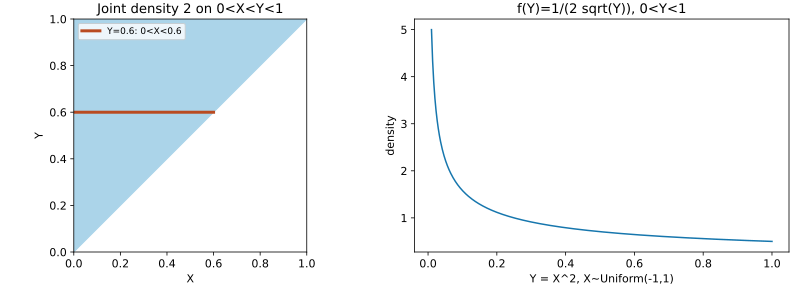

# 随机变量变换、联合分布与常见分布

一次实验可以同时产生收益与成交量，也可以把原始读数平方或取对数。读者的问题是：已知原变量的规律，怎样得到新变量的概率？这首先是把事件搬回原空间，再计算概率的问题。本课以实随机变量为对象，连续密度的计算要求会单变量积分；二维变换要求会多重积分和 Jacobian。积分换元背景可读 [[数学/16-数学分析/12-多重积分换元与积分次序|多重积分换元]]，不必先学习一般测度论。

## 1. 分布函数比密度更基本

在概率空间 $(\Omega,\mathcal F,P)$ 上，随机变量 $X$ 是从结果 $\omega$ 到实数的可测函数；其分布函数是 $F_X(x)=P(X\le x)$。$F_X$ 单调不减、右连续，左右无穷远的极限分别为0和1。离散变量用概率质量函数 $p_X(x)=P(X=x)$；绝对连续变量用密度 $f_X\ge0$，满足 $F_X(x)=\int_{-\infty}^x f_X(t)\,dt$。单点概率为0不等于这个点“绝不可能出现”；概率是对集合赋值。

密度的单位是“$X$的单位的倒数”，密度值可以大于1，区间概率才必须在0与1之间。例如 $U\sim U(0,1/2)$ 的密度为2。混合分布也很常见：令 $X=0$ 的概率为1/2，另以1/2概率从 $U(0,1)$ 抽样。其CDF在0跳跃1/2，不能只用普通函数密度完整表示。后文的密度公式都要求相应绝对连续性。

## 2. 一维变换：先写事件，后微分

若 $Y=g(X)$，总有
$$F_Y(y)=P(g(X)\le y).$$
当 $g$ 在支持区间上严格单调、可微，逆函数 $h=g^{-1}$ 可微且导数非零时，换元得到
$$f_Y(y)=f_X(h(y))|h'(y)|.$$
绝对值来自长度的正性；递减变换也必须得到非负密度。值域之外密度为0。若 $g$ 分段单调，对每个合法逆分支求和：$f_Y(y)=\sum_{x:g(x)=y} f_X(x)/|g'(x)|$，式子仅在可微且导数不为0的普通点成立，临界点可单独用CDF处理。

**完整手算：平方会合并两侧。** 令 $X\sim U(-1,1)$，$Y=X^2$。当 $0\le y\le1$，
$$F_Y(y)=P(-\sqrt y\le X\le\sqrt y)=\frac{2\sqrt y}{2}=\sqrt y.$$
因此 $f_Y(y)=1/(2\sqrt y)$，$0<y<1$。在0附近密度发散但可积：$\int_0^1(2\sqrt y)^{-1}dy=1$。期望由新密度算得 $E[Y]=\frac12\int_0^1 y^{1/2}dy=1/3$，与 $E[X^2]=\frac12\int_{-1}^1x^2dx=1/3$ 一致。若只取正根，概率总和会少一半。

**逆变换采样。** $U\sim U(0,1)$，令 $Y=-\log U/\lambda$，$\lambda>0$。对 $y\ge0$，$P(Y>y)=P(U<e^{-\lambda y})=e^{-\lambda y}$，所以 $Y\sim\mathrm{Exp}(\lambda)$。$\lambda$ 是速率，单位为“时间的倒数”；均值 $1/\lambda$ 是等待时间，不能把速率与尺度混用。

## 3. 联合、边缘、条件：分别回答什么

联合CDF为 $F_{X,Y}(x,y)=P(X\le x,Y\le y)$。离散时，$p_X(x)=\sum_y p_{X,Y}(x,y)$；若 $p_Y(y)>0$，$p_{X\mid Y}(x\mid y)=p_{X,Y}(x,y)/p_Y(y)$。绝对连续时，
$$f_X(x)=\int_{\mathbb R}f_{X,Y}(x,y)dy,\qquad f_{X\mid Y}(x\mid y)=\frac{f_{X,Y}(x,y)}{f_Y(y)},\quad f_Y(y)>0.$$
此处 $P(Y=y)=0$，不能把条件密度定义成两个单点概率之比。它是由联合密度构造的条件分布版本，按几乎处处意义确定。联合分布不是由两条边缘分布唯一决定的；依赖关系也是信息。

**三角形联合密度。** 令 $f_{X,Y}(x,y)=2$ 在 $0<x<y<1$ 上，其他位置为0。先检查归一化：$\int_0^1\int_0^y2\,dxdy=1$。边缘为
$$f_Y(y)=2y\ (0<y<1),\qquad f_X(x)=2(1-x)\ (0<x<1).$$
给定 $Y=y$，$X$ 在 $(0,y)$ 上均匀，故 $f_{X\mid Y}=1/y$，$E[X\mid Y=y]=y/2$。于是
$$E[X]=\int_0^1 \frac y2(2y)dy=\frac13,\quad E[Y]=\frac23,$$
$$E[XY]=\int_0^1 y\left(\int_0^y2x\,dx\right)dy=\frac14,\quad \operatorname{Cov}(X,Y)=\frac14-\frac29=\frac1{36}.$$
两者不独立：例如 $P(X>Y)=0$，而边缘的乘积分布给这个区域正概率。

图中蓝色三角形是密度为2的区域；横线 $y=0.6$ 的截面是 $0<x<0.6$，条件密度为 $1/0.6$。右图是平方变换后的密度，曲线只在 $0<y<1$ 使用，0处的可积奇性不画成有限值。

独立的定义是对所有可测集合 $A,B$ 有 $P(X\in A,Y\in B)=P(X\in A)P(Y\in B)$。对于有联合密度的变量，独立等价于 $f_{X,Y}=f_Xf_Y$ 几乎处处。独立且相应矩存在推出协方差为0，逆向一般失败：$X\sim U(-1,1),Y=X^2$ 时，$E[X]=E[X^3]=0$，所以协方差0；$Y$ 却由 $X$ 完全决定。

## 4. 两个变量一起变换

令 $(U,V)=T(X,Y)$，在支持区域上 $T$ 一一对应且有可微逆 $H$、$\det DH\ne0$。换元公式是
$$f_{U,V}(u,v)=f_{X,Y}(H(u,v))|\det DH(u,v)|.$$
它把一个小面积的概率守恒转写成密度。多对一映射必须按合法分支求和，不能只写行列式而忽略新支持。

例如 $X,Y$ 独立 $\mathrm{Exp}(\lambda)$，设 $S=X+Y,R=X/(X+Y)$。$S>0,0<R<1$；逆为 $X=SR,Y=S(1-R)$，
$$\det\begin{pmatrix}r&s\\1-r&-s\end{pmatrix}=-s.$$
于是 $f_{S,R}(s,r)=\lambda^2s e^{-\lambda s}$。对 $r$ 积分得 $f_S(s)=\lambda^2s e^{-\lambda s}$，对 $s$ 积分得 $f_R(r)=1$，联合密度又恰为它们的乘积，所以 $S,R$ 独立。若两个速率不同，这个因式分解通常失败。

对独立且有密度的 $X,Y$，$S=X+Y$ 的另一条路线是卷积：
$$f_S(s)=\int_{\mathbb R}f_X(x)f_Y(s-x)dx.$$
这由 $(S,X)$ 换元得到，Jacobian绝对值为1。支持决定实际积分区间；两条均匀$(0,1)$的和在$(0,1)$密度为$s$、$(1,2)$为$2-s$，不是均匀分布。

## 5. 常见分布是一组模型选择

| 对象与参数化 | 质量或密度及支持 | 均值、方差 | 使用前问什么 |
| --- | --- | --- | --- |
| Bernoulli$(p)$，$0\le p\le1$ | $P(X=1)=p,P(X=0)=1-p$ | $p,p(1-p)$ | 单位是否一次二元试验？ |
| Binomial$(n,p)$，整数$n\ge0$ | $\binom nk p^k(1-p)^{n-k}$，$k=0,\ldots,n$ | $np,np(1-p)$ | $n$次是否独立且成功率相同？ |
| Poisson$(\lambda)$，$\lambda>0$ | $e^{-\lambda}\lambda^k/k!$，$k\ge0$整数 | $\lambda,\lambda$ | 固定窗口内是否适合独立稀有事件模型？ |
| Geometric$(p)$，$0<p\le1$ | $(1-p)^{k-1}p$，$k=1,2,\ldots$ | $1/p,(1-p)/p^2$ | 本页数到首次成功的试验次数，含成功那次 |
| Uniform$(a,b)$，$a<b$ | $1/(b-a)$，$a<x<b$ | $(a+b)/2,(b-a)^2/12$ | 各等长区间是否真的等可能？ |
| Exponential$(\lambda)$，速率$\lambda>0$ | $\lambda e^{-\lambda x}$，$x>0$ | $1/\lambda,1/\lambda^2$ | 危险率是否常数？ |
| Gamma$(a,\lambda)$，形状$a>0$、速率$\lambda>0$ | $\lambda^a x^{a-1}e^{-\lambda x}/\Gamma(a)$，$x>0$ | $a/\lambda,a/\lambda^2$ | 参数是速率还是尺度？ |
| Normal$(\mu,\sigma^2)$，$\sigma>0$ | $e^{-(x-\mu)^2/(2\sigma^2)}/(\sigma\sqrt{2\pi})$，$x\in\mathbb R$ | $\mu,\sigma^2$ | 是否只是近似？尾部是否适合？ |

二项系数来自选择成功的位置，独立性让每条含$k$次成功的序列有相同概率。Poisson的质量和由指数级数得1，$E[K]=\lambda e^{-\lambda}\sum_{j\ge0}\lambda^j/j!=\lambda$，再用 $E[K(K-1)]=\lambda^2$ 得方差。指数分布的生存函数满足 $P(X>s+t\mid X>s)=e^{-\lambda t}$；一般寿命数据未必满足这个无记忆条件。Gamma均值方差由 $\Gamma(a+1)=a\Gamma(a)$ 积分得出；上节两指数之和就是$a=2$。

这张表不证明某组金融收益正态或某类用户请求独立；应由数据机制与诊断支持。抽样分布中的 $t,\chi^2,F$ 放在 [[数学/30-概率与统计/08-中心极限定理与抽样分布|08课]]，在那里解释它们由哪些随机量组成。

### 不放回计数：批次状态与样本似然

十件物品抽一件发现坏了，样本当然提供信息；但信息强弱要由抽法和观察事件决定。先固定总体：编号01—10的十件物品，在同一时点、同一操作性测试下，每件只有“bad/非bad”两种状态。$K\in\{0,\ldots,10\}$ 是该时点的bad总件数，状态固定且未知；假定测试识别无误、不改变其他物品状态。此处bad只是测试定义，应用到书架时的时点、安装和载荷见 [[社会科学/63-法学/06-同题比较与共同案例完整解答#F1-S：抽到坏样品后，批次主张能走多远|F1-S]]，不能先写成已经成立的法律瑕疵。

**先预测。** 想象三个候选总体：只有1件bad、5件bad、10件bad。在不知道bad位于哪些编号时，按简单随机不放回设计抽样：所有同样大小的编号集合等可能。抽1件恰为bad，哪种总体更容易产生？另一个事先确定的设计抽2件，恰好1件bad，又是哪种更容易？先写排序，尤其检查“全部bad”能否产生第二个事件。这是两个分别实施的教学设计，不是在抽到bad后临时决定追加一件。

**从抽样空间数起。** 一般地，$N\ge1$、$0\le K\le N$、$0\le n\le N$ 都是整数。$\Omega_n=\{s\subseteq\{1,\ldots,N\}:|s|=n\}$ 包含 $\binom Nn$ 个等概率无序样本，$X(s)$ 数样本中bad的件数。要让 $X=x$，必须从 $K$ 件bad中取 $x$ 件，再从 $N-K$ 件非bad中取 $n-x$ 件，两步计数相乘：

$$
P(X=x\mid K)=\frac{\binom Kx\binom{N-K}{n-x}}{\binom Nn},
\qquad \max(0,n-N+K)\le x\le\min(n,K).
$$

这就是超几何计数；区间外概率为0，约定无法取出的组合数为0。$K$ 固定时，对所有合法 $x$ 求和等于1：每个样本集合只会落入一个bad件数类别。式中件数与概率均无量纲；$N$ 的分母范围来自同一个有限总体。

$N=10,n=1$ 时，观察 $X=1$ 有 $K$ 个成功编号、10个可能编号。把已经观察到的事件固定，得到似然 $L_1(K)=K/10$。

| 固定候选 $K$ | 1 | 5 | 10 |
| --- | --- | --- | --- |
| 随机抽1件，观察bad：$L_1(K)$ | $1/10$ | $1/2$ | $1$ |

$N=10,n=2$ 时，$\Omega_2$ 有 $10\times9/2=45$ 对。恰好一bad的配对是 $K(10-K)$ 对，因此 $L_2(K)=K(10-K)/45$。

| 固定候选 $K$ | 1 | 5 | 10 |
| --- | --- | --- | --- |
| 无序抽2件，恰好1件bad：$L_2(K)$ | $9/45=1/5$ | $25/45=5/9$ | $0/45=0$ |

为了直观看分子，给 $K=5$ 的候选安排01—05为bad、06—10为非bad；这只是计数用的排列，不是已观测事实。交叉配对例如 $\{01,06\}$ 有 $5\times5=25$ 对；$\{01,02\}$ 的两bad和 $\{06,07\}$ 的零bad不属于本次事件。编号便于追踪原件，本表只使用“样本bad件数”这一汇总观察，没有对具体哪个编号为bad另建概率模型。

若记录的是**有序先bad后非bad**，有90个等概率有序对，事件概率为 $K(10-K)/90$，恰为表中一半；“非bad后bad”是另一个不相交事件。若固定 $K\ge1$，第一件已是bad后，第二件再为bad的条件概率变为 $(K-1)/9$。在非退化情形 $0<K<10$，它不等于第一件的 $K/10$，两次指示不是i.i.d. Bernoulli，不能套 $2(K/10)(1-K/10)$：$K=5$ 时二项式会给 $1/2$，这里应为 $5/9$。$K=0$或10时所有状态相同，是退化例外；不能由端点数值相同推广到未知$K$。当总体很大、抽取比例很小时可能考虑近似，但本例不需要近似。

**把计算读成证据信息。** 回 [[数学/30-概率与统计/03-似然负对数似然与困惑度#主轨：同一个公式，两种提问方向|似然主解释]] 核对参数固定与数据固定，再回来读表：同一“抽1件为bad”观察在 $K=5$ 下是 $K=1$ 下的5倍容易，在 $K=10$ 下是10倍容易；并未证明 $K=10$。第二个观察含一件非bad，在这些理想假设下直接排除 $K=10$，且 $K=5$ 比 $K=1$ 更容易产生它。两表比较的是不同固定状态对**各自同一个观察**的相对支持，不能跨事件按数值大小比较证据强弱。

似然列也不是 $K$ 的概率分布：第一种观察的 $L_1(K)$ 对 $K=0,\ldots,10$ 的和是 $11/2$，无须等于1。若要问 $P(K=10\mid X=1)$，还须指定先验与更新规则；若要形成区间或检验，还须指定相应推断办法。本小节只给完整抽样模型和观察似然，不擅自报告“全批bad概率”或置信水平。改变测试误差、时点或选样机制后，零似然排除与相对支持都须重核。

**复算后迁移。** 标准库脚本 [finite_batch_likelihood.py](finite_batch_likelihood.py) 枚举十个编号的样本集合，以精确分数核对 $K=0,\ldots,10$ 和全部样本大小的公式及归一化，并输出上述两表和有序事件。可从库根运行 `python3 数学/30-概率与统计/finite_batch_likelihood.py`；它不抽取真实物品，也不产生法律证据。遮住答案再做：①工作人员专挑已有松动迹象的一件，检测为bad；②保持随机抽2件，但报告变为“至少1件bad”。分别写出能否沿用原表、需要什么新计数，并携带“总体—时点—检测定义—设计—观察事件”返回F1-S，解释哪些退款前提还未处理。

> [!success]- 迁移答案
> ① 所有编号不再等概率，$K/10$不能直接用；还须知道松动迹象、真实bad状态与选择概率的关系。对被检件的直接观察仍在，在无误测试的固定总体假设下至少有1件bad，却没有原表的相对似然；未知选样方式同样不能直接套表。② 事件应改成 $P(X\ge1\mid K)=1-\binom{10-K}{2}/45$，$K=1,5,10$ 分别为 $1/5,7/9,1$；$K=10$又能产生这个事件。“恰好1件”和“至少1件”不只换词，后者保留两bad的样本。两题都没有补出交付时的法律不合约、F2事故机制或整体解除/拒收条件；法律请求的对象与范围须回F1另查。

## 6. 练习及完整解答

1. $X\sim U(0,1)$，$Y=\sqrt X$，求CDF、密度和均值。
2. 用三角形例求 $P(X<1/2)$ 和 $P(X<1/2\mid Y=3/4)$。
3. 若$X,Y$独立均匀$(0,1)$，求 $P(X+Y\le1/2)$。
4. “密度大于1”和“零协方差即独立”分别哪里错？给本课数例。

> [!question]- 解答
> 1. 当$0\le y\le1$，$P(\sqrt X\le y)=P(X\le y^2)=y^2$；密度$2y$；$E[Y]=\int_0^1 2y^2dy=2/3$。
> 2. $\int_0^{1/2}2(1-x)dx=3/4$；给定$Y=3/4$，条件区间长$3/4$，所问子区间长$1/2$，概率$2/3$。后者是条件密度概率，非$P(Y=3/4)$作分母。
> 3. 正方形内边长$1/2$的直角三角形面积为$1/8$；也可积分$\int_0^{1/2}s\,ds=1/8$。
> 4. 均匀$(0,1/2)$密度为2，积分仍为1；$X$对称、$Y=X^2$零协方差但相依。

## 继续读与来源边界

回 [[数学/30-概率与统计/00-概率与统计-MOC|课程地图]]；下一课 [[数学/30-概率与统计/07-概率不等式大数定律与收敛方式|07：为什么平均值稳定]]。若要看可测性与积分换元的理论背景，读 [[数学/16-数学分析/14-测度可测函数与Lebesgue积分|测度与积分背景]]。若要把协方差矩阵转成主成分方向，读 [[数学/20-线性代数与几何/15-谱定理二次型与正定矩阵|谱定理的矩阵应用]]；它承担谱分解，不承担本课概率结论。

本课的公式、算例与题解为独立推演。对照材料：[MIT18.600 Fall2019 Lecture21](https://ocw.mit.edu/courses/18-600-probability-and-random-variables-fall-2019/79a42fd8297d4afaca276b7e938876f9_MIT18_600F19_lec21.pdf)，PDF页24–28核对联合密度、页31–35核对独立性。只用该讲作这些对象定义的对照，不宣称它逐段证明本课全部变换或分布表。复算入口 [[数学/30-概率与统计/81-概率极限与推断复算|81：复算]]。

分布表的具名对照还包括MIT18.600的[Lecture11二项分布 PDF页4–11、42–53](https://ocw.mit.edu/courses/18-600-probability-and-random-variables-fall-2019/851faa681ed54899934ed624c00e7cd5_MIT18_600F19_lec11.pdf)、[Lecture12 Poisson PDF页41–53](https://ocw.mit.edu/courses/18-600-probability-and-random-variables-fall-2019/e5f8372019bd6c6975975a27961ca918_MIT18_600F19_lec12.pdf)、[Lecture19指数 PDF页4–14、26–31](https://ocw.mit.edu/courses/18-600-probability-and-random-variables-fall-2019/6c96b0a7289c01775bc4942d7ae2f46f_MIT18_600F19_lec19.pdf)和[Lecture20 Gamma PDF页23–26](https://ocw.mit.edu/courses/18-600-probability-and-random-variables-fall-2019/ae960146d5e042e671ea625e8fb5cf98_MIT18_600F19_lec20.pdf)。Gamma与指数均按速率λ写，若教材使用尺度θ，需换成θ=1/λ；这些来源定位不意味着所有分布建模条件已在现实数据中验证。

## 电子电路往返：X16良率计数与寿命时钟

本页的Poisson和指数分布需要不同物理对象。[[电子电路/62-Chiplet与异构封装/03-系统分割与接口权衡#跨学科往返：X16良率成本与真实版本]] 的缺陷计数N用均值DA（无量纲），Y=P(N=0)=exp(−DA)；D=0.3/cm²、A=1cm²给Y=0.740818。[[电子电路/54-制造可靠性与生命周期/04-热可靠性与失效机理#跨学科往返：寿命概率需要自己的条件]] 的寿命T以小时计、常危险率λ以1/h计，P(T>t)=exp(−λt)。两者的指数都必须无量纲，但λt和DA不代表同一个随机事件。

返回良率页时检查缺陷均匀/独立、关键面积、KGD筛选与封装条件；返回寿命页时检查是否可用恒定危险率及同一机理。联合分布只有在有依据的独立条件下才因子化；共享晶圆/批次/温度可造成相关，筛选观测又可改变条件分布。独立假设下的成本比较是一个有限模型，不是实际工艺报价或质保寿命。若只有出厂通过/失败数据，没有时间与失效信息，不能把0.740818换算成小时危险率。
