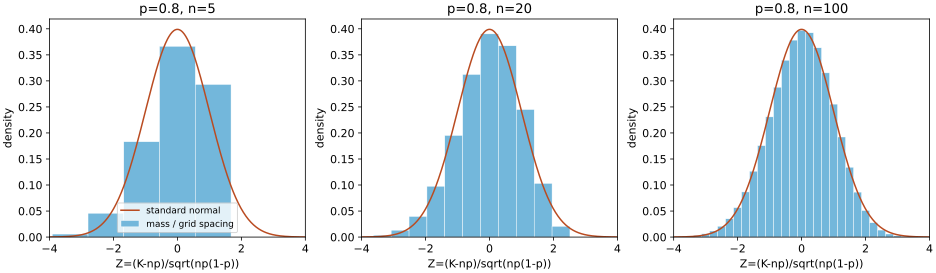

# 中心极限定理与抽样分布

均值越来越稳定，并不告诉我们误差在某个$n$下怎样分布，也不自动给出95%区间。本课区分两个来源：iid有限方差下的**渐近正态**，以及正态总体下的**有限样本精确分布**。它们得到的临界值相似，承担结论的条件不同。

## 1. CLT在放大什么

设$X_i$ iid，$E[X_i]=\mu$，$0<\sigma^2=\operatorname{Var}(X_i)<\infty$。令
$$Z_n=\frac{\sum_{i=1}^nX_i-n\mu}{\sigma\sqrt n}=\frac{\sqrt n(\bar X_n-\mu)}\sigma.$$
Lindeberg–Lévy中心极限定理说 $Z_n\xrightarrow d N(0,1)$。注意它不说$X_i$本身趋正态，也不说$\bar X_n$趋向一个方差固定为1的正态。未标准化均值依弱大数趋常数，标准化误差才保留非平凡形状。

若$X_i$本来正态，则任意$n$都有$\bar X_n\sim N(\mu,\sigma^2/n)$。若是Bernoulli，均值仍是离散格点变量，只能作分布近似。$n\ge30$不是对所有分布有效的定理门槛；罕见事件、重偏态或重尾会需要更大样本。无穷方差、非独立样本也不满足本课这版CLT。

## 2. 特征函数证明路线：每一步及外部依赖

这里证明标准化特征函数的极限，并明确依赖Lévy连续性定理完成最后一步；不宣称从零完整证明所有概率分析工具。定义 $\varphi_Y(t)=E[e^{itY}]$。因为$|e^{itY}|=1$，所有实随机变量都有特征函数，区别于可能不在0邻域存在的矩母函数。

**二阶展开（本课展开证明）。** 标准化单个变量$Y=(X-\mu)/\sigma$，$E[Y]=0,E[Y^2]=1$。对实$z$令
$$r(z)=e^{iz}-1-iz+\frac{z^2}2.$$
Taylor积分余项使$r(z)/z^2\to0$，且对所有$z$有$|e^{iz}-1-iz|\le z^2/2$，从而$|r(z)|\le z^2$。所以对$t\ne0$，$|r(tY)/t^2|\le Y^2$，逐点趋0。使用已有 [[数学/16-数学分析/15-收敛定理与Fubini-Tonelli|支配收敛定理]]，得到$E[r(tY)]=o(t^2)$。因此
$$\varphi_Y(t)=1-\frac{t^2}2+o(t^2).$$
这里仅需二阶矩，不可未经说明换成$O(t^3)$；后者常需三阶绝对矩。

**独立乘积与尺度（本课展开证明）。** 对固定实$t$，独立性给
$$\varphi_{Z_n}(t)=\left[\varphi_Y(t/\sqrt n)\right]^n=\left[1-\frac{t^2}{2n}+o(1/n)\right]^n\longrightarrow e^{-t^2/2}.$$
令括号里的增量为$a_n=-t^2/(2n)+o(1/n)$，有$na_n\to-t^2/2$、$n|a_n|^2\to0$。在1附近用复对数的连续分支，$\log(1+a_n)=a_n+O(|a_n|^2)$，故$n\log(1+a_n)\to-t^2/2$，再取指数即可。这避免把复数幂极限当成未说明的实数公式。

**识别正态与Lévy（外部定理依赖）。** 标准正态的特征函数为$e^{-t^2/2}$：若$I(t)=\int e^{itx}\phi(x)dx$，由$x\phi(x)=-\phi'(x)$和分部积分得$I'(t)=-tI(t)$，$I(0)=1$，于是$I(t)=e^{-t^2/2}$。微分换积分由$\int|x|\phi(x)dx<\infty$支持，边界项为0。Lévy连续性定理说：特征函数逐点趋向某随机变量的特征函数，便有对应分布收敛；更一般地，极限在0连续也足够。**本课使用该定理，不证明其紧性、子列抽取和唯一性部分。** 精确依赖为[MIT18.175 Spring2014 Lecture15 PDF页10–11](https://ocw.mit.edu/courses/18-175-theory-of-probability-spring-2014/20b9ab92704112083d78d0af846ac13f_MIT18_175S14_Lecture15.pdf)：页10连续性定理，页11矩与CLT。这是本课“证明路线”的边界。

## 3. 二项分布的近似及连续性修正

$K\sim\mathrm{Bin}(100,0.8)$，均值80、方差16、标准差4。上一课事件$K\le70$或$K\ge90$的精确概率为0.01694536。正态近似用$N(80,16)$，为覆盖整数柱子边界，连续性修正用70.5和89.5：
$$P(K\le70\text{ 或 }K\ge90)\approx\Phi\left(\frac{70.5-80}4\right)+1-\Phi\left(\frac{89.5-80}4\right)=2\Phi(-2.375)\approx0.01755.$$
这不是精确等式。二项分布$p=0.8$不对称，近似仍会有误差。不能把上一课Chebyshev上界0.16解读成正态尾面积。

每幅图画$Z=(K-np)/\sqrt{np(1-p)}$，$p=0.8$、$n=5,20,100$。蓝柱高度是质量除以格点间距，故柱面积为概率；橙线为标准正态密度。格点随$n$增加变密，图示模型下的趋近，不是所有分布的通用样本量保证。

## 4. 为什么$t,\chi^2,F$是“抽样分布”

抽样分布是一个统计量在重复同设计抽样时的分布。$\bar X$、$S^2$都是随机变量；写出的样本均值、样本方差只是它们的一次实现。若$X_i$ iid $N(\mu,\sigma^2)$、$n\ge2$，令$S^2=\sum_i(X_i-\bar X)^2/(n-1)$，有
$$Z=\frac{\sqrt n(\bar X-\mu)}\sigma\sim N(0,1),\qquad Q=\frac{(n-1)S^2}{\sigma^2}\sim\chi^2_{n-1},\qquad Z\perp Q.$$
解释自由度与独立性的路线可以直接用正交坐标：标准化向量$W_i=(X_i-\mu)/\sigma$联合密度为$(2\pi)^{-n/2}e^{-\|w\|^2/2}$。取第一基向量$u_1=\mathbf1/\sqrt n$，补成正交矩阵；$V=U^TW$保持平方范数与Jacobian绝对值1，联合密度仍是$n$个独立标准正态的乘积。$V_1=Z$，而$Q=\sum_{j=2}^nV_j^2$，于是卡方自由度$n-1$，与$Z$独立。这是正态总体下的完整有限维构造，不把非正态总体也假装旋转后坐标独立。

定义$\chi^2_\nu$为$\nu$个独立标准正态平方和，$\nu$为正整数；均值$\nu$，方差$2\nu$。若$Z\sim N(0,1)$、$Q\sim\chi^2_\nu$且独立，定义
$$T=Z/\sqrt{Q/\nu}\sim t_\nu.$$
于是正态样本的$T=\sqrt n(\bar X-\mu)/S\sim t_{n-1}$。若$Q_1,Q_2$为独立卡方、自由度$d_1,d_2$，定义
$$F=\frac{Q_1/d_1}{Q_2/d_2}\sim F_{d_1,d_2}.$$
这要求分子分母独立且按各自自由度归一化；不是任意两个样本方差之比都服从F分布。$t_\nu^2\sim F_{1,\nu}$直接由定义得到。

密度公式及尾部形状可用[NIST1.3.6.6.4：t](https://www.itl.nist.gov/div898/handbook/eda/section3/eda3664.htm)、[1.3.6.6.6：卡方](https://www.itl.nist.gov/div898/handbook/eda/section3/eda3666.htm)、[1.3.6.6.5：F](https://www.itl.nist.gov/div898/handbook/eda/section3/eda3665.htm)对照。小自由度$t$尾部更重；$t_1$是Cauchy，均值没有定义，不能因对称就给它均值0。

## 5. 一组教学收益样本：完整区间计算

设五个观察是从一个正态收益总体独立抽取，单位为**百分点**，数据$(1,2,2,4,5)$。这是教学模型，未声称真实市场收益满足该假设。$n=5$、总和14，所以$\bar x=2.8$。平方偏差为$3.24,0.64,0.64,1.44,4.84$，和10.8；$s^2=10.8/4=2.7$，$s=1.64317$，$\widehat{SE}=s/\sqrt5=\sqrt{0.54}=0.73485$。

令$t_{q,\nu}$是$t_\nu$分布的$q$分位点。因为
$$P\left(-t_{0.975,4}\le\frac{\bar X-\mu}{S/\sqrt5}\le t_{0.975,4}\right)=0.95,$$
移项得到95%均值区间$\bar X\pm t_{0.975,4}S/\sqrt5$。代入$t_{0.975,4}=2.776445$，得到$2.8\pm2.04026$，即约$[0.75974,4.84026]$百分点。覆盖率的随机对象是区间，$\mu$是固定参数；详见 [[数学/30-概率与统计/05-统计估计置信度与模型评测|05的覆盖解释]]。

若要估总体方差，用$Q\sim\chi^2_4$，得到
$$\left[\frac{4S^2}{\chi^2_{0.975,4}},\frac{4S^2}{\chi^2_{0.025,4}}\right].$$
分位点约11.14329与0.48442，所以样本方差区间约$[0.9692,22.2948]$，单位为百分点平方。反转分位点次序来自分母：大分母给下界。只有五个观察使方差推断很宽，这是模型内的真实不确定性。

非正态iid有限方差时，可用大样本CLT和一致方差估计再配Slutsky定理得到学生化统计量渐近正态；它通常**不精确服从$t_{n-1}$**。本课未完整证明Slutsky与所有非正态稳健性结论。时间相关、波动聚类或厚尾收益需要另建抽样模型，不能用“数据是收益”来自动满足iid正态。

## 6. 练习及完整解答

1. iid Bernoulli$(0.2)$，$n=100$，写$K$和$\bar X$的均值方差与CLT标准化。
2. 为什么“$n=100$时均值已正态”不严谨？
3. 正态样本$n=6$的均值$t$和方差卡方自由度各是多少？
4. 两个独立正态总体，各抽$n_1=5,n_2=8$，方差相同且未知。$S_1^2/S_2^2$在模型下是什么分布？总体方差不同呢？

> [!question]- 解答
> 1. $E[K]=20,Var(K)=16$；$E[\bar X]=0.2,Var(\bar X)=0.0016$；$(K-20)/4=\sqrt{100}(\bar X-0.2)/0.4\xrightarrow d N(0,1)$是随$n$的序列陈述，不能把单个100写为极限。
> 2. 均值是有限个格点，精确分布仍离散；CLT只给渐近CDF趋近，未给所有分布同一个误差界。
> 3. 均为$n-1=5$；均值方向占去一个正交坐标，残差剩五个。
> 4. 相同总体方差时$S_1^2/S_2^2\sim F_{4,7}$；不同总体方差时$ (S_1^2/\sigma_1^2)/(S_2^2/\sigma_2^2)\sim F_{4,7}$，原比值要乘总体方差比才是相应尺度形式。

## 继续学习

下一课 [[数学/30-概率与统计/09-假设检验错误概率与功效|09：分布怎样成为检验规则]]；再读 [[数学/30-概率与统计/10-回归推断方差分析与模型诊断|10：回归里的正交分解与推断]]。复算 [[数学/30-概率与统计/81-概率极限与推断复算|81]]；返回 [[数学/30-概率与统计/00-概率与统计-MOC|MOC]]。本课CLT部分明确为含外部定理依赖的证明路线；正态向量的均值/残差分解与教学算例已在正文展开，数值执行仍不替代独立语义审阅。
