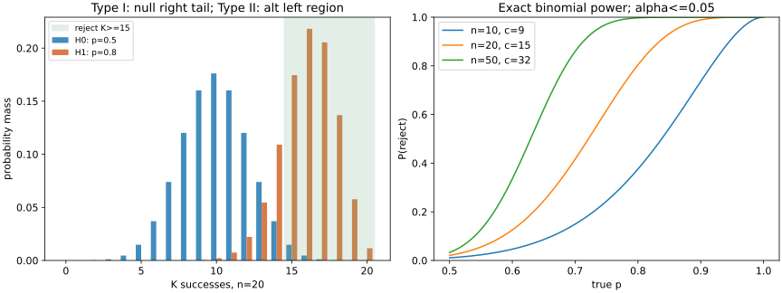

# 假设检验、错误概率与功效

看到20次观察中15次成功，我们能否说成功率超过1/2？检验的核心是事先规定一个规则，计算它在零假设模型下多常误报，再计算真实改善存在时多常检出。显著性、p值和功效分别属于规则、观察结果和备择参数，不能互换。

## 1. 先定义零假设与规则

设数据分布为$P_\theta$，$H_0:\theta\in\Theta_0$、$H_1:\theta\in\Theta_1$。拒绝域$R$是数据空间中的集合；观察落入$R$就拒绝$H_0$。非随机检验用$\phi(X)=\mathbf1_R(X)$表示。显著性水平$\alpha$是预先容许的上限：
$$\sup_{\theta\in\Theta_0}P_\theta(X\in R)\le\alpha.$$
左边叫检验的size，可能小于名义水平$\alpha$，尤其离散检验。对某个备择参数$\theta$，功效$\pi(\theta)=P_\theta(X\in R)$，Ⅱ类错误概率$\beta(\theta)=1-\pi(\theta)$。所以功效不是一个脱离效应大小的常数。

| 真实状态 | 拒绝$H_0$ | 不拒绝$H_0$ |
| --- | --- | --- |
| $H_0$成立 | Ⅰ类错误 | 在零假设下未误报 |
| $H_1$成立 | 检出，概率$\pi(\theta)$ | Ⅱ类错误，概率$\beta(\theta)$ |

不拒绝不证明零假设真；“两个模型完全相同”与“本次数据不足以拒绝”是不同结论。要支持差异小于一个实际阈值，应设计等效性或非劣检验，不能仅凭普通差异检验$p>0.05$。

## 2. 精确二项检验：整个过程手算

**模型与问题。** $X_i$ iid Bernoulli$(p)$，固定$n=20$，$K=\sum_iX_i$。检验$H_0:p\le0.5$，$H_1:p>0.5$，名义水平0.05。预先规定大$K$支持改善。

**为什么复合零假设的最坏点在0.5？** 令独立$U_i\sim U(0,1)$，$X_i(p)=\mathbf1_{\{U_i\le p\}}$，则$p$越大，每个$X_i(p)$和$K(p)$逐点不减，因此$P_p(K\ge c)$不减。$p\le0.5$上尾最大的点就是0.5；这完整说明用边界参数控制size的理由。

**找拒绝阈值。** 在$p=0.5$下，各序列概率$2^{-20}$。$\binom{20}{15},\ldots,\binom{20}{20}$为15504、4845、1140、190、20、1，和21700，故
$$P_{0.5}(K\ge15)=21700/1048576\approx0.02069473\le0.05.$$
而$\binom{20}{14}=38760$，所以$P_{0.5}(K\ge14)=60460/1048576\approx0.05765915>0.05$。最宽的整数上尾拒绝域是$K\ge15$，实际size约2.07%，不是5%。如允许在边界$K=14$随机拒绝，可填满5%预算，但本例采用更容易复现的非随机规则；随机化概率与最优性证明见 [[数学/30-概率与统计/14-似然比最优检验与置换推断#四次 Bernoulli：边界随机化不是随意猜|似然比检验课]]。

**观察结果和p值。** 若观察$k=15$，一侧p值为$\sup_{p\le0.5}P_p(K\ge15)=0.02069473$。它是零假设模型下“至少同样支持备择”的结果概率；不是$P(H_0\mid数据)$，也不是本次结论出错的后验概率。在本设计中拒绝$H_0$，报告“在iid固定20次二项模型下有成功率高于0.5的证据”，同时给样本比例$15/20=0.75$和抽样限制。

**功效。** 若真实$p=0.8$，同一规则检出的概率为
$$\pi(0.8)=\sum_{k=15}^{20}\binom{20}k(0.8)^k(0.2)^{20-k}\approx0.80420779,$$
Ⅱ类错误约0.19579221。不是用观察到的$\hat p=0.75$代替备择然后宣布“本次已经有80%功效”；功效应针对事前关心的$p$、样本量与规则计算。

左图固定$n=20,c=15$：在$p=0.5$分布的拒绝尾部是Ⅰ类错误，在$p=0.8$分布的未拒绝区域是Ⅱ类错误；图例对应不同假设下的两种分布。右图每条曲线对给定$n$按$p_0=0.5,\alpha=0.05$重新选择整数阈值；离散性使实际size通常低于0.05，不能强行认为各曲线在0.5处同为0.05。

## 3. 同一检验反演出区间

对每个候选$p_0$做上尾二项检验，未被拒绝的参数形成置信集合。对于$k>0$，精确一侧95%下界$L$解
$$P_L(K\ge k)=\sum_{j=k}^{n}\binom nj L^j(1-L)^{n-j}=0.05,$$
$k=0$时定义$L=0$。本例$k=15,n=20$给$L\approx0.54441760$，一侧区间$[L,1]$。这由**一侧**5%检验反演；不是双侧95%区间，双侧等尾区间两端用0.025。离散分布使覆盖率至少名义值，未必处处恰等95%。

区间和检验给不同信息：拒绝$p\le0.5$，但区间下界只有约0.544；数据未支持“至少提高到0.7”。有关区间的频率覆盖含义沿用 [[数学/30-概率与统计/05-统计估计置信度与模型评测|05]]，这里新增的是从检验到区间的构造机制。

## 4. 连续模型中的$t$检验及双侧方向

在08的iid正态收益模型中，数据$(1,2,2,4,5)$百分点，$\bar x=2.8,s^2=2.7,n=5$。检验$H_0:\mu=0$对$H_1:\mu\ne0$，统计量
$$t=\frac{2.8-0}{\sqrt{2.7/5}}\approx3.81032.$$
在$H_0$下$T\sim t_4$。双侧$p=2P(t_4\ge|3.81032|)\approx0.01893$；5%拒绝规则$|T|\ge2.776445$，本例拒绝。08的双侧95%均值区间不含0，正是同一检验的反演结果。$t$分布精确性来自正态总体及独立抽样；不能把实际收益时间序列直接贴这个结论。[NIST7.2.2](https://www.itl.nist.gov/div898/handbook/prc/section2/prc22.htm)可核对一/双侧均值统计量与临界值方向。

若备择预先是$\mu>0$，只用上尾；看完数据再把双侧改成有利的一侧会改变误报控制。方差检验用$Q=(n-1)S^2/\sigma_0^2$在正态零假设下服从卡方；上尾支持方差变大，下尾支持变小，双侧须明确两边如何分配$\alpha$。

一个有意保留条件的HCI应用是[[计算机知识/75-软件工程与人机交互/06-认知模型用户研究与比较评价#这个区间依赖什么，而不是代表谁|8个构造配对的df6区间]]：先分AB/BA的共同期次，再对等权顺序效果算SE；带回独立正态同方差、无差异迁移和完整配对条件。软件检查次数不是人类样本数，退出后也不能直接沿用该区间。

## 5. 功效、样本量和选择性报告

在已知$\sigma$的iid正态均值模型中，对$H_0:\mu\le\mu_0$、$H_1:\mu>\mu_0$，拒绝$Z=\sqrt n(\bar X-\mu_0)/\sigma\ge z_{1-\alpha}$。如果真实均值$\mu=\mu_0+\Delta$，$\Delta>0$，则
$$\pi(\mu)=1-\Phi(z_{1-\alpha}-\sqrt n\Delta/\sigma).$$
为达到$1-\beta$功效，足够要求
$$n\ge\left[\frac{\sigma(z_{1-\alpha}+z_{1-\beta})}{\Delta}\right]^2,$$
然后向上取整。这是该已知方差正态模型的精确设计式；未知方差需$t$的功效模型或数值设计，二项也应按离散尾求和。小效应需要更多样本；只增大$n$不能修复抽样偏差。

**选择性报告反例。** 若20个互相独立、真实零假设的连续检验各以0.05水平进行，只汇报至少一个显著的结果，族误报概率为$1-0.95^{20}\approx0.64151408$。不独立时这个精确式未必成立，但Bonferroni并集界仍给族误报$\le\sum_j\alpha_j$。把每个检验阈值设$0.05/20$可在有效p值条件下控制族误报至0.05。反复查看同一累积数据、挑停止时点并用固定$n$的p值也会破坏原设计，需预定时点或序贯方法。本课不证明所有多重检验和可选停止方法。

## 同一个搜索集合，三种应用中的报告单位

固定样本的一次检验把整个样本映成一个决定。若先产生很多候选再选择，报告事件已经改变：必须把选择算法和候选集合纳入分析，而非只抄单项阈值。

| 应用 | 事前候选集合 | 单项统计或错误事件 | 选择算子 | 最终报告单位 |
| --- | --- | --- | --- | --- |
| 信号检测 | 一条记录的完整窗口起点 $k$ | 各窗 $z[k]$ 超阈值 | $\max_k z[k]$，超过就报警 | 整条记录是否误报；到达位置另算 |
| AI 验证器 | 固定规则产生的答案集合 $j$ | 错误候选被错误接受 | 任一通过／最高分／指定选择器 | 最终提交或弃权，及提交是否正确 |
| 模型比较 | 事前定义的模型、提示、预处理和阈值流程 $j$ | 无真实改进的流程被有效检验报为改进 | 至少一个显著／挑最高验证分 | 整个选择流程在新数据上的表现 |

表里的两种选择不是自动等价。显著性是检验事件，“最高分”只是排序；有正确候选、至少一次错误通过、最高分越阈值、最后选中错误答案是四个不同事件。

### 100个机会：独立与完全相关的两端

设100个**事前固定**错误事件 $E_j$，每个 $P(E_j)=.01$。若它们独立，
$$P\left(\bigcup_{j=1}^{100}E_j\right)=1-P\left(\bigcap_jE_j^c\right)
=1-(.99)^{100}\approx0.6339676587.$$
信号里是100个真正独立的零信号位置；验证器里是100个错误候选的独立错误通过；模型比较里必须明确“100个均无真实改善的候选，各自做有效的1%检验，报告其中任一个显著”。它不是单纯挑最大验证分的通用概率，也不是关于现实重叠窗口或提示之间独立的观测结论。

相反，若 $E_1=\cdots=E_{100}=E$，并集就是 $E$，概率仍为.01。相关性不能由候选数单独推出。这个反例比再画一百个点更能检查理解：复制同一个检验结果100次没有增加100个独立机会。

尤其在“100个候选其实全部错误”的教学模型里，如果系统无论是否通过都强制提交其中一个，最终错误率为1，而不是.634；若只在有人通过时提交，.634可能是错误提交的无条件概率，但提交条件下的错误率仍为1。它也不是 pass@100：候选集中存在真正确答案的事件需要另定义，测试通过与真实正确也须区别。返回 [[AI/20-LLM/40-推理/10-测试时计算验证器误差与预算公平性#pass@k为什么不是“选出的答案正确率”|pass@k 原分母与采样合同]] 检查到底在数哪个事件。

### 并集界为何不需要独立，却仍需要有效单项检验

对任何有限事件族，逐点 $\mathbf1_{\cup E_j}\le\sum_j\mathbf1_{E_j}$，取期望即
$$P(\cup_jE_j)\le\sum_jP(E_j).$$
若每个真零假设下的 p 值满足超均匀性 $P(p_j\le u)\le u$（对该零假设的每个允许参数成立），事前分配 $\alpha_j\ge0$、$\sum_j\alpha_j\le\alpha$，则以 $p_j\le\alpha_j$ 拒绝可把族中至少一次错误拒绝控制在 $\alpha$。有些零假设不真时，只对真零假设的并集求和仍给同一上界。各 p 值彼此可以相关；单项有效性不能省略。

100项整体1%时，每项可用 $.01/100=.0001$。在各项**确实**为标准正态单侧统计量的模型中，阈值从 $\Phi^{-1}(.99)\approx2.3263478740$ 提高为 $\Phi^{-1}(.9999)\approx3.7190164855$。这是保证上界，通常保守，不是宣称100项校正后整体误报恰好1%。

若看过同一数据才选择检验、指标或候选，原 p 值未必仍有效。只把最终留下的候选数放进分母不能倒补这个前提。自适应程序也可以获得保证，但要对整个适应过程证明条件有效性或用独立数据，而非借用此处固定族结论。

### 三种控制办法各自在控制什么

1. **固定族的误报控制：** 用有效单项检验和并集界约束“至少一次错误拒绝”。它不直接输出被选模型的未来误差。
2. **完整搜索的最大值标定：** 冻结模板、窗口、搜索和评分算法，在独立无目标记录上拟合最大统计量阈值，再用新记录测试；相关窗由整条算法的零分布处理。有限训练分位点仍有估计误差，分布改变另查。见 [[信号与系统/30-随机信号与推断/02-匹配滤波检测与未知到达时间#未知位置：一个记录有多个机会误报|信号页的窗口协方差与 noise-only 标定]]。
3. **评价选模的完整流程：** 内层选择预处理、模型、提示和阈值，外层只评价该流程在封存数据上的预测；它回答“含选择的流程怎样泛化”，不是自动对所有科研结论提供族误报证书。见 [[AI/10-机器学习与深度学习基础/18-嵌套验证配对实验与指标陷阱#把“训练算法”当成要评估的对象|嵌套验证的信息边界]]。如果继续用外层结果挑流程，外层又被消费了，应另有独立确认协议。

从信号窗口进入本表，带回“报告单位是整条记录”；到 [[AI/20-LLM/40-推理/10-测试时计算验证器误差与预算公平性#错误验证器为何会被更大的搜索放大|验证器]] 时再说明是否可弃权、如何选最终答案；返回模型选择时写清被评的是冻结的流程还是一个挑出的内层分数。

## 固定终点、逐步偷看与有效似然过程

再把“搜索机会”改为时间。令零假设下 $X_t$ iid Bernoulli$(1/2)$，$H_n=\sum_{t=1}^nX_t$，每个固定时点的精确上尾 p 值为
$$p_n=2^{-n}\sum_{k=H_n}^{n}\binom nk.$$
以下三条协议都必须事前写定。前两条使用同样的 p 值，但报告事件不同。

| 协议（最多观察20次） | 拒绝事件 | 公平硬币下精确概率 |
| --- | --- | --- |
| 固定终点 | 只在 $n=20$ 检查 $p_{20}\le1/20$ | $5425/262144\approx.02069473$ |
| 每步偷看固定样本 p 值 | 某个 $1\le n\le20$ 首次满足 $p_n\le1/20$ | $6467/65536\approx.09867859$ |
| 有效似然过程 | 某个 $1\le n\le20$ 首次满足 $L_n\ge20$ | $5541/262144\approx.02113724$ |

固定检验因离散性本来保守；时间并集仍使第二条越过5%。各时点共用前缀，不能用20个独立事件相乘解释9.87%。第二条停止规则事前已写定，也不因此有效：事前声明可以定义需计算的协议，不能把错误数学保证变真。

### 用精确递推复核停止事件

对前两种逐时拒绝规则，保留“此前是否已经拒绝”至关重要；只计算最后 $(n,H_n)$ 会把已跨过边界又退回的路径忘掉。设 $c_{n,h}$ 为长度 $n$、正面数 $h$、**从未拒绝**的路径数，$c_{0,0}=1$，越界索引为0。

新节点来路有 $a_{n,h}=c_{n-1,h}+c_{n-1,h-1}$。按所选规则的边界 $B(n,h)$ 分出
$$b_{n,h}=a_{n,h}\mathbf1_{B(n,h)},\qquad
c_{n,h}=a_{n,h}\mathbf1_{B(n,h)^c}.$$
首次拒绝于 $n,h$ 的概率为 $b_{n,h}/2^n$，总误报为 $\sum_{n=1}^{20}\sum_hb_{n,h}/2^n$。也可直接枚举全部 $2^{20}$ 条公平硬币路径，逐前缀找首次越界；三协议最终被拒绝的完整路径数分别为21700、103472、22164。这是与递推状态压缩独立的有限计数检查。

p 值边界可完全用整数比较：$20\sum_{k=h}^n\binom nk\le2^n$；下节似然边界为 $3^h\ge20\cdot2^n$。不依赖浮点数在等号附近的舍入决定。精确输入与两种计算入口见 [[数学/30-概率与统计/82-充分估计与停止规则精确复算|有限复算]]；这些数是已声明硬币模型的概率，不是实际在线系统的实测误报。

### 为什么第三条可以选择停止时刻

事前固定备择为 iid Bernoulli$(3/4)$。观察历史产生 $\mathcal F_n=\sigma(X_1,\ldots,X_n)$，似然过程
$$L_0=1,\qquad L_n=(3/2)^{H_n}(1/2)^{n-H_n}=3^{H_n}/2^n.$$
在零假设下，第 $n$ 步倍率为正面 $3/2$、反面 $1/2$，条件平均为 $(1/2)(3/2)+(1/2)(1/2)=1$，故 $E_0[L_n\mid\mathcal F_{n-1}]=L_{n-1}$。它非负、每个固定时刻可积，从1出发，是非负鞅。

令 $\tau=\inf\{n\ge1:L_n\ge20\}$，永不跨界时取 $\infty$。对每个**确定有限** $N$，不用任何无界停止口号，直接写
$$L_{\tau\wedge N}=1+\sum_{i=1}^{N}\mathbf1_{\{\tau\ge i\}}(L_i-L_{i-1}).$$
$\{\tau\ge i\}$ 只依赖前 $i-1$ 步信息，故每个增量乘积的期望为0，得到 $E_0L_{\tau\wedge N}=1$。在 $\tau\le N$ 上其值至少20，其余情况下仍非负，所以
$$20P_0(\tau\le N)\le1.$$
事件 $\{\tau\le N\}$ 随 $N$ 增大，概率连续性给 $P_0(\tau<\infty)\le1/20$。证明只对有限截断写期望等式，再对**事件**取极限；没有无条件声称 $E L_\tau=1$，也不需要把可能无穷的 $\tau$ 说成有界。

同一零假设下，可在第 $t$ 次观察**之前**按过去选 $q_t\in[0,1]$，使 $q_t$ 为 $\mathcal F_{t-1}$-可测；然后用正面因子 $2q_t$、反面因子 $2(1-q_t)$。条件平均仍为1，乘积过程同样满足上述有限截断论证。若看完本次结果再选，令正面后选 $q_t=1$、反面后选 $q_t=0$，每步倍率恒为2，第5步必超20；误报变成1，直接暴露“可预测”条件的作用。

给固定备择的似然过程提供时间一致错误界，不表示它对每个备择、每种停时和每个样本预算都功效最高。若事后在多个固定备择中挑最大似然过程，最大值一般也不再是这条鞅；预先混合或其他有效调整须另给证明。扩展到复合零假设还须对零假设的每个允许分布证明条件平均不超过1，不能从这个公平硬币模型直接泛化。

这一有限路径证明的一般条件现在见 [[数学/30-概率与统计/20-随机过程/02-鞅与停止规则的条件|鞅与停止规则]]：从停时、可预测系数和截断求和开始，再证明赌徒破产中吸收几乎必然发生、停止状态有界，才以支配收敛通过极限。首次到达时间本身可以无界；翻倍下注则展示缺少尾部控制时为何期望会丢失。返回本页时仍以具体检验的零假设、事件和有限实验为准。

### 迁移：改变评分器与选择停时不同在哪里

AI 评测中，若中途看分数再挑模型、评分阈值或人群，改变了假设／评分过程，不能把最终分数改名为 $L_n$ 就获得保证。有效过程可以允许停时随已见历史改变，因为它每一步在原零假设下仍有条件期望保证；修改生成机制后要重新证明这一步。

人机交互实验也应区分：观察用户完成数据后挑出“显著的人群”，与在原先声明的随机化／统计模型下按有效过程停采，是两种不同的信息使用。访谈饱和、可用性问题发现与确认性效果检验又可能有不同目标，不应给探索活动套一个没有依据的显著性承诺。

**迁移题。** 如果只查看5次而非20次，能继续套9.87%吗？如果把备择3/4换成事后最有利参数，能继续套时间一致5%吗？

答案

都不能直接套。改变最大观察次数后，有限越界概率需按新边界重算；它不一定等于新次数乘单项水平。改变备择规则后，要检查第 $t$ 次更新前能否确定该因子，以及对原零假设的条件均值是否不超过1。事后选择不满足上述证明，而预先固定的3/4过程在任意有限或无限观察范围仍有至多5%的整体越界上界。

时间一致保证的文献定位是 [Howard 等 §6 及附录 A.3](https://arxiv.org/html/1810.08240v9)：它们讨论全过程有效性和非负过程的越界控制。这里的公平硬币、截断和整数递推均完整写出；一般过滤、停止定理和随机过程的扩展另课承接。不得把这里的一次教学复算声称为临床、平台或模型在线试验。

## 6. 练习及完整解答

1. 本例观察$k=14$，是否拒绝？一侧p值是多少？
2. 实际$p=0.8$但$n=20$仅见$k=12$，未拒绝是否证明$p\le0.5$？
3. 设计水平0.05、功效0.8的已知方差上尾均值检验，$\sigma=2,\Delta=1$，用$z_{0.95}=1.644854,z_{0.8}=0.841621$求$n$。
4. 对20个独立零假设检验，至少一个显著的概率与Bonferroni单项阈值分别多少？

> [!question]- 解答
> 1. $k=14$未到阈值15，不拒绝；p值$60460/1048576=0.05765915$。改成$K\ge14$规则会超出5%水平。
> 2. 不证明。真实$p=0.8$下未拒绝概率约0.19579，这正是Ⅱ类错误。若要支持等效于0.5附近，需要另给容许差异和设计。
> 3. $n\ge[2(1.644854+0.841621)]^2\approx24.7302$，向上取整25；这是已知方差iid正态模型。
> 4. $1-0.95^{20}\approx0.64151408$；Bonferroni每项阈值0.0025。后者控制族误报不要求检验独立，但要求各单项p值有效。

心理任务中的命中／虚警与本课错误概率有条件概率的共同结构，但参与者报告规则和研究者推断规则不在同一层。去 [[社会科学/65-心理学/01-信号检测敏感性与判断标准|心理学信号检测]] 推导固定分布的两个阈值；再用 [[社会科学/65-心理学/07-条件改变研究解读与完整答案#B · 六个配对单位，240次按键|六人精确配对检验]] 带回随机化单位、锐零与无携带假设，不能把按键次数当独立人数。

## 继续读与来源边界

下一课 [[数学/30-概率与统计/10-回归推断方差分析与模型诊断|10：把检验放进回归与多组比较]]；复算 [[数学/30-概率与统计/81-概率极限与推断复算|81]]；返回 [[数学/30-概率与统计/00-概率与统计-MOC|MOC]]。对照[NIST1.3.5 Quantitative Techniques](https://www.itl.nist.gov/div898/handbook/eda/section3/eda35.htm)的Ⅰ/Ⅱ类错误与功效定义。本课二项单调性、整数尾数、置信下界反演及选择性报告算例为独立推导；数值输出用于复算，不代表已完成抽样设计或真实业务有效性验证。
