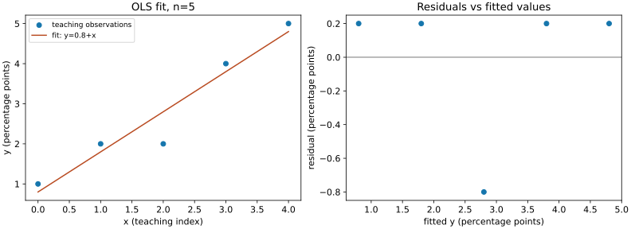

# 回归推断、方差分析与模型诊断

一条拟合直线能否支持“每增加一单位$x$，总体平均$y$上升”？这要求把确定性的最小二乘解放进随机误差模型，再问系数在重复采样时怎样波动。多组均值比较也是同一类问题：用正交分解把模型解释的变化与剩余噪声分开。本课给可手算的小例；所有数据是原创教学数据，不是实测金融记录。

## 1. 先把矩阵拟合与统计模型接起来

前提是 [[数学/20-线性代数与几何/14-最小二乘伪逆与正则化|最小二乘的正交投影解释]]，那页承担正规方程与数值求解，本课新增抽样分布。设$y\in\mathbb R^n$，设计矩阵$X\in\mathbb R^{n\times q}$，参数$\beta\in\mathbb R^q$，模型
$$y=X\beta+\varepsilon.$$
$q$包含截距参数，要求$n>q$、$X$满列秩。我们条件于固定$X$：$E[\varepsilon\mid X]=0$、$\operatorname{Cov}(\varepsilon\mid X)=\sigma^2I_n$，$\sigma^2>0$；若还要求$\varepsilon\mid X\sim N_n(0,\sigma^2I_n)$，得到后文精确$t,F$推断。仅同方差不自动推出独立；此处协方差结构给不相关，联合正态进一步给独立。随机设计也可条件于$X$解释，但零条件均值不能省。

最小二乘估计
$$\hat\beta=(X^TX)^{-1}X^Ty=\beta+(X^TX)^{-1}X^T\varepsilon,$$
因此在前两个矩条件下，
$$E[\hat\beta\mid X]=\beta,\qquad \operatorname{Cov}(\hat\beta\mid X)=\sigma^2(X^TX)^{-1}.$$
协方差推导用$A=(X^TX)^{-1}X^T$，$A\sigma^2I A^T=\sigma^2(X^TX)^{-1}$。无偏性要求$E[\varepsilon\mid X]=0$；遗漏与$x$有关的变量、测量误差或反向因果都可能破坏它。无偏并不证明系数有因果含义。

令$H=X(X^TX)^{-1}X^T$，$H^T=H,H^2=H$；拟合值$\hat y=Hy$，残差$e=(I-H)y=(I-H)\varepsilon$，$X^Te=0$。残差平方和$SSE=e^Te$，$s^2=SSE/(n-q)$。由$\operatorname{tr}(I-H)=n-q$得$E[SSE\mid X]=(n-q)\sigma^2$：展开$E[\varepsilon^T(I-H)\varepsilon]=\sigma^2\operatorname{tr}(I-H)$。这是无偏方差估计的证明，不需要正态性。

## 2. 精确检验为何还要正态假设

在联合正态误差下，$\hat\beta$正态；选设计列空间与正交补的一组正交基，标准化误差各坐标是独立标准正态，和08的构造相同。所以
$$SSE/\sigma^2\sim\chi^2_{n-q},\qquad\hat\beta\perp SSE.$$
对非零向量$a\in\mathbb R^q$，检验$H_0:a^T\beta=b_0$时
$$T=\frac{a^T\hat\beta-b_0}{s\sqrt{a^T(X^TX)^{-1}a}}\sim t_{n-q}.$$
选$a$为第$j$坐标向量得到单系数$t$。置信区间$a^T\hat\beta\pm t_{1-\alpha/2,n-q}s\sqrt{a^T(X^TX)^{-1}a}$由这一分布反演。

比较嵌套模型时，完整模型参数$q$、受限模型少$r$个独立线性自由方向，均包含截距且同一批$y$。在受限零假设及相同正态误差模型下，受限增加的平方和与完整模型残差来自正交方向，故
$$F=\frac{(SSE_R-SSE_F)/r}{SSE_F/(n-q)}\sim F_{r,n-q}.$$
它检验的是$r$条联合线性限制。非嵌套模型、换数据的两次拟合或任意两个误差平方和不能直接套这个F比。$r=1$时同一限制的$F=T^2$；多个单项显著性检验不等同这个联合检验。

## 3. 五点直线：每个数都能跟算

用$x=(0,1,2,3,4)$、$y=(1,2,2,4,5)$，$x$以教学序号单位，$y$以百分点单位。简单回归$y_i=\beta_0+\beta_1x_i+\varepsilon_i$，$q=2$。$\bar x=2,\bar y=2.8$，
$$S_{xx}=\sum_i(x_i-2)^2=4+1+0+1+4=10,$$
$$S_{xy}=\sum_i(x_i-2)(y_i-2.8)=3.6+0.8+0+1.2+4.4=10.$$
故$\hat\beta_1=S_{xy}/S_{xx}=1$、$\hat\beta_0=\bar y-\hat\beta_1\bar x=0.8$；斜率单位为“百分点/序号单位”。

| $x_i$ | $y_i$ | $\hat y_i=0.8+x_i$ | $e_i$ | $e_i^2$ |
| --- | --- | --- | --- | --- |
| 0 | 1 | 0.8 | 0.2 | 0.04 |
| 1 | 2 | 1.8 | 0.2 | 0.04 |
| 2 | 2 | 2.8 | -0.8 | 0.64 |
| 3 | 4 | 3.8 | 0.2 | 0.04 |
| 4 | 5 | 4.8 | 0.2 | 0.04 |

$\sum e_i=0,\sum x_ie_i=0$兑现正交条件。$SSE=0.8$，$s^2=0.8/(5-2)=4/15$。总体均值模型的$SST=\sum_i(y_i-2.8)^2=10.8$；$SSR=\sum_i(\hat y_i-2.8)^2=10$。因截距列存在，$y-\bar y\mathbf1=(\hat y-\bar y\mathbf1)+e$两项正交，$SST=SSR+SSE$。不含截距时这个以$\bar y$中心化的分解未必成立。

| 来源 | 平方和 | 自由度 | 均方 | $F$ |
| --- | --- | --- | --- | --- |
| 回归（斜率） | 10 | 1 | 10 | 37.5 |
| 残差 | 0.8 | 3 | $4/15$ | |
| 总计 | 10.8 | 4 | | |

斜率标准误$SE(\hat\beta_1)=s/\sqrt{S_{xx}}=\sqrt{2/75}\approx0.163299$。检验$H_0:\beta_1=0$对双侧备择，$t=1/\sqrt{2/75}=\sqrt{37.5}\approx6.123724$，自由度3。$p=2P(t_3\ge6.123724)\approx0.00875441$。$F=t^2=37.5$，在零假设下$F_{1,3}$上尾给同一个p值。用$t_{0.975,3}=3.182446$得斜率95%区间
$$1\pm3.182446\sqrt{2/75}\approx[0.48030869,1.51969131].$$
在所述模型下有非零斜率证据；不是“相关必然因果”，也不是“序号越大收益必涨”。$R^2=10/10.8=25/27\approx0.925926$只描述样本平方和比例。

## 4. 均值响应区间与新观察预测区间

给定新设计行$x_0^T=(1,x_0)$，总体条件均值$m_0=x_0^T\beta$，其估计$\hat m_0=x_0^T\hat\beta$方差$\sigma^2x_0^T(X^TX)^{-1}x_0$。若还要预测一个独立新观察$Y_0=m_0+\varepsilon_0$，误差$Y_0-\hat m_0$额外含新噪声方差$\sigma^2$。因此在同一正态模型中，两个95%区间分别是
$$\hat m_0\pm t_{0.975,n-q}s\sqrt{x_0^T(X^TX)^{-1}x_0},$$
$$\hat m_0\pm t_{0.975,n-q}s\sqrt{1+x_0^T(X^TX)^{-1}x_0}.$$
简单回归的杠杆量为$1/n+(x_0-\bar x)^2/S_{xx}$。在$x_0=2$，$\hat m_0=2.8$，均值标准误$\sqrt{(4/15)/5}=\sqrt{4/75}\approx0.230940$，区间半宽约0.73495；预测标准误$\sqrt{(4/15)(1+1/5)}=\sqrt{0.32}\approx0.565685$，半宽约1.80026。预测区间更宽，因为一条新记录有自身噪声。远离$\bar x$，杠杆增大；形式上算得区间也不能替代外推模型的有效性。

## 5. 三组均值的ANOVA：一个完整小账本

独立正态观察$Y_{ij}=\mu_i+\varepsilon_{ij}$，$i=1,\ldots,g$，$j=1,\ldots,n_i$；误差独立、均值0、同方差$\sigma^2$。检验$H_0:\mu_1=\cdots=\mu_g$。组均值是各组常数的最小二乘拟合；零假设仅一个总体常数，完整模型有$g$个均值。因此自由度差$g-1$，残差$N-g$，$N=\sum_i n_i$。

记加权总均值$\bar y=\sum_i n_i\bar y_i/N$。平方分解
$$y_{ij}-\bar y=(y_{ij}-\bar y_i)+(\bar y_i-\bar y)$$
展开并组内求和，交叉项为$2(\bar y_i-\bar y)\sum_j(y_{ij}-\bar y_i)=0$，所以
$$SS_T=SS_W+SS_B,\qquad SS_B=\sum_i n_i(\bar y_i-\bar y)^2,\quad SS_W=\sum_{ij}(y_{ij}-\bar y_i)^2.$$
在$H_0$及正态同方差独立假设下，$SS_B/\sigma^2\sim\chi^2_{g-1}$、$SS_W/\sigma^2\sim\chi^2_{N-g}$且独立，故$F=(SS_B/(g-1))/(SS_W/(N-g))\sim F_{g-1,N-g}$。这是嵌套投影的同一证明；如果各组大小不同，总均值仍须加权，不能直接平均组均值。

原创数据A$(1,2,3)$、B$(3,4,5)$、C$(5,6,7)$，$g=3,N=9$，组均值2、4、6，总均值4。$SS_B=3[(2-4)^2+0+(6-4)^2]=24$；每组$SS_W$为$1+0+1=2$，三组合6，总平方和30。

| 来源 | 平方和 | 自由度 | 均方 | $F$ |
| --- | --- | --- | --- | --- |
| 组间 | 24 | 2 | 12 | 12 |
| 组内 | 6 | 6 | 1 | |
| 总计 | 30 | 8 | | |

$F_{2,6}$上尾有可直接积分的式$P(F_{2,6}\ge f)=[6/(6+2f)]^3$，所以$p=(6/30)^3=0.008$。在5%水平拒绝“所有均值相同”。它只说明至少一组不同，不自动说明每一对均值都不同；后续具名组对比需要相应区间与多重比较控制。对照[NIST7.4.3.3](https://www.itl.nist.gov/div898/handbook/prc/section4/prc433.htm)和[3.2.3.1](https://www.itl.nist.gov/div898/handbook/ppc/section2/ppc231.htm)的平方和与自由度计算。

## 6. 模型诊断：显著p值回答不了什么

左图为五点数据和拟合直线；右图显示残差对拟合值。五点无法有力评估残差分布，尤其不能凭图证明独立或正态。诊断是发现违背条件的线索，应结合采集机制与额外数据。[NIST4.4.4](https://www.itl.nist.gov/div898/handbook/pmd/section4/pmd44.htm)将残差图作为模型验证主工具，并明确高$R^2$不足以支持拟合有效。

先看残差对拟合值是否有弯曲和漏斗：弯曲提示均值函数缺项，漏斗提示异方差。再按观察时序画残差，检查连续同号或周期；这是相关性线索，不能由打乱顺序后好看的图消除。正态QQ图用于检查尾部和形状；异常点、杠杆值和影响度用于识别少数记录是否主导系数。不要为变得显著就删除异常记录，应先核对错误与事先规定规则。

**两个明确反例。** 若$\varepsilon_i=a_iZ$共享同一$Z\sim N(0,1)$，每个边缘误差都正态，误差向量却有非对角协方差，普通$s^2(X^TX)^{-1}$不再是正确方差；“边缘正态”不足以保证独立。若实际$\operatorname{Cov}(\varepsilon\mid X)=\Omega$异方差或相关，正确系数协方差为$(X^TX)^{-1}X^T\Omega X(X^TX)^{-1}$，普通$t,F$精确分布通常失效。可以研究稳健/聚类标准误或加权模型，但其适用设计与大样本条件需另核，不能仅换一个按钮继续沿用小样本精确性。

含截距时$R^2$很高也不推出因果：若$y=100+2x+z$而遗漏的$z$与$x$正相关，回归斜率混合了两种贡献。随机分配、可辩护的识别假设与采集设计才承担因果结论。残差未显示明显模式也不证明全部模型条件成立。

## 7. 练习及完整解答

1. 五点回归把$y$换成$y'=10y$，斜率、标准误、$t$和$R^2$怎样变？
2. 正态误差模型有$n=20,q=4$，联合检验两条独立限制，$SSE_R=30,SSE_F=20$，求$F$及自由度。
3. 在三组例中所有数加100，ANOVA的$F$变化吗？若乘2呢？
4. 两组大小$n_1=2,n_2=8$，组均值0、10，正确总均值是什么？为什么不能取5？

> [!question]- 解答
> 1. 斜率与标准误均乘10，$t$不变；各平方和均乘100，$R^2$不变。只是单位转换，不能因此增加证据。
> 2. $F=[(30-20)/2]/[20/(20-4)]=5/1.25=4$，在所述受限零假设下为$F_{2,16}$。还需嵌套、同数据及正态同方差独立条件。
> 3. 加100使各均值同移，偏差不变；乘2使平方和均乘4，比例仍为12，p值仍0.008。两者都不改模型内相对变化。
> 4. $(2\cdot0+8\cdot10)/10=8$。每条观察等权，总均值必须按组样本量加权；5把两个小组当等权单位，改变了目标量。

## 继续读与课程边界

到 [[数学/30-概率与统计/81-概率极限与推断复算|81]]复算直线、区间和ANOVA；回 [[数学/30-概率与统计/00-概率与统计-MOC|课程地图]]，再按应用问题进入 [[数学/30-概率与统计/05-统计估计置信度与模型评测|评测设计]]。谱方法应用可读 [[数学/20-线性代数与几何/16-SVD的推导最优低秩与PCA|SVD与PCA]]：那里解释矩阵方向与降维，不能代替回归误差的抽样条件。

本组补的是本科概率极限与基础统计推断的首组课程，仍未覆盖充分性与最优性、所有非参数方法、多因素实验、时间序列和因果推断。来源用于核对明确主题，不能由这组页面或一次脚本通过宣称本科统计已全覆盖，或用户已完成学习。
