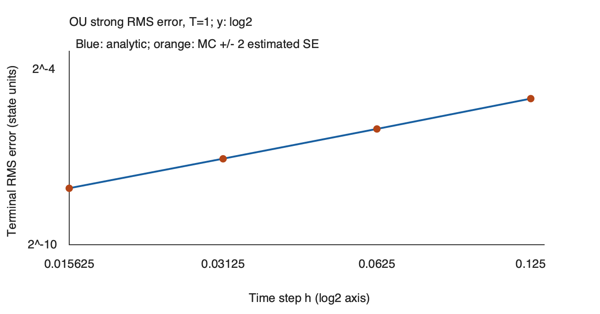

# OU共同噪声与强弱误差实验

步长减半后两条随机路径更接近，究竟说明什么？先要确认它们用了同一个Brownian过程，再把离散误差与有限样本波动分开。本实验从 [[数学/30-概率与统计/20-随机过程/04-Brownian二次变差与Ito公式#同一路噪声才能谈强误差|共同噪声的定义]] 出发，以精确OU更新作路径对照，以解析核积分作误差真值。精确过程与Euler都要走完整个时间区间；不把更细Euler递推当解析解。

## 固定对象和能检查的终点

模型 $dX_t=(0-X_t)dt+\tfrac12 dW_t$，$X_0=1$，终点 $T=1$。参数及完整输入在 [fixed-input.json](OU实验/fixed-input.json)：$kappa=1,\mu=0,\sigma=1/2$；每批最多4096条独立路径，总65536条；最细网格64步，比较8、16、32、64步，种子20261010。另以独立种子20261011从解析终点正态直接采样，检查终点矩和独立噪声反例。

精确均值 $m_T=e^{-1}$、方差 $V_T=(1-e^{-2})/8$。注意第二原点矩是 $E[X_T^2]=V_T+m_T^2$，不能把它称方差。实验只检验终点强均方误差以及弱函数 $g(x)=x,x^2$；记录若干共同路径供检查耦合，未检验整条路径上确界误差或所有测试函数。

## 一次采样如何服务四个步长

在最细段长度 $h_f=1/64$ 上，采样独立标准正态对 $(Z_1,Z_2)$，构造
$$\Delta W=\sqrt{h_f}Z_1,\quad J=\frac{c_f}{h_f}\Delta W+\sqrt{v_f-c_f^2/h_f}\,Z_2,$$
其中 $c_f=(1-e^{-\kappa h_f})/\kappa$、$v_f=(1-e^{-2\kappa h_f})/(2\kappa)$。$J$ 是该段的指数核Brownian积分。它与 $\Delta W$ 联合Gaussian且具有所需协方差；第二份正态提供Brownian段内部不能由终点增量确定的信息，不是一份独立的OU过程噪声。

粗段合并 $q$ 个相邻最细段时，使用
$$\Delta W_h=\sum_{r=0}^{q-1}\Delta W_{f,r},\qquad J_h=\sum_{r=0}^{q-1}e^{-\kappa(q-1-r)h_f}J_{f,r}.$$
所以四个网格共用同一过程的线性函数量；粗网精确OU应在公共时刻与细网精确OU仅差浮点舍入。源码把这个最大差值单独记录。只在各个步长重复同一种子而改动随机数消费顺序，没有这个保证。

## 强误差、弱偏差与标准误怎样读

每条路径记录终点误差 $D_p=X^h_{T,p}-X_{T,p}$。强误差报告 $\widehat q=N^{-1}\sum D_p^2$ 与 $\sqrt{\widehat q}$。均方估计的标准误为样本标准差 $s_{D^2}/\sqrt N$；RMS的标准误以delta法近似为 $s_{D^2}/(2\sqrt{N\widehat q})$。图中的误差棒为后者的两倍，是估计的不确定性，不能当严格有限样本保证。

弱偏差采用同路配对量：$N^{-1}\sum D_p$ 对照 $m_h-m_T$；$N^{-1}\sum[(X^h_{T,p})^2-X_{T,p}^2]$ 对照 $(V_h+m_h^2)-(V_T+m_T^2)$，分别报告配对差的样本标准差除以 $\sqrt N$。配对可减小采样波动；若偏差接近0，取绝对值会掩盖符号并受噪声支配，因此保留有符号偏差，不用四个带噪数点认证收敛阶。

[[数学/30-概率与统计/20-随机过程/04-Brownian二次变差与Ito公式#解析矩是实验的独立对照|正文式(5)]]给强均方误差、Euler均值与方差及交叉矩。测试另外直接积分OU与Euler噪声核之差的平方，用60位十进制算术核对式(5)，并核对网格合并与Gaussian线性变换的协方差；当前源码另有终点时间与零误差图表的两项边界测试。独立精确终点样本只检查分布矩，不用于强误差真值；将Euler与这份独立终点相减则是反例对照，其均方差趋于 $2V_T>0$，预期不随步长趋0。

诊断在固定输入里预先取6个估计标准误加 $10^{-12}$ 浮点余量。它帮助发现实现错误，仍可能受有限样本偶然波动影响；程序通过不等于已经证明定理，也不认证真实数据服从OU模型。

## 2026-10-10的实际观察

独立执行者使用既有锁定环境 Python3.14.7 / NumPy2.5.3，按上述65536条路径和两种子运行一次固定实验；这两种子分别服务共同路径与独立终点，没有称为两次独立重复实验。源码和输入的执行前后身份一致。原v1固定CLI退出0、六项源码测试通过；另一个未导入业务源码或作者测试的核查程序，以70位十进制逐段积分噪声核、独立加权终点和重建矩/标准误完成94项核对。它逐行检查992条路径记录，8步与64步精确OU在公共时刻最大差为 $1.999\times10^{-15}$；全部路径的精确粗细网格差最大为 $3.775\times10^{-15}$。

| 步长 h | 解析终点RMS | 实测终点RMS | RMS估计标准误 | 独立噪声实测均方差 |
| --- | ---: | ---: | ---: | ---: |
| 1/8 | 0.031162894 | 0.031173284 | 6.825e-05 | 0.225720253 |
| 1/16 | 0.015198607 | 0.015185655 | 3.359e-05 | 0.220450640 |
| 1/32 | 0.007507543 | 0.007487053 | 1.655e-05 | 0.218050476 |
| 1/64 | 0.003731297 | 0.003722698 | 8.209e-06 | 0.216903431 |



误差约随步长减半而减半。解析RMS的相邻步长阶估计为1.03589、1.01753、1.00866，接近本课已证明的加性噪声OU终点强阶1；图上的采样偏离仍由标准误衡量。独立噪声对照从0.22572缓慢趋近 $2V_T=0.21616618$，不会趋0，直观展示了为什么两条独立随机路径不能用来测试强收敛。

| 步数 | 均值偏差：解析 / 实测 | 配对标准误 | 第二矩偏差：解析 / 实测 | 配对标准误 |
| --- | ---: | ---: | ---: | ---: |
| 8 | -0.024270525 / -0.024258510 | 7.648e-05 | -0.007760231 / -0.007764882 | 7.723e-05 |
| 16 | -0.011805311 / -0.011762818 | 3.752e-05 | -0.003957172 / -0.003928970 | 3.743e-05 |
| 32 | -0.005824152 / -0.005801040 | 1.849e-05 | -0.001995805 / -0.001997715 | 1.848e-05 |
| 64 | -0.002892917 / -0.002885406 | 9.188e-06 | -0.001001971 / -0.001008873 | 9.188e-06 |

均值和第二矩的离散偏差都保留符号；四步长的实测与解析差均落在预先设定的6个估计标准误内。64步时第二矩偏差约为 $-0.001009$，它的配对标准误约为 $9.19\times10^{-6}$。若改成独立估计两个第二矩再相减，约 $10^{-3}$ 的普通矩采样标准误会与这个偏差相当；共同噪声配对提高的是测量离散偏差的精度。

精确OU的解析均值、方差和第二矩依次为0.367879441、0.108083090、0.243418373。直接独立正态终点样本的均值为0.365955546，标准误0.001282702；第二矩为0.241749807，标准误0.001109943。两者都约偏离1.5个标准误，展示了即便从解析转移分布采样，有限样本也不会逐字等于理论矩。不能把这份采样偏差误认成Euler时间离散误差。

本次固定实验进程观测约0.282秒、峰值RSS79,806,464 bytes；这是本机一次运行观测，线程环境值也不是内存硬上限，A/B同时聚合内存未直接测量。原报告、输入快照、环境、命令、进程退出/资源、完整输出、独立核查与逐项字节映射见 [正式结果入口](OU实验/results/2026-10-10/README.md)。本次没有观测到数值或模型失败。随后只修复图表在终点时间改变和零误差配置下的边界：当前v2八项测试独立通过，新图依据原v1报告生成并实际渲染、查看，采样与统计核心的字节完全相同，固定Monte Carlo未重跑。图中的误差棒很短，部分被圆点覆盖，精确标准误仍见表与JSON。两张边界图属于零Monte Carlo样本的合成检查，不能当新的OU采样结果。Obsidian、同步与真人理解仍未验证。

## 运行和改条件

代码真源为 [ou_lab.py](OU实验/ou_lab.py)，相关检查为 [test_ou_lab.py](OU实验/test_ou_lab.py)；[[数学/30-概率与统计/20-随机过程/81-OU实验源码与复算|源码镜像]]可在笔记中阅读。使用库内已有固定NumPy环境，从库根在一个新的输出目录运行：

```bash
OPENBLAS_NUM_THREADS=1 OMP_NUM_THREADS=1 .venv-issues-111plus/bin/python -B '数学/30-概率与统计/20-随机过程/OU实验/ou_lab.py' --config '数学/30-概率与统计/20-随机过程/OU实验/fixed-input.json' --output /private/tmp/wwl-ou-new-run
OPENBLAS_NUM_THREADS=1 OMP_NUM_THREADS=1 .venv-issues-111plus/bin/python -B -m unittest discover -s '数学/30-概率与统计/20-随机过程/OU实验' -p 'test_ou_lab.py' -v
```

输出 `report.json` 记录理论值、实际估计、标准误、环境与输入/源码身份；`traces.csv` 记录前8条路径的公共时刻；`strong-error.svg` 显示解析和采样的终点强误差。输出文件已存在时程序拒绝覆盖。固定输入已由独立执行者运行，实际结果及原始回执见上节；运行新配置仍应另留输出。

保留固定输入，另存配置后可以只改一个条件：把路径数减为4096，预期标准误约扩大4倍而解析离散误差不变；把 $x_0$ 改成0，均值偏差消失，但强误差与第二矩偏差仍存在；扩大步长使 $\kappa h\ge1$ 时，本实验的参数检查拒绝运行，需另行分析Euler稳定性，不能沿用这里的正衰减系数推导。改变配置、种子、批次大小或运行环境应另留输出身份，不将新结果冒充固定输入的重现。

回到 [[数学/30-概率与统计/20-随机过程/04-Brownian二次变差与Ito公式#一个有完整余项控制的Itô公式|Itô证明]]：这份有限模拟检验解析模型的实现与误差定义，未替代二次变差、积分存在或链式法则的证明。
