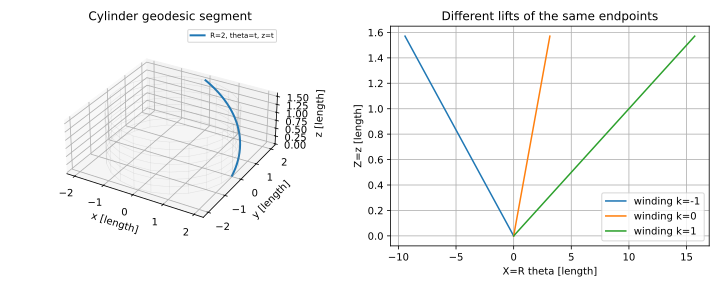

# 坐标变换、联络与测地线

在曲面上“保持方向”不能要求空间速度不变；圆柱螺旋在三维不断转弯，却在展开的纸上是一条直线。我们需要扣掉随曲面切平面转动的法向变化，只看速度的切向改变。这产生联络，也让同一条轨迹在不同坐标中满足同一几何条件。

以下局部图、曲线和变分取足够光滑（至少使所写偏导和ODE存在），$\mathsf g$ 正定。指标 $i,j,k,\ell$ 取1、2，重复上下指标求和；$g^{ij}$ 是 $\mathsf g^{-1}$ 系数，不是逐项倒数。

## 换坐标保持长度

旧坐标 $q=q(\xi)$ 的Jacobian $J^i{}_a=\partial q^i/\partial\xi^a$ 可逆，链式法则给 $Dr_\xi=Dr_qJ$，因此

$$
\widetilde{\mathsf g}=J^T\mathsf gJ,\qquad
\dot q=J\dot\xi,\qquad
\dot\xi^T\widetilde{\mathsf g}\dot\xi=\dot q^T\mathsf g\dot q.
$$

坐标分量改变，实际长度不变。圆柱设 $\theta=\xi+\eta,z=\eta$（为便于此例，长度以选定单位的数值表示），$R=2$ 时

$$
J=\begin{pmatrix}1&1\\0&1\end{pmatrix},\qquad
\widetilde{\mathsf g}=\begin{pmatrix}4&4\\4&5\end{pmatrix}.
$$

原螺旋 $\theta=t,z=t$ 在新坐标成为 $\xi=0,\eta=t$。新旧速率平方都是5；非零交叉项是坐标倾斜的结果。一般第二形式也按 $J^T\mathsf bJ$ 变换，形算子矩阵按 $J^{-1}AJ$ 变换，从而主曲率不随坐标选择改变。

## 切向投影给联络

记 $r_i=\partial_i r$。把 $r_{ij}$ 分解为切向与法向：

$$
r_{ij}=\Gamma^k{}_{ij}r_k+b_{ij}n.
$$

对 $g_{j\ell}=r_j\cdot r_\ell$ 求导，将三个导数 $\partial_i g_{j\ell}+\partial_j g_{i\ell}-\partial_\ell g_{ij}$ 组合，混合偏导对称消去多余项，余下 $2r_{ij}\cdot r_\ell$。点乘上式并乘逆度量便得到

$$
\Gamma^k{}_{ij}=\frac12g^{k\ell}(\partial_i g_{j\ell}+\partial_j g_{i\ell}-\partial_\ell g_{ij}).
$$

定义 $\nabla_{r_i}r_j=\Gamma^k{}_{ij}r_k$，也就是空间导数投影到切平面。沿曲线的切向场 $V=V^kr_k$ 有

$$
\frac{DV}{dt}=\left(\dot V^k+\Gamma^k{}_{ij}\dot q^iV^j\right)r_k.
$$

$DV/dt=0$ 称沿曲线平行；对 $V=\dot r$ 则 $D\dot r/dt=0$ 定义仿射参数测地线，坐标方程为

$$
\ddot q^k+\Gamma^k{}_{ij}\dot q^i\dot q^j=0.
$$

$\Gamma$ 本身不是张量。换坐标时除Jacobian乘积，还出现 $\partial^2q^i/\partial\xi^a\partial\xi^b$；它补偿坐标基的变化。具体公式为

$$
\widetilde\Gamma^a{}_{bc}=\frac{\partial\xi^a}{\partial q^k}\left(\Gamma^k{}_{ij}\frac{\partial q^i}{\partial\xi^b}\frac{\partial q^j}{\partial\xi^c}+\frac{\partial^2q^k}{\partial\xi^b\partial\xi^c}\right).
$$

反例：平面直角坐标中全部 $\Gamma=0$；极坐标度量 $d\rho^2+\rho^2d\theta^2$ 却有 $\Gamma^\rho{}_{\theta\theta}=-\rho,\Gamma^\theta{}_{\rho\theta}=1/\rho$。这说明非零Christoffel系数不等于曲面有非零曲率。

## 从能量的Euler–Lagrange方程得到同一式

固定端点与参数区间 $[a,b]$，能量

$$
\mathcal E[q]=\frac12\int_a^b g_{ij}(q)\dot q^i\dot q^jdt
$$

的被积函数 $L$ 满足 $\partial L/\partial\dot q^\ell=g_{\ell j}\dot q^j$，$\partial L/\partial q^\ell=\tfrac12\partial_\ell g_{ij}\dot q^i\dot q^j$。对端点为0的任意变分分部积分，驻值条件是

$$
0=g_{\ell j}\ddot q^j+\partial_i g_{\ell j}\dot q^i\dot q^j-\tfrac12\partial_\ell g_{ij}\dot q^i\dot q^j.
$$

因为 $\dot q^i\dot q^j$ 对称，可将中项对 $i,j$ 平均；乘 $g^{k\ell}$，恰好得到测地线方程。与上一段的切向投影路线相互核对。能量不显含 $t$，沿解 $g_{ij}\dot q^i\dot q^j$ 恒定；单位速时 $t=s$。

长度 $\mathcal L=\int vdt$ 对可逆重参数不变；能量会随速度分配改变。Cauchy–Schwarz给 $\mathcal L^2\le2(b-a)\mathcal E$，等号要求 $v$ 恒定。因此任何全局长度最小的光滑正则曲线，改成常速参数后也最小化固定区间能量，必满足上述驻值条件。**推导只证明必要条件，驻值不自动是最小值。** 光滑正定度量下，非零速度测地线的充分短小子段局部最短是额外定理；本页未证明一般版本，参见 Petrunin–Zamora Barrera [原作者源码章 Geodesics，节“Shortest paths are geodesics”，命题 `prop:gamma''`](https://github.com/anton-petrunin/gauss/blob/main/geodesics-new.tex#L322-L335)。Powell §6.6 的一阶变分用于驻值核对，不作为本组一般最短性的充分证明。04对球面、圆柱另给全局判断。

## 圆柱：展开后就能直接求解

$c(\theta,z)=(2\cos\theta,2\sin\theta,z)$ 的 $\mathsf g=\operatorname{diag}(4,1)$ 为常矩阵，故 $\Gamma=0$，$\ddot\theta=\ddot z=0$。取 $\theta=t,z=t$ 得01的螺旋；空间加速度 $(-2\cos t,-2\sin t,0)$ 完全沿外法向，切向投影为零。弧长参数是 $s=\sqrt5t$，所以 $d\theta/ds=dz/ds=1/\sqrt5$。

*半径2，端点 $t=0,\pi/2$。右图的不同横向终点是同一圆柱端点在覆盖平面的不同提升，单位为长度；直线性证明每个固定绕数类中的最短性，尚须比较绕数。右图横纵轴显示比例不同，不以屏幕斜率判断角度或长度。*

## 球面：把非零系数真正算完

度量 $g_{\varphi\varphi}=R^2,g_{\theta\theta}=R^2\sin^2\varphi$ 只有后一项随 $\varphi$ 改变，所以非零系数只有

$$
\Gamma^\varphi{}_{\theta\theta}=-\sin\varphi\cos\varphi,\qquad
\Gamma^\theta{}_{\varphi\theta}=\Gamma^\theta{}_{\theta\varphi}=\cot\varphi.
$$

于是单位速解满足

$$
\varphi''-\sin\varphi\cos\varphi(\theta')^2=0,\qquad
\theta''+2\cot\varphi\,\varphi'\theta'=0.
$$

取 $R=2,\varphi(0)=\pi/3,\theta(0)=0,\varphi'(0)=0,\theta'(0)=1/\sqrt3$。速率平方 $4[0+\tfrac34\cdot\tfrac13]=1$；初始 $\varphi''=\sqrt3/12>0$，故轨迹离开该纬线，向赤道偏移。不是所有纬线都是测地线！第二式乘 $\sin^2\varphi$ 给 $(\sin^2\varphi\,\theta')'=0$，可作数值守恒检查。

独立空间解见04；代码用RK4复算这组初值。在 $0\le s\le2$ 范围内不碰极点，所以本坐标图足够。跨过极点需要换图，不能简单让 $\cot\varphi$ 爆炸再把它理解为球面不光滑。

## 可复算练习

1. 平面极坐标中验证 $\rho(t)=t,\theta(t)=\theta_0$（$t>0$）满足测地线方程；$\rho=2,\theta=t$ 是否满足？
2. 球面中设 $\varphi=\varphi_0$、$\theta=\omega s$ 且 $\omega\ne0$。哪些纬线可满足方程？验证共用初值的角向守恒量 $J=R^2\sin^2\varphi\,\theta'$。

> [!question]- 答案与检验
> 1. 方程是 $\rho''-\rho(\theta')^2=0,\theta''+2\rho'\theta'/\rho=0$；径向直线两个左边都为0。圆周第一式左边为 $-2$，所以不是平面测地线。
> 2. 第一式要求 $\sin\varphi_0\cos\varphi_0\omega^2=0$。在本图 $0<\varphi_0<\pi$ 中只有 $\varphi_0=\pi/2$，即赤道。共用初值给 $J=4(3/4)/\sqrt3=\sqrt3$；单位为长度，因为导数对弧长取。实验同时检查速率平方与这个 $J$，不能只看轨迹图像。

来源核对：[Powell Part IV §5.5 pp.11–13](https://www.maths.gla.ac.uk/~mpowell/M435-chapter-4-2nd-FF-curvature.pdf) 的二阶导数分解与内在度量计算；[Part V §6.2、§6.4–6.6 pp.1–6](https://www.maths.gla.ac.uk/~mpowell/M435-chapter-5-geodesics.pdf) 的切向投影、测地线与最短性。本页能量变分和具体坐标换元为逐步展开的独立计算。下一页 [[数学/35-微分几何/04-曲率内外在几何与完整算例|完整算例]] 回答驻值以后还要判断什么。
