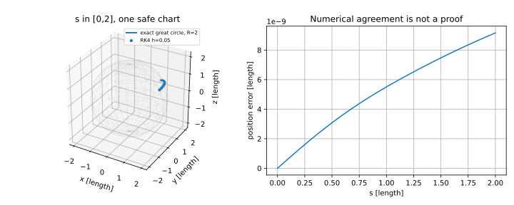

# 曲率：内外在几何与完整算例

把纸卷成圆柱，空间中的法向改变了，纸上小范围内的尺子长度却仍一样。02计算的 $H=-1/(2R)$ 和 $K=0$ 已经提示两种弯曲不同。本页把完整计算链走到最短路，并说明方程、全局选择和拓扑结论之间的边界。

## 内在曲率从度量也能算出

高斯曲率 $K=k_1k_2$ 最初由形算子得到，却只依赖度量及其导数，这是Gauss卓越定理；[Powell Part IV §5.5 Theorem 5.14 pp.11–13](https://www.maths.gla.ac.uk/~mpowell/M435-chapter-4-2nd-FF-curvature.pdf) 给一般证明。本组对以下正交度量给实际内在复算，并未覆盖任意度量的一般证明。

写 $ds^2=dx^2+f(x)^2d\theta^2$，$f>0$。非零系数为 $\Gamma^x{}_{\theta\theta}=-ff'$ 和 $\Gamma^\theta{}_{x\theta}=f'/f$。取曲率 convention $R(X,Y)Z=\nabla_X\nabla_YZ-\nabla_Y\nabla_XZ-\nabla_{[X,Y]}Z$，则

$$
R^x{}_{\theta x\theta}
=\partial_x\Gamma^x{}_{\theta\theta}
-\Gamma^x{}_{\theta\theta}\Gamma^\theta{}_{x\theta}
=-(f'^2+ff'')+f'^2=-ff''.
$$

因此该二维平面的截面曲率为

$$
K=\frac{\langle R(\partial_x,\partial_\theta)\partial_\theta,\partial_x\rangle}{g_{xx}g_{\theta\theta}-g_{x\theta}^2}
=-\frac{f''}{f}.
$$

圆柱取 $x=z,f=R$，便有 $K=0$；球面取 $x=R\varphi,f=R\sin(x/R)$，有 $f''=-f/R^2$，于是 $K=1/R^2$，与外在形算子结果一致。球面在极点 $f=0$ 时此公式所在图失效，不能在那里计算 $0/0$；球面光滑性和 $K$ 的连续延拓见02的另一张局部图。

平均曲率 $H$ 不具有相同的内在不变性：平面与圆柱局部等距，前者 $H=0$，后者外法向下 $H=-1/(2R)$。鞍面原点 $k_1=1,k_2=-1$ 给 $H=0,K=-1$，所以平均曲率为零也不意味着平面；已有 [[数学/80-跨学科专题与综合练习/08-曲线曲面与解析几何补充#算例：鞍面为何两方向弯曲相反|鞍面主解释]] 负责该计算。$K$ 单位是长度的倒数平方，$H$ 是长度的倒数。

## 圆柱：解析比较所有绕数

统一取 $R=2$，端点 $P=(2,0,0)$、$Q=(0,2,\pi/2)$。圆柱上的任意连续分段光滑曲线可将角度沿路径连续提升到实数，固定起角0后，终角必为 $\pi/2+2\pi k$，$k\in\mathbb Z$。覆盖平面坐标 $X=2\theta,Z=z$ 保持曲线长度。每个绕数的直线提升连接

$$
(0,0)\quad\hbox{与}\quad(\pi+4\pi k,\pi/2),
$$

长度 $L_k=\sqrt{(\pi+4\pi k)^2+(\pi/2)^2}$。三角不等式 $\int\|\dot\gamma\|dt\ge\|\gamma(b)-\gamma(a)\|$ 证明每个固定绕数类中这条直线最短，等号要求沿同一方向、不回走。由于整数 $k$ 中 $|\pi+4\pi k|$ 在 $k=0$ 唯一最小，真正全局最短的是

$$
\theta=t,z=t,\quad0\le t\le\pi/2,\qquad L_0=\frac{\pi\sqrt5}{2}\approx3.5124073655.
$$

本例从参数到结论的链为：切向量给 $\mathsf g=\operatorname{diag}(4,1)$，常度量给 $\Gamma=0$，测地线给角度与高度线性，再提升比较所有绕数确定全局分支。ODE解只走到倒数第二步。

反例：$k=1$ 的提升也为直线，投影仍是测地线、每一足够短子段仍局部最短，但全段长度比 $L_0$ 大。如果同高度端点相差角 $\pi$，$k=0$ 与 $k=-1$ 两支等长，最短路不唯一。圆柱与平面局部等距，却没有一张覆盖全圆柱的单值展开坐标；角度接缝必须保留全局信息。

## 球面：独立空间公式核对ODE

半径2、初点纬余角 $\pi/3$、经度0，单位初切向指向正 $y$ 方向。记单位向量

$$
a=(\sqrt3/2,0,1/2),\quad b=(0,1,0),\quad a\cdot b=0.
$$

解析曲线

$$
p(s)=2[a\cos(s/2)+b\sin(s/2)]
$$

满足 $\|p\|=2,\|p'\|=1,p''=-p/4$；加速度完全法向，所以是单位速测地线。这条曲线在过原点的平面 $\operatorname{span}(a,b)$ 内，即大圆。坐标表示为

$$
\varphi(s)=\arccos\!\left(\tfrac12\cos(s/2)\right),\quad
\theta(s)=\operatorname{atan2}\!\left(\sin(s/2),\tfrac{\sqrt3}{2}\cos(s/2)\right).
$$

在 $0\le s\le2$ 内 $\cos(s/2)>0$，没有角度跳变，也不碰极点。初值正是03的 $(\varphi,\theta,\varphi',\theta')=(\pi/3,0,0,1/\sqrt3)$。终点

$$
p(2)=(\sqrt3\cos1,\,2\sin1,\,\cos1),
$$

中心夹角1弧度，距离为2。02给起点度量 $\operatorname{diag}(4,3)$，03给Christoffel与ODE；这里空间大圆公式成为与ODE实现独立的对照。

*图使用同一初值、半径2和弧长区间 $[0,2]$；右图是RK4坐标积分与空间解析式的位置差，长度单位一致。图显示计算一致性，不证明最短性。*

## 为什么短大圆弧是全局最短

固定起点 $P=Ra$。对于任意球面分段光滑路径 $x(t)$，定义夹角 $\alpha(t)=\arccos(a\cdot x(t)/R)\in[0,\pi]$。在 $0<\alpha<\pi$ 时，由 $x'\perp x$，$a$ 的切向投影长度为 $\sin\alpha$，所以

$$
|\alpha'|=\frac{|a\cdot x'|}{R\sin\alpha}\le\frac{\|x'\|}{R}.
$$

为了同时处理路径经过起点或对跖点的情况，先把 $\alpha$ 截断到 $[\varepsilon,\pi-\varepsilon]$，记为 $\alpha_\varepsilon$。截断在区间外导数为0，在区间内仍满足上面的导数界；对固定 $\varepsilon>0$ 它沿分段光滑路径绝对连续。积分得 $R|\alpha_\varepsilon(b)-\alpha_\varepsilon(a)|\le L$，令 $\varepsilon\downarrow0$，得到 $L\ge R|\alpha(b)-\alpha(a)|=R\alpha_Q$。夹角不超过 $\pi$ 的短大圆弧长度正好达到该下界。共用例 $\alpha_Q=1$ 给 $L\ge2$，解析曲线达到2。

同一大圆走过 $s>\pi R$ 后仍满足ODE，但到端点有反向更短弧；绕整圈更明显不是全局最短。对跖点夹角 $\pi$，经过两点的不同大圆给不同最短半圆，最短不唯一。这些是能量驻值不能代替全局最优的具体反例。

## 二次曲面先消除代数误判

识别图形时仍先用已有 [[数学/80-跨学科专题与综合练习/08-曲线曲面与解析几何补充#解析几何与线性代数不是两套孤立工具|二次型主解释]]。例如 $3x^2+2xy+3y^2+z^2=1$，令 $u=(x+y)/\sqrt2,v=(x-y)/\sqrt2$；代回得 $4u^2+2v^2+z^2=1$，半轴长分别 $1/2,1/\sqrt2,1$。这个正交变换保留欧氏长度，随后可选正则参数再算曲率。奇异二次部分的反例 $x^2+y^2-z=0$ 与 $x^2+y^2-1=0$ 的二次矩阵同为 $\operatorname{diag}(1,1,0)$，前者沿核方向有线性项而为抛物面，后者为圆柱；不能只靠二次矩阵惯性识别整张曲面。

## Gauss–Bonnet是进阶依赖

对光滑、紧致、无边界的可定向曲面，全球Gauss–Bonnet为 $\int_MK\,dA=2\pi\chi(M)$。球面 $K=1/R^2$、面积 $4\pi R^2$ 给总曲率 $4\pi$，与 $\chi(S^2)=2$ 一致。带边界的版本需要边界测地曲率和角点项；无限圆柱既非紧致也不是闭曲面，不能直接套上式。

球面一例只是定理核对，不能推出一般结论。证明转到[[数学/35-微分几何/10-Gauss-Bonnet/00-Gauss-Bonnet-MOC|Gauss–Bonnet证明路线]]：先统一曲面与边界定向、有号测地曲率和角点，再由联络结构方程与Stokes得到圆盘局部式，最后用三角剖分消去内部边并得到Euler示性数。可三角剖分和Euler示性数与剖分无关是明示的标准拓扑前提。来源核对见 [Powell Part VI §7.1、§7.4–7.5，Theorems 7.1、7.4、7.8，pp.1、3–10](https://www.maths.gla.ac.uk/~mpowell/M435-chapter-6-gauss-bonnet.pdf)：先理解区域定理，再看三角剖分拼合与Euler示性数；曲面拓扑是额外前提。

## 可复算练习

1. 共用圆柱端点保持不变，计算 $k=-1$ 的长度，并解释为何它满足测地线方程却不全局最短。
2. 球面解析式把半径改为 $R$：写单位速曲线与测地线加速度，说明终点中心夹角 $\pi/3$ 的距离。再判断这条大圆弧延长到 $4\pi R/3$ 后是否仍全局最短。

> [!question]- 答案与检验
> 1. 横差 $-3\pi$，高差 $\pi/2$，$L_{-1}=\pi\sqrt{37}/2\approx9.5547810394$。展开直线仍给 $\theta,z$ 线性，所以满足ODE；$L_0=\pi\sqrt5/2$ 更小，否定其全段最短性。
> 2. $p_R(s)=R[a\cos(s/R)+b\sin(s/R)]$，$p_R''=-p_R/R^2$，$\|p_R'\|=1$。夹角 $\pi/3$ 的短弧长 $\pi R/3$。若走到弧长 $4\pi R/3$，同一终点反向短弧长 $2\pi R/3$，原弧仍是测地线却不是全局最短。比较的是球面长度，不能用空间弦长 $2R\sin(\alpha/2)$ 代替。

最后到 [[数学/35-微分几何/80-几何计算与测地线复算|复算页]] 检查解析case、守恒漂移和步长收敛；返回 [[数学/35-微分几何/00-微分几何-MOC|课程地图]] 可按读者问题选入口。
