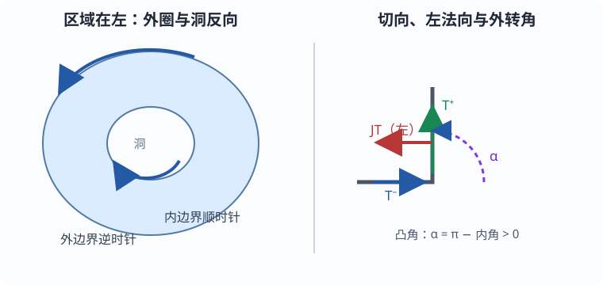

# 定向、边界、测地曲率与转角

Gauss–Bonnet 最常见的错误不是积分，而是四个方向各取了一套。先把所有符号固定，再谈证明。

## 曲面方向决定边界方向

在正向正交标架 $(e_1,e_2)$ 中定义 $Je_1=e_2,Je_2=-e_1$。沿边界按单位速行走，若 $T$ 是切向，$JT$ 就是左侧单位切向法向。**正向边界要求 $JT$ 指向区域内部**，也就是“边走边让区域留在左手边”。

*图：平面取标准方向时，外边界逆时针；洞的边界顺时针。箭头只是核对方向，定义和计算仍由正文给出。*

若曲面嵌入 $\mathbb R^3$ 且正向法向为 $n$，上述 $J$ 等于 $n\times(\cdot)$。因此

$$
k_g=\langle\nabla_TT,JT\rangle
=\langle\nabla_TT,n\times T\rangle.
$$

$k_g$ 是空间加速度的**切平面左向分量**。测地线满足 $\nabla_TT=0$，故 $k_g=0$；空间曲率非零并不矛盾，因为剩余加速度可全在曲面法向上。反向参数令 $\widetilde T=-T$，有 $\nabla_{\widetilde T}\widetilde T=\nabla_TT$ 而 $J\widetilde T=-JT$，所以 $k_g$ 变号。

## 角点贡献是切向量的瞬时转动

在角点 $p_j$，设一侧极限单位切向为 $T_j^-,T_j^+$。有号外转角 $\alpha_j$ 是从 $T_j^-$ 到 $T_j^+$ 的定向角，取与整条切向角连续提升相容的分支。普通无反向尖点的简单边界可取 $-\pi<\alpha_j<\pi$。凸顶点的内角 $\beta_j\in(0,\pi)$ 给

$$
\alpha_j=\pi-\beta_j>0.
$$

凹角 $\beta_j>\pi$ 给负外转角。角点没有经典曲率函数，不能把它偷偷塞进光滑弧上的 $k_g$；$\int k_gds$ 与 $\sum\alpha_j$ 分开记账。

## 平面圆盘先把口径跑通

半径 $a$ 的圆盘取标准方向，正向边界

$$
\gamma(t)=a(\cos t,\sin t),\quad 0\le t\le2\pi,
\qquad
T=(-\sin t,\cos t).
$$

此时 $JT=(-\cos t,-\sin t)$ 指向圆心，$ds=a\,dt$，并且

$$
\nabla_TT=\frac1aJT,\qquad k_g=\frac1a.
$$

平面 $K=0$、圆边无角点、圆盘 $\chi=1$，所以

$$
\int_DK\,dA+\int_{\partial D}k_g\,ds+0
=0+\int_0^{2\pi}\frac1a a\,dt=2\pi=2\pi\chi(D).
$$

同一个圆反向走会得到 $-2\pi$，那不是给定曲面方向诱导的正向边界，不能仍把右端写成 $+2\pi$。把圆换成正向正方形时，四条直边 $k_g=0$，四个外转角各为 $\pi/2$，总和仍为 $2\pi$；曲率从光滑弧“搬到”角点，记账没有改变。

## 洞为什么方向相反

平面圆环 $r_0\le r\le r_1$ 的外圈逆时针，给 $\int k_gds=2\pi$；内圈必须顺时针，给 $-2\pi$。两圈和为0，与 $K=0,\chi=0$ 一致。漏掉内圈会错误得到 $2\pi$。这就是 [[数学/15-微积分/16-Green-Gauss-Stokes内部变化与边界累积|Stokes 主解释]] 中“洞的边界不能自动消失”的几何版本。

Powell Part VI §7.3 pp.2–3 用平面切向转角核对 $\int k_gds+\sum\alpha=2\pi$；该讲义有时用内角写公式，本组统一换成有号外转角。
