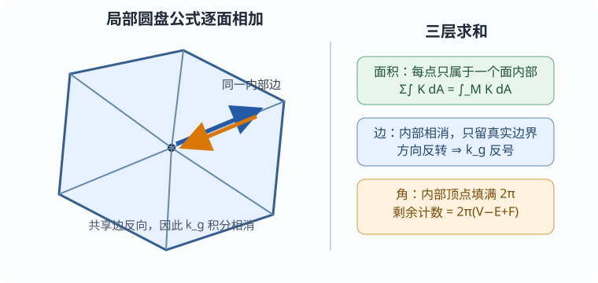

# 联络形式、结构方程与局部证明

本页证明：若紧致区域 $D$ 拓扑上是圆盘，并落在一个具有正向正交标架的邻域中，边界由有限条 $C^2$ 正则弧组成且只有有限个无反向尖点角点，那么

$$
\int_DK\,dA+\int_{\partial D_{\mathrm{reg}}}k_g\,ds+\sum_j\alpha_j=2\pi.
$$

局部标架可由正向坐标基 Gram–Schmidt 得到。若圆盘不在单个坐标图中，但其邻域切丛已知可平凡化，也可直接取标架；一般区域将在下一课用足够细的三角剖分归约到这里。

## 一张符号表先锁住结构方程

令 $(e_1,e_2)$ 为正向正交标架，$(\theta^1,\theta^2)$ 为对偶 $1$ 形式，$dA=\theta^1\wedge\theta^2$。定义联络 $1$ 形式

$$
\nabla_Xe_1=\omega(X)e_2,
\qquad
\nabla_Xe_2=-\omega(X)e_1.
$$

第二式来自内积相容性：对 $\langle e_i,e_j\rangle$ 求导。无挠率给第一结构方程

$$
d\theta^1=\omega\wedge\theta^2,
\qquad
d\theta^2=-\omega\wedge\theta^1.
$$

例如

$$
d\theta^1(X,Y)
=\langle Y,\nabla_Xe_1\rangle-\langle X,\nabla_Ye_1\rangle
=(\omega\wedge\theta^2)(X,Y).
$$

本库在 [[数学/35-微分几何/04-曲率内外在几何与完整算例#内在曲率从度量也能算出|04课]] 取

$$
R(X,Y)Z=\nabla_X\nabla_YZ-\nabla_Y\nabla_XZ-\nabla_{[X,Y]}Z,
\qquad
K=\langle R(e_1,e_2)e_2,e_1\rangle.
$$

直接对 $e_1$ 计算曲率，交叉项相消：

$$
R(X,Y)e_1=d\omega(X,Y)e_2.
$$

曲率算子对最后两个槽反对称，故

$$
d\omega(e_1,e_2)
=\langle R(e_1,e_2)e_1,e_2\rangle=-K,
\qquad
\boxed{d\omega=-K\,dA}.
$$

若教材定义 $\nabla e_1=-\omega e_2$，盒中符号会反转；必须连同后面的边界式一起换。

## 边界切向把 $k_g$ 与联络接起来

在每条光滑边界弧上取单位速参数，并把切向写成

$$
T=\cos\varphi\,e_1+\sin\varphi\,e_2,
\qquad
JT=-\sin\varphi\,e_1+\cos\varphi\,e_2.
$$

逐项求协变导数，得到

$$
\nabla_TT=(\varphi'+\omega(T))JT,
\qquad
\boxed{k_g\,ds=d\varphi+\omega}.
$$

这也说明换标架不改变 $k_g$：若标架旋转角为 $\lambda$，则 $\omega\mapsto\omega+d\lambda$，而同一 $T$ 的角坐标 $\varphi\mapsto\varphi-\lambda$，两项之和不变。$\omega$ 依赖标架，$d\omega$ 和 $d\varphi+\omega$ 才是几何量。

## Stokes 与切向转数完成证明

把边界各光滑弧相加：

$$
\int_{\partial D_{\mathrm{reg}}}k_g\,ds
=\sum_{\mathrm{arcs}}\Delta\varphi+\int_{\partial D}\omega.
$$

角点处 $\varphi$ 跳过外转角 $\alpha_j$。正向简单圆盘边界的单位切向绕一周总转数为1，因此

$$
\sum_{\mathrm{arcs}}\Delta\varphi+\sum_j\alpha_j=2\pi.
$$

另一方面，Stokes 与结构方程给

$$
\int_{\partial D}\omega=\int_Dd\omega=-\int_DK\,dA.
$$

代回并移项，得到所求公式。三项不是互相补丁：它们分别是标架的内部旋转、边界连续旋转和边界瞬时旋转，合起来等于切向绕行次数。

*图：每个小圆盘都用同一局部式；共享边的两个诱导方向相反。下一课把这一步与顶点计数完整写成 $\chi$。*

Powell Part VI §7.5 pp.6–10 以 Gram–Schmidt 标架和 Green 定理完成相同证明，并在 p.10 加入角点；Zhang Theorem 5.4 pp.8–10 给正交参数版本。两者的联络形式记号与本页不完全相同，本页以上述盒中定义独立核对符号。
