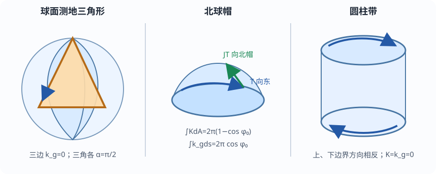

# 四个算例与失效边界

以下全部使用同一列：$\int KdA$、$\int k_gds$、$\sum\alpha$、$2\pi\chi$。角度用弧度，球与圆柱半径统一取 $R=2$；这样每一例都能看出哪一项在承担总转动。

*图：球帽边界按向东方向走，北帽在左；圆柱带上下两圈方向相反。图帮助检查方向，不替代下面的积分。*

## 例1：平面圆盘——全部来自边界弯曲

半径任取 $a>0$。01课已算 $K=0,k_g=1/a,ds=a\,dt$，圆边无角点，$\chi(D)=1$：

$$
\int_DK\,dA=0,\qquad
\int_{\partial D}k_g\,ds=2\pi,\qquad
\sum\alpha=0,\qquad
2\pi\chi(D)=2\pi.
$$

这也是“遗漏边界”的最小反例：若只保留 $\int KdA$，会把 $0$ 错当成 $2\pi$。

## 例2：球面测地三角形——全部由面积与角点分担

在半径2球面取第一卦限：$0\le\varphi\le\pi/2,0\le\theta\le\pi/2$。三条边都是大圆弧，所以 $k_g=0$。[[数学/35-微分几何/02-参数曲面度量法向与形算子#共用球面：每一步保留半径R|球面度量]] 给

$$
K=\frac14,\qquad dA=4\sin\varphi\,d\varphi d\theta.
$$

因此

$$
\int_\triangle K\,dA
=\int_0^{\pi/2}\int_0^{\pi/2}\sin\varphi\,d\theta d\varphi
=\frac\pi2.
$$

三个内角都是 $\pi/2$，故三个外转角也是 $\pi/2$：

$$
\int KdA=\frac\pi2,\qquad
\int k_gds=0,\qquad
\sum\alpha=\frac{3\pi}{2},\qquad
2\pi\chi(\triangle)=2\pi.
$$

一般测地三角形内角 $A,B,C$ 满足

$$
\int_\triangle K\,dA=A+B+C-\pi.
$$

这是 Powell Corollary 7.2 p.2 的角盈公式；本例把面积积分也独立算出。

## 例3：北球帽——曲率与光滑边界连续交换

取 $0\le\varphi\le\varphi_0$，$0<\varphi_0<\pi$。边界沿经度增加方向走，$T=e_\theta$，$JT=-e_\varphi$ 指向北帽内部。球面联络或空间加速度的切向分量给

$$
k_g=\frac{\cot\varphi_0}{R},\qquad
ds=R\sin\varphi_0\,d\theta.
$$

于是

$$
\int_MK\,dA=\frac1{R^2}\int_0^{2\pi}\int_0^{\varphi_0}R^2\sin\varphi\,d\varphi d\theta
=2\pi(1-\cos\varphi_0),
$$

$$
\int_{\partial M}k_g\,ds
=\int_0^{2\pi}\frac{\cot\varphi_0}{R}R\sin\varphi_0\,d\theta
=2\pi\cos\varphi_0.
$$

无角点，球帽为圆盘，故两项和为 $2\pi$。取本组数值 $R=2,\varphi_0=\pi/3$，两项各为 $\pi$。当 $\varphi_0>\pi/2$ 时边界项为负：正向边界仍是经度增加，但左侧大区域使纬线向右弯；公式连续有效。Powell §7.5 前的球帽计算 pp.5–6 给同一半径抵消现象。

## 例4：圆柱带——四项都为零

取

$$
M=\{(2\cos\theta,2\sin\theta,z):0\le\theta<2\pi,0\le z\le h\},\quad h>0.
$$

[[数学/35-微分几何/02-参数曲面度量法向与形算子#共用圆柱：弯曲但K为零|圆柱算例]] 给 $K=0$。上下边界圆的空间加速度完全沿圆柱法向，切向投影为0，所以两圈 $k_g=0$；边界光滑无角点。圆柱带同胚于圆环，$\chi=0$：

$$
\int_MK\,dA=0,\qquad
\int_{\partial M}k_g\,ds=0,\qquad
\sum\alpha=0,\qquad
2\pi\chi(M)=0.
$$

上下两圈的诱导方向相反仍须注明，即使本例各自积分恰为0；方向错误会在稍微弯曲边界后暴露。

## 两类不能删掉的条件

**非紧致反例。** 平面 $\mathbb R^2$ 无边界、$K=0$，普通同伦意义下 $\chi(\mathbb R^2)=1$。若删去紧致条件套闭曲面式，会得到 $0=2\pi$。对半径 $a$ 的穷竭圆盘，缺失的 $2\pi$ 始终在外边界；令 $a\to\infty$ 不能无条件把边界项宣布为0。

**遗漏边界反例。** 平面圆环有外圈 $+2\pi$ 与内圈 $-2\pi$，总和0，匹配 $\chi=0$。只算外圈就会错出 $2\pi$。边界分支是定理数据的一部分，洞不是积分时可以忽略的零面积集合。

最后到 [[数学/35-微分几何/10-Gauss-Bonnet/80-Gauss-Bonnet复算|复算页]] 用数值积分重跑四例；数值残差只检查实现和手算，不证明一般定理。
