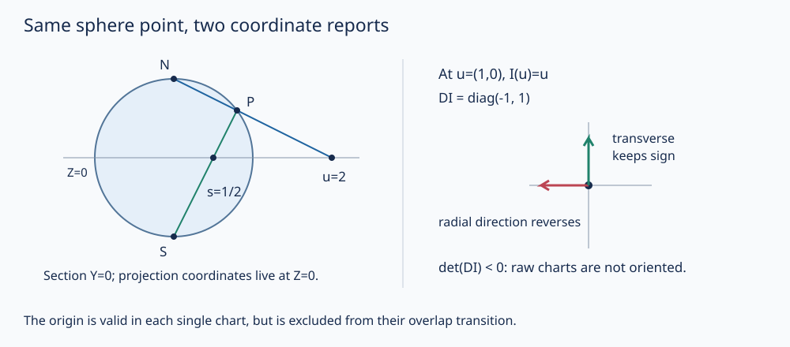

# 图册、光滑映射与球面双图

经纬度在极点失效，球面并没有在那里破掉。问题在于：用来报位置的两个数，能否和位置本身区分开？现有 [[数学/35-微分几何/03-坐标变换联络与测地线#换坐标保持长度|曲面换坐标]] 已证明同一长度的不同矩阵表达。本课把“坐标不是对象”提升为一般定义，明确局部坐标怎样允许微积分、又为什么不能覆盖所有整体问题。

## 三个拓扑条件各挡住什么

本课固定有限整数 $n\ge1$，先只讨论**无边界、实 $C^\infty$ 流形**。拓扑 $n$ 维流形 $M$ 是满足下列条件的拓扑空间：

1. Hausdorff：不同点有不交开邻域。
2. 第二可数：拓扑有一组可数开基。
3. 局部 Euclid：每点属于开集 $U\subset M$，存在同胚 $x:U\to x(U)\subset\mathbb R^n$，且 $x(U)$ **开**。

$(U,x)$ 称坐标图，$x(p)$ 是点 $p$ 的坐标。图不是一张有限像素图片；它是整个开集之间的可逆连续映射。固定 $n$ 是这里的定义约定；不把拓扑维数不变性当作已经在本课证明。边界需要半空间图和延拓光滑性，留给积分/Stokes 单元，不能将闭半空间当作本定义中的 Euclid 开集。[Lee，第1章 pp3–4](https://sites.math.washington.edu/~lee/Books/ISM/c01.pdf)

局部 Euclid 不自动提供另外两个条件。双原点直线由两份实线把所有非零同名点粘合，原点仍保留 $0_+,0_-$。每个原点连同全部非零点给一张实线图；两图重叠转换为恒等，仍无法分离两个原点：任何分别包含它们的开邻域，都含某个共同的足够小非零数。因此它不是 Hausdorff。这里采用商拓扑；两图区域开，因为其商映射逆像是一整份实线加另一份去掉原点的开集，坐标与逆也连续。

另取不可数多个互不相交的实线的拓扑不交并。它 Hausdorff 且局部 Euclid，但不是第二可数：每个分量是非空开集，可数基若存在，每个分量至少需含一个非空基元素；这些元素不能跨两个不交分量，故至少不可数个。两个反例分别定位丢掉哪个前提会出问题；不是说所有商空间都坏。[MIT Lecture 2，pp1–2](https://ocw.mit.edu/courses/18-965-geometry-of-manifolds-fall-2004/b481a27fb1583bbaf43153bcaf0643fe_lecture2.pdf)

第二可数还给本课马上会用的结论：**任意开覆盖有可数子覆盖**。给可数基 $\{B_j\}$，对每个能被某覆盖成员包含的 $B_j$，选一个这样的成员；任一点先取覆盖成员，再取含该点且落在成员内的基元素，所以选出的至多可数个成员覆盖全空间。于是任意图册有可数子图册。它没有保证有限图册；紧性才把每个开覆盖压到有限子覆盖。

## 图册为何不仅是同胚的集合

图册 $\mathcal A=\{(U_\alpha,x_\alpha)\}$ 的图域覆盖 $M$。重叠上，过渡映射
$$h_{\beta\alpha}=x_\beta\circ x_\alpha^{-1}:x_\alpha(U_\alpha\cap U_\beta)\longrightarrow x_\beta(U_\alpha\cap U_\beta)$$
在 Euclid 开集之间。要求它和逆都为 $C^\infty$，称图光滑相容；每对图相容才是光滑图册。过渡同时满足 $h_{\alpha\alpha}=\mathrm{id}$、$h_{\alpha\beta}=h_{\beta\alpha}^{-1}$，三重交上 $h_{\gamma\beta}\circ h_{\beta\alpha}=h_{\gamma\alpha}$。这些等式把局部表述钉在同一个空间上。

一个光滑图册确定唯一最大光滑图册，即光滑结构。证明不能只说“把相容的图统统放进来”：要核它们彼此相容。令 $\widehat{\mathcal A}$ 为与原图册每张图相容的全部图。任意两张新图 $x,y$ 在 $p$ 重叠，取原图册中也含 $p$ 的 $z$，在三图共同邻域有
$$y\circ x^{-1}=(y\circ z^{-1})\circ(z\circ x^{-1}).$$
右侧与逆均光滑，所以新图彼此相容。任一与全部新图相容的图当然也与原图相容，已经在其中，故最大；任一包含原图册的最大光滑图册都包含于它，最大性使二者相等。同理，两光滑图册定义同一结构，当且仅当它们的并仍光滑相容。这是一般证明，不依赖球面只有两张图。[Lee，Proposition 1.17，pp13–14](https://sites.math.washington.edu/~lee/Books/ISM/c01.pdf)

反例要分清“同一结构”与“存在某个微分同胚”。实线上单图 $x(t)=t$、另一单图 $y(t)=t^3$ 都各自生成光滑结构，但两图不能放入同一光滑图册：过渡 $y=x^3$ 的逆 $x=\sqrt[3]y$ 在零点不可微。两结构之间的**恒等点映射**在一个方向光滑、逆方向不光滑；这不说明二者不存在别的微分同胚。事实上从标准结构到 $y$ 结构取 $H(t)=\sqrt[3]t$，坐标表达 $y\circ H\circ x^{-1}(t)=t$，逆也为恒等，所以它是微分同胚。

## 球面两张图的定义域、逆与覆盖

取单位球面 $S^2=\{(X,Y,Z):X^2+Y^2+Z^2=1\}$，采用 $\mathbb R^3$ 的子空间拓扑。它 Hausdorff；与 Euclid 空间可数有理球基相交给可数基，所以第二可数。令北极 $N=(0,0,1)$、南极 $S=(0,0,-1)$，
$$U_N=S^2\setminus\{N\},\quad u=\phi_N(X,Y,Z)=\frac{(X,Y)}{1-Z},$$
$$U_S=S^2\setminus\{S\},\quad s=\phi_S(X,Y,Z)=\frac{(X,Y)}{1+Z}.$$
两域开且覆盖全球，每张图的值域都是 $\mathbb R^2$。令 $r^2=u_1^2+u_2^2$，逆为
$$\phi_N^{-1}(u)=\frac{(2u_1,2u_2,r^2-1)}{1+r^2};\qquad
\phi_S^{-1}(s)=\frac{(2s_1,2s_2,1-|s|^2)}{1+|s|^2}.$$
分母始终正；代入平方和用 $4r^2+(r^2-1)^2=(1+r^2)^2$ 得点在球面，逆像不会是被删去的极点；再代回两投影互相抵消。所有公式连续，故两图确实为同胚。$u=0$ 表示南极，$s=0$ 表示北极；“另一图的无穷远”不是需要储存无穷数的几何点。[Lee，Problem 1-7，p30](https://sites.math.washington.edu/~lee/Books/ISM/c01.pdf)

图左取截面 $Y=0$、$P=(4/5,0,3/5)$：从北极投到 $Z=0$ 得 $u=(2,0)$，从南极投得 $s=(1/2,0)$。同一个点没有在两幅坐标中移动；右图检查过渡微分在 $u=(1,0)$ 对径向和横向的不同作用。

## 过渡函数合法，却未自动保定向

共同域去掉两个极点，对应两边的 $\mathbb R^2\setminus\{0\}$。直接代入逆公式得
$$s=I(u)=\frac{u}{|u|^2},\qquad I(I(u))=u.$$
这是去心平面上的光滑微分同胚，不能把原点补进去。其 Jacobian
$$J(u)=DI_u=\frac1{r^2}\mathbf1-\frac2{r^4}uu^T$$
在径向 $u$ 上为 $-r^{-2}$ 倍，在与 $u$ 垂直的方向为 $+r^{-2}$ 倍。因此
$$\det J(u)=-r^{-4}<0,\quad J(I(u))J(u)=\mathbf1.$$
这既证可逆，也指出原始两图**不是保定向图册**。若把其中一图再复合一次线性反射，如将北图改为 $\widetilde\phi_N=(-u_1,u_2)$，过渡行列式变正。它给出保定向图册；若使用球面的外法向约定，北图逆在南极的两个原坐标方向叉积向内，反射后向外，南图逆在北极本来向外。逆投影微分处处秩2（投影复合为恒等的链式法则），叉积是非零法向；其与外法向的点积连续非零，而每张图像 $\mathbb R^2$ 连通，故符号在全图恒定。因此这一选择还与外法向一致。完整的可定向/不可定向、带边图/方向与积分现在由 [[数学/35-微分几何/20-光滑流形/04-定向单位分解与流形积分#定向怎样在重叠与边界上传递|一般定向与Möbius反例]] 承接；本例能修好仍不推出所有流形可定向。

这与已建 [[数学/45-复变函数/30-多复变量与复流形/02-复流形图册切空间与射影直线#射影直线的两张图怎样真正拼起来|复射影直线]] 不矛盾：把本 $u,s$ 都直接当复数时，$s=1/\bar u$，不是 $1/u$。复课选择的图方向不同；双全纯图的实行列式为正，条件也比实光滑更强。

## 光滑映射是坐标表达的相容规则

给光滑流形 $M^n,N^m$。连续映射 $F:M\to N$ 若在每点可选源图 $x$、目标图 $y$，并限制到 $F(U)\subset V$，使
$$\widehat F=y\circ F\circ x^{-1}:x(U)\to y(V)$$
为 $C^\infty$，就称光滑。改成任意其他光滑图，坐标表达变成
$$\widehat F'=(y'\circ y^{-1})\circ\widehat F\circ(x\circ x'^{-1}),$$
在相应的开邻域上仍光滑。所以定义与所选图无关；取复合的目标/源共用中间图，Euclid 复合光滑立即证光滑映射复合光滑。恒等也光滑。光滑双射的逆若也光滑才称微分同胚；$t\mapsto t^3$ 在两边都取标准结构时说明双射仍不足。这里的“连续”也可由逐点光滑坐标表达推出，但明确写入有助核对表达的开定义域。[MIT Lecture 2，§2](https://ocw.mit.edu/courses/18-965-geometry-of-manifolds-fall-2004/b481a27fb1583bbaf43153bcaf0643fe_lecture2.pdf)

球面高度 $z:S^2\to\mathbb R$ 在北图是 $(r^2-1)/(1+r^2)$，南图是 $(1-|s|^2)/(1+|s|^2)$，各自包含另一图漏掉的极点，所以给出全局光滑函数。相反 $\phi_N$ 只是 $U_N$ 上的图，不是全球的全局坐标。事实上 $S^2$ 紧致，若存在单张全局图，其像将是非空紧致的 $\mathbb R^2$ 开集；紧致性使第一坐标有最大值，开性却允许向第一坐标正方向挪动一点，矛盾。两张已经够，但一张不行。

机器人 [[AI/45-机器人与具身智能/30-刚体与机械臂/02-刚体位姿空间与机体速度#ZYX图册退化，不等于刚体不能处于该姿态|ZYX坐标退化]] 给同类警报：矩阵姿态仍是合法点，而某组三角角度没有局部光滑反解。本课没有因此证明全部 $SO(3)$ 图册，原机器人课继续负责其具体刚体映射与模型。下一课将一般光滑映射的 Jacobian 从坐标矩阵恢复为 [[数学/35-微分几何/20-光滑流形/02-切向量余切与坐标变换#光滑映射的微分不是随意搬运向量场|切映射]]。

## 撤去提示以后

1. 点 $P=(2/3,-1/3,2/3)$ 属于哪两图？求两套坐标、检查过渡，并判断 $u=(0,0)$ 是否在过渡定义域。
2. 某图册的重叠转换 $h$ 都光滑，但不核逆；$h(t)=t^3$ 暴露什么问题？若两图各自生成结构，能否宣布两流形不微分同胚？
3. 重新说明双原点与不可数实线不交并各违反哪一条件；为什么“每点附近都像实线”没有排除它们？
4. 在 $u=(1,0)$ 求 $DI$，比较方向 $(2,3)$ 的变换。将北图第一坐标反号后过渡行列式符号如何改变？这是否证明所有流形可定向？

> [!question]- 答案
> 1. 两极之外，两图都适用。$u=(2,-1)$、$s=(2/5,-1/5)$，$|u|^2=5$，所以 $I(u)=s$。$u=0$ 是南极，不在 $U_N\cap U_S$；北图本身在这里合法，失败的是两图之间的转换定义域。
> 2. 光滑同胚的逆未必光滑；立方的逆在零点不可微，不能作同一光滑图册的过渡。恒等点映射不能给微分同胚，但另取 $H(t)=\sqrt[3]t$ 从标准结构到立方坐标结构，坐标表达是恒等，故两结构仍微分同胚。必须报告是在检验哪一个映射。
> 3. 双原点不 Hausdorff，两个原点所有邻域相交；不可数不交并不第二可数，因为不交非空开分量需不同基元素。两者都有局部实线图，故第三条件不能代替前两条。
> 4. $DI=\mathrm{diag}(-1,1)$，方向变为 $(-2,3)$。反射又贡献一个负行列式，使新重叠转换为正；只证明这个球面图册可如此调整，不证明一般可定向性。

完整局部计算和图同源输入见 [[数学/35-微分几何/20-光滑流形/80-图册切余切精确复算|精确复算]]；从 [[数学/35-微分几何/20-光滑流形/00-光滑流形-MOC|本路线]] 进入下一课，不用先重读已建的曲面联络或覆盖空间课程。
