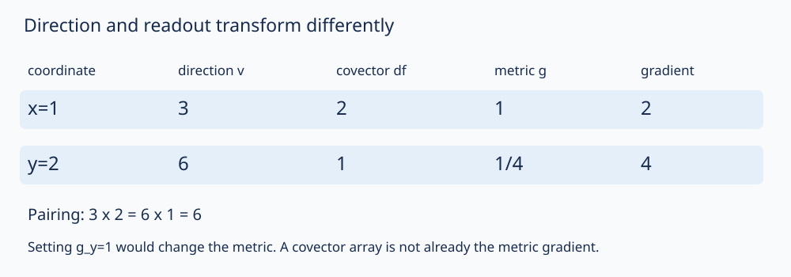

# 切向量、余切与坐标变换

同一个方向，换坐标后分量可以加倍；同一个函数的偏导分量却减半。这不是链式法则自相矛盾，而是切向量与余切向量走相反的变换。本课先在任意无边界实光滑流形上定义这两类对象，再把自动微分和球面计算放回一般规则。

以下 $M^n,N^m$ 有限维、Hausdorff、第二可数，图为 $C^\infty$；向量与余向量系数都用列。$y=h(x)$ 时 $J=D h$ 为可逆 $n\times n$ 矩阵；一般映射 $F:M^n\to N^m$ 的 Jacobian 则为 $m\times n$，不要求可逆。先分清这两种 Jacobian。

## 从过一点的曲线定义切空间

固定 $p\in M$，考虑定义于零附近、满足 $\gamma(0)=p$ 的光滑曲线 $\gamma:(-\varepsilon,\varepsilon)\to M$；只关心充分小邻域。选含 $p$ 的图 $x$，以
$$\gamma\sim\eta\quad\Longleftrightarrow\quad (x\circ\gamma)'(0)=(x\circ\eta)'(0)$$
定义速度等价。若换图 $y=h(x)$，链式法则给
$$v_y=J_{x(p)}v_x.$$
所以等速的两条曲线换图后仍等速，反向用 $J^{-1}$，等价关系与图无关。每个等价类称 $p$ 处切向量，类的集合是 $T_pM$。它保留一阶速度，不记录曲线的二阶弯曲。

对固定图，$[\gamma]\mapsto v_x$ 是到 $\mathbb R^n$ 的双射：单射来自定义；任意 $a\in\mathbb R^n$ 可取 $\gamma(t)=x^{-1}(x(p)+ta)$，只须 $|t|$ 足够小以留在开集内，故满射。用这个双射把加法与数乘搬到等价类上；换图是**同一个点处的线性矩阵 $J$**，保持线性运算，故所得向量空间结构不依赖图，维数恰为 $n$。这给一般存在/维数证明，几个球面方向不能替代它。[MIT Lecture 7，Definition 7.3](https://ocw.mit.edu/courses/18-965-geometry-of-manifolds-fall-2004/de18bf0029c583cacffb09810879bb54_lecture7.pdf) 用图与坐标向量的等价类构造同一个空间，本课的曲线实现补出每个坐标向量都能出现。

坐标基 $\partial/\partial x^i|_p$ 对应第 $i$ 个标准速度。对定义在 $p$ 邻域的光滑实函数，
$$v(f)=\left.\frac d{dt}f(\gamma(t))\right|_0=\sum_i v_x^i\frac{\partial(f\circ x^{-1})}{\partial x^i}(x(p)),$$
由链式法则只依赖速度类；有 $v(fg)=f(p)v(g)+g(p)v(f)$。因此“方向导数”是切向量对函数的读数，并不要求把坐标函数延拓到全流形。

若想与 [[数学/25-高等代数/60-交换代数与代数几何/05-局部环切空间与曲线奇点#局部环怎样给内在切空间|代数切空间的局部函数观点]] 对照，可以完全在**函数芽**中证明反向。函数芽指在 $p$ 某邻域定义、缩小邻域后相同就视为相同的函数。设 $D$ 是光滑实函数芽到 $\mathbb R$ 的实线性映射，满足同一 Leibniz 规则。它杀掉常数（$D1=2D1$）。在坐标小凸球内（下面 $f$ 简写其坐标表达）有一阶积分分解
$$f(x)-f(x_0)=\sum_i(x^i-x_0^i)g_i(x),\quad
g_i(x)=\int_0^1\partial_i f(x_0+t(x-x_0))dt,\quad g_i(x_0)=\partial_i f(x_0).$$
$g_i$ 光滑，由紧参数区间上光滑被积函数逐次微分可知。应用 Leibniz 得 $Df=\sum_iD(x^i)\partial_i f(x_0)$，所以恰对应速度 $v_x^i=D(x^i)$。这条证明用局部芽而非全局函数，不借尚未建立的单位分解。光滑函数芽与代数正则函数的当地环仍是不同函数类别，不能把代数奇点的切维数直接移到任意实点集。

## 光滑映射的微分不是随意搬运向量场

对光滑 $F:M\to N$，定义
$$dF_p:T_pM\to T_{F(p)}N,\qquad dF_p[\gamma]=[F\circ\gamma].$$
在源/目标图中的分量为 $A v_x$，$A=D(y\circ F\circ x^{-1})_{x(p)}$，所以换代表曲线不变、映射线性；改源图 $x'=h(x)$、目标图 $y'=k(y)$ 后
$$A'=Dk_{y(F(p))}\,A\,(Dh_{x(p)})^{-1},$$
恰好给同一个线性映射的不同基。复合曲线直接给
$$d(G\circ F)_p=dG_{F(p)}\circ dF_p,\qquad d(\mathrm{id})_p=\mathrm{id}.$$
若 $F$ 为微分同胚，逆的链式法则说明 $dF_p$ 可逆。反向“某点导数可逆便全局可逆”不成立；[[数学/16-数学分析/11-多元微分逆映射与隐函数定理|逆函数定理]] 只保证适当邻域内的逆。

任意 $F$ 都可逐点推切向量，但任意向量场 $X$ 未必能推成目标上的单值场。例 $F:\mathbb R\to\mathbb R$、$F(t)=t^2$，$X=\partial_t$；源点 $1,-1$ 同映到 $1$，却给目标速度 $2,-2$。只有满足适当同纤维一致条件时，才可在像上定义一个共同读数；若要求目标全域的光滑场，还须像与光滑性条件。对微分同胚，直接在每个唯一原像定义就没有这个歧义。

## 余切空间和拉回走对偶方向

$T_p^*M=\operatorname{Hom}_{\mathbb R}(T_pM,\mathbb R)$，配对 $\alpha(v)$ 是实数。基 $dx^i|_p$ 是 $\partial_{x^i}|_p$ 的对偶，$\alpha=\sum_i a_{x,i}dx^i$，所以 $\alpha(v)=a_x^Tv_x$。因为 $v_y=Jv_x$，要求对所有速度同一读数，必须且足够
$$a_y=J^{-T}a_x,\qquad a_y^Tv_y=a_x^Tv_x.$$
对函数 $f:M\to\mathbb R$，$df_p(v)=v(f)$，故分量是偏导列；$df_p$ 是余切向量，还不是一个已经给定内积的梯度向量。

一般 $F$ 的对偶则是
$$ (dF_p)^*:T_{F(p)}^*N\to T_p^*M,\qquad ((dF_p)^*\beta)(v)=\beta(dF_pv),$$
坐标为 $A^Tb_y$，只用转置而非逆，即使 $A$ 不方或降秩也成立。若目标有光滑一形式 $\beta$（每点选一余向量且局部分量光滑），定义 $(F^*\beta)_p=(dF_p)^*\beta_{F(p)}$；坐标系数光滑，所以给全源上的光滑一形式，且
$$F^*(df)=d(f\circ F),\qquad (G\circ F)^*=F^*G^*.$$
两式分别由函数链式法则、线性对偶复合验证。不要把逐点对偶误写成在没有指定源点时从整个 $T^*N$ 到 $T^*M$ 的单值映射；一个目标点可能有多个原像。本课仅完成一形式层的拉回，外代数、高阶形式与外微分后续再建。

[[数学/40-微积分与优化/02-梯度方向导数与Jacobian#JVP 与 VJP|JVP/VJP]] 正是 $Av$ 和 $b^TA$（若存列则 $A^Tb$）。它们不需度量。回 [[AI/10-机器学习与深度学习基础/04-计算图与自动微分#预览：反向传播输出什么|自动微分]] 时，原有固定 Euclid 参数坐标的偏导数组照常使用；本课解释何时需另加度量，不能把原代码的合法欧氏公式改错。

## 从一处切空间拼成切丛

定义集合 $TM=\bigsqcup_{p\in M}T_pM$，投影 $\pi(p,v)=p$。图 $x:U\to x(U)$ 诱导丛图
$$\Phi_x:\pi^{-1}(U)\to x(U)\times\mathbb R^n,\quad(p,v)\mapsto(x(p),v_x).$$
重叠转换为 $(x,v)\mapsto(h(x),Dh_xv)$，逆为 $(y,w)\mapsto(h^{-1}(y),D(h^{-1})_yw)$，都光滑，并由链式法则满足三重交相容。用这些图定义拓扑（集合开当且仅当它在每个丛图中开），相容转换保证各图为同胚。

还要核对全空间的拓扑条件：基点不同可用 $M$ 的不交图邻域的投影原像分开；基点相同而向量不同，用同一丛图中的不交 Euclid 邻域分开，故 Hausdorff。01已证明可取可数子图册，每张丛图像 $x(U)\times\mathbb R^n$ 有可数基，合并这些基的逆像便给 $TM$ 可数基。因此 $TM$ 确为 $2n$ 维光滑流形，$\pi$ 在丛图中为前 $n$ 个分量的投影，故光滑。$T^*M$ 同理，转换改为 $(x,a)\mapsto(h(x),Dh_x^{-T}a)$；矩阵逆在可逆矩阵集合光滑（伴随矩阵除以非零行列式），所以没有遗漏新条件。

这证明局部是 $U\times\mathbb R^n$，未证明全局一定为 $M\times\mathbb R^n$。向量场是光滑截面 $X:M\to TM$、$\pi\circ X=\mathrm{id}$，等价于各图的分量光滑且重叠按 $X_y=JX_x$ 拼接。一形式是 $T^*M$ 的光滑截面，走 $J^{-T}$ 规则。一般全局平凡化或处处非零场的存在，不能凭一张局部坐标基宣布。

## 度量才把微分变成梯度

现在**给定**光滑正定对称度量 $g$，即每点 $T_pM$ 上一个正定双线性型，局部矩阵 $g_x$ 光滑。为保持 $g(v,w)$，换图必须有
$$g_y=J^{-T}g_xJ^{-1}.$$
梯度由 $g(\operatorname{grad}f,v)=df(v)$ 对所有 $v$ 定义，正定使矩阵可逆且唯一：
$$ (\operatorname{grad}f)_x=g_x^{-1}a_x,\quad a_x=(df)_x;\qquad
(\operatorname{grad}f)_y=J(\operatorname{grad}f)_x.$$
后一式直接代入度量和余切的两条转换证明。这里没有调用“所有流形上度量存在”的一般结论；其一般构造需要后续单位分解。本课例子都有显式给定的度量。

取同一实线、$y=2x$、$f=x^2$，在 $x=1$、$y=2$，
$$v_x=3,\quad v_y=6;\qquad (df)_x=2,\quad (df)_y=1;\qquad df(v)=6.$$
若固定几何度量 $g=dx^2$，则 $g_y=1/4$，所以梯度分量 $\operatorname{grad}_x f=2$、$\operatorname{grad}_y f=4$。后者是 $J\cdot2$，不是偏导数 $1$。若在新坐标强行设置 $g_y=1$，就是把度量改成 $dy^2=4dx^2$；再称它为“同一个梯度”便改变了问题。

坐标表看起来都是一列数，不等于走同一变换。图中 $3\times2=6\times1$ 检验配对，$2\mapsto4$ 检验固定度量的梯度；不能仅核其中一个等式。

## 球面的一般切平面与两个坐标检查

对任意 $p\in S^2$，将曲线约束 $\gamma\cdot\gamma=1$ 求导，环境速度 $w$ 满足 $p\cdot w=0$。反向，任意这样的 $w$ 可由
$$\gamma(t)=\frac{p+tw}{|p+tw|}$$
实现，$\gamma'(0)=w$；它在小区间光滑（分母非零），在各球面图中的表达也光滑。若两条球面曲线的环境速度相同，在包含 $p$ 的北图或南图上对投影求导，坐标速度也相同，故属于同一速度类；这补出单射。因此内在切空间与环境平面 $\{w:p\cdot w=0\}$ 线性同构，给出整个球面的一般结论。

设北图逆 $r_N(u)=\phi_N^{-1}(u)$。其微分上两行为 $2(1+|u|^2)^{-1}\mathbf1-4(1+|u|^2)^{-2}uu^T$，最后行为 $4u^T/(1+|u|^2)^2$。列向量内积直接给
$$g_N=Dr_N^TDr_N=\frac4{(1+|u|^2)^2}\mathbf1;\qquad g_S=\frac4{(1+|s|^2)^2}\mathbf1.$$
它们来自环境内积，不是给每张坐标平面擅自各设单位矩阵；由 $r_N=r_S\circ I$ 求导，也直接证 $g_N=J^Tg_SJ$。

取 $u=(1,2)$、$s=(1/5,2/5)$、$p=(1/3,2/3,2/3)$，并取 $v_N=(3,-1)$。逐项计算为
$$J=\frac1{25}\begin{pmatrix}3&-4\\-4&-3\end{pmatrix},\quad
v_S=(13/25,-9/25),\quad Dr_Nv_N=Dr_Sv_S=(8/9,-5/9,1/9).$$
最后的环境向量点乘 $p$ 为零，且不是另一个几何方向。高度函数 $z(p)=Z$ 的读数与梯度为
$$ (dz)_N=(1/9,2/9),\quad(dz)_S=(-5/9,-10/9),\quad dz(v)=1/9,$$
$$g_N=\tfrac19\mathbf1,\quad g_S=\tfrac{25}9\mathbf1,\qquad
(\operatorname{grad}z)_N=(1,2),\quad(\operatorname{grad}z)_S=(-1/5,-2/5).$$
对应同一个环境切向量 $e_Z-Zp=(-2/9,-4/9,5/9)$，因为对所有 $w\perp p$，$(e_Z-Zp)\cdot w=e_Z\cdot w=dz(w)$。这些等式同时核切、余切、度量和环境方向，避免两个一起写错的数组碰巧保持某个内积。

一个全局光滑向量场是 $V(X,Y,Z)=(-Y,X,0)$，处处与 $p$ 正交，在两图分别为 $(-u_2,u_1)$、$(-s_2,s_1)$，按 $J$ 正确拼接；它在两个极点为零。坐标图不覆盖某极点，不等于向量场在那里不存在；场为零也不等于流形奇异。

回 [[数学/25-高等代数/60-交换代数与代数几何/05-局部环切空间与曲线奇点#参数导数为零，不是几何奇点的定义|退化参数与奇点]]：$\gamma(t)=(t^3,0)$ 在零点速度类为零，但像是光滑横轴，不能据此否定它的一维切空间；尖点的代数当地环非正则是另一种对象判断。回机器人课时同样区分坐标图、状态到任务的微分和物理约束，不把任何导数降秩都叫“流形不存在”。

## 撤去提示以后

1. 固定 $g=dx^2$，改坐标 $y=3x$，仍在 $x=1$，取 $f=x^2,v_x=-2$。计算 $v_y,(df)_y,g_y,(\operatorname{grad}f)_y$ 及配对。若把 $g_y$ 设成1，改变了什么？
2. 在球面北图 $u=(1,0)$ 取方向 $(2,3)$。算南图方向、两边高度微分、配对和度量；把两个微分列都按 $J$ 变换为何在此点可能骗过单次测试？
3. 对 $F(t)=t^2$，取目标一形式 $\beta=dy$、源场 $X=\partial_t$。求 $F^*\beta$，解释为什么拉回处处合法，却不能把 $dF(X)$ 直接称目标上的场。
4. $\gamma(t)=(t^3,0)$ 的零速度说明什么？若有人从每个图上存在 $\partial_{x^1}$ 推“所有流形都存在处处非零全局场”，缺了什么？用本课球面旋转场检验极点。

> [!question]- 答案
> 1. $v_y=-6,(df)_y=2/3,g_y=1/9,(\operatorname{grad}f)_y=6$；配对两边 $-4$。新坐标若设 $g_y=1$，便改为 $dy^2=9dx^2$，梯度变成另一度量下的对象。
> 2. $s=(1,0),J=\mathrm{diag}(-1,1)$，$v_S=(-2,3)$。$(dz)_N=(1,0)$、$(dz)_S=(-1,0)$，配对均为2，度量两边都是单位矩阵。这里恰有 $J^{-T}=J$，故错误地把余向量也按 $J$ 变换暂时不露馅；改到正文 $u=(1,2)$ 就不成立。单个特殊点不能检验一般转换公式。
> 3. $F^*dy=d(t^2)=2t\,dt$，不需逆矩阵，在 $t=0$ 也合法。源点 $1,-1$ 同映到目标1，推出速度分别2、−2，目标读数不单值，不能得到目标场。
> 4. 只说明这条参数曲线在该点的一阶速度为零，像横轴仍可用正则参数 $(t,0)$ 给非零切向量。局部坐标基必须在重叠上按Jacobian一致拼接，局部存在不能推出全局非零截面。本旋转场确实拼成全局场，但在南北极均为零；这不是本课对“所有球面场必有零点”的一般证明。

[[数学/35-微分几何/20-光滑流形/80-图册切余切精确复算|精确实验]] 核固定有理坐标与改条件例；一般坐标独立性由前文证明。下一段仍需建设高阶形式、外微分、定向、单位分解和整体积分，才能补上 [[数学/80-跨学科专题与综合练习/07-微分形式与一般Stokes定理#一般 Stokes 定理到底说什么|一般Stokes]] 明示的依赖；回 [[数学/35-微分几何/20-光滑流形/00-光滑流形-MOC|本路线]] 不把本首包视为整门课已完。
