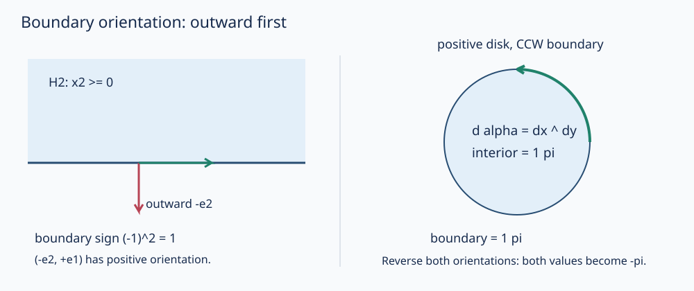

# 整体 Stokes 证明与物理返回

局部基本定理如何变成不依赖图册的整体等式？03已给形式与外微分，04已证明单位分解存在并据之定义积分。现在把剩余逻辑逐项闭合；不是只写一句“分块后内部边消掉”。

## 定理的对象和条件

设 $M^n$（$n\ge1$）为定向、Hausdorff、第二可数的实 $C^\infty$ 带边流形，允许 $\partial M=\varnothing$、允许 $M$ 非紧。令 $\omega\in\Omega_c^{n-1}(M)$，即**光滑到边界且支撑在 $M$ 内紧**；边界采用外向横截方向在前，$\iota:\partial M\hookrightarrow M$ 为包含。则
$$\boxed{\int_Md\omega=\int_{\partial M}\iota^*\omega.}$$
$\operatorname{supp}d\omega\subseteq\operatorname{supp}\omega$，因为在形式恒零的开集导数也零。边界为闭子集，其限制支撑也紧，所以两积分都按04已建的有限和定义。若 $M$ 紧，任意光滑 $\omega$ 自动紧支撑，不要求在边界为零；否则会把真正的边界读数提前删掉。

这里的边界是光滑半空间边界，没有角点。多边形/多面体有相应分片版本，可用各光滑片与内部公共面相反定向抵消来证明；本文的完整一般定理不借一个方格图假装已经包含任意角点或分形边界。[MIT18.952，§4.6及Theorem4.6.5，pp128–130](https://math.mit.edu/classes/18.952/2018SP/files/18.952_book.pdf) 给同一路线；原文半空间取首坐标的另一侧，下面固定末坐标 $x^n\ge0$，独立核符号。

## 局部证明：所有方向只用一次基本定理

先在 $\mathbb R^n$ 或 $H^n=\{x^n\ge0\}$ 中，对光滑紧支撑 $(n-1)$ 形式唯一写
$$\omega=\sum_{i=1}^n(-1)^{i-1}a_i\,dx^1\wedge\cdots\widehat{dx^i}\cdots\wedge dx^n.$$
由03公式，只有 $\partial_i a_i$ 那项不含重复 $dx$，重排的两个 $(-1)^{i-1}$ 相乘为正，故
$$d\omega=\left(\sum_i\partial_i a_i\right)dx^1\wedge\cdots\wedge dx^n.$$
系数光滑紧支撑，绝对可积，[[数学/16-数学分析/15-收敛定理与Fubini-Tonelli|Fubini条件]] 已满足，可先沿 $x^i$ 积分。全空间每一项都是一维紧支撑函数导数的全线积分，端点为零，所以结果0，与空边界一致。

半空间中 $i<n$ 的切向积分仍全线、仍为零；仅剩法向
$$\int_{\mathbb R^{n-1}}\int_0^\infty\partial_n a_n(x',x^n)\,dx^n\,dx'=-\int_{\mathbb R^{n-1}}a_n(x',0)\,dx'.$$
边界拉回把含 $dx^n$ 的项杀掉，只余
$$\iota^*\omega=(-1)^{n-1}a_n(x',0)\,dx^1\wedge\cdots\wedge dx^{n-1}.$$
04的诱导边界方向给 $(-1)^n$，所以边界积分也为 $(-1)^n(-1)^{n-1}\int a_n=-\int a_n$。若该图相对 $M$ 方向标记为 $\varepsilon_x=-1$，两边都再乘同一个 $\varepsilon_x$，等式仍成立；这包含一维区间的右端图。$n=1$ 时恰为 $\int_0^\infty f'(x)dx=-f(0)$，右边是负端点0的带号求和。

若形式只在一个图域里支撑紧包含，而不在整个半空间上，先把其坐标系数在图域外、半空间内延为零。支撑紧包含保证光滑；靠实际边界 $x^n=0$ 不必零延到另一侧，只需04局部延拓光滑性。于是上面的半空间局部公式仍适用，没有多造一条“图边界”。

## 单位分解拼接：多出来的导数去哪了

取04已证明存在的、从属于带方向标记图覆盖的局部有限单位分解 $\{\rho_i\}$。每个 $\rho_i\omega$ 支撑紧包含于相应图，因此可用局部 Stokes：
$$\int_M d(\rho_i\omega)=\int_{\partial M}\iota^*(\rho_i\omega).$$
注意 $d(\rho_i\omega)$ **不是**简单的 $\rho_i d\omega$。真正等式是
$$d(\rho_i\omega)=d\rho_i\wedge\omega+\rho_i d\omega.$$
由于局部有限，$\sum_i d\rho_i=d(\sum_i\rho_i)=d1=0$；乘 $\omega$ 后，紧支撑又把所有实际非零项压到有限个。于是
$$\sum_i d(\rho_i\omega)=\left(\sum_i d\rho_i\right)\wedge\omega+\left(\sum_i\rho_i\right)d\omega=d\omega,$$
$$\sum_i\iota^*(\rho_i\omega)=\iota^*\left(\sum_i\rho_i\omega\right)=\iota^*\omega.$$
对局部等式求和便得整体定理。04已证明积分独立于图与单位分解，因此结果是几何读数，不是所选权重的读数。

如果改用几何剖分图直观理解，公共内部面的两侧外向横截方向相反，同一环境定向便诱导相反边界方向，同一形式的两份积分相消。[[数学/35-微分几何/10-Gauss-Bonnet/03-三角剖分消边与全局定理#第一步：面积相加，内部边抵消|Gauss–Bonnet的内部边]] 用这个机制；对任意一般流形，本课的证明本身不预设一份有限三角剖分，真正拼接由 $d\rho_i$ 的和为零承担。

## 哪些条件一改，等式就失去原来的意思

非紧流形上删掉紧支撑，哪怕两边都有限也可能错。取 $M=[0,\infty)$，正向 $dx$，$\omega=1$ 为0形式；$d\omega=0$，左积分0，边界只有负端点0，右积分−1。有限区间 $[0,R]$ 上基本定理的右端是 $1-1=0$；丢掉向无穷远的右端，才造成错误。非紧非紧支撑有些情形仍成立，但须另检查衰减、无穷远通量和积分定义，不由本定理自动覆盖。

不可定向Möbius带上，普通顶形式不能沿各图任取绝对值还保持同一个Stokes公式；无向面积可积是密度理论，不是已经给了全局定向。闭曲面也有其他障碍：球面面积形式 $\sigma$ 为闭（3形式在二维为零），但不可能全局写成 $d\alpha$，否则 Stokes 给 $\int_{S^2}\sigma=0$，与正面积 $4\pi$ 矛盾。闭与恰当再次分开。

光滑性/定义域同样重要：去心平面的角形式闭但沿绕原点单位圆有非零周期，不能用被删掉原点的整个圆盘作为同一光滑域来声称积分应零。物理点源或界面跳跃也要先挖去奇点、分片或改用弱形式；不能把一条形式公式当成取消奇点的许可证。

## 圆盘、半球与同一个环量/通量

取单位圆盘 $D=\{X^2+Y^2\le1,Z=0\}$，方向 $dX\wedge dY$，以及三维一形式
$$\alpha=\tfrac12(-Y\,dX+X\,dY),\qquad d\alpha=dX\wedge dY.$$
圆盘是光滑带边流形：边界约束 $X^2+Y^2=1$ 的梯度非零，隐函数定理给半空间图。外向半径在前使边界 $c(t)=(\cos t,\sin t,0)$、$0\le t\le2\pi$ 逆时针。直接算
$$c^*\alpha=\tfrac12dt,\quad\int_{\partial D}\alpha=\pi;\qquad\int_Dd\alpha=\int_0^{2\pi}\int_0^1r\,dr\,dt=\pi.$$
若只反转曲面方向，边界方向也必须反转，两边同为−π；若只把边界绕向反过来，则把两个不同定向问题硬拼在一起。

再取单位上半球 $S_+$，方向为球面外向。它的赤道诱导方向也是上述逆时针：在 $p=(1,0,0)$，向半球外的切向横截向量 $-e_Z$ 在前，接 $e_Y$ 后叉积为 $e_X$。同一形式给
$$\int_{S_+}d\alpha=\int_{\partial S_+}\alpha=\pi.$$
独立坐标核对可用 $r(\theta,\varphi)=(\sin\theta\cos\varphi,\sin\theta\sin\varphi,\cos\theta)$，$0<\theta<\pi/2$：$r^*(dX\wedge dY)=\sin\theta\cos\theta\,d\theta\wedge d\varphi$，积分仍π。极点/经线接缝不是一张全球坐标，计算只忽略在光滑局部图中面积零的这些集合；它们没有代替整体证明。

在固定三维Euclid模型中，$\alpha$ 编码向量场 $(-Y/2,X/2,0)$ 的环量，$d\alpha$ 编码其旋度 $(0,0,1)$ 的通量。半球面积为 $2\pi$，通量却π，因为积分的是法向分量，不是只数面积。一般 $F=(P,Q,R)$ 的通量二形式
$$\eta_F=P\,dy\wedge dz+Q\,dz\wedge dx+R\,dx\wedge dy$$
满足 $d\eta_F=(\nabla\cdot F)dx\wedge dy\wedge dz$；把Stokes用在三维体域，才成为散度定理。它不是将一形式直接拿去积分三维体积。

## 返回电磁例：先报阶数、模型和方向

去 [[物理/20-电磁学/01-场源与守恒#同一组 Maxwell 方程的两种读法|Maxwell两种读法]]，采用原页固定实验室Euclid空间、光滑场和固定区域约定。电场的环量一形式 $e=E_i dx^i$ 在曲线积分，单位V；磁通二形式 $b=B_xdy\wedge dz+B_ydz\wedge dx+B_zdx\wedge dy$ 在曲面积分，单位Wb；$de=-\partial_t b$ 是Faraday式。电位移通量二形式 $\eta_D$ 的 $d\eta_D=\rho_f dx\wedge dy\wedge dz$ 是Gauss式。数学Stokes负责把相应阶数的内部/边界读数相连；物理本构、源、固定/移动边界及时间微分穿过积分仍需原页条件。

原页充电电容器两个跨面同边界，环流一形式为 $h=H_i dx^i$，$dh$ 是自由电流加位移电流的通量二形式，单位A。读完本课回去解释为什么跨面改变不能删位移项；奇点/跳跃处仍保留积分或分片条件。本课没有重跑电容/硬件，也没有把一般流形当所有入门静场问题的强制先修。

三种常混名的操作必须分别定义：

- **普通重参数化**：对同一个区域/曲面改用光滑可逆参数，形式按拉回计算，定向一起追踪。$F(u,v)=(u,v+u^2)$ 就是例子，不改变物理场或源。
- **Lorentz坐标变换**：在原 [[物理/30-电动力学/04-参考系四矢量与协变场#先固定被动变换和时间坐标|协变场合同]] 中 $x^\mu=(ct,x,y,z)$，$x'=\Lambda x$、$\Lambda^T\eta\Lambda=\eta$，$\eta=\operatorname{diag}(1,-1,-1,-1)$。它是保指定Minkowski矩阵的特殊时空坐标变换；不是任意Jacobian都满足。比较不同同时切片还改变积分子流形，须回原物理页核同一事件/同一面。
- **物理规范变换**：在固定时空点与坐标中改势代表。用单位为V·s的一形式 $\mathcal A=A_i dx^i-\phi dt$，原 [[物理/30-电动力学/01-势规范与守恒源#规范变换为什么不改变场|规范变换]] $\mathbf A\mapsto\mathbf A+\nabla\chi,\phi\mapsto\phi-\partial_t\chi$ 给 $\mathcal A\mapsto\mathcal A+d\chi$。于是场二形式 $d\mathcal A$ 不变，由 $d^2\chi=0$ 保证；这是固定点上的代表改变，不是换图。全局单值χ与边界/初值还要相容；Lorenz规范的人名也不是Lorentz变换。

## 撤去提示以后

1. 取 $[a,b]$ 正向 $dx$，$f(x)=x^2$，用带号0维边界核Stokes。再取 $[0,\infty)$ 上 $f=1$，哪一前提失败，丢掉哪一端？
2. 对单位上半球把外向改内向，但保持原逆时针赤道。两边各是多少？怎样修复？把半球通量错写成面积 $2\pi$ 又错了哪种对象？
3. 在球面上是否存在全局光滑一形式 $\beta$ 使 $d\beta$ 等于标准外向面积形式？以Stokes作证；为何局部形式计算不能直接给全局答案？
4. 返回充电电容器：写H环流、J与∂tD两项分别对应的形式阶数与积分单位，说明边界/跨面定向怎样相配。再判断 $\mathcal A\mapsto\mathcal A+d\chi$、$x'=\Lambda x$、$F(u,v)=(u,v+u^2)$ 哪个是规范、哪个需要Minkowski条件、哪个只是在同一曲面上换参数。

> [!question]- 答案
> 1. $\int_a^b2x\,dx=b^2-a^2$，边界带号求和也是 $f(b)-f(a)$。半线上的常数不紧支撑，左0、右−1；有限截断的R端原为+1，不能在无衰减时扔掉。
> 2. 内向曲面积分为−π，但保留原逆时针赤道仍给+π，不相等是定向未配套。将边界也改顺时针，两边−π。把通量写成面积2π则忽略了场的法向分量；此处被积二形式是dX∧dY，非球面面积形式。
> 3. 不存在。若有，全局Stokes在无边界紧球面给面积积分0，与4π矛盾；局部可以找到原函数形式，不代表能在重叠上拼成一个全局β。单位分解拼β还会产生dρ项，不是随意拼原函数就得到同一个dβ。
> 4. $h=H_i dx^i$是一形式，环积分A；自由电流通量与位移通量均为二形式，积分分别A、A（D通量先为C，时间导数后为A）。两跨面须诱导同一闭合曲线方向，源/位移项不可因改跨面丢掉。第一项是固定点上的规范改变，场二形式由d²χ=0不变；第二项是Lorentz，须ΛᵀηΛ=η并沿原页时间/被动约定；第三项是普通曲面重参数化，按拉回及定向换元。它们可共用微分形式语言，却不是同一种操作。回原电磁页继续检查固定/移动区域、材料、本构与奇点条件。

[[数学/35-微分几何/20-光滑流形/81-微分形式与Stokes符号复算|有限符号复算]] 保留同公式输入、精确输出与方向图；回 [[数学/35-微分几何/20-光滑流形/00-光滑流形-MOC|本路线]] 时，本包补齐形式/积分/Stokes链，一般联络、测地与曲率现由 [[数学/35-微分几何/20-光滑流形/06-Levi-Civita联络与平行移动|06]] 到 [[数学/35-微分几何/20-光滑流形/08-曲率张量Gauss方程与曲面迁移|08]] 接齐；新课的平行角与原Gauss–Bonnet继续使用本页已证明的整体积分语言。
