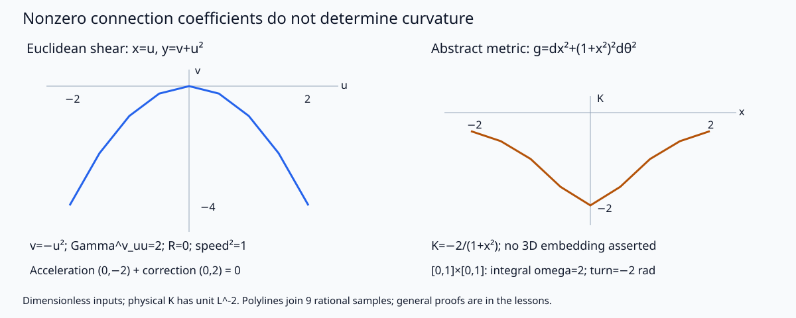

# 联络、测地与曲率：同一度量的精确复算

正文给任意维正定度量的证明；这里将其落实到有限的精确输入，特别检验非张量Christoffel与张量曲率的区别。程序不做数值ODE积分，旧球面测地积分器及其步长实验保留在 [[数学/35-微分几何/80-几何计算与测地线复算|曲面复算主源]]；这里给新的解析残差和局部导数计算，没有重跑旧实验。

## 输入、轴顺序与可变条件

规范源是同目录 `riemann_lab.py`，仅用Python标准库。核心接口 `metric_jet(g,dg,ddg)` 输入同一点的度量与一、二阶偏导，轴严格为

- `g[i][j]`；`dg[a][i][j]=∂_a g_ij`；`ddg[a][b][i][j]=∂_a∂_b g_ij`。
- 输出 `Gamma[k][i][j]=Γᵏᵢⱼ`；`dGamma[a][k][i][j]`；`R[l][k][i][j]` 表示 `R(∂i,∂j)∂k` 的第l分量。
- 只收整数或 `fractions.Fraction`，拒绝bool和float；shape、度量槽对称、混合二阶导数对称、Sylvester正定主子式均核。输入是有限jet，不代表已提供整个流形的图册。

`warped(f,fp,fpp,dimension=2)` 给 $dx^2+f^2d\theta^2$ 的jet，`dimension=3` 添加 $dz^2$；要求 $f>0$。改 $f'$ 会改Christoffel和平行场分量导数，改 $f''$ 会直接改 $K=-f''/f$。应先预测：在 $f=2,f'=0$ 时，将 $f''=-1/2$ 改成0，$K$ 从 $1/4$ 变为0，而该点Christoffel都为0。这显示只看一点的Christoffel无法识别曲率。

## 固定输入实际结果

2026-10-17实际执行（输出目录默认为源码所在目录）：

```bash
python3 riemann_lab.py
# 另写可再生结果时：python3 riemann_lab.py --output-dir /path/to/new-directory
```

本次在共享两槽runner、单线程限制内 exit0，stdout为 `PASS, rows=36, identity_checks=6291, rejections=12`。完整固定输入与全部数组在 [实际JSON](实践结果/riemann-20261017.json)，运行没有依赖网络、硬件或浮点求解器。

| 对象与有限输入 | 实际核对 | 意义与边界 |
|---|---|---|
| 剪切欧氏图 $u=a/2,a=-4,\ldots,4$，共9点 | 只有 $\Gamma^v_{uu}=2$，全部R为0；$(u,v)=(t,-t^2)$的测地残差与物理恒定向量的平行残差均0，范数平方1；错令Γ零残差$(0,-2)$ | 真实换图二阶项；有限点不证明任意坐标变换定理 |
| $f=1+x^2$，$x=a/2$的9点，分别维2/3，共18行 | $K_{x\theta}=-2/(1+x^2)$；维3的 $K_{xz}=0$；沿θ0的 $V=(2,3/f[,0])$ 平行、范数平方13 | 一点多截面；一般张量性与Gauss引理仍由正文证明 |
| 半径1/2/3的球面赤道、$\sin(x/R)=3/5$的纬线、圆柱，共9行 | 球面 $K=1/R^2$，柱0；保留精确 $f,f',f''$ | 远离极点的合法jet；不让f0冒充正定输入 |
| $g=I, b=\left(\begin{smallmatrix}2&1\\1&-3\end{smallmatrix}\right),X=(2,0),Y=(1,1)$ | Gauss分子−28，Gram4，比值−7 | 非对角第二形式与非正交基交叉核 |
| warped矩形 $[0,1]\times[0,1]$，f=1+x² | 四边∮ω贡献0/2/0/0，面积4/3，∫KdA=−2，平行角−2rad；半高矩形角−1 | 方向和同一面积权重；最终方向读模2π |

每行另核无挠、metric相容、前两方向反对称、末槽metric反伴随和第一Bianchi，共6291个有限等式。12个拒绝分支覆盖空维/shape/float/bool/零或不定度量/不对称g与导数/f≤0/非法维/相关向量；这些是接口拒绝证据，不是12种新的几何定理。



*图直接取上述9个有理点折线。左面坐标中的抛物线在物理欧氏平面其实是直线；右面是指定抽象度量的K读数，未声称展示三维等距嵌入。所有数已无量纲化，恢复尺度L时K单位为L⁻²。图能排除两个误判，不能替一般联络存在、局部最短或Gauss方程证明。*

## 源码镜像

下列是规范源的完整镜像，修改时两处同版。可以导入纯函数构造其他合法有理jet，不导入即不执行写文件主程序。

<!-- code-sync: riemann_lab.py -->
```python
"""Exact metric 2-jets -> Levi-Civita and R, plus fixed shear/warped examples.
Standard library only. CLI writes the finite JSON and SVG to --output-dir.
The finite checks do not prove the general theorems or certify ODE integration.
"""
from fractions import Fraction as Q
from pathlib import Path
import argparse
import json


def zeros(*shape):
    return [zeros(*shape[1:]) for _ in range(shape[0])] if shape else Q(0)


def exact_array(a, shape):
    if not shape:
        if type(a) not in (int, Q):
            raise ValueError('only int/Fraction entries, excluding bool/float')
        return Q(a)
    if not isinstance(a, (list, tuple)) or len(a) != shape[0]:
        raise ValueError('array shape mismatch')
    return [exact_array(x, shape[1:]) for x in a]


def determinant(a):
    n = len(a)
    a = [row[:] for row in a]
    ans = Q(1)
    for i in range(n):
        j = next((j for j in range(i, n) if a[j][i]), None)
        if j is None:
            return Q(0)
        if j != i:
            a[i], a[j] = a[j], a[i]
            ans = -ans
        pivot = a[i][i]
        ans *= pivot
        for j in range(i + 1, n):
            factor = a[j][i] / pivot
            for k in range(i + 1, n):
                a[j][k] -= factor * a[i][k]
    return ans


def inverse(a):
    n = len(a)
    z = [row[:] + [Q(i == j) for j in range(n)] for i, row in enumerate(a)]
    for i in range(n):
        j = next((j for j in range(i, n) if z[j][i]), None)
        if j is None:
            raise ValueError('singular matrix')
        z[i], z[j] = z[j], z[i]
        pivot = z[i][i]
        z[i] = [x / pivot for x in z[i]]
        for j in range(n):
            if j != i:
                factor = z[j][i]
                z[j] = [x - factor * y for x, y in zip(z[j], z[i])]
    return [row[n:] for row in z]


def metric_jet(g, dg, ddg):
    """dg[a][i][j]=partial_a g_ij; ddg[a][b][i][j]=partial_a partial_b g_ij.
    Output Gamma[k][i][j], dGamma[a][k][i][j], R[l][k][i][j].
    Symmetric, positive g and symmetric metric/derivative slots are required.
    This is a pointwise exact evaluator, not a metric field or theorem prover.
    """
    if not isinstance(g, (list, tuple)) or not g:
        raise ValueError('positive dimension required')
    n = len(g)
    g = exact_array(g, (n, n))
    dg = exact_array(dg, (n, n, n))
    ddg = exact_array(ddg, (n, n, n, n))
    for i in range(n):
        for j in range(n):
            if g[i][j] != g[j][i]:
                raise ValueError('g must be symmetric')
            for a in range(n):
                if dg[a][i][j] != dg[a][j][i]:
                    raise ValueError('dg metric slots must be symmetric')
                for b in range(n):
                    if ddg[a][b][i][j] != ddg[a][b][j][i] or ddg[a][b][i][j] != ddg[b][a][i][j]:
                        raise ValueError('ddg symmetries required')
    minors = [determinant([row[:k] for row in g[:k]]) for k in range(1, n + 1)]
    if any(x <= 0 for x in minors):
        raise ValueError('g must be positive definite')
    gi = inverse(g)
    dgi = zeros(n, n, n)
    for a in range(n):
        for k in range(n):
            for l in range(n):
                dgi[a][k][l] = -sum(gi[k][r] * dg[a][r][s] * gi[s][l] for r in range(n) for s in range(n))
    G = zeros(n, n, n)
    dG = zeros(n, n, n, n)
    for k in range(n):
        for i in range(n):
            for j in range(n):
                for l in range(n):
                    c = dg[i][j][l] + dg[j][i][l] - dg[l][i][j]
                    G[k][i][j] += gi[k][l] * c / 2
                    for a in range(n):
                        dc = ddg[a][i][j][l] + ddg[a][j][i][l] - ddg[a][l][i][j]
                        dG[a][k][i][j] += (dgi[a][k][l] * c + gi[k][l] * dc) / 2
    R = zeros(n, n, n, n)
    for l in range(n):
        for k in range(n):
            for i in range(n):
                for j in range(n):
                    R[l][k][i][j] = dG[i][l][j][k] - dG[j][l][i][k] + sum(G[m][j][k] * G[l][i][m] - G[m][i][k] * G[l][j][m] for m in range(n))
    return {'g': g, 'dg': dg, 'ddg': ddg, 'inverse': gi, 'positive_minors': minors, 'Gamma': G, 'dGamma': dG, 'R': R}


def dot(g, v, w):
    return sum(g[i][j] * v[i] * w[j] for i in range(len(g)) for j in range(len(g)))


def curvature(jet, X, Y):
    n = len(jet['g'])
    X, Y = exact_array(X, (n,)), exact_array(Y, (n,))
    gram = dot(jet['g'], X, X) * dot(jet['g'], Y, Y) - dot(jet['g'], X, Y) ** 2
    if gram <= 0:
        raise ValueError('independent vectors required')
    rxyy = [sum(jet['R'][l][k][i][j] * X[i] * Y[j] * Y[k] for i in range(n) for j in range(n) for k in range(n)) for l in range(n)]
    return dot(jet['g'], rxyy, X) / gram


def identities(jet):
    """Finite point checks, never used as a proof of the identities."""
    g, G, R, dg = (jet[k] for k in ('g', 'Gamma', 'R', 'dg'))
    n = len(g)
    count = 0
    for i in range(n):
        for j in range(n):
            for k in range(n):
                assert G[k][i][j] == G[k][j][i]
                assert dg[k][i][j] == sum(g[l][j] * G[l][k][i] + g[i][l] * G[l][k][j] for l in range(n))
                count += 2
                for l in range(n):
                    assert R[l][k][i][j] == -R[l][k][j][i]
                    assert R[l][k][i][j] + R[l][i][j][k] + R[l][j][k][i] == 0
                    for w in range(n):
                        assert sum(g[l2][w] * R[l2][k][i][j] + g[k][l2] * R[l2][w][i][j] for l2 in range(n)) == 0
                        count += 1
                    count += 2
    return count


def warped(f, fp, fpp, dimension=2):
    f, fp, fpp = exact_array([f, fp, fpp], (3,))
    if type(dimension) is not int or dimension not in (2, 3) or f <= 0:
        raise ValueError('positive f and dimension 2 or 3 required')
    n = dimension
    g, dg, ddg = zeros(n, n), zeros(n, n, n), zeros(n, n, n, n)
    for i in range(n):
        g[i][i] = Q(1)
    g[1][1] = f * f
    dg[0][1][1] = 2 * f * fp
    ddg[0][0][1][1] = 2 * (fp * fp + f * fpp)
    return metric_jet(g, dg, ddg)


def shear(u):
    u = exact_array(u, ())
    g = [[1 + 4*u*u, 2*u], [2*u, Q(1)]]
    dg, ddg = zeros(2, 2, 2), zeros(2, 2, 2, 2)
    dg[0] = [[8*u, Q(2)], [Q(2), Q(0)]]
    ddg[0][0][0][0] = Q(8)
    return metric_jet(g, dg, ddg)


def residual(jet, velocity, derivative, vector=None):
    n = len(jet['g'])
    velocity = exact_array(velocity, (n,))
    derivative = exact_array(derivative, (n,))
    vector = velocity if vector is None else exact_array(vector, (n,))
    return [derivative[k] + sum(jet['Gamma'][k][i][j]*velocity[i]*vector[j] for i in range(n) for j in range(n)) for k in range(n)]


def serial(value):
    if isinstance(value, Q):
        return str(value)
    if isinstance(value, dict):
        return {k: serial(v) for k, v in value.items()}
    if isinstance(value, (list, tuple)):
        return [serial(v) for v in value]
    return value


def build_results():
    rows = []
    checks = 0
    for a in range(-4, 5):
        u = Q(a, 2)
        z = shear(u)
        checks += identities(z)
        expected = zeros(2, 2, 2)
        expected[1][0][0] = Q(2)
        assert z['Gamma'] == expected
        assert z['R'] == zeros(2, 2, 2, 2)
        vel = [Q(1), -2*u]
        res = residual(z, vel, [0, -2])
        par = residual(z, vel, [0, -2], vel)
        assert res == par == [0, 0] and dot(z['g'], vel, vel) == 1
        rows.append({'family': 'flat_shear', 'u': u, 'coordinate_path': [u, -u*u], 'velocity': vel, 'geodesic_residual': res, 'parallel_residual': par, 'norm_squared': Q(1), 'wrong_zero_Gamma_residual': [0, -2], 'jet': z})
    for a in range(-4, 5):
        x = Q(a, 2)
        f, fp, fpp = 1+x*x, 2*x, Q(2)
        for n in (2, 3):
            z = warped(f, fp, fpp, n)
            checks += identities(z)
            X, Y = [1, 0] + ([0] if n == 3 else []), [0, 1] + ([0] if n == 3 else [])
            K = curvature(z, X, Y)
            assert K == -fpp/f
            Kxz = curvature(z, [1,0,0], [0,0,1]) if n == 3 else None
            assert n == 2 or Kxz == 0
            # Along theta=0, x=t, V=2 e1 +3 e2 has components (2,3/f,0).
            V, Vdot = [Q(2), 3/f]+([Q(0)] if n==3 else []), [Q(0), -3*fp/f**2]+([Q(0)] if n==3 else [])
            par = residual(z, X, Vdot, V)
            assert par == [0]*n and dot(z['g'], V, V) == 13
            rows.append({'family': 'warped_polynomial', 'x': x, 'dimension': n, 'f_jet': [f,fp,fpp], 'K_xtheta': K, 'K_xz': Kxz, 'parallel_components': V, 'parallel_residual': par, 'parallel_norm_squared': Q(13), 'jet': z})
    for radius in (Q(1), Q(2), Q(3)):
        for label, f, fp, fpp, target in (
            ('sphere_equator', radius, Q(0), -1/radius, 1/radius**2),
            ('sphere_sin3over5', 3*radius/5, Q(4,5), -Q(3,5)/radius, 1/radius**2),
            ('cylinder', radius, Q(0), Q(0), Q(0))):
            z = warped(f, fp, fpp)
            checks += identities(z)
            assert curvature(z, [1,0], [0,1]) == target
            rows.append({'family': label, 'radius': radius, 'f_jet': [f,fp,fpp], 'K': target, 'jet': z})
    # Nonorthogonal basis test for Gauss equation: II=[[2,1],[1,-3]], g=I.
    X, Y = [Q(2),Q(0)], [Q(1),Q(1)]
    b = [[Q(2),Q(1)],[Q(1),Q(-3)]]
    eye = [[Q(1),Q(0)],[Q(0),Q(1)]]
    numerator = dot(b, Y,Y)*dot(b,X,X)-dot(b,X,Y)**2
    gram = dot(eye,X,X)*dot(eye,Y,Y)-dot(eye,X,Y)**2
    assert (numerator, gram, numerator/gram) == (-28,4,-7)
    holonomy = {'f': '1+x^2', 'a': Q(0), 'b': Q(1), 'Theta': Q(1), 'edge_integrals_omega_ccw': [Q(0),Q(2),Q(0),Q(0)], 'area': Q(4,3), 'integral_KdA': Q(-2), 'parallel_angle_radians': Q(-2), 'half_height_angle_radians': Q(-1)}
    # Public rejection paths: malformed shapes/types, degeneracy, and dependent plane.
    bad = []
    cases = [
        ('empty', lambda: metric_jet([],[],[])),
        ('shape', lambda: metric_jet([[1]],[],[])),
        ('float', lambda: metric_jet([[1.0]],[[[0]]],[[[[0]]]])),
        ('bool', lambda: metric_jet([[True]],[[[0]]],[[[[0]]]])),
        ('zero_metric', lambda: metric_jet([[0]],[[[0]]],[[[[0]]]])),
        ('indefinite', lambda: metric_jet([[1,0],[0,-1]],zeros(2,2,2),zeros(2,2,2,2))),
        ('nonsymmetric', lambda: metric_jet([[1,1],[0,1]],zeros(2,2,2),zeros(2,2,2,2))),
        ('nonpositive_f', lambda: warped(0,1,1)),
        ('dimension', lambda: warped(1,0,0,True)),
        ('dependent_plane', lambda: curvature(shear(0),[1,2],[2,4]))]
    dg = zeros(2,2,2); dg[0][0][1]=Q(1)
    cases.append(('dg_symmetry', lambda: metric_jet(eye,dg,zeros(2,2,2,2))))
    ddg = zeros(2,2,2,2); ddg[0][1][0][0]=Q(1)
    cases.append(('ddg_derivative_symmetry', lambda: metric_jet(eye,zeros(2,2,2),ddg)))
    for name, call in cases:
        try:
            call()
        except ValueError as e:
            bad.append({'case':name,'exception':str(e)})
        else:
            raise AssertionError('expected rejection '+name)
    return {'status': 'PASS', 'date': '2026-10-17', 'convention': 'R[l][k][i][j] means R(partial_i,partial_j)partial_k; K=g(R(X,Y)Y,X)/Gram', 'arithmetic': 'exact fractions as strings; dimensionless fixed inputs; restore curvature unit L^-2', 'rows': rows, 'identity_checks': checks, 'gauss_nonorthogonal': {'II':b,'X':X,'Y':Y,'numerator':numerator,'Gram':gram,'K':numerator/gram}, 'holonomy': holonomy, 'rejections':bad, 'boundary': 'finite metric jets and analytic residuals, not numerical ODE solving, general proof, global geodesic completion, or Obsidian/human acceptance'}


def svg(results):
    # SVG samples are taken from the same exact rows; pixels are display coordinates.
    flat = [r for r in results['rows'] if r['family']=='flat_shear']
    warp = [r for r in results['rows'] if r['family']=='warped_polynomial' and r['dimension']==2]
    def path(points):
        return 'M'+' L'.join(f'{x:.2f},{y:.2f}' for x,y in points)
    a = path([(285+90*float(r['u']),130-45*float(r['coordinate_path'][1])) for r in flat])
    k = path([(890+90*float(r['x']),170-70*float(r['K_xtheta'])) for r in warp])
    return f'''<svg xmlns="http://www.w3.org/2000/svg" width="1200" height="480" viewBox="0 0 1200 480">
<title>弯坐标与内在曲率分开核验</title><desc>左：欧氏直线在剪切图中为v等于负u平方，Christoffel非零但曲率零。右：正定度量dx平方加(1加x平方)平方dtheta平方，高斯曲率为负2除以1加x平方。同一有限有理输入生成折线，不是空间嵌入图。</desc>
<rect width="1200" height="480" fill="#f8fafc"/><g font-family="sans-serif" fill="#0f172a">
<text x="34" y="36" font-size="24">Nonzero connection coefficients do not determine curvature</text>
<text x="40" y="80" font-size="20">Euclidean shear: x=u, y=v+u²</text><text x="650" y="80" font-size="20">Abstract metric: g=dx²+(1+x²)²dθ²</text>
<path d="M70,130 H510 M285,105 V350 M670,170 H1110 M890,145 V340" stroke="#94a3b8" fill="none"/>
<path d="{a}" fill="none" stroke="#2563eb" stroke-width="3"/><path d="{k}" fill="none" stroke="#b45309" stroke-width="3"/>
<text x="514" y="134" font-size="16">u</text><text x="294" y="112" font-size="16">v</text><text x="1114" y="174" font-size="16">x</text><text x="900" y="154" font-size="16">K</text>
<text x="98" y="155" font-size="16">−2</text><text x="459" y="155" font-size="16">2</text><text x="302" y="318" font-size="16">−4</text>
<text x="704" y="194" font-size="16">−2</text><text x="1067" y="194" font-size="16">2</text><text x="900" y="320" font-size="16">−2</text>
<text x="45" y="377" font-size="18">v=−u²; Gamma^v_uu=2; R=0; speed²=1</text><text x="650" y="377" font-size="18">K=−2/(1+x²); no 3D embedding asserted</text>
<text x="45" y="414" font-size="17">Acceleration (0,−2) + correction (0,2) = 0</text><text x="650" y="414" font-size="17">[0,1]×[0,1]: integral omega=2; turn=−2 rad</text>
<text x="34" y="459" font-size="15">Dimensionless inputs; physical K has unit L^-2. Polylines join 9 rational samples; general proofs are in the lessons.</text>
</g></svg>'''


def main():
    ap = argparse.ArgumentParser(description=__doc__)
    ap.add_argument('--output-dir', type=Path, default=Path(__file__).resolve().parent)
    args = ap.parse_args()
    result = build_results()
    (args.output_dir/'实践结果').mkdir(parents=True, exist_ok=True)
    (args.output_dir/'assets').mkdir(parents=True, exist_ok=True)
    (args.output_dir/'实践结果/riemann-20261017.json').write_text(json.dumps(serial(result),ensure_ascii=False,indent=2)+'\n')
    (args.output_dir/'assets/connection-curvature.svg').write_text(svg(result))
    print(json.dumps({'status':result['status'],'rows':len(result['rows']),'identity_checks':result['identity_checks'],'rejections':len(result['rejections']),'output_dir':str(args.output_dir)},ensure_ascii=False))


if __name__ == '__main__':
    main()
```

返回 [[数学/35-微分几何/20-光滑流形/00-光滑流形-MOC|主路线]]；解释题应先依据06–08给一般理由，再以本页固定例核符号。有限表、静态引用、SVG渲染、Obsidian客户端和真人理解分别是不同证据层。
