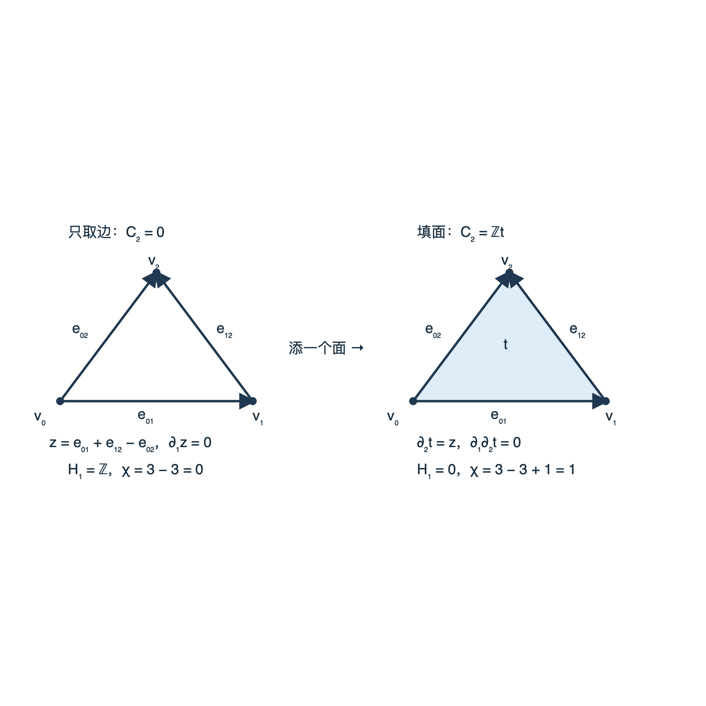
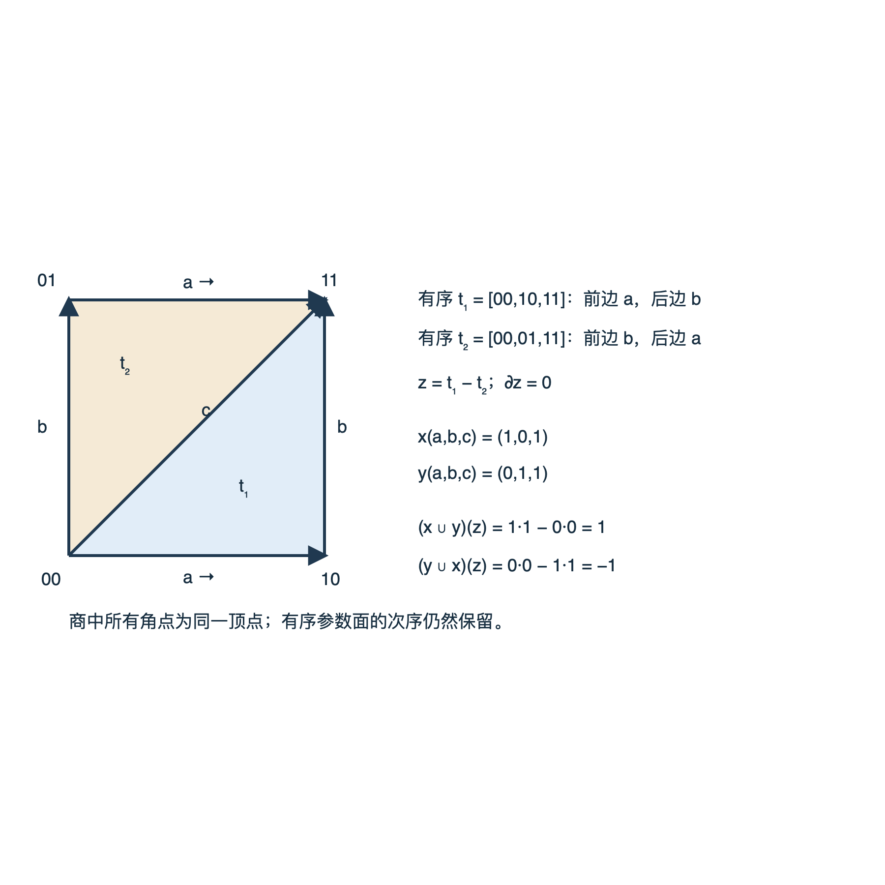

# 2026-10-10 固定输入实际证据

独立执行槽已实际运行课程 r1 的固定 CLI、7项 unittest 和独立 oracle；本页携带完整原始输入、命令、逐项结果与失败记录。课程作者只组装并核对证据字节，没有重跑这些实验。入口回到 [[数学/36-拓扑学/20-同调与上同调/80-有限链与杯积复算|有限链与杯积复算]]。

## 实际观察与范围

| 检查 | 实际结果 | 原始记录 |
| --- | --- | --- |
| 固定7模型CLI | exit0，报告生成 | [child receipt](raw/logs/fixed-cli.json)、[完整报告](raw/fixed-output/report.json) |
| 7项代码测试 | exit0，7 tests OK | [child receipt](raw/logs/unit-tests.json)、[详细stderr](raw/logs/unit-tests.stderr) |
| 独立整数H/Hco、边界和子式 | exit0，7模型共42组整数群核对通过 | [child receipt](raw/logs/independent-oracle.json)、[完整逐项trace](raw/logs/independent-oracle.stdout) |
| 两三角形杯积 | 625对余循环通过；xy=1、yx=−1、xx=yy=0；指定线性组合给7 | 同一oracle trace，保存两面前后边的分别乘积 |
| #152整数Smith联调 | K=(1,−2)ᵀ、C=[3]，原代表阶3 | 同一trace，保存U/D/V、核内坐标与独立格成员检查 |
| 无覆盖写入 | 重复输出目录的CLI实际exit1，原报告SHA未变 | [完整预期失败](raw/logs/reused-output.stderr)、oracle的no_overwrite项 |

三角形仅边与填面的整数H₁分别为ℤ和0，χ分别0和1；RP²整数H₁与整数H²各为ℤ/2，位于不同degree，F₂的Betti为(1,1,1)。环面和楔和的整数加法群相同。W没有代码cup API；oracle中的625个零张量配对明确消费课程给出的限制数据，不能从相同加法链矩阵推导出其零积。一般覆盖分类、同伦不变、胞腔比较、UCT和杯积自然性的证明仍按正文及独立理论核查验收。

执行环境为系统Python3.14.7、macOS27.0.1 arm64；每个原child限时60秒，线程环境请求≤4。环境请求不是OS硬限制，原ru_maxrss也没有覆盖renderer的XPC helper或全系统aggregate，不能据此宣布硬资源上限已测。[原执行说明](raw/README.md.txt)保留完整条件、命令与观测边界。

## 图像成功与失败都保留

原SVG最终由macOS Quick Look离线渲染并由独立执行者逐图查看，中文、ℤ、箭头与索引可读，图中方向与正文一致。这是指定SVG原字节的渲染证据；Obsidian页面布局、同步与真人理解尚未验证。





CairoSVG默认渲染虽exit0却缺中文字形；自有Fontconfig尝试仍缺字，原图和记录保留，不能把工具exit0当显示通过。首次Quick Look因sandbox初始化失败exit255；后次显式申请正常自动审批后exit0，原失败与成功都保存：[默认Cairo](raw/logs/svg-render.json)、[字体尝试](raw/logs/svg-render-fontconfig.json)、[首次Quick Look错误](raw/logs/native-svg-render.stderr)、[最终授权成功receipt](raw/logs/native-svg-render-approved.json)。未改SVG、安装依赖或改变系统字体。

## 字节身份与可携带复建

[copy-receipt.json](copy-receipt.json)逐项记录原61个必要artifact到本目录的路径与SHA，全部按原字节复制；原manifest另存[raw/artifact-manifest.json](raw/artifact-manifest.json)。原Markdown仅追加`.txt`，明确是历史context，内容字节不变。原B的[source snapshot](raw/source-snapshot.json)、[执行后源码核对](raw/post-run-source-check.json)绑定r1的14文件；后续正文两处术语修订与80证据增量不冒用这些旧哈希，实验两份源码和两幅SVG保持同字节。

[replay.py](replay.py)是新增可携带数字协议入口，**目前只经AST静态检查，未运行**。它验证归档输入SHA，再创建不存在的新目录；只复制snapshot、#152已验证实现与oracle源输入，不复制旧logs或旧output。先生成新独立期望，再运行新CLI/测试/oracle，每个child保存新命令、stdout/stderr、status与exit；最后核全部7模型/42组群、625AW、7拒绝、阶3与预期写入失败。它不运行图像渲染。

```bash
python3 -B replay.py --new-dir /private/tmp/wwl-topology154-new-replay
```

从本目录运行时把`--new-dir`换成新的不存在绝对目录。上层返回0还须读取新目录`fresh-receipt.json`：status应为completed、exit_code应为0，各child应completed且exit0，测试stderr应为7 tests OK，CLI/oracle stderr应空；oracle内预期的重复输出CLI则应exit1且前后SHA相同。新helper如果超时或child出错，保留新raw与失败receipt并返回非零。历史包中的旧成功logs不能作为这次复建的结果。
