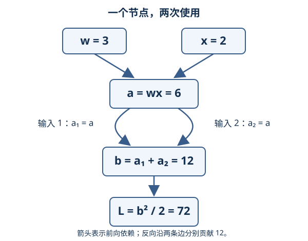

# 计算图、反向传播与自动微分

## 本课目标

- 把复合函数拆成带形状的计算图；
- 用“上游梯度 × 局部导数”手算一次反向传播；
- 理解共享参数与分支处为何要累加梯度；
- 区分符号求导、数值差分和自动微分。

## 直觉轨：反向传播是一套责任记账法

想象一张生产流水账：原料经过多个工序形成最终损失。反向传播从最终损失 1 元的变化开始，逐站追问“本工序的输入要为输出变化承担多少责任”。

每个节点只需要知道两件事：

1. 下游传回来的上游梯度；
2. 本节点输出对每个输入的局部导数。

两者相乘得到一条边的贡献。同一个变量若通向多条路径，所有责任相加。这就是链式法则在有向无环图上的动态规划。

## 推导轨一：手算一张图

考虑

$$
u=wx+b,\qquad e=u-y,\qquad L=\frac12e^2.
$$

全部量都是标量。取 $x=2,w=3,b=1,y=5$：

$$
u=7,\qquad e=2,\qquad L=2.
$$

反向从 $\partial L/\partial L=1$ 开始：

$$
\bar e=\frac{\partial L}{\partial e}=e=2,
\qquad
\bar u=\bar e\frac{\partial e}{\partial u}=2,
$$

其中横杠记号 $\bar z=\partial L/\partial z$ 表示节点 $z$ 的伴随量。继续：

$$
\bar w=\bar u\frac{\partial u}{\partial w}=2x=4,
\quad
\bar x=\bar u\frac{\partial u}{\partial x}=2w=6,
\quad
\bar b=\bar u=2.
$$

每个伴随量都与对应变量同形。向量与张量情形把局部乘法推广为 VJP。

## 推导轨二：分支为何相加

若 $z=x^2+x$，可把同一个 $x$ 看作同时进入平方分支和恒等分支：

$$
\frac{dz}{dx}=2x+1.
$$

计算图中两条路径分别贡献 $2x$ 和 1，必须累加。残差连接 $y=F(x)+x$ 也是同样结构：

$$
\nabla_xL=J_F(x)^\mathsf{T}\nabla_yL+\nabla_yL.
$$

第二项是恒等路径，让梯度拥有一条不必穿过 $F$ 的通道，但并不保证永远不会梯度爆炸或消失。

### 一个节点被同一算子使用两次

把页末练习展开：令 $a=wx$、$b=a+a$、$L=b^2/2$，取 $w=3,x=2$。前向得到 $a=6,b=12,L=72$。这里始终只有一个节点 $a$；加法算子的两个输入位置都引用它。

图中两条边代表两次使用，而不是两个独立参数。为避免把局部输入导数与总导数混淆，暂把加法写成 $b(a_1,a_2)=a_1+a_2$，然后令 $a_1=a_2=a$。对两个输入位置分别有 $\partial b/\partial a_1=\partial b/\partial a_2=1$，沿两条边合并后才得到 $db/da=2$。

反向仍用 $\bar z=\partial L/\partial z$，从 $\bar L=1$ 开始：

| 反向步骤 | 局部导数 | 对输入的贡献 |
| --- | --- | --- |
| 从 $L$ 到 $b$ | $\partial L/\partial b=b=12$ | $\bar b=12$ |
| 从加法的第一个输入位置回到 $a$ | $\partial b/\partial a_1=1$ | $12\times1=12$ |
| 从加法的第二个输入位置回到同一个 $a$ | $\partial b/\partial a_2=1$ | 再加 $12\times1=12$ |
| 从 $a$ 到 $w$ | $\partial a/\partial w=x=2$ | $\bar w=(12+12)\times2=48$ |

因此 $\bar a=24$。如果把两条边去重，或把第二次贡献写成覆盖前值的 `=`，就只剩 $\bar a=12$，错误地得到 $\bar w=24$。节点在逆拓扑遍历中可以只处理一次，但处理加法时必须保留两个输入位置的贡献；共享节点应在下游贡献累加完成后继续向前传。

也可以直接代入独立核对：$L=(2wx)^2/2=2w^2x^2$，所以 $\partial L/\partial w=4wx^2=48$。

本例全部是标量，无须选择行、列约定。推广到向量时，读 [[AI/11-数学与统计桥梁/02-矩阵微积分VJP与反向传播#矩阵微积分、VJP 与反向传播：梯度沿什么方向传|VJP 主解释]]，核对列向量及其上游伴随量；本页下方的批量线性层则把样本排成行。进入 [[AI/20-LLM/20-架构/10-注意力反向传播与Softmax竞争#先固定维度与符号|注意力反向传播]] 时，token 也按行排列，应按该页的矩阵形状使用公式。转置来自这些坐标约定，分支贡献相加的规则不变。

## 反向模式的算法骨架

对标量损失 $L$：

1. 前向按拓扑序计算每个节点，并保存反向需要的中间值；
2. 初始化 $\bar L=1$；
3. 按逆拓扑序访问节点；
4. 对节点每个输入计算局部 VJP，并用 `+=` 累加到输入伴随量；
5. 叶子参数的伴随量就是梯度。

设图中原始算子总成本为 $C$，反向传播通常是 $C$ 的一个常数倍，而不是对 $p$ 个参数分别重跑一次完整前向。这一优势来自共享中间结果；具体常数依赖算子和实现。

## 三种“求导”不要混淆

| 方法 | 做什么 | 优点 | 边界 |
| --- | --- | --- | --- |
| 符号求导 | 操作公式表达式 | 得到可读公式 | 表达式可能膨胀，控制流处理困难 |
| 数值差分 | 用相邻函数值近似导数 | 独立、适合核验 | 慢且有截断/舍入误差，不用于大模型训练 |
| 自动微分 | 运行原程序并组合局部精确导数 | 高效、适合实际程序 | 仍受浮点误差、不可导点和实现语义影响 |

自动微分不是数值差分：局部导数来自算子规则；它也不是把整个函数先化简成符号公式。

## 张量形状与保存值

以 $Y=XW^\mathsf{T}+b$ 为例：

| 量 | 形状 |
| --- | --- |
| $X$ | $B\times n$ |
| $W$ | $m\times n$ |
| $b$ | $m$，前向广播 |
| $Y$、上游 $G_Y$ | $B\times m$ |
| $G_X=G_YW$ | $B\times n$ |
| $G_W=G_Y^\mathsf{T}X$ | $m\times n$ |
| $G_b=\sum_{k=1}^B(G_Y)_k$ | $m$ |

反向需要 $X$ 和 $W$。框架可能保存它们，也可能为节省显存在反向前重算，这就是 activation checkpointing 的时间—空间交换。

## 自动微分的边界

- **不可导点**：如 ReLU 在 0，框架采用约定的次梯度；有限差分可能给出另一种结果。
- **原地修改**：若覆盖了反向所需中间值，会报错或产生错误梯度。
- **停止梯度**：detach/stop-gradient 会切断图；它是语义操作，不只是节省内存。
- **随机性**：dropout 等操作做梯度检查时要固定随机状态或关闭随机分支。
- **控制流**：动态图只对本次实际执行路径建图；未走的分支没有贡献。

## 微型 Transformer 与 CUDA

微型 Transformer 的一次训练可画成：token → embedding → 注意力 → 残差/LayerNorm → MLP → logits → 交叉熵。反向传播按逆序串联各算子的 VJP。要核对这条前向图的 tensor shape、causal mask 与训练/prefill/decode 三种运行形态，见 [[AI/20-LLM/20-架构/01-Transformer完整数据流|Transformer 完整数据流]]。CUDA kernel 可以融合多个局部算子以减少显存往返；融合必须保持数学等价的梯度语义，但浮点加法次序改变会造成微小差异。

## 练习与成功标准

设 $a=wx$，$b=a+a$，$L=b^2/2$，取 $w=3,x=2$。

1. 画图并标出 $a$ 被使用两次；
2. 手算 $\partial L/\partial w$；
3. 故意只保留一条 $a\to b$ 路径，再比较错误答案。

**成功标准**：正确得到 $a=6,b=12,L=72$、$\partial L/\partial a=24$、$\partial L/\partial w=48$；能解释漏掉一次累加为何会得到错误的 24。

随后完成 [[数学/40-微积分与优化/80-梯度与反向传播检查实验|梯度检查实验]]，用独立数值证据核验手写反传。

上一站：[[数学/40-微积分与优化/02-梯度方向导数与Jacobian|梯度、方向导数与 Jacobian]] · 下一站：[[数学/40-微积分与优化/04-SGD-Momentum-Adam与AdamW|SGD、Momentum、Adam 与 AdamW]] · 返回：[[数学/40-微积分与优化/00-微积分与优化-MOC|微积分与优化 MOC]]

## 系统理论对照

本页保留应用问题与最小实验；更完整的对象定义、推导条件和反例见 [[数学/15-微积分/11-多元极限偏导与全微分|多元极限偏导与全微分]]；[[数学/15-微积分/12-多元链式法则隐函数与约束优化|多元链式法则隐函数与约束优化]]；[[数学/20-线性代数与几何/17-矩阵范数条件数与数值稳定性|矩阵范数条件数与数值稳定性]]。应用记号与标准教材不同时，以定义和矩阵形状对照，不仅比较字母。
