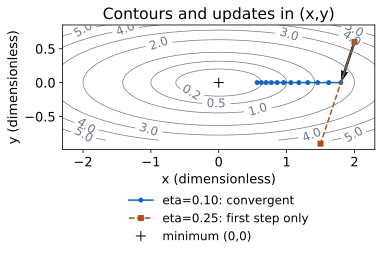
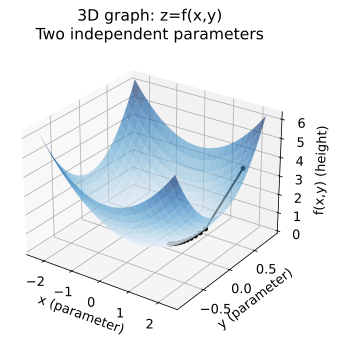
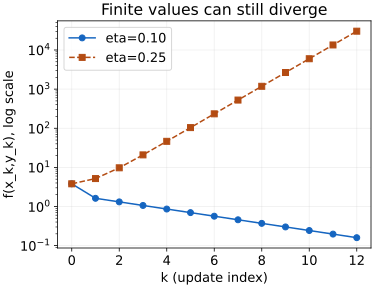

# 两个参数，为什么用二维和三维两种图？

你想知道的不是“这张损失地形像不像一个碗”，而是：**同一组参数改变后，目标怎样变，更新为什么收敛或失败？** 两种图始终追踪同一个函数，只改变观察方式。

本例是独立构造的无量纲二次目标，没有训练数据、随机梯度或真实神经网络。现有 [[AI/11-数学与统计桥梁/04-优化曲率条件数与AdamW#一个二维碗解释学习率的困难|AI 优化页]] 用第二方向曲率 100；本页用 10 方便看图，稳定边界也相应改变。读图前核对系数，不能把两页的数字混用。

## 基础入口：先预测一次更新

固定

$$
f(x,y)=\frac12(x^2+10y^2),\qquad (x_0,y_0)=(2,0.6).
$$

你能选择的参数只有 $x,y$。给定它们，函数高度 $z=f(x,y)$ 就已经确定，不能独立再挑一个 $z$。初始高度是 $3.8$。

沿坐标轴微小移动时，局部变化率分别是 $x$ 和 $10y$。所以梯度是 $(x,10y)$。取步长 $\eta=0.1$：

$$
(x_1,y_1)=(2,0.6)-0.1(2,6)=(1.8,0),\qquad f(x_1,y_1)=1.62.
$$

先自己预测：把步长改成 $0.25$，第一次更新是否仍降低目标？答案是 $(1.5,-0.9)$，目标升到 $5.175$。第二方向越过零点，且幅度由 $0.6$ 增到 $0.9$。

**可停点：** 能算这一步，并说明三维图的高度不是第三个待优化参数；还不能仅凭一个下降点判断以后都收敛。

## 机制入口：三张图怎样互相核对

### 二维图：在参数平面上比较方向和等高线



[PNG 备用图](assets/quadratic-2d.png)。横轴 $x$、纵轴 $y$ 都是无量纲参数；灰线上的数字是函数值。灰线越密，表示在所画方向上同样距离内高度变化越快。蓝色圆点实线是 $\eta=0.1$ 的轨迹；橙色方点虚线只画 $\eta=0.25$ 的第一次更新，后续点会跑出这张局部图。黑色箭头是在初始点的负梯度 $(-2,-6)$，为方便显示，箭头长度缩小到原向量的十分之一；此例缩放恰好等于步长 $0.1$，因此与第一步更新重合。一般图的显示缩放不等于算法步长，它不代表额外的一次迭代。

不看图也能复述：等高线满足 $x^2+10y^2=2c$，是沿 $y$ 方向较窄的椭圆。初始负梯度在欧氏度量下垂直于该等高线，指向局部下降方向。梯度决定局部方向，步长决定究竟落在哪里。改变度量或使用预条件矩阵会改变“最速”的含义。

### 三维图：同一对参数增加一个高度坐标



[PNG 备用图](assets/quadratic-3d.png)。竖轴表示 $f(x,y)$；黑色点线把蓝色二维轨迹抬到曲面上。三维图帮助看出为什么第二方向更陡，也让第一次更新从高度 $3.8$ 降到 $1.62$ 可见。透视、坐标轴显示比例和曲面遮挡会影响视觉印象，不能从屏幕上量角度或读出严格曲率；数值来自公式和数据。

不看图也能复述：曲面上每个点是 $(x,y,f(x,y))$，三个坐标只有两个独立自由度。曲面向两个方向弯曲的程度不同；真正的曲率信息在 Hessian 中，而不是图的透视角度里。

### 更新图：有限数值也可能持续发散



[PNG 备用图](assets/quadratic-stability.png)。横轴 $k$ 是更新次数，纵轴是 $f(x_k,y_k)$ 的对数刻度。圆点实线下降，方点虚线增长；数据仍然有限，没有 NaN，也并不表示在收敛。这张图展示 12 步，关于所有步的结论来自下方递推证明。

## 为什么这两个步长不同？

本科快进入口从这里开始。$\nabla f=(x,10y)$，Hessian $H=\operatorname{diag}(1,10)$，其二范数条件数为 $10$。精确梯度、欧氏度量、固定步长、无动量 GD 给出

$$
x_{k+1}=(1-\eta)x_k,\qquad y_{k+1}=(1-10\eta)y_k.
$$

要对**所有初值**收敛到 $(0,0)$，两个放大因子的绝对值都必须小于一，因此

$$
0<\eta<0.2.
$$

$\eta=0.1$ 时，$y$ 一步归零，$x_k=2(0.9)^k$；$\eta=0.25$ 时，$y_k=0.6(-1.5)^k$，符号交替且幅度增长。在边界 $\eta=0.2$，非零 $y$ 等幅振荡。若碰巧从 $y_0=0$ 开始，不稳定的方向根本没有被激发；不能由这个特殊初值反推“对所有初值都稳定”。

完整推导回到 [[数学/40-微积分与优化/06-曲率Hessian与学习率稳定性#3. 多维二次函数：最尖锐方向限制步长|Hessian 与学习率稳定性]]；带着“为什么最大特征值限制步长、最小特征值影响进展”阅读，回来写出两个放大因子。若“最速方向”卡住，回补 [[数学/40-微积分与优化/02-梯度方向导数与Jacobian|梯度与方向导数]] 的单位方向定义。

## 跨层返回：一张图还不能保证什么？

| 下一问 | 主解释与携带问题 | 回来应能补上的一步 |
| --- | --- | --- |
| 稳定是否就是小误差？ | [[数学/60-数值计算与量化/12-数值常微分方程局部全局误差与稳定\|数值 ODE]]；读稳定与精度反例，用同一个放大因子比较 GD 与显式 Euler | 说明稳定、步长精度和最终误差是不同命题；本例可以看作 $\dot w=-Hw$ 的 Euler 离散化，但这不是任意优化器的等价关系 |
| 计算机是否执行同一个数？ | [[数学/60-数值计算与量化/01-二进制浮点精度与数值稳定性\|浮点表示]]，随后 [[计算机知识/40-并行与异构计算/80-张量跨层执行/01-同一张量从数值到线程\|张量执行]] | 分开实数递推、浮点舍入和真实 kernel；这里的 NumPy 复算不是 FP16 或 GPU 验证 |
| Loss 下降是否说明任务改善？ | [[AI/11-数学与统计桥梁/04-优化曲率条件数与AdamW#warmup、裁剪与收敛不能互相代替\|优化与任务边界]] | 本例只保证所定义二次目标的行为，没有给泛化、任务效果、因果或安全保证 |

## 迁移：改变两个条件再判断

不看答案，令 $f(x,y)=\frac12(x^2+cy^2)$，取 $c=100$、$\eta=0.1$、$(x_0,y_0)=(2,0)$。有人说“我运行十二步都下降，所以这个步长对该函数稳定”。你接受吗？给出一个只改变初值的检验，并说明用三维图能做什么、不能做什么。

<details><summary>核对答案与等价方案</summary>

不接受“对所有初值稳定”的结论。此时两个因子为 $0.9$ 和 $-9$；特殊初值 $y_0=0$ 只激活第一方向。可取任何非零 $y_0$，例如 $10^{-6}$，第二方向最终按 $9^k$ 增长。真正对所有初值收敛的固定步长区间是 $0<\eta<0.02$。三维图可显示更窄的谷，却不能证明收敛区间，也不能保证有限精度不会把极小初值舍入为零。任一非零第二分量、等价的特征坐标论证或精确递推证明都应接受。

</details>

## 复算、来源与验证边界

[生成源码](quadratic_figures.py) 用已有 NumPy/Matplotlib 环境重新生成三图、[逐步数据](assets/quadratic-data.csv) 和 [数值检查结果](assets/quadratic-checks.json)。从库根运行下面命令，将运行缓存和输出留在新的库外目录，不覆盖课程资产：

```bash
MPLCONFIGDIR=/private/tmp/wwl-quadratic-mpl-cache .venv/bin/python -B \
  数学/40-微积分与优化/quadratic_figures.py --output /private/tmp/wwl-quadratic-reproduction
```

源码用闭式 $2(0.9)^k$、$0.6(-1.5)^k$ 独立对照迭代；还检查边界等幅振荡和“有限但发散”。这是对本例实现与图数据的核对，不是一般收敛证明；数学结论由上面的递推给出。依赖已在本次环境中运行，不据此宣称其他机器都已运行。

一般优化背景可以从 [Boyd 与 Vandenberghe 作者教材入口](https://web.stanford.edu/~boyd/cvxbook/)继续。本页的数字、图和答案为原创教学构造；未把任何实测 AI 数据当作此例来源。已完成公式独立核对、源码执行与离线图检查；Obsidian 实际主题/点击与真人学习效果待验。

带回：两个放大因子、三维图的两个自由度、一种会被特殊初值掩盖的失败。下一问：你关心的是稳定、精度还是任务效果？回补按上表选择。返回 [[数学/40-微积分与优化/00-微积分与优化-MOC|优化课程]]。
