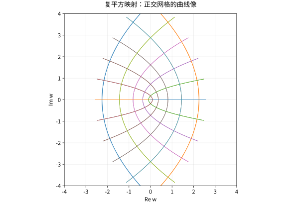

# 复可微与Cauchy-Riemann方程

## 一个复导数要求所有方向共享同一线性规则

$f$ 在 $z_0$ 复可微，指存在 $a\in\mathbb C$ 使
$$f(z_0+h)=f(z_0)+ah+o(|h|).$$
一般实可微映射 $\mathbb R^2\to\mathbb R^2$ 的导数可以是任意 $2\times2$ 实矩阵；乘以 $a=\alpha+i\beta$ 的矩阵却只能是 $\begin{pmatrix}\alpha&-\beta\\\beta&\alpha\end{pmatrix}$。所以复可微要求局部形变没有方向相关的剪切或不同轴比例。

若 $f=u+iv$，沿实方向计算得 $f'=u_x+iv_x$，沿虚方向计算得 $f'=v_y-iu_y$，因此必要条件是
$$u_x=v_y,\qquad u_y=-v_x.$$
这就是 Cauchy–Riemann 方程。**只在一点存在偏导并满足它们，并不自动足够**；若 $f$ 在该点实全微分存在，则加上 CR 就充分。一个更易检验的充分条件是偏导在邻域存在并在该点连续。

## 三个例子分清不同限制

$f(z)=\bar z$ 连续且实可微，但 $u=x,v=-y$，所以 $u_x=1\ne v_y=-1$，任何点都不复可微。它保持长度却反转方向，不是复数乘法型的导数。

反过来，只在一点满足 CR 也未必复可微。定义
$$
f(0)=0,\qquad
f(x+iy)=\frac{x^3+iy^3}{x^2+y^2}\quad ((x,y)\ne(0,0)).
$$
写 $f=u+iv$。在坐标轴上有 $u(t,0)=t$、$u(0,t)=0$、$v(t,0)=0$、$v(0,t)=t$，因此原点的四个偏导为
$$
u_x(0,0)=1,\qquad u_y(0,0)=0,\qquad
v_x(0,0)=0,\qquad v_y(0,0)=1.
$$
所以 $u_x=v_y$ 且 $u_y=-v_x$，CR 在原点成立。这个函数在原点还连续，因为
$$
|f(x+iy)|
=\frac{\sqrt{x^6+y^6}}{x^2+y^2}
\le \sqrt{x^2+y^2}\longrightarrow0.
$$
但沿两条路径的差商不同，其中 $t\in\mathbb R\setminus\{0\}$：

| $z\to0$ 的路径 | $f(z)$ | $\dfrac{f(z)-f(0)}{z}$ |
|---|---:|---:|
| $z=t$ | $t$ | $1$ |
| $z=t+it$ | $\dfrac{t(1+i)}2$ | $\dfrac12$ |

因此 $f'(0)$ 不存在。失败的条件不是连续性，而是“一点处有偏导并满足 CR”仍不能替代合适的实可微条件。

$f(z)=|z|^2=z\bar z$ 在零点复可微，因为 $|h|^2/h=\bar h\to0$；在其他点不满足 CR。由此可见“某一点可微”不等于“全纯”。全纯要求在一个开邻域每点复可微，远比孤立一点强。

## Wirtinger 记号简化了什么

对实可微函数定义
$$\partial_z=\tfrac12(\partial_x-i\partial_y),\qquad\partial_{\bar z}=\tfrac12(\partial_x+i\partial_y).$$
全微分可写为 $df=f_z\,dz+f_{\bar z}\,d\bar z$，复可微恰要求 $f_{\bar z}=0$，此时 $f'=f_z$。这不是把 $z,\bar z$ 当作两个独立复变量，而是对两个实方向作方便的线性组合。对实值损失做复变量优化时，一般不能假设损失全纯；这与复分析的解析函数有不同任务。

## 算例：二次映射的几何

$f(z)=z^2=(x^2-y^2)+i2xy$，偏导连续且满足 CR，导数 $2z$。在 $z_0\ne0$ 附近，局部将长度缩放 $2|z_0|$、角度旋转 $\arg(2z_0)$；在零点导数为零，一阶模型失去可逆性，角度被平方映射加倍，不能称那里共形。

*图：复映射 $z\mapsto z^2$ 将直角网格映成曲线网格。远离零点时局部保持角度；零点是临界点。*

## 自测与解答

$f(z)=\bar z^2$ 在哪些点复可微？有没有非空开集使它全纯？

> [!question]- 解答
> $f_{\bar z}=2\bar z$，所以只有 $z=0$ 满足条件；在零点由 $|\bar h^2/h|=|h|\to0$ 直接得到导数 0。没有非空开集能只由零点组成，所以它在任何非空开集都不全纯。

## 继续学习

前一节：[[数学/45-复变函数/01-复平面几何拓扑与复数运算|复平面几何拓扑与复数运算]]。 下一节：[[数学/45-复变函数/03-指数对数复幂与分支|指数对数复幂与分支]]。

课程地图：[[数学/45-复变函数/00-复变函数-MOC|复变函数课程地图]]；[[数学/90-资源/06-统一符号约定与定理条件索引|符号与条件索引]]。

## 跨学科连接

[[数学/15-微积分/11-多元极限偏导与全微分|多元极限偏导与全微分]]。先用目标页“全微分须统一控制所有方向”的定义检查 CR 的充分条件；一点有偏导且满足 CR 仍不替代实全微分，也不能把任意实可微矩阵当作复导数。

## 核验与延伸阅读

本页为独立编写的讲解、推导与算例；以下一手教材用于对照标准定义与课程范围，不是逐段译写。更具体的主题定位见 [[数学/90-资源/04-六科学术来源与阅读对照|学术来源对照]]。

- [Jiří Lebl：Guide to Cultivating Complex Analysis，作者开放教材](https://www.jirka.org/ca/)
- [Juan Ponce Campuzano：Complex Analysis，作者开放教材](https://complex-analysis.com/)
