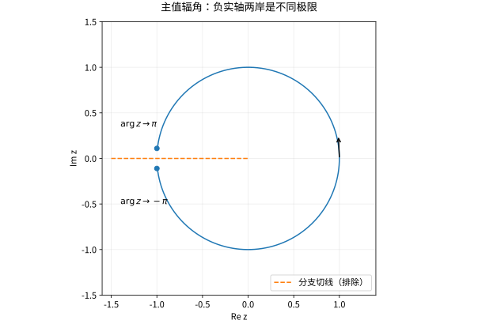
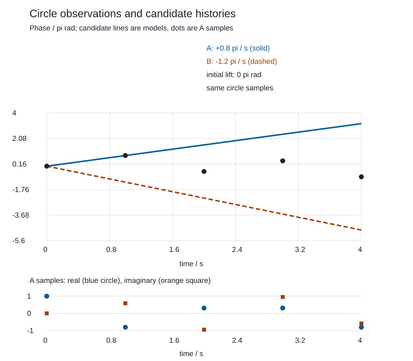

# 指数对数复幂与分支

## 指数先定义，对数再选分支

复指数由绝对收敛幂级数定义，满足
$$e^{x+iy}=e^x(\cos y+i\sin y),\qquad e^{z+2\pi i}=e^z.$$
它从不为零，但不是一一映射。求 $e^w=z\ne0$ 得到所有值
$$w=\ln|z|+i(\arg z+2k\pi).$$
因此复对数最初是多值关系；一个全纯分支是选定域内连续且全纯的一组值，不能在每个点随意挑一个角度。

## 为什么必须切开绕零的闭路

先不用曲线积分，就能看出整个穿孔平面上不可能有连续单值对数。反设 $L$ 满足 $e^{L(z)}=z$，沿单位圆取 $z=e^{it}$。则 $L(e^{it})-it$ 连续，且其指数恒为 $1$，所以它的虚部 $h(t)=\operatorname{Im}L(e^{it})-t$ 连续并只取 $2\pi\mathbb Z$ 中的值，因而必须恒定。可是 $e^{i0}=e^{i2\pi}=1$，单值性要求 $L(e^{i0})=L(e^{i2\pi})$，于是 $h(2\pi)=h(0)-2\pi$，矛盾。全局全纯单值对数当然也不可能，因为它必连续。

在切开的域 $\mathbb C\setminus(-\infty,0]$ 上取 $-\pi<\operatorname{Arg}z<\pi$，主值对数 $\operatorname{Log}z=\ln|z|+i\operatorname{Arg}z$ 的导数为 $1/z$：

这个导数可由前一课的 [[数学/45-复变函数/02-复可微与Cauchy-Riemann方程|Cauchy–Riemann 条件]]直接检查。任取切线外的 $z=x+iy$，$r=|z|>0$；在它的一个小邻域内选取光滑的辐角 $v=\operatorname{Arg}z$，并令 $u=\ln r$。有
$$u_x=\frac{x}{r^2},\qquad u_y=\frac{y}{r^2},\qquad v_x=-\frac{y}{r^2},\qquad v_y=\frac{x}{r^2}.$$
所以 $u_x=v_y$、$u_y=-v_x$，且这些偏导在该邻域连续；由前课的充分条件，$u+iv$ 复可微，并且
$$ (u+iv)'=u_x+i v_x=\frac{x-iy}{r^2}=\frac1z. $$
这里 $r>0$ 且邻域避开负实轴，保证所选辐角是光滑的；主值在切线两侧的极限不同，不能把导数结论延伸穿过切线。也不能把 $\arctan(y/x)$ 当作全局辐角：它会漏掉象限信息，并在其自身分母或角度跳变处失效。

分支切线不是原函数本身突然有物理裂缝，而是为了让角度沿路径追踪时不绕回不同值。切线位置可以改变，但不能假装拓扑障碍消失。

*图：主值辐角在负实轴两侧分别接近 $\pi$ 与 $-\pi$，两侧值相差 $2\pi$。图中的断开来自分支选择。*

## 从连续路径提升到有限相位样点

主值跳跃常出现在一个平滑旋转的信号上。先声明观测模型：$x(t)=a(t)e^{i\theta(t)}$ 是已给定的**复信号**，$a(t)>0$，$\theta$ 用 rad，正方向为逆时针；归一化后 $z(t)=x(t)/|x(t)|\in S^1$。这可以是复频响、I/Q 模型或已另行定义的解析信号；单独一条实电压记录不自动带有这样的复相位，构造解析信号还须声明方法。模型中相位不是“V”，幅度才携带原信号单位。

### 完整路径唯一，有限样点还欠什么

取 $p:\mathbb R\to S^1$，$p(\theta)=e^{i\theta}$。小于整圈的开弧的逆像由互不相交的区间平移组成，每个限制同胚到该弧，所以它是覆盖。若已知**整条连续** $z:[0,T]\to S^1$，并指定 $\theta_0\in p^{-1}(z(0))$，[[数学/36-拓扑学/10-覆盖空间与van-Kampen/01-覆盖的局部副本与路径提升#一条路径为什么能且只能沿一片接一片走|路径提升的存在唯一性证明]] 给唯一连续 $\theta$。这里只需给定覆盖和路径；覆盖分类课的局部道路连通、半局部单连通等条件不需重新加到本例上。

不指定起点时，两条提升的差连续且落在 $2\pi\mathbb Z$，因此是全局常数 $2\pi m$。指定起点消掉这个常数，并没有把有限样点补成完整路径。若底路径闭合，则 $(\theta(T)-\theta(0))/(2\pi)$ 是整数绕数；开放路径的总角位移可以不是整数圈。

现只给 $t_0<\cdots<t_N$ 和 $z_k=z(t_k)$，选代表 $\alpha_k\in[-\pi,\pi)$，满足 $e^{i\alpha_k}=z_k$。这是**离散记数约定**，在 $z=-1$ 取 $-\pi$；不改变上节解析 $\operatorname{Log}$ 的割域及其 $(-\pi,\pi)$ 辐角。任意相容的样点相位都可写成

$$\theta_k=\alpha_k+2\pi n_k,\qquad n_k\in\mathbb Z.$$

所以增量仅确定模 $2\pi$：

$$\Delta\theta_k=\alpha_k-\alpha_{k-1}+2\pi(n_k-n_{k-1}).$$

**离散唯一性的准确条件。** 已知相容起点 $\theta_0$，且承诺每步真实增量 $\Delta\theta_k\in(-\pi,\pi)$。每个模 $2\pi$ 类在这个开区间至多有一个代表：若两个都在里面且相差 $2\pi m$，其差绝对值小于 $2\pi$，只能 $m=0$。真实增量保证所需代表存在。依次取它、加到已定前点，有限归纳给唯一的**样点提升**。若相邻观测恰好相反，则类中有 $+\pi$ 和 $-\pi$ 两个边界代表，开区间内没有代表；放宽到 $|\Delta\theta_k|\le\pi$ 后两者都允许，唯一性失效。比如从0出发的 $\theta_+(t)=\pi t$ 和 $\theta_-(t)=-\pi t$，在 $t=0,1$ 都观测到 $(1,-1)$。

即使全部样点提升唯一，点间仍可有不同连续插值。只约束端点增量时，$0.8\pi t/(1\ \mathrm{s})$ 和 $0.8\pi t/(1\ \mathrm{s})+2\pi\sin^2(\pi t/(1\ \mathrm{s}))$ 在所有整数时刻有相同提升，点间却不同。若另有可微相位及 $|\theta'(t)|\le M$（rad/s），则 $|\Delta\theta_k|\le M\Delta t_k$，故 $M\Delta t_k<\pi$ 是充分采样条件。它来自变化率界，不是一般带限采样定理，也不保证恢复每个时刻的曲线。

### 先预测跳跃，再复算两种历史

固定 $t_k=k\ \mathrm{s}$，$k=0,\ldots,4$。两个教学模型取

$$\theta_A(t)=0.8\pi t/(1\ \mathrm{s}),\qquad
\theta_B(t)=-1.2\pi t/(1\ \mathrm{s}).$$

先看已有主值图：A逆时针越过负实轴时，主值会从接近 $+\pi$ 跳到接近 $-\pi$。在 $k=1\to2$ 与 $3\to4$ 应加回 $2\pi$；B的真实方向与速度却不同。下面所有角度除以 $\pi$ 列出；“本步补偿”加到原始相邻差，“累计层”满足恢复值 $u_k=\alpha_k+2\pi n_k$。

| $k$ | 主值 $\alpha_k/\pi$ | 原始差 $(\alpha_k-\alpha_{k-1})/\pi$ | 本步补偿 / $\pi$ | 选定增量 / $\pi$ | 累计层 $n_k$ | 恢复 $u_k/\pi$ | B的真实 $\theta_B(t_k)/\pi$ |
| --- | --- | --- | --- | --- | --- | --- | --- |
| 0 | 0 | — | — | — | 0 | 0 | 0 |
| 1 | 0.8 | 0.8 | 0 | 0.8 | 0 | 0.8 | −1.2 |
| 2 | −0.4 | −1.2 | 2 | 0.8 | 1 | 1.6 | −2.4 |
| 3 | 0.4 | 0.8 | 0 | 0.8 | 1 | 2.4 | −3.6 |
| 4 | −0.8 | −1.2 | 2 | 0.8 | 2 | 3.2 | −4.8 |

A与B的差在样点为 $2\pi k$，故 $e^{i\theta_A(t_k)}=e^{i\theta_B(t_k)}$ **完全相同**，不仅模相同。算法在 $|\Delta\theta|<\pi$ 的先验下恢复A；B每步为 $-1.2\pi$，不满足该先验，所以若实际是B，算法仍输出A并解释错方向。它没有违反覆盖定理，因为两条圆周路径在样点之间本就不同，例如 $t=0.5\ \mathrm{s}$ 的相位为 $0.4\pi$ 与 $-0.6\pi$。

*图：上半图的圆点是共有离散角度代表，实线A、虚线B是明确构造的两种候选模型；连线不是实测路径。下半图是同一数据的圆周观测实部与虚部，只有点表示观测。图由实验中的固定输入和同一CSV生成。*

A、B在 $0\le t\le4\ \mathrm{s}$ 的圆周终点不是起点，不称其各有“整数绕数”；它们的提升终点差为 $8\pi$，相对整圈数为4。要直接看到**闭路绕数**歧义，另取 $z_C(t)=1$ 与 $z_D(t)=e^{2\pi i t/(1\ \mathrm{s})}$：在 $k=0,\ldots,4$ 同样全部为1，都是闭路，连续提升终点分别0与 $8\pi$，绕数0与4。只知道这五个点时，连完整的复数样本也不能告诉你走了哪条闭路。

这里有三个不同问题：起点未定导致全局常数层未知；主值过割线导致显示跳跃；点间路径未观测导致额外整圈或其他运动未知。主值跳跃不等于物理相位突变，输出一条平滑展开也不排除点间绕行。

### 带噪余量恢复哪一层

先限定为相位噪声模型

$$\widetilde z_k=e^{i(\theta_k+\eta_k)},\qquad |\eta_k|\le\epsilon,$$

其中 $\epsilon$ 单位rad，给定有噪起点提升 $\widetilde\theta_0=\theta_0+\eta_0$ 及其整数层。由三角不等式

$$|\Delta(\theta+\eta)_k|\le|\Delta\theta_k|+|\eta_k-\eta_{k-1}|
\le |\Delta\theta_k|+2\epsilon<\pi.$$

上一段的离散证明因此唯一恢复 $\widetilde\theta_k=\theta_k+\eta_k$ 这组**有噪样点**及相对于其主值的整数层。这里恢复的是有噪代表的分支补偿；噪声可能跨过主值割线，有噪层号未必等于无噪主值的层号。若起点另选 $2\pi m$，全序列也相差该常数。把起点对齐到上述层后，误差仍为 $\eta_k$，并未得到无误差的真相位，更未得到点间路径。

固定A，取 $\eta_k/\pi=(0.05,-0.05,0.05,-0.05,0.05)$、$\epsilon=0.05\pi$：最坏界为 $0.8\pi+0.1\pi=0.9\pi<\pi$，恢复为 $(0.05,0.75,1.65,2.35,3.25)\pi$，各点仍有 $\pm0.05\pi$ 的误差。将噪声改为 $(-0.11,0.11,-0.11,0.11,-0.11)\pi$，第一步有噪真增量与原始主值差同为 $1.02\pi$，展开将它归约成 $-0.98\pi$，因而少补一整圈。$0.8\pi+2(0.11\pi)=1.02\pi$ 的充分条件失败，不能声称已保证分支正确。等号也是边界：取第一步噪声由 $-0.1\pi$ 到 $+0.1\pi$，有噪增量恰为 $\pi$，与 $-\pi$ 同样观测；库的端点规则不能提供额外事实。

零幅值另属一个问题。若 $x_k=0$，$x_k/|x_k|$ 和物理辐角都未定义；软件可能按约定给0等数字，但这不构成相位测量。若测的是复平面加性扰动 $\widetilde x=x+\nu$，固定 $x=r>0$、$\nu=i\delta$，则角误差为 $\arctan(\delta/r)$：任意小的固定 $\delta>0$，在 $r\downarrow0$ 时也可趋近 $\pi/2$。所以近零幅值的相位读数不稳定，不能从“小电压噪声”直接假设固定小角误差，强行连续化也不能修好缺失的观测模型。遇到零幅值点，应停止将该点纳入相位恢复保证，按有效区间分段；近零时若无法给出可复核的相位误差界 $\epsilon$，也应停止使用短增量加噪声界的保证，保留无定义或不可靠标记，并重测或补充观测模型。这里不预设某个通用硬件幅度阈值。

### 改采样条件后，软件为什么会选错

保持A的角速度 $0.8\pi\ \mathrm{rad/s}$，仅把间隔从1s改为1.5s，则真增量为 $1.2\pi$；展开选 $-0.8\pi$。这时 $\theta_E(t)=-(8/15)\pi t/(1\ \mathrm{s})$ 在新网格 $t_k=1.5k\ \mathrm{s}$ 与A相差 $2\pi k$，也给同样复数样点。改成0.5s时，A和B的增量分别 $0.4\pi$ 与 $-0.6\pi$，两者都满足变化界且样点不再相同；新观测才能分开这两个模型。更密采样仍需一个可核的变化率或其他模型先验，不能由算法给自己的输出背书。

[[数学/45-复变函数/80-相位展开实验/README|同一固定输入的标准库演示]]保留表、复数样本、噪声成功与失败、改采样结果和生成本图的源码。它只用 Python 标准库，将原始相邻差归约到 $[-\pi,\pi)$ 后累加到给定起点；恰好半圈时明确选 $-\pi$，这只是端点约定，不能认证真实方向。不同通用软件也会选择数值代表：[NumPy unwrap 官方说明](https://numpy.org/doc/stable/reference/generated/numpy.unwrap.html)规定默认对大于 $\pi$ 的相邻差作周期补偿，但工具返回值不会提供缺失的物理先验。本实验不依赖 NumPy，也不把近边界的浮点行为当成严格不等式证明。

**撤去提示后判断：**（1）最大角速度 $M=0.8\pi$ rad/s、无噪，分别采1s与1.5s，哪些样点提升可保证唯一？（2）1s但 $\epsilon$ 分别为 $0.05\pi$ 与 $0.1\pi$，能保证哪层？（3）第三点幅值变成0；有一条实电压记录却没给复相位定义；还有什么欠缺？（4）即使样点相位都唯一，是否已得到整条连续路径？

> [!question]- 答案与返回问题
> （1）1s满足 $M\Delta t<\pi$，给定起点后样点提升唯一；1.5s界为 $1.2\pi$，不能保证，A/E为同样本反例。（2）$0.9\pi<\pi$ 只保证有噪样点的分支恢复，误差仍不超过给定 $\epsilon$；$0.8\pi+0.2\pi=\pi$ 不能保证，取噪声从负界到正界制造半圈歧义。充分条件失效不表示每一份具体记录必失败。（3）零幅值点的相位无定义，不能穿过它自动声称全段有连续提升；实记录还需声明复信号的构造。（4）没有，端点唯一和完整路径唯一是不同量词。返回覆盖课时说明“给定的整条路径在哪里”；去 [[信号与系统/20-数字信号处理/04-IIR设计二阶节与幅相取舍#有限复频响样点能确定群延迟吗|IIR有限复频响反例]] 时，将采样轴换成频率，重新核相位斜率的单位。

与 [[数学/45-复变函数/30-多复变量与复流形/01-多复变量全纯与Hartogs延拓#完整函数、有限样点与带噪观测不是同一种输入|全纯有限样点反例]] 比较：圆周网格上加整圈指数与加入在所有采样点为零的高次多项式都会隐形，但未知对象分别是相位历史和全纯函数。这里的相邻变化界与那里多项式次数上界解除不同的歧义，不能互换先验。

## 复幂的定义依赖对数

在选定对数分支的域上，$z^\alpha=\exp(\alpha\operatorname{Log}z)$。对非整数 $\alpha$，换一层对数会多出因子 $e^{2\pi i k\alpha}$；整数幂则不受影响。平方根有两层，绕零一圈会交换它们。

例如 $i^i$ 的全部值是
$$\exp\bigl(i\cdot i(\pi/2+2k\pi)\bigr)=e^{-\pi/2-2k\pi},$$
主值为 $e^{-\pi/2}$。所有这些值都是正实数，但数值不同。给出一个值时应说明使用主值，而不是把多值问题隐藏掉。

## 常见恒等式的适用范围

$\operatorname{Log}(zw)$ 与 $\operatorname{Log}z+\operatorname{Log}w$ 一般相差 $2\pi i$ 的整数倍。例如取两个辐角均为 $3\pi/4$ 的数，乘积主辐角为 $-\pi/2$，而相加为 $3\pi/2$。同样 $(z^a)^b=z^{ab}$ 对复幂也不能无条件成立。

读完 04 的 [[数学/45-复变函数/04-复曲线积分原函数与Cauchy定理#回访：复对数的闭路判据与存在性|“复对数的闭路判据与存在性”]] 后，再回来完成解析版本；为使用 Cauchy 定理，还需按该段提示有限借读 05 的 Cauchy 公式与导数两节（只用到 $n=1,2$）。单连通且 $f$ 无零点是 $f$ 存在全纯对数的充分条件，但不是必要条件。闭路积分何时构成障碍，以及为什么穿孔域上的 $f\equiv1$ 有对数而 $f(z)=z$ 没有，将在 04 用同一判据对照。

## 自测与解答

在主值分支上求 $\sqrt{-1+i0^+}$ 与 $\sqrt{-1+i0^-}$ 的边界极限，并解释能否穿过负实轴连续拼接同一个主值。

> [!question]- 解答
> 上侧辐角趋 $\pi$，平方根趋 $i$；下侧辐角趋 $-\pi$，平方根趋 $-i$。两个极限不同，所以该主值不能跨负实轴连续。可另选分支切线避开这段轴，但不能在整条绕零闭路上得到全局单值平方根。

## 继续学习

前一节：[[数学/45-复变函数/02-复可微与Cauchy-Riemann方程|复可微与Cauchy-Riemann方程]]。 下一节：[[数学/45-复变函数/04-复曲线积分原函数与Cauchy定理|复曲线积分原函数与Cauchy定理]]。

课程地图：[[数学/45-复变函数/00-复变函数-MOC|复变函数课程地图]]；[[数学/90-资源/06-统一符号约定与定理条件索引|符号与条件索引]]。

## 跨学科连接

[[数学/45-复变函数/14-多值函数单值化Gamma函数与延拓|多值函数单值化Gamma函数与延拓]]。去读绕闭路的单值化与 Gamma 延拓，检查本页对数分支所固定的域和辐角；不能把主值跨越切线拼接，也不能把 Gamma 的右半平面积分直接用于负整数。

## 核验与延伸阅读

本页为独立编写的讲解、推导与算例；以下一手教材用于对照标准定义与课程范围，不是逐段译写。更具体的主题定位见 [[数学/90-资源/04-六科学术来源与阅读对照|学术来源对照]]。

- [Jiří Lebl：Guide to Cultivating Complex Analysis，作者开放教材](https://www.jirka.org/ca/)
- [Juan Ponce Campuzano：Complex Analysis，作者开放教材](https://complex-analysis.com/)
