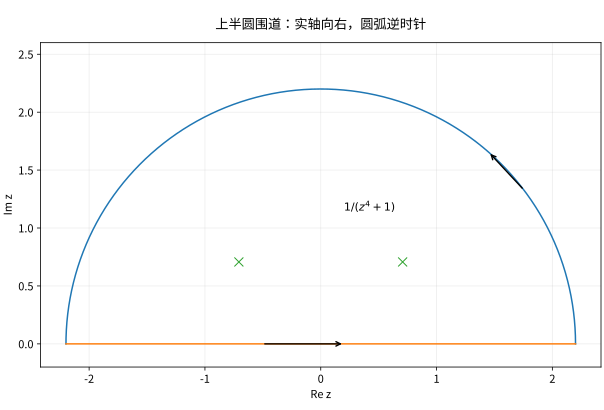

# 留数计算实积分与围道选择

## 先选围道，再证明额外边消失

实积分的留数法包含三个不同任务：将实函数嵌入合适复函数；选择避开分支与极点的闭路；证明新增圆弧或边段的积分趋零。仅算对留数却没控制圆弧，并未完成证明。

对 $\int_{-\infty}^{\infty}R(x)\,dx$，有理函数若无实轴极点且分母次数至少比分子高 2，可用上半圆，因圆弧长 $O(R)$ 而被积函数 $O(R^{-2})$，弧积分趋零。$e^{iaz}$ 型则要依据 $a$ 的符号选衰减半平面。

*图：实轴线段加上半圆组成正向围道；只有上半平面的极点计入。半径最终趋于无穷，图中画的是有限半径。*

## 算例一：四次分母

$I=\int_{-\infty}^{\infty}dx/(x^4+1)$。上半平面极点 $a=e^{i\pi/4}$、$b=e^{3i\pi/4}$，均简单，留数分别 $1/(4a^3),1/(4b^3)$。它们之和为 $-i/(2\sqrt2)$，故
$$I=2\pi i\left(-\frac i{2\sqrt2}\right)=\frac\pi{\sqrt2}.$$
弧上 $|z^4+1|\ge R^4-1$，积分界为 $\pi R/(R^4-1)\to0$。偶性给出半轴积分 $\pi/(2\sqrt2)$。最终结果实且正，是可用于排查方向符号的基本检验。

## 算例二：振荡与指数衰减

对 $b>0$、实 $a$，
$$\int_{-\infty}^{\infty}\frac{e^{iax}}{x^2+b^2}\,dx=\frac\pi b e^{-b|a|}.$$
$a>0$ 选上半圆，$|e^{iaz}|=e^{-a\operatorname{Im}z}\le1$，留数在 $ib$ 为 $e^{-ab}/(2ib)$；$a<0$ 选下半圆，注意顺时针负号；$a=0$ 直接有理积分。虚部因奇性为零，所以同式给出余弦积分。对分母仅一次衰减的函数，需要更细的 Jordan 引理，不能套用这里 $O(R^{-2})$ 的粗估计。

## 算例三：钥匙孔与分支跳跃

当 $0<\alpha<1$，考虑

$$
I_\alpha=\int_0^\infty\frac{x^{\alpha-1}}{1+x}\,dx,
\qquad g(z)=\frac{z^{\alpha-1}}{1+z}.
$$

取 $\operatorname{Log}z=\log|z|+i\arg z$、$0<\arg z<2\pi$，即沿正实轴切开。对 $0<\varepsilon<1<R$，钥匙孔围道依次经过下表四段。表中的两岸采用边界值记号：实际先沿辐角 $\delta$ 与 $2\pi-\delta$ 的射线闭合围道，在固定 $\varepsilon,R$ 下令 $\delta\downarrow0$，再令两端半径趋向极限；不在割线上直接调用未定义的分支。

| 围道段 | 参数与方向 | 对积分的贡献 |
| --- | --- | --- |
| 上岸 | $z=x$，$x:\varepsilon\to R$ | $\displaystyle \int_\varepsilon^R\frac{x^{\alpha-1}}{1+x}\,dx$ |
| 外圆 | $z=Re^{i\theta}$，$\theta:0\to2\pi$，逆时针 | 当 $R\to\infty$ 时趋于 0 |
| 下岸 | $z=xe^{2\pi i}$，$x:R\to\varepsilon$ | $\displaystyle -e^{2\pi i\alpha}\int_\varepsilon^R\frac{x^{\alpha-1}}{1+x}\,dx$ |
| 内圆 | $z=\varepsilon e^{i\theta}$，$\theta:2\pi\to0$，顺时针 | 当 $\varepsilon\to0$ 时趋于 0 |

下岸的因子来自

$$
z^{\alpha-1}=x^{\alpha-1}e^{2\pi i(\alpha-1)}
=x^{\alpha-1}e^{2\pi i\alpha},
$$

而负号来自积分方向 $R\to\varepsilon$。因此上下岸之和是

$$
(1-e^{2\pi i\alpha})\int_\varepsilon^R\frac{x^{\alpha-1}}{1+x}\,dx.
$$

弧段消失也要分别检查。在外圆上，$|1+z|\ge R-1$，弧长至多为 $2\pi R$，故

$$
\left|\int_{C_R}g(z)\,dz\right|
\le\frac{2\pi R^\alpha}{R-1}
=O(R^{\alpha-1})\longrightarrow0,
$$

恰好使用 $\alpha<1$。在内圆上，$|1+z|\ge1-\varepsilon$，弧长至多为 $2\pi\varepsilon$，故

$$
\left|\int_{C_\varepsilon}g(z)\,dz\right|
\le\frac{2\pi\varepsilon^\alpha}{1-\varepsilon}
=O(\varepsilon^\alpha)\longrightarrow0,
$$

恰好使用 $\alpha>0$。

围道内唯一极点是 $z=-1$。在所选分支上 $\arg(-1)=\pi$，所以 $\operatorname{Res}(g,-1)=e^{i\pi(\alpha-1)}$。留数定理及上述极限给出

$$
(1-e^{2\pi i\alpha})I_\alpha=2\pi i e^{i\pi(\alpha-1)}.
$$

最后用

$$
\begin{aligned}
1-e^{2\pi i\alpha}&=-2i e^{i\pi\alpha}\sin(\pi\alpha),\\
e^{i\pi(\alpha-1)}&=-e^{i\pi\alpha},
\end{aligned}
$$

得到 $I_\alpha=\pi/\sin(\pi\alpha)$。同样的范围也可从实积分直接看出：零点附近形如 $x^{\alpha-1}$，无穷远处形如 $x^{\alpha-2}$，所以 $\alpha>0$ 与 $\alpha<1$ 都不能删去。

## 实轴极点需要换一个问题

若路径上有极点，普通反常积分可能不存在。主值是左右按约定同步截断的另一种极限；绕小半圆的方向和半径趋零过程会产生半个留数项。不能用“留数法得出有限数”去证明原本发散的普通积分收敛。

## 自测与解答

求 $\int_0^\infty dx/(1+x^2)$，并用钥匙孔例与直接原函数交叉核验。

> [!question]- 解答
> 直接得 $\arctan x|_0^\infty=\pi/2$。令 $t=x^2$，积分变为 $\frac12\int_0^\infty t^{-1/2}/(1+t)\,dt$；用 $\alpha=1/2$ 的结果得 $\pi/2$。一致说明换元因子与分支常数都正确。

## 继续学习

前一节：[[数学/45-复变函数/08-留数定理与极点计算|留数定理与极点计算]]。 下一节：[[数学/45-复变函数/10-辐角原理Rouche定理与零点计数|辐角原理Rouche定理与零点计数]]。

课程地图：[[数学/45-复变函数/00-复变函数-MOC|复变函数课程地图]]；[[数学/90-资源/06-统一符号约定与定理条件索引|符号与条件索引]]。

## 跨学科连接

[[数学/16-数学分析/10-反常积分与含参积分的极限交换|反常积分与含参积分的极限交换]]：用其中的端点可积性与尾部控制检查本页 $\varepsilon\downarrow0$、$R\to\infty$ 两个反常极限；若还要让参数 $\alpha$ 趋近边界或把极限、求导移入积分，则需另验对参数统一的可积控制，留数计算本身不提供这一步。

## 核验与延伸阅读

本页为独立编写的讲解、推导与算例；以下一手教材用于对照标准定义与课程范围，不是逐段译写。更具体的主题定位见 [[数学/90-资源/04-六科学术来源与阅读对照|学术来源对照]]。

- [Jiří Lebl：Guide to Cultivating Complex Analysis，作者开放教材](https://www.jirka.org/ca/)
- [Juan Ponce Campuzano：Complex Analysis，作者开放教材](https://complex-analysis.com/)
- [Imperial College London：Complex Analysis Lecture 30，第 2 页钥匙孔围道推导](https://www.ma.ic.ac.uk/~bin06/M2PM3-Complex-Analysis/m2pm3l30%2811%29.pdf)
