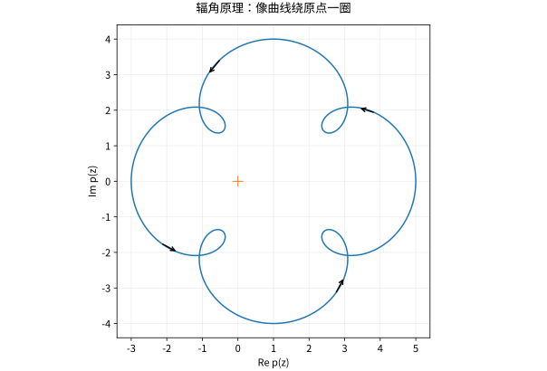

# 辐角原理Rouche定理与零点计数

## 用边界的转动计算内部的零点

若 $f$ 在正向简单闭曲线及内部亚纯，边界无零点、无极点，则
$$\frac1{2\pi i}\int_C\frac{f'(z)}{f(z)}\,dz=N-P,$$
其中零点与极点均按重数计数。若 $a$ 是 $m$ 阶零点，写 $f=(z-a)^mg$，则 $f'/f=m/(z-a)+g'/g$，留数为 $m$；极点相同计算给出负阶数。留数定理立刻得到辐角原理。

几何上左边是 $f(C)$ 围绕零点的绕数，即沿路径连续追踪辐角的总变化除以 $2\pi$。不是把每个点的主值辐角直接相减，因为主值会跳跃，必须连续展开角度。

## Rouché 如何避免解高次方程

若 $f,g$ 在曲线及内部全纯，边界满足 $|g|<|f|$，则 $f$ 与 $f+g$ 在内部有同样多零点。考虑 $f+tg$、$0\le t\le1$，边界上始终不为零，所以映射边界的绕数沿 $t$ 连续变化但又是整数，只能不变。辐角原理完成证明。

严格不等式保证同伦途中不碰零；仅有 $\le$ 时不能不加其他条件照用。比较哪个部分更大由所选曲线决定，不一定永远选最高次项。

## 同一多项式的两种计数

$p(z)=z^5+3z+1$。在 $|z|=2$ 上，$|z^5|=32>|3z+1|\le7$，所以圆内有 5 个零点。在 $|z|=1$ 上，$|3z|=3>|z^5+1|\le2$，所以单位圆内恰有 1 个零点。于是环域 $1<|z|<2$ 内有 4 个，两个边界均无零点。

这里根本没有求出任何根，却得到精确计数。数值求根可以用这个结果做完整性核验，避免只找到部分根后误以为结束。

*图：$z^5+3z+1$ 将单位圆映成的曲线；它绕原点一圈，对应单位圆内一个零点。自交不妨碍定义绕数。*

## Hurwitz 与极限中零点的稳定

非零全纯函数列在紧子集上一致收敛到 $f$ 时，若 $f$ 非恒零，围住一个孤立零点的小圆上可用 Rouché 比较 $f_n$ 与 $f$，得到附近零点按重数稳定。这导出 Hurwitz 定理：无零点全纯函数的局部一致极限，要么仍无零点，要么恒零。

恒零例外不能删去：常函数 $f_n=1/n$ 每个都无零点，极限却处处为零。这个例外也出现在单叶函数的极限理论中。

## 自测与解答

判断 $z^4+2z+10$ 在单位圆内有多少零点；只用一个不等式完成。

> [!question]- 解答
> 边界上 $|z^4+2z|\le3<10$，与常函数 10 比较，所以没有零点。不是看次数判断圆内根数；次数给出整个复平面按重数计的总根数。

## 继续学习

前一节：[[数学/45-复变函数/09-留数计算实积分与围道选择|留数计算实积分与围道选择]]。 下一节：[[数学/45-复变函数/11-共形映射Mobius变换与边值问题|共形映射Mobius变换与边值问题]]。

课程地图：[[数学/45-复变函数/00-复变函数-MOC|复变函数课程地图]]；[[数学/90-资源/06-统一符号约定与定理条件索引|符号与条件索引]]。

## 跨学科连接

[[数学/25-高等代数/02-多项式的根重数不可约性与插值|多项式的根重数不可约性与插值]]。建议比较定义、适用条件与所用范数，再迁移方法。

## 核验与延伸阅读

本页为独立编写的讲解、推导与算例；以下一手教材用于对照标准定义与课程范围，不是逐段译写。更具体的主题定位见 [[数学/90-资源/04-六科学术来源与阅读对照|学术来源对照]]。

- [Jiří Lebl：Guide to Cultivating Complex Analysis，作者开放教材](https://www.jirka.org/ca/)
- [Juan Ponce Campuzano：Complex Analysis，作者开放教材](https://complex-analysis.com/)
