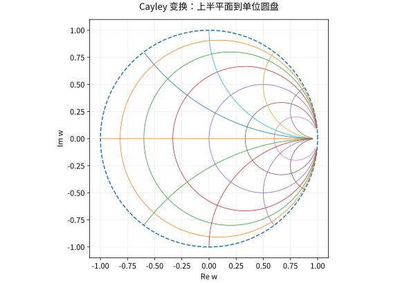

# 共形映射Mobius变换与边值问题

## 共形是局部角度保持，不是全局一一对应

若全纯函数满足 $f'(a)\ne0$，其局部主项是乘以非零复数，因此保持两条相交光滑曲线的有向夹角。复逆函数定理还给出局部全纯逆。若称一个域之间的共形同构，另外要求全局一一且满到目标域。

$e^z$ 处处导数非零，却有 $2\pi i$ 周期，所以不是整个复平面到像的全局一一映射。导数不零不能替代全局单叶性。

## Möbius 变换的结构

$f(z)=(az+b)/(cz+d)$，$ad-bc\ne0$，在扩充复平面上是双射。分母零点送到无穷远，无穷远按极限送到 $a/c$（$c\ne0$）。它由平移、非零伸缩旋转和倒数复合，因此将广义圆（圆或直线加无穷远点）映成广义圆。

三个不同点的像唯一确定一个 Möbius 变换，可用交比不变构造。必须检查目标三点也不同；行列式为零时函数退化为常数，不再是变换。

## 完整例子：上半平面到单位圆盘

取
$$w=\frac{z-i}{z+i},\qquad z=i\frac{1+w}{1-w}.$$
对 $z=x+iy$，
$$|z+i|^2-|z-i|^2=4y,$$
所以 $y>0$ 恰好对应 $|w|<1$，实轴对应单位圆，$i\mapsto0$，无穷远对应边界点 1。这个代数检验比仅凭图像猜映射区域可靠。

*图：上半平面的水平线和竖直线在 $w=(z-i)/(z+i)$ 下成为单位圆盘内的圆弧；边界趋向单位圆。*

## 用共形映射搬运调和问题

若 $u$ 在目标域调和，$f$ 全纯，则链式法则给出
$$\Delta(u\circ f)=|f'|^2(\Delta u)\circ f=0.$$
因此二维 Laplace 方程在共形变换下保形，边界值随映射搬运。这个性质不等于所有 PDE 都保持相同形式：Poisson 方程右端会乘 $|f'|^2$，时间相关热方程也不能简单原样搬走。

例如上半平面边界除原点外取 $u(x,0)=1$（$x<0$）和 0（$x>0$）。$u(z)=\operatorname{Arg}z/\pi$ 在上半平面调和，具有这些非连续边界数据的逐点极限。边界原点是跳跃处，应单独说明，不要求那里同时匹配两侧值。

## 自测与解答

将半径 $R$ 的扇形 $0<\arg z<\pi/\alpha$ 局部映到上半平面方向，可用什么幂映射？其在原点能否直接称共形？

> [!question]- 解答
> 选择扇形中的连续辐角分支，$w=z^\alpha$ 将角度区间乘以 $\alpha$ 变为 $(0,\pi)$，有限半径扇形映为上半圆盘，若径向无限则映上半平面。原点是域的边界，且幂函数可能有分支或导数退化，不能把内部共形性不加区分地延伸到原点。

## 继续学习

前一节：[[数学/45-复变函数/10-辐角原理Rouche定理与零点计数|辐角原理Rouche定理与零点计数]]。 下一节：[[数学/45-复变函数/12-调和函数共轭函数与Poisson公式|调和函数共轭函数与Poisson公式]]。

课程地图：[[数学/45-复变函数/00-复变函数-MOC|复变函数课程地图]]；[[数学/90-资源/06-统一符号约定与定理条件索引|符号与条件索引]]。

## 跨学科连接

[[数学/46-数理方程/11-Laplace-Poisson方程与最大值原理|Laplace-Poisson方程与最大值原理]]。建议比较定义、适用条件与所用范数，再迁移方法。

## 核验与延伸阅读

本页为独立编写的讲解、推导与算例；以下一手教材用于对照标准定义与课程范围，不是逐段译写。更具体的主题定位见 [[数学/90-资源/04-六科学术来源与阅读对照|学术来源对照]]。

- [Jiří Lebl：Guide to Cultivating Complex Analysis，作者开放教材](https://www.jirka.org/ca/)
- [Juan Ponce Campuzano：Complex Analysis，作者开放教材](https://complex-analysis.com/)
