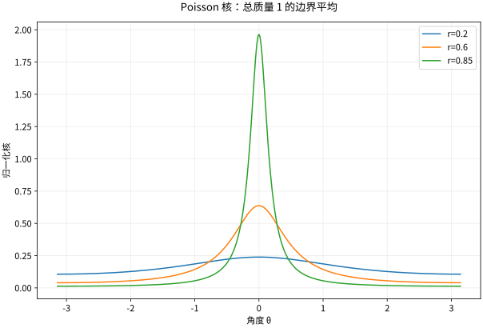

# 调和函数共轭函数与Poisson公式

## 调和函数是复分析与静态 PDE 的交点

$u\in C^2$ 若满足 $\Delta u=u_{xx}+u_{yy}=0$，称调和。全纯函数 $f=u+iv$ 的实部、虚部都调和，因为 CR 与二阶混合偏导相等给出 $u_{xx}+u_{yy}=v_{yx}-v_{xy}=0$。复分析已保证光滑性，所以这里不需要额外假设高阶导数存在。

反过来，调和函数局部总有共轭调和函数 $v$，使 $u+iv$ 全纯。解微分关系 $dv=-u_y\,dx+u_x\,dy$；该 1-形式闭，因为 $u_{xx}+u_{yy}=0$。在单连通域，路径无关给出全局共轭，差一个常数。非单连通域可能失败：$\log|z|$ 在去零平面调和，其共轭角度不能全局单值。

## 算例：直接求调和共轭

$u=x^2-y^2+2x$。CR 要求 $v_y=2x+2,v_x=2y$，先积分前式得 $v=(2x+2)y+h(x)$，代入后式得 $h'=0$。所以 $f=z^2+2z+iC$。若两式计算不相容，通常意味着 $u$ 不调和或符号写错。

## Poisson 核从边界重建内部

单位圆盘上连续边界函数 $g(e^{i\theta})$ 的调和延拓为
$$u(re^{i\phi})=\frac1{2\pi}\int_0^{2\pi}\frac{1-r^2}{1-2r\cos(\phi-\theta)+r^2}\,g(e^{i\theta})\,d\theta.$$
核非负、总质量为 $2\pi$，当 $r\uparrow1$ 时集中到 $\theta=\phi$，因此连续边界数据被恢复。可从几何级数得到核的 Fourier 展开 $1+2\sum_{n\ge1}r^n\cos nt$，于是每个边界频率向内衰减为 $r^n$。高频更快消失，正是调和延拓的平滑效应。

*图：不同 $r$ 的圆盘 Poisson 核。接近边界时峰值增大、宽度缩小，但归一化总质量保持 1。*

## 唯一性来自最大值原理

调和函数在圆心等于任意同心小圆周的平均。若内部点达到最大值，附近平均只能由全部同样大的值构成，进而局部常数，再由连通性推广。因此有界域上连续到边界的调和函数若边界为零，就处处为零；这证明 Dirichlet 解唯一。

对不连续边界数据，需明确以逐点连续点极限、$L^p$ 或非切向边界值等何种意义恢复。Poisson 公式不是忽略边界函数正则性的通行证。

## 自测与解答

单位圆边界 $g(\theta)=2+3\cos2\theta-\sin3\theta$ 的调和延拓是什么？圆心值为什么这样？

> [!question]- 解答
> $u(r,\theta)=2+3r^2\cos2\theta-r^3\sin3\theta$。圆心值为 2，是边界平均；其他频率平均为零。直接在极坐标 Laplacian 中代入 $r^n\cos n\theta$、$r^n\sin n\theta$ 也能核验调和性。

## 继续学习

前一节：[[数学/45-复变函数/11-共形映射Mobius变换与边值问题|共形映射Mobius变换与边值问题]]。 下一节：[[数学/45-复变函数/13-Schwarz引理正规族与Riemann映射|Schwarz引理正规族与Riemann映射]]。

课程地图：[[数学/45-复变函数/00-复变函数-MOC|复变函数课程地图]]；[[数学/90-资源/06-统一符号约定与定理条件索引|符号与条件索引]]。

## 跨学科连接

[[数学/46-数理方程/12-分离变量在矩形圆盘与球域|分离变量在矩形圆盘与球域]]。去读圆盘 Fourier 模式向内乘 $r^n$ 的分离变量解，与 Poisson 核的边界重建相互核对；圆环可保留对数和负幂，不能把圆盘中心正则性或全局调和共轭照搬过去。

## 核验与延伸阅读

本页为独立编写的讲解、推导与算例；以下一手教材用于对照标准定义与课程范围，不是逐段译写。更具体的主题定位见 [[数学/90-资源/04-六科学术来源与阅读对照|学术来源对照]]。

- [Jiří Lebl：Guide to Cultivating Complex Analysis，作者开放教材](https://www.jirka.org/ca/)
- [Juan Ponce Campuzano：Complex Analysis，作者开放教材](https://complex-analysis.com/)
