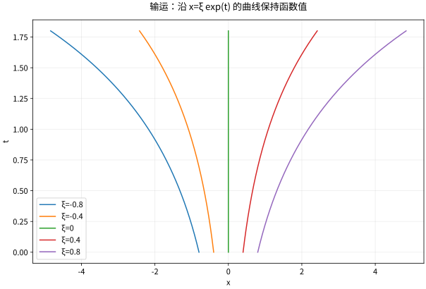

# 一阶偏微分方程与特征线

## 沿一条运动轨迹，PDE 变成 ODE

对输运方程 $u_t+a(x,t)u_x=f(x,t)$，选择特征线 $x'=a(x,t)$。链式法则给出
$$\frac d{dt}u(x(t),t)=u_t+x'u_x=f(x(t),t).$$
因此解分两步：先追踪点如何运动，再沿轨迹累积源项。常速 $a=c$ 时，$x=\xi+ct$，初值 $u(x,0)=g(x)$ 给出
$$u(x,t)=g(x-ct)+\int_0^t f(x-c(t-s),s)ds.$$
$c>0$ 时轮廓向右移，不是向左，代入一个峰的位置即可检查符号。

## 变速场中的完整算例

$u_t+xu_x=0$、$u(x,0)=g(x)$。特征 $x'=x$ 解为 $x(t)=\xi e^t$，沿线 $u$ 常数，所以 $u(x,t)=g(xe^{-t})$。轮廓被拉宽，但幅度不变。

这与守恒形式 $u_t+(xu)_x=0$ 不同：后者是 $u_t+xu_x=-u$，沿线幅度衰减 $e^{-t}$，解 $e^{-t}g(xe^{-t})$，从而总积分守恒。非散度与散度形式相差一个 $a_xu$ 项，不能因为外形相似而混为一谈。

*图：$u_t+xu_x=0$ 的特征曲线 $x=\xi e^t$。同一条轨线上函数值不变，轨线间距却随时间扩大。*

## 一般一阶方程与非特征初始曲线

对 $a(x,y,u)u_x+b(x,y,u)u_y=c(x,y,u)$，解特征系统 $x'=a,y'=b,u'=c$。给定初始曲线 $(x_0(s),y_0(s),u_0(s))$ 后，映射 $(s,t)\mapsto(x,y)$ 必须局部可逆，才可把特征解重新写成函数 $u(x,y)$。

初始曲线切向与特征方向不能平行，即二维行列式 $x_0'b-y_0'a\ne0$。这就是非特征条件。若平行，数据可能互相矛盾，也可能不能唯一决定邻域解；不是所有曲线都能作为自由初始线。

## 非线性特征何时相交

无粘 Burgers 方程 $u_t+uu_x=0$，初值 $g(\xi)$，特征为 $x=\xi+t g(\xi)$，沿线 $u=g(\xi)$。局部可逆性要求 $1+tg'(\xi)\ne0$，并有
$$u_x=\frac{g'(\xi)}{1+tg'(\xi)}.$$
若某处 $g'<0$，分母可能首先为零，梯度爆破。光滑解不能继续用多值曲线表示，必须转向守恒律弱解与熵条件，见本课程第 18 章。

## 自测与解答

解 $u_t+2u_x+3u=0$、$u(x,0)=\cos x$，并说明相位与振幅分别如何变化。

> [!question]- 解答
> 特征为 $x=\xi+2t$，沿线 $du/dt=-3u$，所以 $u(x,t)=e^{-3t}\cos(x-2t)$。轮廓向右速度 2 平移，振幅按 $e^{-3t}$ 衰减。代入三项可逐项相消，初值也正确。

## 继续学习

前一节：[[数学/46-数理方程/04-建模分类初边值条件与适定性|建模分类初边值条件与适定性]]。 下一节：[[数学/46-数理方程/06-Fourier方法与Sturm-Liouville谱|Fourier方法与Sturm-Liouville谱]]。

课程地图：[[数学/46-数理方程/00-数理方程-MOC|数理方程课程地图]]；[[数学/90-资源/06-统一符号约定与定理条件索引|符号与条件索引]]。

## 跨学科连接

[[数学/15-微积分/12-多元链式法则隐函数与约束优化|多元链式法则隐函数与约束优化]]：用链式法则把特征参数 $(s,t)\mapsto(x,y)$ 的局部可逆条件与隐函数定理的 Jacobian 条件逐项核查；非特征条件保证的是局部把特征解写成 $u(x,y)$，并不保证全局单值或避开后续特征相交。

## 核验与延伸阅读

本页为独立编写的讲解、推导与算例；以下一手教材用于对照标准定义与课程范围，不是逐段译写。更具体的主题定位见 [[数学/90-资源/04-六科学术来源与阅读对照|学术来源对照]]。

- [Victor Ivrii：Partial Differential Equations，作者课程教材](https://www.math.utoronto.ca/courses/apm346h1/20181/PDE-textbook/contents.html)

## 电子电路往返：两族特征在端点交换信息

去 [[电子电路/46-电磁射频与高速/02-传输线反射与终端#X13：带着电子变量回数学|电报方程的特征变量]]，取 $w_\pm=v\pm Z_0i$（V）。均匀无损线中 $(w_+)_t+v_p(w_+)_x=0$、$(w_-)_t-v_p(w_-)_x=0$，于是本页常速无源特征公式分别把两变量沿±方向搬运。回来在x=ℓ施加 $v=Z_L i$，得到 $w_-=\Gamma_L w_+$，端点并非凭空指定两族独立数据；源端另有电压源与串阻边界。特征符号给速度方向，电流符号负责反向波的功率方向。

这里w±单位V，vp单位m/s，Z0单位Ω；数学变速输运的“沿线恒值”只在该式无源且参数满足假设时适用。有损线令特征之间出现耦合/耗散，不能从常速公式直接得到阶跃格图；非线性Burgers的相交也不是线性传输线反射的机制。两个完整迁移任务见 [[数学/46-数理方程/09-一维波动方程特征锥与能量#电子电路往返：行波必须携带电流与阻抗边界|边界与传播练习]]，回电子页核电流/能量单位。
